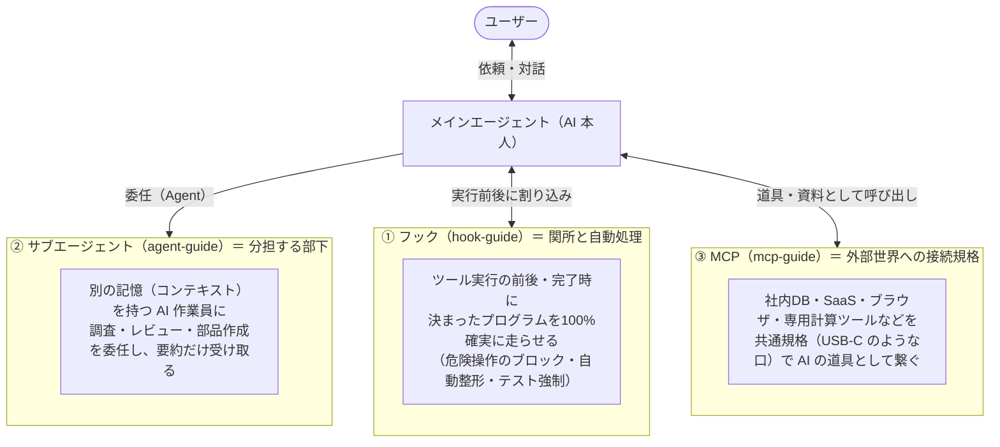
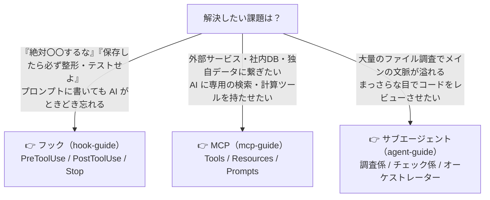

# ai-study — サブエージェント・フック・MCP を「仕組み・パターン・実験」で学ぶ

このリポジトリは、AI コーディングエージェント（Claude Code や GitHub Copilot など）を使いこなすための3つの拡張機能――**サブエージェント（Agent）**、**フック（Hook）**、**MCP（Model Context Protocol）**――を、同じ構成の読み物・図解・サンプル集・実験環境で体系的に学ぶための作業場です。

---

## 1. 3つの仕組みの全体像（「誰に任せるか」「いつ強制するか」「何に繋ぐか」）

最初に3つの違いを一言で整理すると、次のようになります。



| 項目 | サブエージェント（[agent-guide/](agent-guide/README.md)） | フック（[hook-guide/](hook-guide/README.md)） | MCP（[mcp-guide/](mcp-guide/README.md)） |
|---|---|---|---|
| **日常の例え** | **部下・専門スタッフ**（別室で調べて報告してくれる人） | **駅の改札・工場の検品センサー**（通るたびに必ずチェックする機械） | **USB-C アダプター**（外付けの機器やデータベースを繋ぐ共通規格） |
| **動く中身** | 別の **AI モデル**（推論する・毎回少し違う） | **スクリプト・プログラム**（決まった規則で100%同じ動きをする） | **外部サーバー・プログラム**（API 呼び出し・DB 検索・ブラウザ操作など） |
| **誰が起動を決めるか** | AI が判断して呼ぶ（または親として起動） | イベント（ファイル保存・コマンド実行・完了時など）で**自動的に必ず発火** | AI が「この道具が必要」と判断したときに呼ぶ |
| **一番の強み** | メインの頭（コンテキスト）を汚さず、並列調査や第三者レビューができる | プロンプトの「お願い」では防げないミスを**物理的に100%防げる・自動化できる** | AI が標準では持っていない**外部データや社内ツール**を安全に扱える |
| **主な注意点** | 1体ごとにトークン（コスト）が増える。「書く作業」の並列分担は食い違いやすい | スクリプトが重いと毎回待たされる。終了条件を誤ると無限ループになる | サーバーを入れすぎると「道具の説明」だけでコンテキストを圧迫する |

---

## 2. どれをいつ使うべきか（判断チャート）



---

## 3. 各ガイドのフォルダ構成（3つとも同じ構成です）

どのフォルダも、**① 基礎ガイド → ② Copilot 対応編 → ③ 定番パターン5選（＋一次情報の調査メモ）→ ④ コピーして使えるサンプル集 → ⑤ 手元で動かして比べる実験環境** の順に並んでいます。

```text
ai-study/
├─ README.md                 ← この全体案内
├─ agent-guide/              ← サブエージェント（AI の分担・親子構成）
│   ├─ README.md             … 実験手順書（1人 vs 分担 vs 統合スクリプト）
│   ├─ docs/                 … 読み物3本（00 入門 / 01 Copilot編 / 02 定番パターン5選）＋ SVG図解
│   ├─ info/                 … 一次情報の出典メモ（21件、鮮度ラベルつき）
│   ├─ samples/              … パターン別の定義ファイル見本（01〜05）
│   └─ scripts/ prompts/ output/ … 計測実験環境
│
├─ hook-guide/               ← フック（関所・自動整形・完了ゲート）
│   ├─ README.md             … 実験手順書＆ローカル1秒テスト手順
│   ├─ docs/                 … 読み物3本（00 入門 / 01 Copilot編 / 02 定番パターン5選）＋ SVG図解
│   ├─ info/                 … 一次情報の出典メモ（鮮度ラベルつき）
│   ├─ samples/              … パターン別のフック設定・スクリプト見本（01〜05）
│   └─ hooks/ scripts/ prompts/ output/ … 計測実験＆ローカル検証環境
│
└─ mcp-guide/                ← MCP（外部ツール・データ接続の標準規格）
    ├─ README.md             … 実験手順書＆JSON-RPC通信のローカル検証手順
    ├─ docs/                 … 読み物3本（00 入門 / 01 Copilot編 / 02 定番パターン5選）＋ SVG図解
    ├─ info/                 … 一次情報の出典メモ（鮮度ラベルつき）
    ├─ samples/              … パターン別のMCPサーバー・設定ファイル見本（01〜05）
    └─ servers/ data/ scripts/ prompts/ output/ … 計測実験＆ローカル検証環境
```

---

## 4. おすすめの読み進め方

1. **まずは全体像をつかむ**（各フォルダの `docs/00_*.md`）
   - [サブエージェント入門](agent-guide/docs/00_subagent-guide.md)
   - [フック（Hooks）入門](hook-guide/docs/00_hook-guide.md)
   - [MCP（Model Context Protocol）入門](mcp-guide/docs/00_mcp-guide.md)
2. **「いつ使い、いつ使わないか」のセオリーを知る**（各フォルダの `docs/02_*_patterns.md`）
   - [親子エージェントの定番パターン5選](agent-guide/docs/02_agent-patterns.md)
   - [フックの定番パターン5選](hook-guide/docs/02_hook-patterns.md)
   - [MCP の定番パターン5選](mcp-guide/docs/02_mcp-patterns.md)
3. **手元で動かして体験する**（各フォルダの `README.md` と `samples/`）
   - `hook-guide` と `mcp-guide` には、Claude Code を起動しなくても `node` コマンド1発で「フックがコマンドをブロックする瞬間」や「MCP サーバーと JSON-RPC で会話する中身」を確認できるテストスクリプトも入っています。
