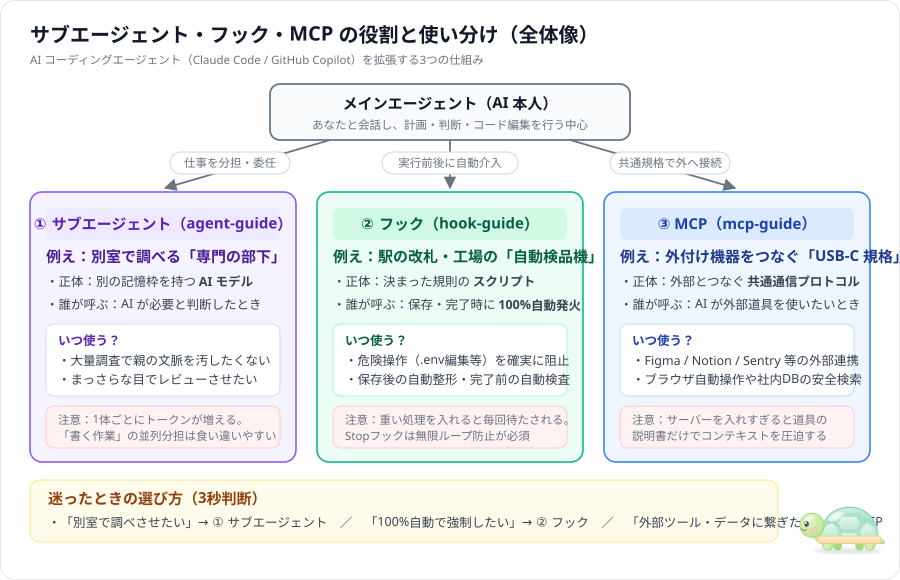

# ai-study — サブエージェント・フック・MCP を「図解・パターン・実験」で学ぶ

AI コーディングエージェント（Claude Code や GitHub Copilot）を使いこなす3つの拡張機能――**サブエージェント**、**フック**、**MCP**――を、ベクター図解・定番パターン・サンプル集・実験環境で学ぶための作業場です。



フックの接続関係と具体的な動きは、[全体図と4つのシーケンス図（Claude Code / Copilot・VS Code 比較）](hook-guide/docs/03_hook-flow-examples.md)で確認できます。

Copilot の新しい実行管理とモデル協調は、[Copilot Fusion とハーネスの図解ガイド](copilot-fusion/README.md)にまとめています。Local / Copilot の違い、MCP の移行、Fusion の3方式を2本の解説と13枚の図で確認できます。

---

## 1. どこから読むか（3つのガイド一覧）

| フォルダ | テーマ | 基礎ガイド（図解） | Copilot 編 | 定番パターン5選 | サンプル集 | 実験手順 |
|---|---|---|---|---|---|---|
| **[agent-guide/](agent-guide/README.md)** | **サブエージェント**<br/>（AI の分担・親子構成） | [00 入門](agent-guide/docs/00_subagent-guide.md) | [01 Copilot編](agent-guide/docs/01_copilot-subagent-guide.md) | [02 パターン5選](agent-guide/docs/02_agent-patterns.md) | [samples/](agent-guide/samples/README.md) | [README](agent-guide/README.md) |
| **[hook-guide/](hook-guide/README.md)** | **フック（Hooks）**<br/>（関所・自動整形・完了ゲート） | [00 入門](hook-guide/docs/00_hook-guide.md) | [01 Copilot編](hook-guide/docs/01_copilot-hook-guide.md) | [02 パターン5選](hook-guide/docs/02_hook-patterns.md) | [samples/](hook-guide/samples/README.md) | [README](hook-guide/README.md) |
| **[mcp-guide/](mcp-guide/README.md)** | **MCP**<br/>（外部ツール・データ接続規格） | [00 入門](mcp-guide/docs/00_mcp-guide.md) | [01 Copilot編](mcp-guide/docs/01_copilot-mcp-guide.md) | [02 パターン5選](mcp-guide/docs/02_mcp-patterns.md) | [samples/](mcp-guide/samples/README.md) | [README](mcp-guide/README.md) |

---

## 2. フォルダ構成（3つとも同じ並びです）

```text
ai-study/
├─ README.md                 ← この全体案内
├─ assets/                   ← 全体像のベクター図
├─ agent-guide/              ← ① サブエージェント（AI の分担・親子構成）
│   ├─ docs/                 … 読み物3本（00 / 01 / 02）＋ SVGベクター図解
│   ├─ info/                 … 一次情報の出典メモ（鮮度ラベルつき）
│   ├─ samples/              … パターン別の定義ファイル見本（01〜05）
│   └─ scripts/ prompts/ output/ … 計測実験環境
│
├─ hook-guide/               ← ② フック（関所・自動整形・完了ゲート）
│   ├─ docs/                 … 読み物3本（00 / 01 / 02）＋ SVGベクター図解
│   ├─ info/                 … 一次情報の出典メモ（鮮度ラベルつき）
│   ├─ samples/              … パターン別の設定・スクリプト見本（01〜05）
│   └─ hooks/ scripts/ prompts/ output/ … 1秒ローカル検証＆計測実験環境
│
└─ mcp-guide/                ← ③ MCP（外部ツール・データ接続の共通規格）
    ├─ docs/                 … 読み物3本（00 / 01 / 02）＋ SVGベクター図解
    ├─ info/                 … 一次情報の出典メモ（鮮度ラベルつき）
    ├─ samples/              … パターン別のサーバー・設定見本（01〜05）
    └─ servers/ data/ scripts/ prompts/ output/ … 1秒通信検証＆計測実験環境
```
