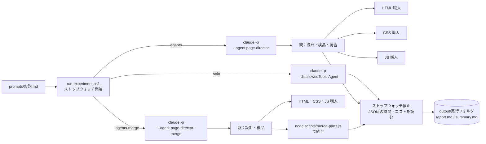

# agent-study — サブエージェントを「使う／使わない」で Web ページを作り比べる

このリポジトリは、サブエージェント（AI に仕事を分担させる仕組み）を学ぶための作業場です。
読み物は [docs/](docs/)、構成パターンの見本は [samples/](samples/README.md) にあります。

この README では、ルートに置いた**すぐ使えるエージェント**を使って、

- **自己紹介ページ**
- **ちょっとオシャレで動きのあるホームページ**（架空のカフェ）

を実際に作り、次の3通りで**出来栄え・時間・コストを比べる**手順を説明します。

| 方式 | モード名 | やり方 |
|---|---|---|
| A | **solo**（1人） | AI 1人に全部任せる（サブエージェント禁止） |
| B | **agents**（分担） | `page-director`（親）が設計し、HTML／CSS／JS の職人3体に並列で発注。最後に親が部品を1ファイルに書き写して統合する |
| C | **agents-merge**（分担＋統合スクリプト） | B と同じ流れで、最後の統合だけを AI ではなくスクリプト [scripts/merge-parts.js](scripts/merge-parts.js) で行う（親は `page-director-merge`） |

---

## 1. フォルダ構成

```text
agent-study/
├─ README.md                ← この手順書
├─ .claude/agents/          ← Claude Code 用のエージェント（方式 B・C で使う）
│   ├─ page-director.md     … B の親：設計・発注・検品・統合（opus）
│   ├─ page-director-merge.md … C の親：統合だけスクリプトに任せる（opus）
│   ├─ markup-builder.md    … HTML 担当（sonnet）
│   ├─ style-builder.md     … CSS 担当（sonnet）
│   └─ script-builder.md    … JS 担当（haiku）
├─ .github/agents/          ← GitHub Copilot 用の同じ構成（*.agent.md）
├─ prompts/                 ← お題（A・B で同じ文面を渡す）
│   ├─ 01-profile.md        … 自己紹介ページ
│   ├─ 02-homepage.md       … カフェのホームページ
│   └─ tools/make-merge-script.md … 統合スクリプトを AI に作らせるお題（C の準備）
├─ scripts/
│   ├─ run-experiment.ps1   ← 実行して時間・ターン数・トークン・コストを記録するスクリプト
│   └─ merge-parts.js       ← C で使う統合スクリプト（AI が作成。作成コストも計測済み）
├─ output/                  ← ★成果物の置き場（実行するたびにフォルダが増える）
│   └─ summary.md           … 全実行の一覧表（自動で1行ずつ追記）
├─ docs/                    ← 読み物
└─ samples/                 ← 構成パターンの見本
```

方式 B・C の親は作業中に `work/`（設計書 `spec.md`・部品 `parts/`）を使います。
スクリプトは終了時にそれを `output/` の実行フォルダへ移すので、`work/` は残りません（`.gitignore` 済み）。

### 1回の実行で output/ にできるもの

```text
output/20261106-101500_01-profile_agents/
├─ index.html     ← 完成品（ブラウザで開く）
├─ report.md      ← 時間・ターン数・コスト・モデル別使用量・AI の最終報告・評価メモ欄
├─ result.json    ← claude の生の出力（JSON）
└─ work/          ← 方式 B・C のみ：spec.md（設計書）と parts/（HTML・CSS・JS の部品）
```

方式 A（solo）では `work/` はできません。**B・C だけに設計書と部品が残る**こと自体も、比べるポイントの1つです。

---

## 2. 準備

1. [Claude Code](https://code.claude.com/docs) の CLI をインストールし、ログインしておく。

   ```powershell
   claude --version
   ```

2. ターミナルで**このリポジトリのルート**に移動する（`.claude/agents/` を読み込ませるため）。

   ```powershell
   cd C:\git_home\agent-study
   ```

3. お題を自分用に書き換えたいときは、`prompts/01-profile.md` の名前や趣味を編集する。
   新しいお題を足すときは `prompts/03-xxx.md` のように**ファイルを増やす**だけで OK（ファイル名がそのまま結果フォルダ名に入ります）。

---

## 3. 実行する（おすすめ：スクリプトで計測つき）

同じお題を **A → B → C の順**で1回ずつ実行します（同時に実行すると時間が正しく測れないので、必ず1つずつ）。1回あたり数分〜十数分かかり、サブスクの使用枠を消費します。

### 準備（C を初めて使うときだけ）：統合スクリプトを AI に作らせる

[scripts/merge-parts.js](scripts/merge-parts.js) はリポジトリに入っているので、通常はこの手順は不要です。
「スクリプトを作るのにどれだけかかるか」を測り直したいときは、`scripts/merge-parts.js` を別名に退避してから次を実行します。

```powershell
powershell -ExecutionPolicy Bypass -File scripts\run-experiment.ps1 -Prompt prompts\tools\make-merge-script.md -Mode plain -Model opus
```

### 自己紹介ページ

```powershell
# A：1人
powershell -ExecutionPolicy Bypass -File scripts\run-experiment.ps1 -Prompt prompts\01-profile.md -Mode solo -Model opus -Open

# B：分担（統合も AI）
powershell -ExecutionPolicy Bypass -File scripts\run-experiment.ps1 -Prompt prompts\01-profile.md -Mode agents -Open

# C：分担（統合はスクリプト）
powershell -ExecutionPolicy Bypass -File scripts\run-experiment.ps1 -Prompt prompts\01-profile.md -Mode agents-merge -Open
```

### カフェのホームページ

```powershell
powershell -ExecutionPolicy Bypass -File scripts\run-experiment.ps1 -Prompt prompts\02-homepage.md -Mode solo -Model opus -Open
powershell -ExecutionPolicy Bypass -File scripts\run-experiment.ps1 -Prompt prompts\02-homepage.md -Mode agents -Open
powershell -ExecutionPolicy Bypass -File scripts\run-experiment.ps1 -Prompt prompts\02-homepage.md -Mode agents-merge -Open
```

| オプション | 意味 |
|---|---|
| `-Prompt` | お題ファイル |
| `-Mode solo` | 方式 A。`--disallowedTools Agent` でサブエージェントを**呼べなくして**、AI 1人に作らせる |
| `-Mode agents` | 方式 B。`claude --agent page-director` で親エージェントとして起動する |
| `-Mode agents-merge` | 方式 C。`claude --agent page-director-merge` で起動する。統合は `node scripts/merge-parts.js` |
| `-Mode plain` | お題の文面をそのまま渡す（保存先の指示を足さない）。ツール作成などの計測用 |
| `-Model opus` | solo / plain のモデル。B・C の親と同じ opus にそろえると比べやすい。省略すると普段の既定モデル |
| `-Open` | 完成したら `index.html` をブラウザで開く |

権限はすべてのモードで同じです。ファイルの作成・編集は自動で許可し（`--permission-mode acceptEdits`）、シェルは `node scripts/merge-parts.js` の実行だけを許可します（`--allowedTools`）。それ以外のコマンドは拒否されます。

終わるとターミナルに次のように出ます。

```text
完了：312.4 秒（5 分 12 秒） / ターン 18 / 1.2345 USD / 完成品 ○
記録：C:\git_home\agent-study\output\20261106-101500_01-profile_agents\report.md
```

### スクリプトが内部でやっていること



- どちらも `claude -p`（対話なしの一発実行）＋ `--permission-mode acceptEdits`（ファイル作成を自動許可）で動かすので、**途中で人が待たせる時間が入らず、時間を公平に比べられます**。
- 時間は2種類記録します。
  - **実測時間**：スクリプトが `claude` の起動から終了までをストップウォッチで測った値（いちばん信頼できる）
  - **duration_ms / duration_api_ms**：Claude Code 自身が報告する処理時間と、そのうち AI の応答待ちの時間
- コスト（`total_cost_usd`）・ターン数・モデル別トークン数も、Claude Code の JSON 出力から取ります。B では子エージェント（sonnet / haiku）の分もモデル別に並ぶので、**どのモデルにどれだけ働かせたか**が分かります。

> **料金について**：スクリプトは API を直接呼ばず、ふだん使っている `claude` コマンドを起動するだけです。サブスクリプション（Pro / Max など）でログインしていれば、その使用枠の中で動きます。`report.md` のコストは「API で払ったらいくらか」の**換算値（目安）**で、実際に請求される額ではありません。作業量の比較に使ってください。
> ただし環境変数 `ANTHROPIC_API_KEY` が設定されていると API キーが使われ、API 料金がかかるので注意してください。

> **AI に時間を測らせないのはなぜ？** AI は時計を持っておらず、ツールで時刻を取らない限り経過時間を正確には言えません。また方式 B の `page-director` はシェルを使う権限がないので、自分で時刻を取れません。そこで「外側（スクリプト）で測る」方式にしています。

---

## 4. 比べる

> **実施例**：自己紹介ページで A・B・C を1回ずつ実行した結果と、統合スクリプトの作成コストを [output/report_01-profile.md](output/report_01-profile.md) にまとめています（構成図・スクリーンショット・時間の内訳・コスト・元が取れる回数）。

### 4.1 数字で比べる

`output/summary.md` に全実行が1行ずつ並びます。

| 実行名 | お題 | 方式 | 実測時間(秒) | ターン数 | 出力トークン | 換算コスト(USD) | 完成 |
|---|---|---|---|---|---|---|---|
| （例）…_01-profile_solo | 01-profile | solo | … | … | … | … | ○ |
| （例）…_01-profile_agents | 01-profile | agents | … | … | … | … | ○ |
| （例）…_01-profile_agents-merge | 01-profile | agents-merge | … | … | … | … | ○ |

見どころ：

- **時間**：B は3体が並列に動く一方、設計書づくり・検品・統合の手間が増えます。どちらが速いかは、お題の大きさで変わります（[docs の 5章](docs/00_subagent-guide.md#5-何体並列にすると効率的か)）。
- **コスト（API 換算）**：B は子に安いモデル（sonnet / haiku）を使うぶん安くなることもあれば、やり取りが増えて高くなることもあります。`report.md` のモデル別の表で内訳を確認します。
- **ターン数**：B は差し戻し（検品で食い違いが見つかり、職人に修正を頼む）が起きると増えます。

### 4.2 出来栄えで比べる

2つの `index.html` をブラウザで並べて開き、`report.md` の「評価メモ」の表に点数を付けます。

| 観点 | 確かめ方 |
|---|---|
| 見た目のオシャレさ | 配色・余白・フォントに統一感があるか |
| 指定した動きがすべて動くか | お題の「見た目と動き」を1つずつ試す（ダークモード、タブ、モーダル、営業中表示など） |
| スマホ幅で崩れないか | F12 → デバイスツールバー（Ctrl+Shift+M）で幅 375px 前後にする |
| コンソールエラーがないか | F12 → Console に赤いエラーが出ていないか |
| 指示の守り具合 | セクションの数・順番・内容がお題どおりか |
| コードの読みやすさ | B は `work/parts/` の部品と `work/spec.md` の設計書も見る |

B 特有の確認ポイント：

- `work/spec.md` に書かれた **id / class 名の約束**を、HTML・CSS・JS の3部品が守れているか（守れていないと、見た目が当たらない・ボタンが動かない、が起きる）
- `report.md` の「AI の最終報告」に、差し戻しがあったかどうかが書かれているか

### 4.3 ばらつきに注意

AI の出力は毎回変わります。**1回ずつの比較では偶然の差が大きい**ので、余裕があれば A・B を2〜3回ずつ実行して、`summary.md` の平均で比べてください。

---

## 5. 対話モードで試す場合（計測は手動）

スクリプトを使わず、普段どおり会話しながら作ることもできます。途中で確認や追加指示ができる反面、人の待ち時間が混ざるので**時間の比較には向きません**。

| 方式 | 手順 |
|---|---|
| A（お任せ） | `claude` を起動 → `prompts/01-profile.md` の内容を貼り付け、最後に「完成品は output/manual_01-profile_solo/index.html に1ファイルで保存して。サブエージェントは使わないで。最初と最後に Get-Date で時刻を取り、かかった時間を output/manual_01-profile_solo/report.md に書いて」と足す |
| B（分担） | `claude --agent page-director` で起動 → 同じ内容を貼り付ける。完成後、`work/` を `output/manual_01-profile_agents/` に移動する。時間はターミナルの開始・終了時刻から自分で記録する（page-director はシェルを使えないため） |
| C（分担＋統合スクリプト） | `claude --agent page-director-merge` で起動 → 同じ内容を貼り付ける。統合のときに `node scripts/merge-parts.js …` の実行許可を求められるので許可する。あとは B と同じ |

> メインの Claude に「page-director を使って」と頼む方法では動きません。サブエージェントはさらに子を呼べないため、page-director は `claude --agent page-director` で**親として**起動する必要があります（[docs の 7章](docs/00_subagent-guide.md#7-実践親エージェント1体サブエージェント3体を作る)）。

### GitHub Copilot（VS Code）で試す場合

`.github/agents/` に同じ構成があります。

- A：チャットのエージェント選択で既定の **Agent** を選び、お題を貼り付ける
- B：エージェント選択で **page-director** を選び、同じお題を貼り付ける
- Copilot には計測スクリプトがないので、開始・終了時刻を手で記録し、結果を `output/manual_<お題>_<方式>-copilot/` に置いてください
- `model:` の値は使える環境に合わせて書き換えてください（[docs/01](docs/01_copilot-subagent-guide.md)）

---

## 6. うまくいかないとき

| 症状 | 対処 |
|---|---|
| `work\ フォルダが残っています` と止まる | 前回の B が途中で止まった跡です。中身を確認し、必要なら `output/` に移してから `work/` を消して再実行 |
| 完成品が × になる | `report.md` の「AI の最終報告」と `result.json` を見る。保存場所を間違えている場合は、ルート付近に `index.html` ができていないか確認 |
| 日本語が文字化けする | `report.md` を UTF-8 で開く（VS Code なら問題なし） |
| スクリプトが実行できない | `powershell -ExecutionPolicy Bypass -File …` の形で実行する |
| C で完成品が × になる | `report.md` の最終報告に統合スクリプトのエラーが出ていないか確認。`work/parts/` の部品は `output/…/work/` に残っているので、`node scripts/merge-parts.js --title "…" --dir output/<実行名>/work` で手動で統合できる |
| B・C で職人が呼ばれていない | `report.md` のモデル別の表に sonnet / haiku が出ているか確認。出ていなければ、リポジトリのルートで実行しているか確認 |
