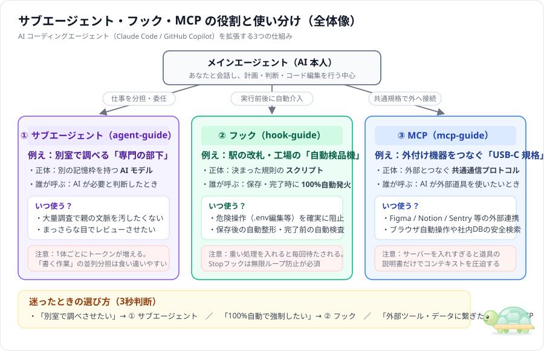

# agent-study — サブエージェント・フック・MCP を「図解・パターン・実験」で学ぶ

AI コーディングエージェント（Claude Code や GitHub Copilot）を使いこなす3つの拡張機能――**サブエージェント**、**フック**、**MCP**――を、ベクター図解・定番パターン・サンプル集・実験環境で学ぶための作業場です。



> [!TIP]
> **AI の契約や外部パッケージなしでも、今すぐ手元で試せます（Node.js のみ・約1秒）**
> - **フックの動きを試す**：`node hook-guide/scripts/test-hooks-locally.js`（模擬入力で各イベントのブロック／自動整形／差し戻しを一括検証）
> - **MCP の通信を見る**：`node mcp-guide/scripts/test-mcp-server.js`（`initialize` → `tools/list` → `tools/call` の JSON-RPC 2.0 往復を表示）

---

## 1. 目的別の最短ルート（どこから始めるか）

| 目的 | おすすめの入口 | 分かること・できること |
|---|---|---|
| **① まず全体像と実測を見る** | [3つの仕組み（上の図）](assets/three-pillars-overview.svg) ／ [フックの動き（全体図・シーケンス図）](hook-guide/docs/03_hook-flow-examples.md) ／ [サブエージェント実測レポート](agent-guide/output/report_01-profile.md) | 「いつどれを使うか」、そして分担とスクリプト統合で時間・コストがどう変わるかの実測結果 |
| **② Copilot の最新仕様を押さえる** | [Copilot Fusion とハーネス](copilot-fusion/README.md) ／ [01 ハーネス移行ガイド](copilot-fusion/01_harness-local-vs-copilot.md) | 旧 Local から Copilot ハーネスへの移行、MCP が見えなくなる原因と復旧、Fusion の3方式（Single / Cascade / Critique） |
| **③ 1分で動く最小サンプルを試す** | [hook-guide/README.md](hook-guide/README.md#2-すぐ試せるclaude-code-なしでフックの動きを1秒で体験する) ／ [mcp-guide/README.md](mcp-guide/README.md#2-まずは1秒体験mcp-サーバーと直接会話してみるclaude-不要) | 外部パッケージ不要の Node.js スクリプトで、フックと MCP の仕組みを手元で即体験 |
| **④ 自分のリポジトリへコピーする** | [agent-guide/samples/](agent-guide/samples/README.md) ／ [hook-guide/samples/](hook-guide/samples/README.md) ／ [mcp-guide/samples/](mcp-guide/samples/README.md) | 定番5パターン別の定義・設定ファイルを Claude Code 用と GitHub Copilot 用で並べて収録 |
| **⑤ 自分の環境で比較実験する** | [agent-guide](agent-guide/README.md) ／ [hook-guide](hook-guide/README.md) ／ [mcp-guide](mcp-guide/README.md) の `run-experiment.ps1` | 「使う／使わない」の差を時間・ターン数・トークン・規約遵守スコア・計算精度で記録 |

> [!NOTE]
> **このリポジトリの設計方針**
> 1. **Claude Code と GitHub Copilot（VS Code / CLI）の両対応**：同じ題材で定義ファイル・設定ファイル・ハーネスの違いを並べて比較しています。
> 2. **「まず 1 人・標準機能」から始める**：一次情報の出典メモには**鮮度ラベル**を付け、「使わない方がよい場面」や「AI の進化で古くなる工夫」も整理しています。
> 3. **外部パッケージ不要**：付属のフック・MCP サーバー・図生成スクリプトはすべて Node.js 標準モジュールのみで動きます。

---

## 2. ガイド一覧

| フォルダ | テーマ | 基礎ガイド（図解） | Copilot 編 | 定番パターン5選 | サンプル集 | 実験手順 |
|---|---|---|---|---|---|---|
| **[agent-guide/](agent-guide/README.md)** | **サブエージェント**<br/>（AI の分担・親子構成） | [00 入門](agent-guide/docs/00_subagent-guide.md) | [01 Copilot編](agent-guide/docs/01_copilot-subagent-guide.md) | [02 パターン5選](agent-guide/docs/02_agent-patterns.md) | [samples/](agent-guide/samples/README.md) | [README](agent-guide/README.md) |
| **[hook-guide/](hook-guide/README.md)** | **フック（Hooks）**<br/>（関所・自動整形・完了ゲート） | [00 入門](hook-guide/docs/00_hook-guide.md) | [01 Copilot編](hook-guide/docs/01_copilot-hook-guide.md) | [02 パターン5選](hook-guide/docs/02_hook-patterns.md) | [samples/](hook-guide/samples/README.md) | [README](hook-guide/README.md) |
| **[mcp-guide/](mcp-guide/README.md)** | **MCP**<br/>（外部ツール・データ接続規格） | [00 入門](mcp-guide/docs/00_mcp-guide.md) | [01 Copilot編](mcp-guide/docs/01_copilot-mcp-guide.md) | [02 パターン5選](mcp-guide/docs/02_mcp-patterns.md) | [samples/](mcp-guide/samples/README.md) | [README](mcp-guide/README.md) |
| **[copilot-fusion/](copilot-fusion/README.md)** | **Copilot Fusion とハーネス**<br/>（実行管理・MCP移行・モデル協調） | [01 ハーネス移行](copilot-fusion/01_harness-local-vs-copilot.md) | [02 Fusion解説](copilot-fusion/02_copilot-fusion.md) | — | — | [README](copilot-fusion/README.md) |
| **[uml-guide/req/](uml-guide/req/README.md)** | **UML・SysML と要求図**<br/>（要望 → 要求 → 要件 → 仕様 → 設計） | [00 言葉の定義](uml-guide/req/00_what-is-a-requirement.md) ／ [01 UML と SysML](uml-guide/req/01_uml-vs-sysml.md) ／ [02 要求図の書き方](uml-guide/req/02_requirement-diagram.md) | — | — | — | [03 要求から設計図まで](uml-guide/req/03_requirements-to-design.md) |

---

## 3. フォルダ構成

```text
agent-study/
├─ README.md                 ← この全体案内
├─ assets/                   ← 全体像のベクター図
├─ agent-guide/              ← ① サブエージェント（AI の分担・親子構成）
│   ├─ docs/                 … 読み物3本（00 / 01 / 02）＋ SVGベクター図解
│   ├─ info/                 … 一次情報の出典メモ（21件、鮮度ラベルつき）
│   ├─ samples/              … パターン別の定義ファイル見本（01〜05）
│   └─ scripts/ prompts/ output/ … 計測実験環境＆実測レポート
│
├─ hook-guide/               ← ② フック（関所・自動整形・完了ゲート）
│   ├─ docs/                 … 読み物4本（00 / 01 / 02 / 03）＋ SVGベクター図解
│   ├─ info/                 … 一次情報の出典メモ（10件、鮮度ラベルつき）
│   ├─ samples/              … パターン別の設定・スクリプト見本（01〜05）
│   └─ hooks/ scripts/ prompts/ output/ … 1秒ローカル検証＆計測実験環境
│
├─ mcp-guide/                ← ③ MCP（外部ツール・データ接続の共通規格）
│   ├─ docs/                 … 読み物3本（00 / 01 / 02）＋ SVGベクター図解
│   ├─ info/                 … 一次情報の出典メモ（10件、鮮度ラベルつき）
│   ├─ samples/              … パターン別のサーバー・設定見本（01〜05）
│   └─ servers/ data/ scripts/ prompts/ output/ … 1秒通信検証＆計測実験環境
│
├─ copilot-fusion/           ← ④ Copilot Fusion とハーネス（図解ガイド）
│   ├─ 01_harness-local-vs-copilot.md … Local / Copilot 比較と MCP 移行
│   ├─ 02_copilot-fusion.md           … Fusion の3方式・Auto 等との比較
│   ├─ assets/                        … SVGベクター図解（13枚）
│   └─ scripts/                       … 図の再生成スクリプト
│
├─ uml-guide/req/            ← ⑤ UML・SysML と要求図（図解ガイド）
│   ├─ 00〜03 *.md                     … 言葉の定義・UML と SysML の比較・要求図の書き方・設計図への落とし込み
│   ├─ assets/                        … SVGベクター図解（19枚）
│   └─ scripts/                       … 図の再生成スクリプト
│
└─ scripts/                  ← 一括検証（npm test）と SVG 図の共通描画キット
```
