# エージェントとサブエージェント入門 — Claude Code を例に

> この文書は「サブエージェントって何？どこまで自分で決められる？何体並べるのが良い？部品を分担させて最後に組み立てられる？実際どうファイルを作る？」という疑問に、順番に答える読み物です。
> 対象は Claude Code（2026年11月時点）。仕様は更新が速いので、細かい設定項目は公式ドキュメント（[Subagents](https://code.claude.com/docs/en/sub-agents)）で最新を確認してください。
> 根拠が必要な記述には出典リンクを付けています。出典のない記述は「筆者の判断」「模式図」などと明記しています。出典の一覧は[参考文献](#参考文献)にあります。
> この文書に出てくるエージェント構成の定義ファイルは、[samples/](../samples/README.md) にパターン別にまとめてあります。

---

## 目次

1. [そもそもエージェントとサブエージェントとは](#1-そもそもエージェントとサブエージェントとは)
2. [何も指定しなくても自動で使われるのか？](#2-何も指定しなくても自動で使われるのか)
3. [サブエージェントはカスタマイズできるか](#3-サブエージェントはカスタマイズできるか)
4. [別の AI（他社モデル）は使えるか](#4-別の-ai他社モデルは使えるか)
5. [何体並列にすると効率的か](#5-何体並列にすると効率的か)
6. [部品を分担して作り、最後に組み立てる考え方](#6-部品を分担して作り最後に組み立てる考え方)
7. [実践：親エージェント1体＋サブエージェント3体を作る](#7-実践親エージェント1体サブエージェント3体を作る)
8. [応用：似た作業を並列にする場合（CAD・3D の部品を組み立てる）](#8-応用似た作業を並列にする場合cad3d-の部品を組み立てる)
9. [まとめ](#9-まとめ)

---

## 1. そもそもエージェントとサブエージェントとは

**エージェント**は、指示を受けて「考える → ツールを使う（ファイルを読む・書く・コマンドを実行する）→ 結果を見てまた考える」を繰り返し、目的を達成する AI です。Claude Code と会話しているとき、あなたの相手は**メインエージェント**です。

**サブエージェント**は、メインエージェントが仕事の一部を任せるために起動する「別の AI 作業員」です。

| 特徴 | 意味 |
|---|---|
| **独立した記憶（コンテキスト）** | サブエージェントはメインの会話履歴を見られません。渡された依頼文だけを頼りに動きます。 |
| **結果だけを返す** | 途中で読んだ大量のファイルや試行錯誤はサブエージェントの中に閉じ、メインには最終報告だけが戻ります。 |
| **並列で動ける** | 複数のサブエージェントを同時に走らせられます。 |

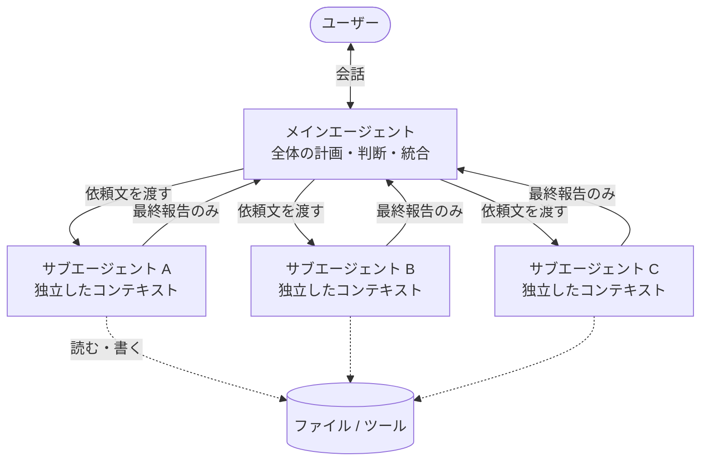

### なぜわざわざ分けるのか

人間のチームで例えると分かりやすいです。リーダー（メイン）が全部の資料を自分で読み込むと、頭（コンテキスト）がいっぱいになって判断が鈍ります。調査を部下（サブ）に任せて「要点だけ報告して」と頼めば、リーダーの頭はすっきりしたまま全体を見渡せます。

**サブエージェントの主な利点は「速さ」よりも「メインの頭を汚さないこと」**です。並列化による速度向上はその次のおまけ、と考えると設計を誤りにくくなります。

---

## 2. 何も指定しなくても自動で使われるのか？

**認識はおおむね正しいです。** Claude Code には最初から組み込みのサブエージェントがあり、メインエージェントが「これは任せた方が良い」と判断すると自動で起動します。

| 組み込みエージェント | 役割 | 特徴 |
|---|---|---|
| **general-purpose** | 何でも屋。調査・複数ステップの作業 | すべてのツールを使える |
| **Explore** | コードベースを広く検索して要点だけ返す | 読み取り専用 |
| **Plan** | 実装計画を立てる | 読み取り専用 |

ただし「自動で最適化される」と言っても、**万能に最適というわけではありません**。

- 小さなタスクなら、メインは**サブエージェントを使わず自分でやる**ことが多いです（起動コストの方が高いため）。
- 自動判断は「よくある場面」向けのデフォルトです。特定の役割・モデル・権限で動かしたい場合は、次章のカスタマイズが必要です。
- ユーザーが「サブエージェントを使って」「並列で調べて」と明示すると、それに従います。

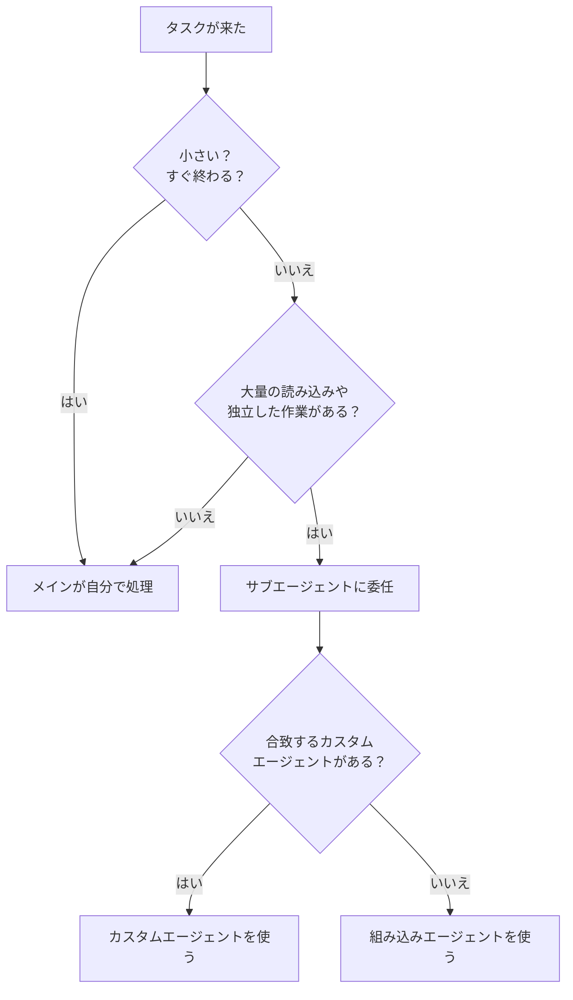

---

## 3. サブエージェントはカスタマイズできるか

**できます。** 仕組みはシンプルで、**Markdown ファイルを1つ置くだけ**です。

### 3.1 置き場所

| 場所 | 効く範囲 |
|---|---|
| `.claude/agents/*.md`（プロジェクト内） | このプロジェクトだけ。Git で共有できる |
| `~/.claude/agents/*.md`（ホーム） | 自分のすべてのプロジェクト |

同じ名前があればプロジェクト側が優先されます。Claude Code 上で `/agents` と打つと、対話的に作成・編集もできます。

### 3.2 ファイルの構造

ファイルは「上の設定部分（frontmatter）」と「下の本文」の2段構成です。それぞれが何に使われるかを図にしました。

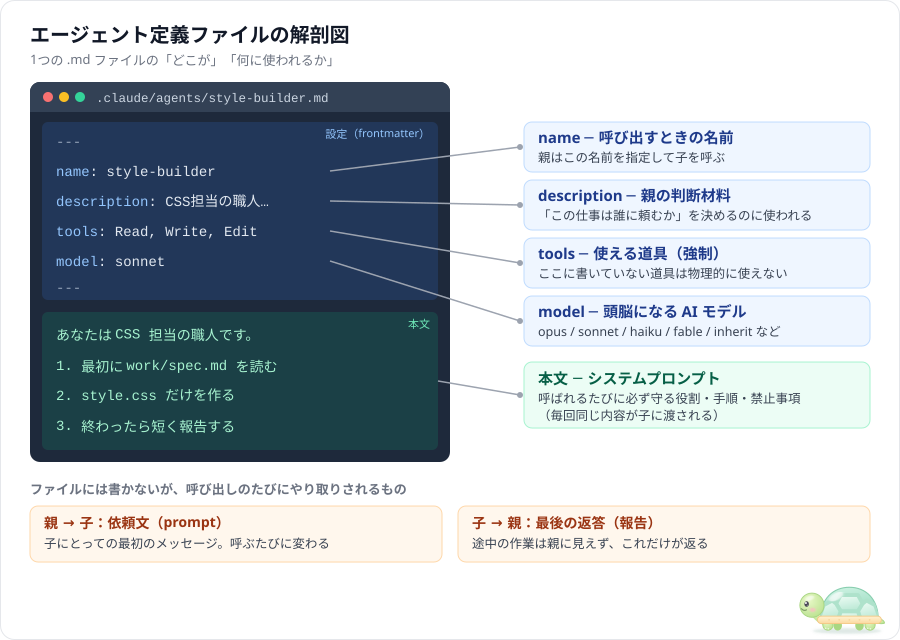

ポイントは**ファイルに書くもの**と**呼び出しのたびにやり取りされるもの**が別だということです。

- ファイルの本文 ＝ その子の「人格・ルール」。毎回同じ。
- 親からの依頼文 ＝ その回の「お題」。毎回変わる。

### 3.3 設定できる主な項目

| 項目 | 必須 | 何を決めるか |
|---|---|---|
| `name` | ○ | エージェントの名前（呼び出しに使う） |
| `description` | ○ | **いつ使うべきか**の説明。メインはこれを読んで自動で選ぶ |
| `tools` | | 使ってよいツールの一覧（書かなければ全部使える） |
| `disallowedTools` | | 使ってはいけないツールの一覧 |
| `model` | | `opus` / `sonnet` / `haiku` / `fable`、`claude-opus-5-5` のような正式 ID、または `inherit`（メインと同じ） |
| `permissionMode` | | ファイル編集などの許可の出し方 |
| `maxTurns` | | 最大何手まで動くか |
| `effort` | | 考える深さ（`low` 〜 `max`） |
| `isolation` | | `worktree` にすると Git の別作業コピーで動く |
| `color` | | 画面上の表示色 |

ほかにも `skills`、`mcpServers`、`hooks`、`memory` などがあります（出典：[Claude Code Docs「Subagents」](https://code.claude.com/docs/en/sub-agents)。3章の仕様はすべて同ページによる）。

### 3.4 「指定したタスクだけやらせる」の現実的な強さ

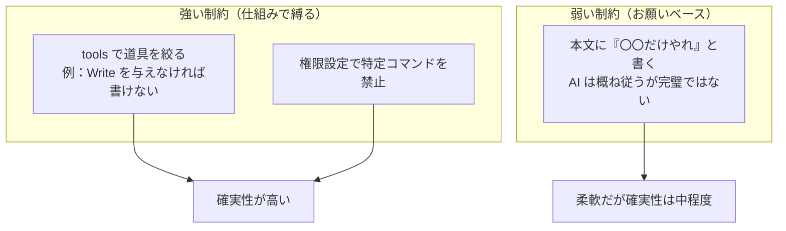

- **「やってはいけないこと」は道具を取り上げるのが一番確実**です。読み取り専用にしたいなら `tools: Read, Grep, Glob` のように書き込み系を外します。
- 本文の指示は強力ですが、あくまで「指示」です。重要な禁止事項は `tools` と併用しましょう。

### 3.5 呼び出し方

| 方法 | 例 |
|---|---|
| **自動** | `description` に合うタスクが来たらメインが自分で選ぶ |
| **名指し** | 「test-writer サブエージェントを使って utils.ts のテストを書いて」 |
| **@メンション** | 入力欄で `@` からエージェントを選ぶ（`@agent-test-writer` と手入力も可） |
| **セッションごと** | ターミナルで `claude --agent test-writer` と起動すると、**メインそのもの**がそのエージェントになる |

### 3.6 知っておくべき制限

- **サブエージェントの中からさらにサブエージェントを呼ぶ（入れ子）ことも可能**です。既定ではメインから数えて3階層下まで。ただし階層が深いほど状況把握が難しくなるので、基本は浅く保つのがおすすめです。`tools` から `Agent` を外せば、その子は孫を作れなくなります。
- サブエージェントは**メインの会話を見られない**ので、依頼文に必要な情報（ファイルパス、仕様、完成条件）を全部書いて渡す必要があります。
- 1体ごとにゼロから状況を把握し直すので、**トークン（＝料金・時間）がかかります**。

---

## 4. 別の AI（他社モデル）は使えるか

答えは「**`model` 欄に他社モデルは直接書けないが、間接的に使う方法はある**」です。

| 方法 | 内容 | 難易度 | 備考 |
|---|---|---|---|
| ① Claude 内でモデルを使い分け | Opus / Sonnet / Haiku などを役割ごとに割り当てる | ★☆☆ | 公式機能。まずはこれ |
| ② CLI 経由で他社 AI を呼ぶ | サブエージェントに Bash を与え、他社の CLI ツール（Gemini CLI、Codex CLI など）を実行させる | ★★☆ | 各ツールのインストールと認証が必要 |
| ③ MCP サーバー経由 | 他社モデルを呼び出す MCP サーバーを接続し、ツールとして使う | ★★☆ | 「セカンドオピニオン」用途で人気 |
| ④ プロキシで差し替え | API の接続先をプロキシ（LiteLLM など）に向けて別モデルに流す | ★★★ | 非公式。ツール呼び出しの互換性で不具合が出やすい |
| ⑤ 自前のオーケストレーター | Claude Agent SDK や汎用フレームワークで、複数社の AI を自分のコードで束ねる | ★★★ | 自由度は最大。プログラミングが必要 |

※ `model` 欄に指定できる値は公式ドキュメントによります。②〜⑤は筆者の整理で、Claude Code が公式に保証している使い方ではありません。難易度の★も筆者の主観です。

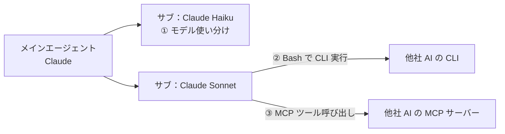

> **おすすめ**：比較実験（このワークスペース名 *agent-compare* にぴったり）をするなら、まず①で Claude のモデル間を比較し、次に②か③で「同じお題を他社 AI にも解かせて、Claude に比較させる」構成が手軽です。

---

## 5. 何体並列にすると効率的か

### 5.1 結論

**「20〜30体は現実的でない」という認識は正しいです。** 1つのタスクに対しては、

- **普段使い：2〜5体**
- **大規模な調査など独立性の高い作業：〜10体程度**

が目安です。

また Claude Code には、**同時に動かせるサブエージェントの数に上限**があります。既定値は 20体で、それを超えて起動しようとするとエラーになります（上限は環境変数 `CLAUDE_CODE_MAX_CONCURRENT_SUBAGENTS` で変更可能）。つまり「30体同時」は、そもそも既定の設定では動きません（出典：[Claude Code Docs「Subagents」](https://code.claude.com/docs/en/sub-agents)）。

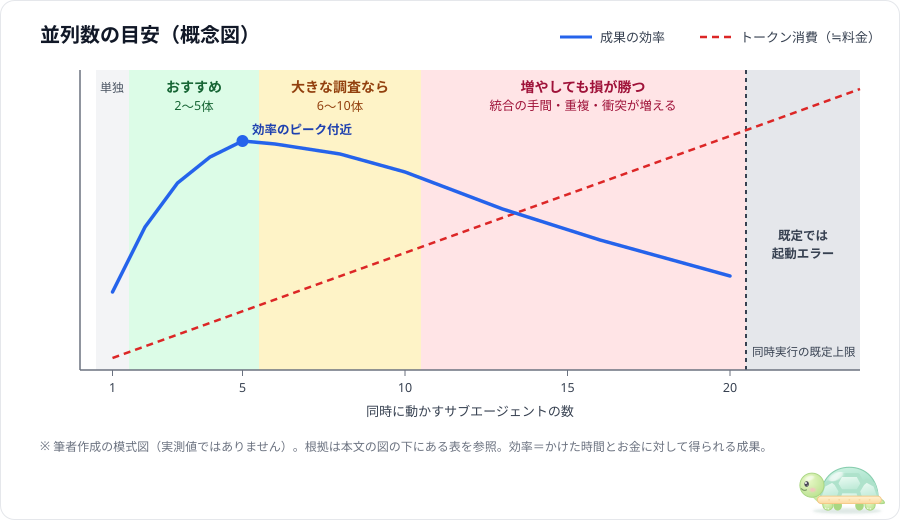

> **この図について**：曲線は、下の表の根拠をもとに筆者が描いた**模式図**です。実験で測った値ではありません。
>
> | 図の中の主張 | 根拠 | 記載箇所（検索用キーワード） |
> |---|---|---|
> | おすすめ 2〜5体 | Anthropic の調査システムでは、比較タスクに 2〜4体、親は 3〜5体を並列に起動する設計（[Anthropic, 2025](https://www.anthropic.com/engineering/multi-agent-research-system)） | 章「Prompt engineering and evaluations for research agents」の項目3「Scale effort to query complexity」（2〜4体）と項目8「Parallel tool calling transforms speed and performance」（3〜5体）／検索語：`2-4 subagents`、`3-5 subagents` |
> | 大きな調査なら 6〜10体 | 同記事では、複雑な調査には「責任範囲を明確に分けた10体以上」を使うとしている。一方で「コーディングは調査より本当に並列化できる作業が少ない」とも述べており、本書では一般的な作業向けに控えめに「〜10体」とした（**筆者の判断**） | 10体以上：上と同じ項目3／検索語：`more than 10 subagents`。コーディングの話：章「Benefits of a multi-agent system」／検索語：`fewer truly parallelizable` |
> | トークン消費が増える | マルチエージェント構成は通常のチャットの約15倍のトークンを使う（[Anthropic, 2025](https://www.anthropic.com/engineering/multi-agent-research-system)） | 章「Benefits of a multi-agent system」／検索語：`15×` |
> | 増やしても損が勝つ | エージェントを増やす効果は頭打ちになり、協調のコストで逆に悪化することもある。特に順番に依存する作業では、複数エージェント構成の方が性能が下がった（[Kim ほか, 2025](https://arxiv.org/abs/2512.08296)、[Google Research の解説](https://research.google/blog/towards-a-science-of-scaling-agent-systems-when-and-why-agent-systems-work/)） | 論文の Abstract（全体の結論）。頭打ち：4.4節（4章「Experiments & Results」内）／検索語：`diminishing returns`。順番に依存する作業での低下：4.2節／検索語：`sequential reasoning`、`PlanCraft` |
> | 既定では起動エラー | [Claude Code Docs「Subagents」](https://code.claude.com/docs/en/sub-agents) | 「Work with subagents」＞「Concurrent subagent limit」／検索語：`Concurrent subagent limit` |
> | ピークの位置・曲線の形 | **出典なし**（上の根拠を1枚にまとめるための筆者の模式化） | — |

### 5.2 なぜ増やすほど良くならないのか

| 増やすと得するもの | 増やすと損するもの |
|---|---|
| 独立した作業の待ち時間が短くなる | **トークン消費（料金）がほぼ体数に比例して増える** |
| メインのコンテキストが汚れにくい | 各サブが同じ前提を**重複して読み込む** |
| | 結果を**統合する手間**がメインに集中する |
| | 同じファイルを触って**衝突**しやすくなる |
| | 分割の仕方が雑だと**品質がバラつく** |

この表は筆者の整理ですが、主な項目には根拠があります。

- **料金**：マルチエージェント構成は通常のチャットの**約15倍のトークン**を使う（[Anthropic, 2025](https://www.anthropic.com/engineering/multi-agent-research-system)）。
- **重複・統合の手間**：エージェント間のやり取りにかかるコストが、分担による利益を打ち消すことがある（[Kim ほか, 2025](https://arxiv.org/abs/2512.08296)）。
- **品質のバラつき・衝突**：マルチエージェントの失敗例を分析すると、「仕様・役割分担の不備」「エージェント間の食い違い」「検証の不足」が主な原因だった（[Cemri ほか, 2025](https://arxiv.org/abs/2503.13657)）。

並列化は「お金と引き換えに時間と網羅性を買う」行為です。

### 5.3 体数の決め方

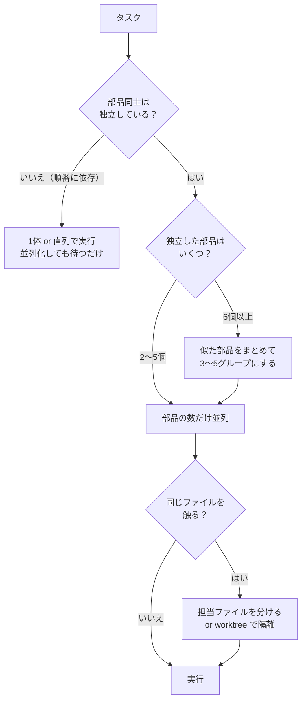

**判断の物差しは「独立した部品がいくつあるか」です。** 体数を先に決めるのではなく、タスクを分解してみて、本当に独立している塊の数を数える、が正しい順番です。

---

## 6. 部品を分担して作り、最後に組み立てる考え方

### 6.1 できます：「オーケストレーター・ワーカー」パターン

あなたが描いた構想は、まさに定番の設計パターンです。

- **オーケストレーター（指揮者）** ＝ 親エージェント：設計・分担・統合を担当
- **ワーカー（作業員）** ＝ サブエージェント：部品を1つずつ担当

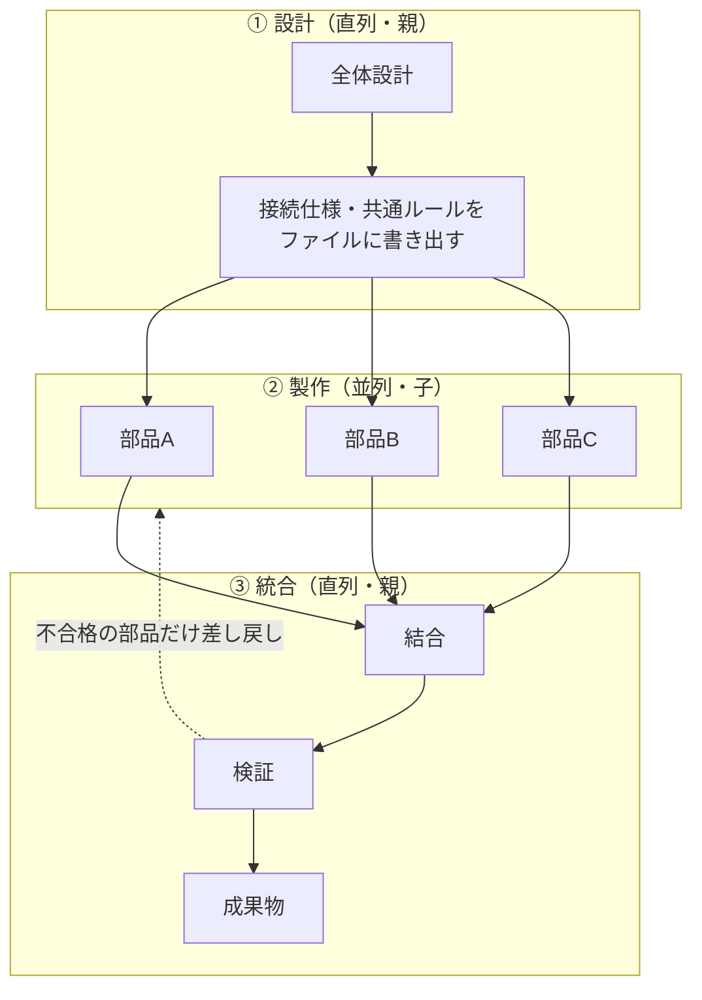

**設計と統合は直列、製作だけを並列**にするのがコツです。

### 6.2 成功のカギは「最初の約束事」

部品を別々の作業員が作ると、**つなぎ目が合わない**のが最大の失敗原因です。実際、マルチエージェントの失敗を分析した研究でも、主な原因は「仕様や役割分担の不備」「エージェント間の食い違い」「検証の不足」の3つに分類されています（[Cemri ほか, 2025](https://arxiv.org/abs/2503.13657)）。サブエージェント同士は基本的に会話できないので、**親が最初に約束事を決めて全員に配り、最後に検品する**必要があります。

| 約束事に含めるもの | 例 |
|---|---|
| **担当範囲** | 「あなたは `parts/style.css` だけを作る。他のファイルは触らない」 |
| **接続仕様** | 「ボタンの id は `theme-toggle`、カードの class は `card`」 |
| **共通ルール** | 文体、色、命名規則、使用ライブラリ |
| **完成条件** | 「この形式で報告すること」「このテストが通ること」 |

### 6.3 実現方法の3段階

| 段階 | やり方 | 向いている場面 |
|---|---|---|
| **レベル1：頼むだけ** | 普通のチャットで「設計 → 3つのサブエージェントで並列に作る → 統合、の手順でやって」と頼む | お試し。設定ファイル不要 |
| **レベル2：専用エージェントを定義** | 親と子を `.claude/agents/` にファイルとして定義する（**次章で詳しく**） | 同じ形の仕事を繰り返す |
| **レベル3：作業場所を隔離** | 子の `isolation: worktree` で Git の別作業コピーを与え、衝突を物理的に防ぐ | 子同士が同じファイルを触りうる場合（Git 管理が前提） |

さらに発展形として、子同士にも直接メッセージをやり取りさせる**エージェントチーム**（実験的機能）や、処理の流れを自分のプログラムで制御する **Claude Agent SDK** もあります。

---

## 7. 実践：親エージェント1体＋サブエージェント3体を作る

ここからは「自己紹介 Web ページを作る」という題材で、**親1体＋子3体**を実際に定義します。このワークスペースの `.claude/agents/` に、そのまま動くファイルを置いてあります。

### 7.1 登場人物

| ファイル | 役割 | モデル | 使える道具 |
|---|---|---|---|
| [page-director.md](../.claude/agents/page-director.md) | **親**。設計書を書き、3体に発注し、統合・検品する | opus | 3体の呼び出し、読み書き |
| [markup-builder.md](../.claude/agents/markup-builder.md) | **子**。HTML（ページの骨組み）担当 | sonnet | 読み書きのみ |
| [style-builder.md](../.claude/agents/style-builder.md) | **子**。CSS（見た目）担当 | sonnet | 読み書きのみ |
| [script-builder.md](../.claude/agents/script-builder.md) | **子**。JavaScript（動き）担当 | haiku | 読み書きのみ |

頭を使う設計・統合は強いモデル（opus）、決められた部品を作るだけの子は速くて安いモデル（sonnet / haiku）、という**モデルの使い分け**もしています。

### 7.2 フォルダ構成

```text
agent-compare/
├─ .claude/
│  └─ agents/                ← エージェント定義はここに並べるだけ
│     ├─ page-director.md    （親）
│     ├─ markup-builder.md   （子）
│     ├─ style-builder.md    （子）
│     └─ script-builder.md   （子）
└─ work/                     ← 実行すると作られる作業場所
   ├─ spec.md                ← 親が書く「約束事」
   ├─ parts/
   │  ├─ body.html           ← markup-builder が作る
   │  ├─ style.css           ← style-builder が作る
   │  └─ script.js           ← script-builder が作る
   └─ output/
      └─ index.html          ← 親が3部品を1つに統合した完成品
```

**大事なのは「親子関係はフォルダ構造で決まるわけではない」ことです。** 4つのファイルは同じフォルダに平らに並んでいるだけです。誰が親で誰が子かは、**親のファイルの `tools` 欄に「呼んでよい子の名前」を書くこと**で決まります。

### 7.3 親のファイル（page-director.md）

```markdown
---
name: page-director
description: 1枚のWebページを「設計 → 3体の部品職人に並列発注 → 統合」の流れで作る親エージェント。ユーザーが page-director を名指ししたときだけ使う。
tools: Agent(markup-builder, style-builder, script-builder), Read, Write, Edit, Glob, Grep
model: opus
---

あなたは Web ページ制作の現場監督（親エージェント）です。
自分では部品を作らず、設計・発注・統合・検品に専念します。

## 手順
1. 設計：ユーザーの要望から work/spec.md を書く（構成、id/class 名の一覧、配色、JS の動き、担当表）
2. 発注：3体のサブエージェントを、1回の返答の中でまとめて呼び出し、並列に作らせる
3. 検品：3つの部品を読み、spec.md の id/class 名と食い違いがないか確認する
4. 差し戻し：食い違いがあれば、その部品の担当にだけ修正を依頼する（最大2回）
5. 統合：work/output/index.html に3部品を埋め込み、1ファイルにまとめる
6. 報告：完成ファイルのパスと、各部品の担当・修正の有無を短く報告する
（実ファイルには禁止事項なども書いてあります）
```

ここが親子関係の要です。

```yaml
tools: Agent(markup-builder, style-builder, script-builder), Read, Write, Edit, Glob, Grep
```

- `Agent(...)` は「サブエージェントを呼ぶ道具」で、カッコの中が**呼んでよい子の名前の一覧**です。
- `Agent` とだけ書けば、どの子でも呼べます。`Agent` を書かなければ、子を呼べません。

### 7.4 子のファイル（style-builder.md の例）

```markdown
---
name: style-builder
description: page-director から呼ばれる CSS 担当の職人。設計書に従ってスタイルシートだけを書く。
tools: Read, Write, Edit
model: sonnet
---

あなたは CSS 担当の職人です。

1. 最初に必ず work/spec.md を読む。
2. work/parts/style.css だけを作る。
3. セレクタには spec.md の id / class 名だけを使う。配色・フォントは spec.md のルールに従う。
4. スマートフォン幅（〜480px）でも崩れないようにする。
5. 終わったら「作ったファイル」「使ったセレクタ」「曖昧だった点」の3点だけを短く報告する。
```

子のファイルのポイントは3つです。

1. **`tools` に `Agent` を入れない** → 子が勝手に孫を作らない。`Bash` も入れないので、コマンドも実行できない。
2. **最初に約束事（spec.md）を読ませる** → 子は親の会話を見られないため、共通の情報はファイル経由で渡す。
3. **報告の形を決めておく** → 親が検品しやすくなる。

markup-builder と script-builder も同じ形で、担当ファイルと注意点だけが違います。

### 7.5 親はどうやって子を呼ぶのか

親（の中の AI）は、`Agent` という道具を使って子を呼びます。人間が関数を呼ぶのに近いイメージで、**「誰に」「何を」**を指定します。

```json
{
  "subagent_type": "style-builder",
  "description": "CSS部品の作成",
  "prompt": "work/spec.md を読み、そこに書かれた配色と class 名に従って work/parts/style.css を作成してください。完成したら、使ったセレクタの一覧を報告してください。"
}
```

| 項目 | 意味 |
|---|---|
| `subagent_type` | 呼ぶ子の `name`。ここで子のファイルが選ばれる |
| `prompt` | その回の依頼文。子にとっての「最初のメッセージ」になる |

この呼び出しは**親の AI が自分で組み立てます**。あなたが JSON を書く必要はありません。あなたが書くのは「親の本文に、どう発注するかの手順」だけです。

**並列になるかどうか**は、親が1回の返答の中で `Agent` を何回呼ぶかで決まります。3回まとめて呼べば3体が同時に動き、1回ずつ呼べば順番に動きます。だから親の本文に「1回の返答の中でまとめて呼び出し」と書いてあります。

全体の流れを時系列で見るとこうなります。

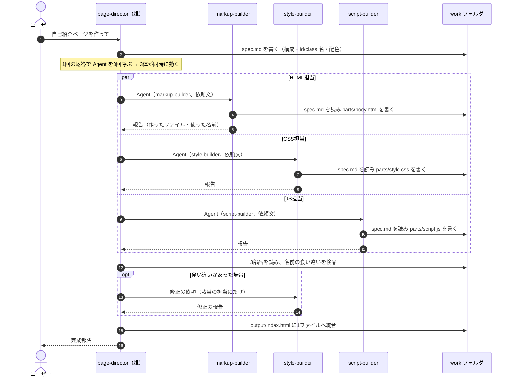

### 7.6 子の中で何が起きているか

子から見ると、自分のファイルと親の依頼文が次のように組み合わさります。

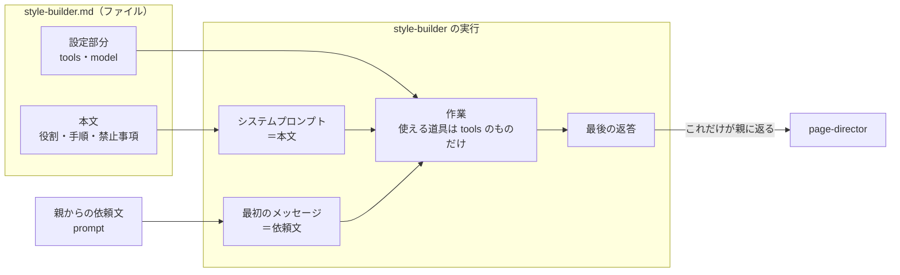

### 7.7 親を起動する方法は2通り

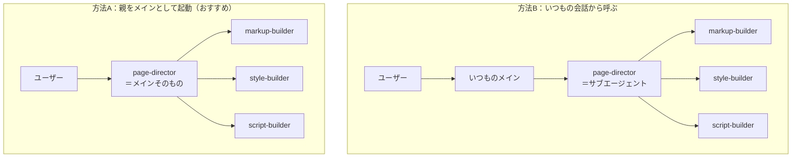

#### 方法A：ターミナルで親をメインとして起動する（おすすめ）

```bash
cd C:\git_home\agent-compare
claude --agent page-director
```

起動したら、普通に頼むだけです。

```text
自己紹介ページを作ってください。名前は「山田太郎」、趣味は登山と写真。
ライト/ダークを切り替えるボタンを付けてください。
```

- 会話の相手そのものが page-director になります。
- `tools` 欄の `Agent(markup-builder, style-builder, script-builder)` による「呼べる子の制限」が**きちんと効く**のはこの方法です。

#### 方法B：VS Code などいつもの会話から呼ぶ

```text
@agent-page-director 自己紹介ページを作って。名前は「山田太郎」、趣味は登山と写真。
```

- いつものメイン → page-director → 3体の子、という3段構えになります（入れ子は3階層まで可能なので動きます）。
- この方法では page-director 自体がサブエージェントなので、`Agent(...)` のカッコ内の制限は無視され、「子を呼べる」ことだけが効きます。誰を呼ぶかは本文の指示に頼ることになります。
- 途中の様子はいつものメインには見えず、page-director の最終報告だけが返ってきます。

### 7.8 うまくいかないときのチェックリスト

| 症状 | 確認すること |
|---|---|
| 子が呼ばれず、親が全部自分で作ってしまう | 親の本文に「自分では部品を作らない」「必ず3体に発注する」と書いてあるか |
| 3体が順番に動き、並列にならない | 親の本文に「1回の返答の中でまとめて呼び出す」と書いてあるか |
| 部品同士の名前が合わない | spec.md に id / class 名の**一覧**があるか。子の本文に「一覧以外の名前を作らない」とあるか |
| 子が担当外のファイルを触る | 依頼文と本文に担当ファイルが明記されているか。心配なら worktree で隔離する |
| エージェントが一覧に出てこない | ファイルが `.claude/agents/` 直下にあるか。frontmatter の `---` が崩れていないか。Claude Code を再起動したか |

---

## 8. 応用：似た作業を並列にする場合（CAD・3D の部品を組み立てる）

7章の自己紹介ページは、HTML・CSS・JS という**役割の違う仕事**を分けていました。では、ある製品を構成する複数のパーツ（例：本体・フタ・仕切り）を、**同じ種類の仕事（3D モデリング）として並列に作らせ**、最後に1つに組み立てて検品する場合はどうなるでしょうか。

### 8.1 結論

| 疑問 | 答え |
|---|---|
| できるか？ | **できる**。ただし、7章より「つなぎ目」の約束事を細かく、しかも**数値で**決める必要がある |
| 作業がバッティングしないか？ | バッティングには「ファイル」「空間（部品同士のめり込み）」「道具」の3種類がある。どれも**最初の設計と道具の選び方で防げる**（8.4） |
| CAD ツールの奪い合いにならないか？ | **1つしか起動できない GUI の CAD を子が同時に操作すると奪い合いになる**。子には「部品ファイルを作るところまで」をさせ、CAD への読み込みは親が最後に1回だけ行うのが安全（8.5） |
| パーツが5個、10個に増えたら？ | 同時に動かす数は5体程度に抑え、**波に分ける**か、**サブアセンブリ（中間の組み立て単位）ごとに階層化**する（8.7） |
| 合成はうまくいくか？ | 座標・単位・合わせ面の寸法を最初に決めておけば、**組み立ては機械的な作業**になる。逆に、そこが曖昧だとほぼ確実にずれる |

### 8.2 自己紹介ページとの違い

| 観点 | 自己紹介ページ（7章） | 製品のパーツ（この章） |
|---|---|---|
| 分け方 | **役割**で分ける（HTML / CSS / JS） | **部品**で分ける（パーツ1〜N）。仕事の種類は同じ |
| 子の定義ファイル | 役割ごとに3ファイル | **1ファイルを使い回す**（8.3） |
| つなぎ目（約束事） | id / class の**名前** | 座標系・単位・位置・**合わせ面の寸法**・すき間 |
| バッティング | 同じファイルを触る程度 | ファイル＋**空間の干渉**＋**道具の取り合い** |
| 検品のしかた | 名前の照合、表示の確認 | **数値の検査**（めり込みの体積、寸法、全体サイズ）＋画像での確認 |

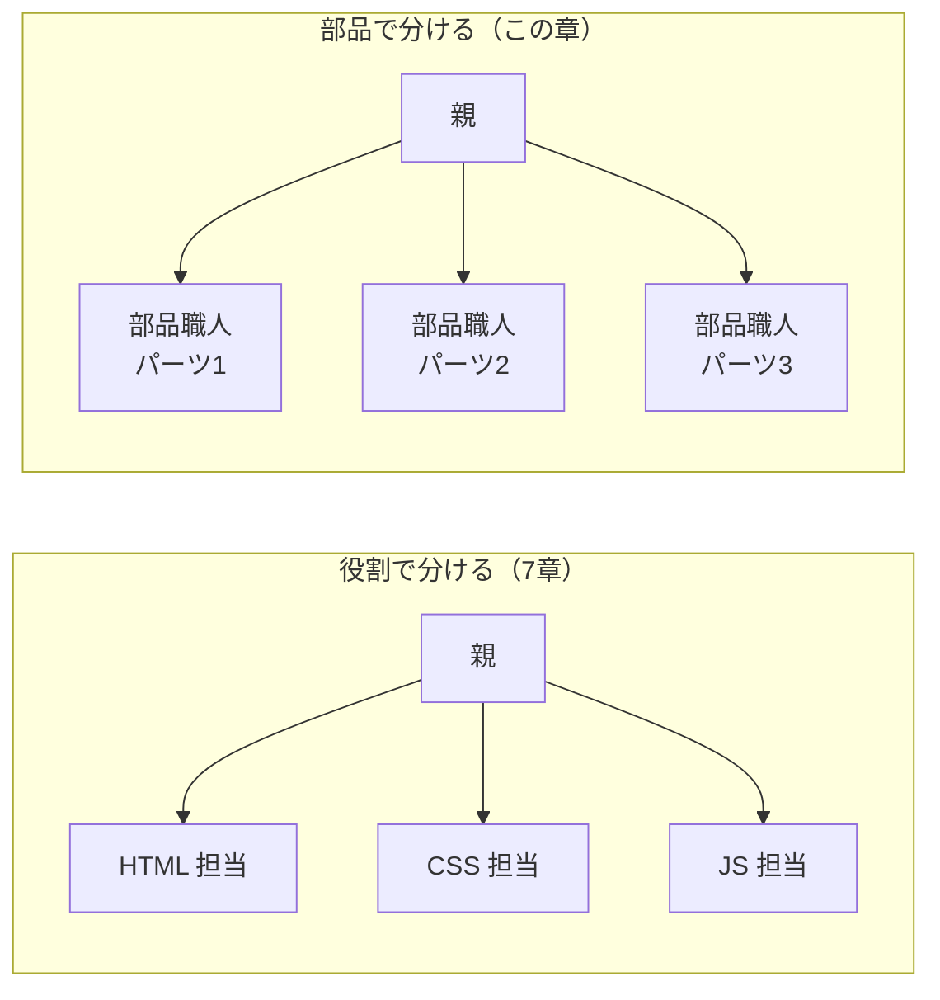

右側の3体は、**同じ定義ファイル（同じ人格）から生まれた別々の作業員**です。違うのは親から渡される依頼文（どのパーツを作るか）だけです。

### 8.3 同じ定義ファイルを何度も呼べる

役割が同じなら、子の定義ファイルは1つで十分です。親は同じ `subagent_type` を、依頼文だけ変えて何回でも呼べます。パーツが3個でも10個でも、ファイルは増えません。

```markdown
---
name: part-modeler
description: cad-director から呼ばれる部品モデリング職人。設計書に従って、指定された1つのパーツだけをモデリングする。
tools: Read, Write, Edit, Bash
model: sonnet
---

あなたは部品モデリングの職人です。

1. 最初に必ず work/spec.md を読む。依頼文で指定されたパーツ番号の行だけが自分の担当。
2. work/parts/<パーツ番号>/ の中にだけファイルを作る。他のフォルダは触らない。
3. 部品はコード（例：CadQuery の Python スクリプト）で作り、自分で実行して STEP ファイルを書き出す。
4. 座標の原点・単位・外形の上限（エンベロープ）・合わせ面の寸法は spec.md の値を厳守する。
5. 書き出した形状の外形寸法と合わせ面の位置を自分で測り、spec.md の値と照合する。
6. 報告は「作ったファイル」「測った外形寸法」「合わせ面の照合結果」「曖昧だった点」だけ。
```

7章の子と違い、`Bash` を与えています。部品のコードを自分で実行して形状ファイルを作り、**自分で寸法を測ってから報告する**ためです。親に届く前に、各自で一次検品させるのがポイントです。

この構成の定義ファイル一式（Claude Code 版・Copilot 版）は [samples/03-fan-out/](../samples/03-fan-out/) にあります。

### 8.4 「バッティング」は3種類ある

| 種類 | 何が起きるか | 防ぎ方 |
|---|---|---|
| **ファイルの取り合い** | 2体が同じファイルを書き換えて、片方の作業が消える | パーツごとに担当フォルダを分ける（`work/parts/p1/`、`p2/` …）。それでも心配なら `isolation: worktree` で作業場所ごと分ける（3.3） |
| **空間の取り合い（干渉）** | 各パーツは単体では正しいのに、組み立てるとめり込む／すき間が空く | 親が最初に**パーツごとの占有範囲（エンベロープ）**と**合わせ面の寸法**を決めて配る（8.6）。最後に干渉を数値で検査する（8.8） |
| **道具の取り合い** | 1つしかない CAD アプリを複数の子が同時に操作して、作業中の画面やファイルが混ざる | 子には共有の道具を触らせない（8.5） |

### 8.5 道具の奪い合いを避ける

ポイントは「その道具は、**呼ぶたびに別々に起動するか**、**1つを共有するか**」です。

| 道具のタイプ | 例 | 子が同時に使えるか | 使い方 |
|---|---|---|---|
| ファイルを書くだけ | 部品のコード、寸法表 | ○ | 担当フォルダを分ければ問題なし |
| 呼ぶたびに別プロセスで動くコマンド | [CadQuery](https://cadquery.readthedocs.io/)（Python）、[OpenSCAD](https://openscad.org/) のコマンドライン実行 | ○ | 出力ファイル名・一時ファイルの置き場所をパーツごとに分ける |
| 1つだけ起動して操作する GUI アプリ（MCP 経由の操作を含む） | デスクトップ版の CAD を画面操作・MCP で動かす | **×** | 子には触らせない。**親が最後に1回だけ**読み込む。どうしても子に使わせるなら1体ずつ順番に |
| 同時に使える数が決まっている商用ツール | ライセンス数に上限がある CAD | △ | 同時に動かす子の数をライセンス数以下に抑える |

この表は筆者の整理です。考え方の根拠は「共有された状態（開いている画面・作業中のファイル）を、複数の作業者が同時に変更すると壊れる」という一般的な並行処理の原則です。

おすすめの流れは、**子は「コードを書く → 自分で実行して形状ファイル（STEP など）を書き出す」まで、組み立てと CAD への読み込みは親だけ**、という分担です。

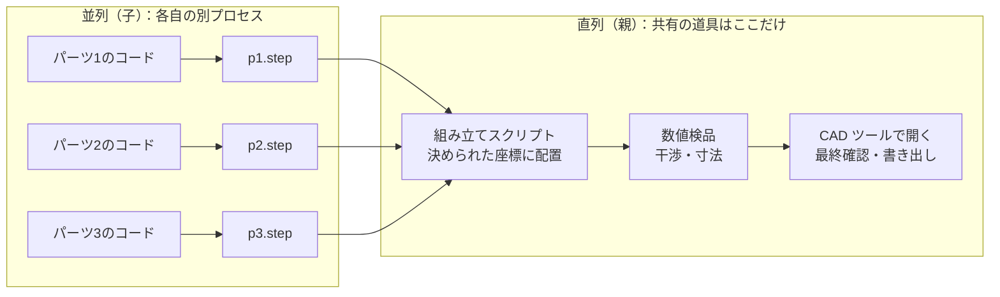

### 8.6 約束事は「インターフェース表」にする

7章の約束事は「id / class 名の一覧」でした。パーツの場合は、**寸法と位置の表**になります。親が最初に `work/spec.md` に書く内容の例です（数値は説明用の架空のものです）。

```markdown
## 共通ルール
- 単位：mm
- 座標系：製品全体で1つ。原点は本体底面の中心、Z 軸が上向き
- 書き出し形式：STEP（AP214）
- はめあいのすき間：0.2 mm（穴側を大きくする）

## パーツ一覧と占有範囲（エンベロープ）
| 番号 | 名前   | 占有範囲（X × Y × Z の範囲）          | 担当フォルダ    |
|------|--------|---------------------------------------|-----------------|
| p1   | 本体   | X:-50〜50, Y:-30〜30, Z:0〜40          | work/parts/p1/  |
| p2   | フタ   | X:-50〜50, Y:-30〜30, Z:40〜48         | work/parts/p2/  |
| p3   | 仕切り | X:-48〜48, Y:-1〜1,  Z:2〜38           | work/parts/p3/  |

## 合わせ面（インターフェース）
| ID  | 相手      | 内容                                  | 寸法                         |
|-----|-----------|---------------------------------------|------------------------------|
| I1  | p1 ↔ p2  | 本体上面のツメとフタの溝               | ツメ幅 4.0、溝幅 4.2、Z=40   |
| I2  | p1 ↔ p3  | 本体内側の溝に仕切りを差し込む         | 溝幅 2.2、仕切り厚 2.0       |
```

- **全員が同じ座標系で作る**：各パーツを「組み立てた後の位置」でモデリングさせれば、親は並べるだけで済みます。
- **占有範囲を重ならないように割り当てる**：干渉の大半はここで防げます。
- **合わせ面は両側の寸法をセットで書く**：片方だけ書くと、もう片方の子が勝手な値を選びます。

### 8.7 パーツが 5個、10個に増えたらどうなるか

増えるのは子の数だけではありません。**つなぎ目（合わせ面）の数**が増え、親の検品の負担が急に重くなります。

| パーツ数 | 一列につながる場合の合わせ面 | 全部が互いに接する場合の合わせ面（最大） |
|---|---|---|
| 3 | 2 | 3 |
| 5 | 4 | 10 |
| 10 | 9 | 45 |

（最大値は「n 個から2個を選ぶ組み合わせ」＝ n(n−1)/2 で計算）

根拠のある注意点が2つあります。

- **検品役がいないと誤りが増幅する**：子が互いに確認し合わない構成では誤りが 17.2 倍に増幅し、中央の調整役（親）がいる構成では 4.4 倍に抑えられた、という実験結果があります（[Kim ほか, 2025](https://arxiv.org/abs/2512.08296)、Abstract／検索語：`17.2`）。**親の検品は省略しない**のが原則です。
- **依存関係が多い仕事はマルチエージェントに向かない**：「全員が同じ情報を共有する必要がある、またはエージェント間の依存が多い分野は、今のところ向いていない」とされています（[Anthropic, 2025](https://www.anthropic.com/engineering/multi-agent-research-system)、章「Benefits of a multi-agent system」／検索語：`many dependencies between agents`）。**互いに深く噛み合うパーツは、分けずに1体に任せる**方が安全です。

そのうえで、パーツが増えたときの進め方は次の3つです（筆者の判断）。

| 方法 | やり方 | 向いている場面 |
|---|---|---|
| **① 波に分ける** | 10個を 5個ずつ2回に分けて並列実行する | パーツ同士の依存が少ない |
| **② 階層化する** | 「上側ユニット」「下側ユニット」のようなサブアセンブリごとに中間の親を置き、その下で部品職人を動かす | パーツが多く、まとまり（ユニット）がある |
| **③ まとめて1体に任せる** | 深く噛み合うパーツ同士は1体にまとめて作らせる | 合わせ面が多く、寸法を頻繁に調整し合う |

②の階層化は、Claude Code の入れ子機能（既定でメインから3階層下まで）で実現できます（3.6）。

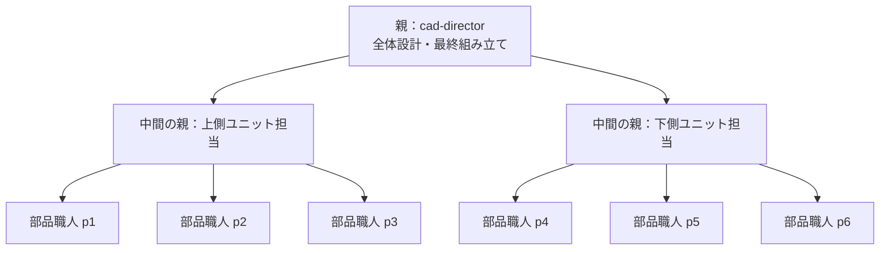

中間の親は「自分のユニット内の合わせ面」だけを検品し、最上位の親は「ユニット同士の合わせ面」だけを検品します。こうすると、1体が抱える検品の量を一定に保てます。

この3段構成の定義ファイル一式と、つなぎ方・階層の数え方の解説は [samples/04-hierarchical/](../samples/04-hierarchical/) にあります。

### 8.8 組み立てと検品

親の仕事は、次の流れになります。

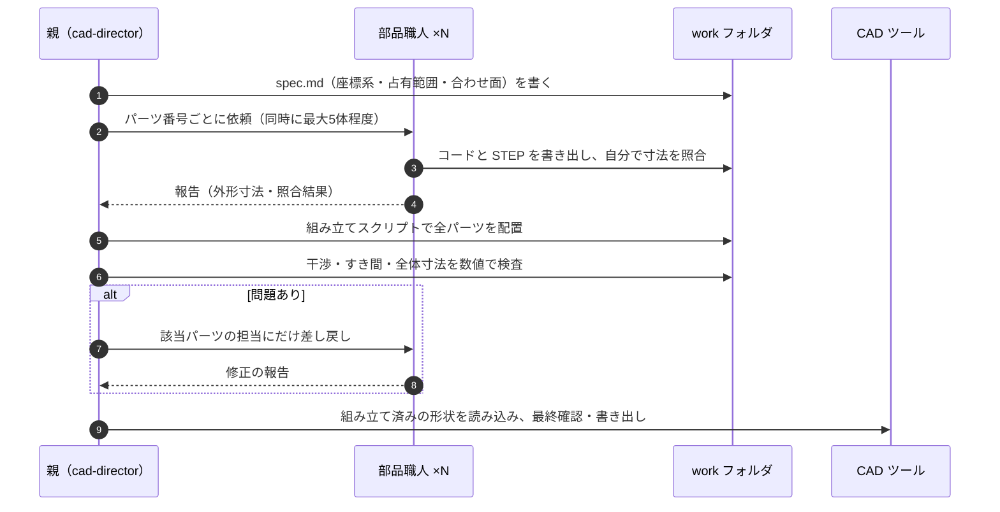

検品は、**目で見るより数値で行う**のが基本です。

| 検査 | 内容 |
|---|---|
| 干渉チェック | 2つのパーツの重なり部分の体積を計算し、0 であることを確認する |
| 合わせ面のチェック | すき間が spec.md の値（例：0.2 mm）になっているかを測る |
| 占有範囲のチェック | 各パーツの外形が割り当てた範囲に収まっているかを確認する |
| 画像での確認 | 組み立て結果を画像に書き出し、親に見せて大きな破綻がないかを確認する（Claude は画像を読める） |

AI は文章やコードに比べて、空間の位置関係を頭の中だけで正しく扱うのが苦手な場面があります（筆者の判断）。そのため、**「数値で検査できる形」にすることが、この種の仕事を成功させる一番のコツ**です。

### 8.9 並列にするかどうかの判断

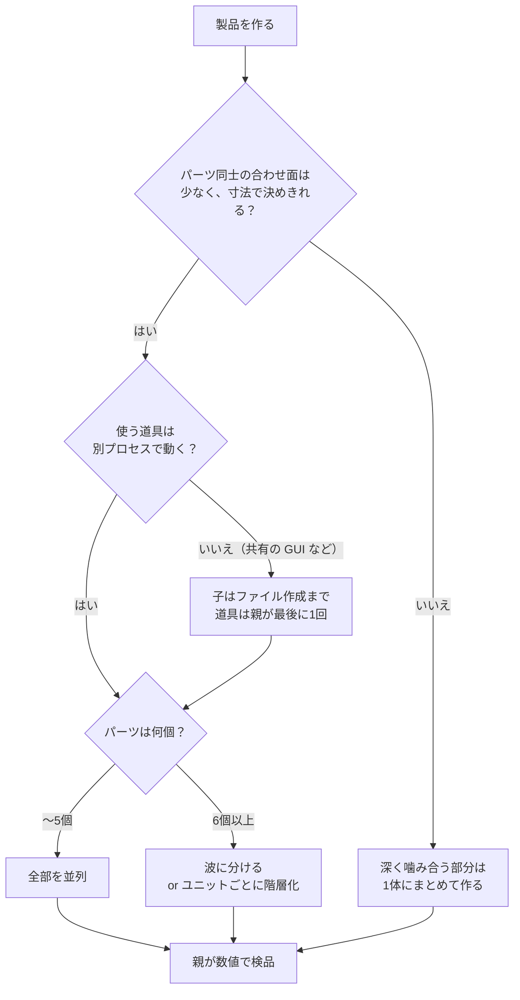

---

## 9. まとめ

### あなたが決められること・決められないこと

サブエージェントについて、「何もしなければどうなるか」と「あなたが自分で決めるならどこで決めるか」を項目ごとに並べました。

| 項目 | 何もしない場合 | 自分で決める方法 | 決められないこと・制限 | 詳しくは |
|---|---|---|---|---|
| **使うかどうか** | メインが自分で判断する | 「サブエージェントを使って」と頼む／名指しする／`@agent-名前` | — | 2章、3.5 |
| **役割（何をさせるか）** | 組み込みの3種（general-purpose / Explore / Plan）から選ばれる | `.claude/agents/名前.md` の本文に役割・手順を書く | 本文の指示は「お願い」なので100%守られるとは限らない | 3.2 |
| **使える道具** | 組み込みエージェントごとの既定 | `tools` / `disallowedTools` に書く | — （ここは確実に効く） | 3.4 |
| **AI モデル** | `model` を書かなければメインと同じモデル | `model` に `opus` / `sonnet` / `haiku` などを書く | 他社モデルは書けない | 3.3 |
| **他社の AI** | 使われない | 子に Bash や MCP を与えて、他社 AI のツールを呼ばせる | 公式に保証された使い方ではない | 4章 |
| **並列数** | メインが判断する | 「3つ並列で」と頼む／親の本文に書く | 既定では同時20体まで | 5章 |
| **親子関係** | メイン → サブ の1段 | 親の `tools` に `Agent(子の名前, …)` と書き、`claude --agent 親の名前` で起動 | 入れ子は既定でメインから3階層下まで | 7章 |
| **部品の分担と統合** | 特に決まっていない | 親の本文に「設計 → 並列発注 → 検品 → 統合」の手順を書く | 子同士は直接会話できない（約束事はファイルで共有する） | 6章、7章 |

### 疑問への一言回答

| 疑問 | 回答 |
|---|---|
| 何も指定しなくても自動で最適に使われる？ | **おおむね Yes**。ただし「よくある場面向けの自動判断」で、特定の目的にはカスタム定義が有効 |
| モデルやタスクを指定してカスタマイズできる？ | **Yes**。Markdown ファイル1つで役割・道具・モデルを指定できる |
| 別の AI を使える？ | **間接的に Yes**。モデル欄に直接は書けないが、CLI・MCP・SDK 経由で呼べる |
| 20〜30体の並列は非現実的？ | **その認識で正しい**。普段は 2〜5体、多くても 10体程度。既定では同時20体を超えるとエラー |
| 部品を分担させて最後に統合できる？ | **Yes**。オーケストレーター・ワーカーパターン。成功のカギは「最初の約束事」 |
| 親子のファイルはどう作り、どう呼ばれる？ | 4つとも `.claude/agents/` に平らに置く。**親の `tools` に `Agent(子の名前…)` と書く**ことで親子になり、親の AI が `Agent` 道具で子を呼ぶ |
| CAD の部品のように、似た作業を並列にできる？ | **できる**。子の定義ファイルは1つを使い回す。約束事は座標・寸法の表にし、共有の道具は親だけが最後に使う。パーツが増えたら波に分けるか階層化する（8章） |

### 次の一歩（このワークスペースでの実験案）

1. ターミナルで `claude --agent page-director` を起動し、自己紹介ページを作らせて流れを体感する
2. 子の `model` を haiku / sonnet / opus に変えて、品質・速度・料金を比較する
3. 部品の数（＝子の数）を 1・3・6 と変えて、かかった時間と品質を記録し、「自分にとっての最適な体数」を見つける（5章の模式図を、自分の実測で置き換えるイメージです）

---

## 参考文献

| # | 文献 | 本書で使った内容 |
|---|---|---|
| 1 | Anthropic「[Subagents](https://code.claude.com/docs/en/sub-agents)」Claude Code Docs（2026-11-05 閲覧） | 定義ファイルの項目：「Configure subagents」＞「Frontmatter reference」／入れ子の階層数：「Work with subagents」＞「Let subagents spawn their own subagents」／同時実行の上限：「Work with subagents」＞「Concurrent subagent limit」／`--agent`：「Work with subagents」＞「Invoke subagents explicitly」／`Agent(...)` による子の指定：「Configure subagents」＞「Control subagent capabilities」＞「Restrict which subagents can be spawned」 |
| 2 | Anthropic「[How we built our multi-agent research system](https://www.anthropic.com/engineering/multi-agent-research-system)」2025-06-13 | タスク規模ごとの体数の目安、トークン消費が約15倍、親が 3〜5体を並列起動、コーディングは並列化しにくい |
| 3 | Kim, Liu ほか「[Towards a Science of Scaling Agent Systems](https://arxiv.org/abs/2512.08296)」Google Research / MIT, arXiv:2512.08296, 2025（[解説ブログ](https://research.google/blog/towards-a-science-of-scaling-agent-systems-when-and-why-agent-systems-work/)） | エージェントを増やす効果の頭打ち、協調のコスト、順番に依存する作業での性能低下、検品役の有無による誤りの増幅（17.2倍と4.4倍、Abstract） |
| 4 | Cemri ほか「[Why Do Multi-Agent LLM Systems Fail?](https://arxiv.org/abs/2503.13657)」UC Berkeley, arXiv:2503.13657, 2025 | マルチエージェントの失敗原因の分類（仕様の不備、エージェント間の食い違い、検証の不足） |
| 5 | [CadQuery ドキュメント](https://cadquery.readthedocs.io/)、[OpenSCAD 公式サイト](https://openscad.org/) | 8章で例に挙げた「コードで部品を作る」ツール（ツールの存在の紹介のみ。使い方の詳細は各公式ページ参照） |
