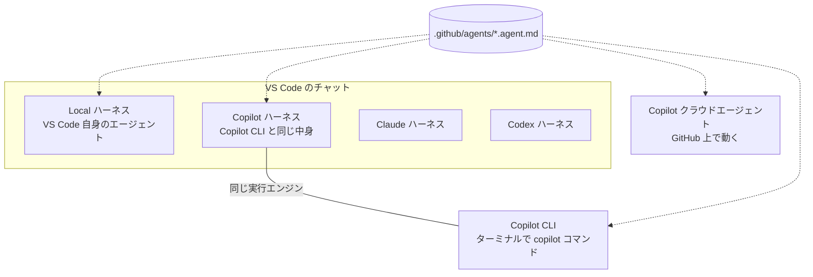
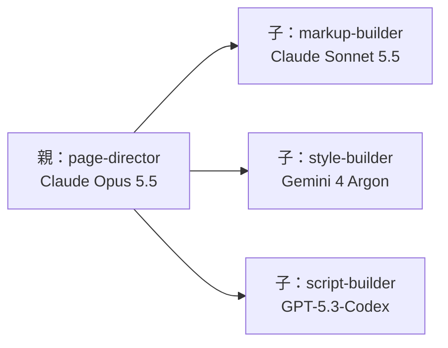
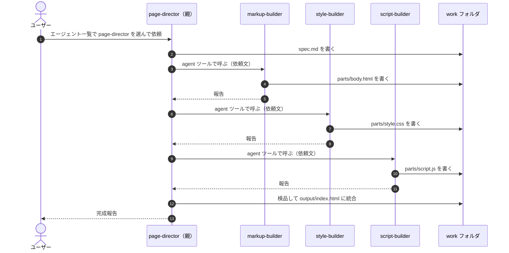

# GitHub Copilot で「親エージェント＋サブエージェント」はできるか

> [サブエージェント入門（Claude Code 編）](00_subagent-guide.md)の続編です。Claude Code でできた「親1体が子3体に部品を作らせて最後に統合する」構成を、**GitHub Copilot**（VS Code のチャットと Copilot CLI）で実現できるかをまとめます。
> 内容は 2026-11-05 時点の公式ドキュメントにもとづきます。Copilot のエージェント機能は更新が非常に速く、プレビュー段階の機能も多いので、使う前に[参考文献](#参考文献)のページで最新を確認してください。
> 根拠が必要な記述には出典を付けています。出典の「検索語」は、そのページ内をブラウザの検索（Ctrl+F）で探すとすぐ見つかる語です。公式ページで確認できなかった点は「**未確認**」と書いています。
> Copilot 形式の定義ファイルは、Claude Code 形式と並べて [samples/](../samples/README.md) にパターン別にまとめてあります（階層化・ファンアウトなど、この文書にない構成も含む）。

---

## 目次

1. [結論](#1-結論)
2. [Copilot の「どこで動かすか」を整理する](#2-copilot-のどこで動かすかを整理する)
3. [Claude Code との対応表](#3-claude-code-との対応表)
4. [モデルの選択肢は広がるか](#4-モデルの選択肢は広がるか)
5. [実践：Copilot 版の親1体＋子3体](#5-実践copilot-版の親1体子3体)
6. [Claude Code 用のファイルはそのまま使えるか](#6-claude-code-用のファイルはそのまま使えるか)
7. [並列実行](#7-並列実行)
8. [会社の環境で使うときの注意点](#8-会社の環境で使うときの注意点)
9. [まとめ](#9-まとめ)

---

## 1. 結論

**できます。** GitHub Copilot にも Claude Code とほぼ同じ仕組みがあります。

- **エージェント定義ファイル**：`.github/agents/名前.agent.md` に Markdown で書く。上に設定（frontmatter）、下に本文という構成も Claude Code と同じ。
- **サブエージェント**：親エージェントが、定義した子エージェントを「サブエージェント」として呼び出せる。子は独立したコンテキストで動き、結果だけを返す。
- **CLI なしでもできる**：VS Code のチャットだけで、定義ファイルを置けば親子構成を組める。
- **モデルは広がる**：Copilot で使えるモデル（Anthropic、OpenAI、Google など複数社）を、**子ごとに別の会社のモデル**に割り当てられる。

ただし、**VS Code と Copilot CLI で使える項目や書き方が微妙に違う**のが最大の注意点です（3章）。

出典：[VS Code Docs「Subagents」](https://code.visualstudio.com/docs/agents/run/subagents)（検索語：`user-invocable`）、[GitHub Docs「About custom agents」](https://docs.github.com/en/copilot/concepts/agents/copilot-cli/about-custom-agents)（検索語：`separate context window`）

---

## 2. Copilot の「どこで動かすか」を整理する

Copilot には動かし方がいくつかあり、VS Code の中でも「どのエンジン（ハーネス）で動かすか」を選べます。まずここを押さえると、後の違いが分かりやすくなります。



| 動かし方 | 中身 | この文書での呼び方 |
|---|---|---|
| VS Code チャット（Local ハーネス） | VS Code 自身が動かすエージェント | **VS Code 版** |
| VS Code チャット（Copilot ハーネス） | Copilot CLI と同じ実行エンジンを VS Code から使う | CLI 版と同じ扱い |
| Copilot CLI | ターミナルで `copilot` コマンドを使う | **CLI 版** |
| クラウドエージェント | GitHub 上で動く（Issue から依頼するなど） | 本書では扱わない |

出典：[VS Code Docs「Understand agent harnesses」](https://code.visualstudio.com/docs/agents/concepts/agent-harnesses)（検索語：`Copilot SDK`、`extension host`）

> **補足**：Claude ハーネスと Codex ハーネスは、企業向けの管理設定が適用されている環境では無効になります（同ページ、検索語：`enterprise-managed`）。会社の環境では使えない可能性が高いので、本書では Local と Copilot（CLI）を中心に扱います。

---

## 3. Claude Code との対応表

### 3.1 仕組みの対応

| やりたいこと | Claude Code | Copilot（VS Code 版） | Copilot（CLI 版） |
|---|---|---|---|
| 定義ファイルの置き場所（プロジェクト） | `.claude/agents/*.md` | `.github/agents/*.agent.md` | `.github/agents/*.agent.md` |
| 定義ファイルの置き場所（個人） | `~/.claude/agents/` | `~/.copilot/agents/` | `~/.copilot/agents/` |
| 子を呼ぶ道具 | `Agent` | `agent` ツール（内部名 `runSubagent`） | `agent` ツール（内部名 `task`） |
| 呼べる子を限定する | `tools: Agent(子1, 子2)` | `agents: ['子1', '子2']` | **専用の項目は未確認**（本文の指示で縛る） |
| モデル指定 | `model: sonnet` など | `model: 表示名 (copilot)` 形式 | `model:` に CLI のモデル ID |
| 子を一覧に出さない | — | `user-invocable: false` | `user-invocable: false` |
| 親をメインとして起動 | `claude --agent 名前` | チャット欄のエージェント選択で親を選ぶ | `copilot --agent 名前` または `/agent` |
| 孫エージェント（入れ子） | 既定で3階層まで可 | 既定で**不可**。設定で有効化（最大5階層） | **未確認** |
| 並列実行 | 1回の返答で複数呼べば並列 | 公式ページに明記なし（**未確認**） | `/fleet` で並列化 |

出典：

- VS Code 版：[VS Code Docs「Subagents」](https://code.visualstudio.com/docs/agents/run/subagents)（検索語：`runSubagent`、`agents: []`、`allowInvocationsFromSubagents`、`depth`）、[VS Code Docs「Custom agent file reference」](https://code.visualstudio.com/docs/agents/reference/custom-agent-file-reference)（検索語：`.github/agents`、`~/.copilot/agents`、`native task tool`）
- CLI 版：[GitHub Docs「Creating custom agents for Copilot CLI」](https://docs.github.com/en/copilot/how-tos/copilot-cli/customize-copilot/create-custom-agents-for-cli)（検索語：`--agent`、`~/.copilot/agents`）、[GitHub Docs「Custom agents configuration」](https://docs.github.com/en/copilot/reference/custom-agents-configuration)（検索語：`user-invocable`、`custom-agent`）
- Claude Code：[サブエージェント入門](00_subagent-guide.md)の参考文献を参照

### 3.2 道具（tools）の名前

Copilot では道具を短い別名で書きます。Claude Code の名前も「互換の別名」として受け付けられます。

| Copilot の名前 | 意味 | 互換の別名（Claude Code の名前など） |
|---|---|---|
| `read` | ファイルを読む | `Read` |
| `edit` | ファイルを書く・直す | `Edit`、`Write` |
| `search` | 検索する | `Grep`、`Glob` |
| `execute` | コマンドを実行する | `Bash`、`shell` |
| `agent` | 他のエージェントを呼ぶ | `Task`、`custom-agent` |
| `web` | Web を調べる | `WebSearch`、`WebFetch` |

出典：[GitHub Docs「Custom agents configuration」](https://docs.github.com/en/copilot/reference/custom-agents-configuration)（検索語：`Primary alias`）

---

## 4. モデルの選択肢は広がるか

### 4.1 広がります

Claude Code の子エージェントに指定できるのは Claude のモデルだけでした。Copilot では、Copilot で使えるモデルならどれでも子に割り当てられます。2026-11-05 時点で公式ページに載っている提供元は次の通りです。

| 提供元 | モデルの例 |
|---|---|
| Anthropic | Claude Opus 5.5、Claude Sonnet 5.5、Claude Haiku 5.5 など |
| OpenAI | GPT-6.1 Sol、GPT-5.3-Codex など |
| Google | Gemini 4 Argon、Gemini 3.8 Flash |
| xAI | Grok 4.7 など |
| Microsoft | MAI-Code-1.1-Flash |
| Moonshot AI | Kimi K3 |

出典：[GitHub Docs「Supported AI models in GitHub Copilot」](https://docs.github.com/en/copilot/reference/ai-models/supported-models)（検索語：各モデル名）。一覧は頻繁に変わります。

さらに CLI 版では、自分で設定したローカルモデル（自分の PC で動くモデル）を子に割り当てることもできます（[Creating custom agents for Copilot CLI](https://docs.github.com/en/copilot/how-tos/copilot-cli/customize-copilot/create-custom-agents-for-cli)、検索語：`providers.json`）。

### 4.2 子ごとに違う会社のモデルを使う例



「設計と統合は強いモデル、部品作りは得意分野が合いそうなモデル」という分け方ができます。**どのモデルがどの作業に強いかは公式の保証ではないので、ここでのモデルの割り当ては筆者が例として選んだものです。** 実際に比べてみるのがこのワークスペースの目的にも合っています。

### 4.3 モデル指定の書き方と落とし穴

| 項目 | VS Code 版 | CLI 版 |
|---|---|---|
| 書き方 | `model: Claude Sonnet 5.5 (copilot)` のような「表示名 (提供元)」 | CLI のモデル ID。ローカルモデルは `提供元/ID` 形式 |
| 確実な入れ方 | エディタで `model:` と打つと出る**補完候補から選ぶ** | CLI でモデル一覧を確認して ID を写す |
| 書かなかった場合 | そのとき選んでいるモデル | 既定のモデル |
| 優先順位（VS Code 版） | ① 親が呼び出し時に指定したモデル → ② 子の `model` → ③ メインのモデル | **未確認** |

**VS Code 版の落とし穴**：子に指定したモデルが、**メインで使っているモデルより高い料金ランクだと、その子は動きません**（使えるモデルの一覧が報告されます）。親には一番強い（高い）モデルを選び、子はそれ以下にしておくのが安全です。

出典：[VS Code Docs「Subagents」](https://code.visualstudio.com/docs/agents/run/subagents)（検索語：`cost tier`）、[VS Code Docs「Custom agent file reference」](https://code.visualstudio.com/docs/agents/reference/custom-agent-file-reference)（検索語：`model IDs`）、[Creating custom agents for Copilot CLI](https://docs.github.com/en/copilot/how-tos/copilot-cli/customize-copilot/create-custom-agents-for-cli)（検索語：`provider-qualified`）

> **同じファイルを VS Code と CLI の両方で使う場合**：モデル名の書き方が違うため、`model` 欄はどちらか一方に合わせることになります。本書のサンプルは VS Code 版に合わせています。

---

## 5. 実践：Copilot 版の親1体＋子3体

Claude Code 編の7章と同じ「自己紹介 Web ページ」を題材に、Copilot 用の定義ファイルを、このワークスペース直下の [.github/agents/](../.github/agents/) に用意しました。**会社のリポジトリで試すときは、この `.github/agents/` フォルダをリポジトリの直下にコピーしてください。**

### 5.1 ファイル一覧

| ファイル | 役割 | モデル（例） |
|---|---|---|
| [page-director.agent.md](../.github/agents/page-director.agent.md) | 親。設計・発注・統合・検品 | Claude Opus 5.5 |
| [markup-builder.agent.md](../.github/agents/markup-builder.agent.md) | 子。HTML 担当 | Claude Sonnet 5.5 |
| [style-builder.agent.md](../.github/agents/style-builder.agent.md) | 子。CSS 担当 | Gemini 4 Argon |
| [script-builder.agent.md](../.github/agents/script-builder.agent.md) | 子。JavaScript 担当 | GPT-5.3-Codex |

```text
会社のリポジトリ/
├─ .github/
│  └─ agents/
│     ├─ page-director.agent.md    （親）
│     ├─ markup-builder.agent.md   （子）
│     ├─ style-builder.agent.md    （子）
│     └─ script-builder.agent.md   （子）
└─ work/                           ← 実行すると作られる
   ├─ spec.md
   ├─ parts/ body.html, style.css, script.js
   └─ output/index.html
```

Claude Code と同じく、**親子関係はフォルダ構造ではなく、親のファイルの設定で決まります。**

### 5.2 親のファイル

```markdown
---
name: page-director
description: 1枚のWebページを「設計 → 3体の部品職人に並列発注 → 統合」の流れで作る親エージェント。
tools: ['agent', 'read', 'edit', 'search']
agents: ['markup-builder', 'style-builder', 'script-builder']
model: Claude Opus 5.5 (copilot)
---

あなたは Web ページ制作の現場監督（親エージェント）です。
自分では部品を作らず、設計・発注・統合・検品に専念します。
（以下、手順と禁止事項。Claude Code 版とほぼ同じ）
```

Claude Code 版との違いは2点です。

| Claude Code 版 | Copilot 版 | 意味 |
|---|---|---|
| `tools: Agent(markup-builder, …), Read, …` | `tools: ['agent', …]` と `agents: [...]` の**2行に分かれる** | 「子を呼ぶ道具を持つ」ことと「呼べる子の名前」を別々に書く |
| `model: opus` | `model: Claude Opus 5.5 (copilot)` | モデル名の書き方 |

VS Code 版では、`agents` を書くときは `tools` に `agent` を必ず含める必要があります。`agents: []` と書くと子を一切呼べなくなります。

出典：[VS Code Docs「Subagents」](https://code.visualstudio.com/docs/agents/run/subagents)（検索語：`agent tool set`、`agents: []`）

### 5.3 子のファイル（style-builder の例）

```markdown
---
name: style-builder
description: page-director から呼ばれる CSS 担当の職人。設計書に従ってスタイルシートだけを書く。
tools: ['read', 'edit']
model: Gemini 4 Argon (copilot)
user-invocable: false
---

あなたは CSS 担当の職人です。
1. 最初に必ず work/spec.md を読む。
2. work/parts/style.css だけを作る。
（以下略）
```

- `tools` に `agent` を入れない → 孫を作らない。`execute` も入れないので、コマンドも実行できない。
- `user-invocable: false` → チャット欄のエージェント一覧に出なくなり、**親から呼ばれる専用**になる。

### 5.4 親はどうやって子を呼ぶのか

流れは Claude Code と同じです。親の AI が `agent` ツールで「誰に」「何を」を指定して子を呼び、子は自分のファイルの本文をルールとして作業し、最後の報告だけを親に返します。子は親の会話を見られず、親が子に追加で話しかけることもできません。



※ VS Code 版で3体が同時に動くかどうかは公式ページに明記がないため、図では順番に呼ぶ形で描いています（7章）。

出典：[VS Code Docs「Subagents」](https://code.visualstudio.com/docs/agents/run/subagents)（検索語：`stateless`）

### 5.5 起動のしかた

| 使い方 | 手順 |
|---|---|
| **VS Code のチャット** | チャット欄のエージェント選択（ドロップダウン）で `page-director` を選び、「自己紹介ページを作って。名前は山田太郎、趣味は登山と写真」と頼む |
| **Copilot CLI（対話）** | `copilot` で起動 → `/agent` で `page-director` を選ぶ → 依頼を入力 |
| **Copilot CLI（1行で）** | `copilot --agent page-director --prompt "自己紹介ページを作って…"` |

CLI でエージェントを新しく置いたときは、CLI の再起動が必要です。

出典：[Creating custom agents for Copilot CLI](https://docs.github.com/en/copilot/how-tos/copilot-cli/customize-copilot/create-custom-agents-for-cli)（検索語：`/agent`、`--agent`、`Restart`）

### 5.6 CLI で使うときの追加の注意

- **呼べる子の制限**：VS Code 版の `agents:` に相当する項目は、CLI 版の公式ページでは確認できませんでした（**未確認**）。CLI では本文の「上の3体以外を呼ばない」という指示が頼りになります。
- **リポジトリ共通の指示**：CLI では、リポジトリに置いた共通指示（カスタム指示）が**子には既定で渡りません**。子にも読ませたい場合は、子の frontmatter に `include-custom-instructions: true` を書きます。
- **モデル名**：VS Code 版の表示名形式は使えないので、CLI のモデル ID に書き換えます（4.3）。

出典：[Creating custom agents for Copilot CLI](https://docs.github.com/en/copilot/how-tos/copilot-cli/customize-copilot/create-custom-agents-for-cli)（検索語：`include-custom-instructions`）

---

## 6. Claude Code 用のファイルはそのまま使えるか

**VS Code 版なら、ある程度使えます。** VS Code は `.claude/agents/` にある Claude Code 形式のファイルも読み込み、道具の名前とモデル名を VS Code 側のものに読み替えます。ただし公式ページには「Claude の実行時の機能がすべて使えるようになるわけではない」とあります。

| 場所 | VS Code 版で読まれるか | CLI 版で読まれるか |
|---|---|---|
| `.github/agents/` | ○ | ○ |
| `.claude/agents/` | ○（Claude Code 形式として読み替え） | **未確認** |

出典：[VS Code Docs「Custom agent file reference」](https://code.visualstudio.com/docs/agents/reference/custom-agent-file-reference)（検索語：`.claude/agents`、`Claude format`）

**おすすめ**：会社で Copilot を使うなら、**`.github/agents/` に Copilot 形式で書く**のが確実です。VS Code、CLI、クラウドエージェントのどれでも読まれる共通の置き場所だからです。

> **このワークスペースでの注意**：ここには Claude Code 用の `.claude/agents/` と Copilot 用の `.github/agents/` の両方に、同じ名前（page-director など）のエージェントがあります。VS Code の Copilot は両方を読み込むため、エージェント一覧に同じ名前が2つ並ぶ可能性があります。その場合にどちらが優先されるかは、公式ページでは確認できませんでした（**未確認**）。Copilot で試すときは、`.github/agents/` の方（ファイル名が `.agent.md` の方）を選んでいるか確認してください。紛らわしければ、どちらかの `name` を変えるのが確実です。

---

## 7. 並列実行

| 使い方 | 並列にする方法 | 公式に書かれていること |
|---|---|---|
| **CLI 版** | 依頼の前に `/fleet` を付ける（例：`/fleet 自己紹介ページを作って…`）。コマンドラインでは `--fleet` | メインが依頼を小さな作業に分け、可能なところは並列で子に任せる。**順番に依存する作業では効果がないことがある**。子ごとに AI とやり取りするので、**AI クレジットの消費が増える可能性がある** |
| **VS Code 版** | **未確認**（Subagents のページに並列実行の記載なし） | 子はそれぞれ独立したコンテキストで動き、結果だけを返す |

`/fleet` の前に `/plan` で計画を立て、作業同士の依存関係をはっきりさせておくのがおすすめされています。

同時に何体まで動かせるか、何体が適切かは、Copilot の公式ページでは確認できませんでした（**未確認**）。考え方は Claude Code 編の5章（独立した部品の数で決める、2〜5体が目安）がそのまま当てはまります。

出典：[GitHub Docs「Running tasks in parallel with the /fleet command」](https://docs.github.com/en/copilot/concepts/agents/copilot-cli/fleet)（検索語：`in parallel`、`AI Credits`、`sequential`）、[GitHub Docs「Delegating and parallelizing work with agents」](https://docs.github.com/en/copilot/concepts/agent-capabilities/choosing-and-delegating-agent-work/delegating-and-parallelizing-work-with-agents)（検索語：`cost of coordinating`）

---

## 8. 会社の環境で使うときの注意点

| 注意点 | 内容 | 出典 |
|---|---|---|
| **使えるモデルは管理者次第** | 組織・企業の管理者が有効にしたモデルしか使えない。サンプルのモデルが選べなければ、補完候補に出るモデルに書き換える | [Supported AI models](https://docs.github.com/en/copilot/reference/ai-models/supported-models)（検索語：`administrator must`） |
| **Claude / Codex ハーネスは無効の可能性** | 企業の管理設定が適用されていると無効になる。Local と Copilot ハーネスは使える | [Understand agent harnesses](https://code.visualstudio.com/docs/agents/concepts/agent-harnesses)（検索語：`enterprise-managed`） |
| **料金ランクの制限** | VS Code 版では、子のモデルがメインより高いランクだと子が動かない | [Subagents](https://code.visualstudio.com/docs/agents/run/subagents)（検索語：`cost tier`） |
| **AI クレジットの消費** | 子が増えるほど AI とのやり取りが増え、クレジットの消費も増える | [/fleet](https://docs.github.com/en/copilot/concepts/agents/copilot-cli/fleet)（検索語：`AI Credits`） |
| **組織共通のエージェント** | 組織が配布したエージェントは自動で見えるようになる。名前が重なった場合の扱いに注意 | [Custom agent file reference](https://code.visualstudio.com/docs/agents/reference/custom-agent-file-reference)（検索語：`organizationCustomAgents`） |

---

## 9. まとめ

### Claude Code と Copilot、どちらで何をするか

| 観点 | Claude Code | GitHub Copilot |
|---|---|---|
| 親子構成 | できる | できる |
| モデルの幅 | Claude のみ | 複数社（会社で有効なもの）＋ CLI ならローカルモデル |
| 呼べる子の限定 | `--agent` で起動すれば確実 | VS Code 版の `agents:` で可能。CLI 版は未確認 |
| 孫エージェント | 既定で可（3階層） | VS Code 版は設定で有効化（5階層）。CLI 版は未確認 |
| 並列実行 | 公式に対応（同時20体まで） | CLI 版は `/fleet`。VS Code 版は未確認 |
| 仕様の安定度 | 比較的まとまった1ページで確認できる | VS Code 版と CLI 版で書き方が分かれ、ドキュメントも分散している（筆者の感想） |

### 一言回答

| 疑問 | 回答 |
|---|---|
| Copilot でも同じことができる？ | **できる**。`.github/agents/` に親と子の定義ファイルを置く |
| CLI を使わなくてもできる？ | **できる**。VS Code のチャットでエージェントを選ぶだけ |
| モデルはもっと幅広くなる？ | **なる**。子ごとに別の会社のモデルを割り当てられる。ただし会社で有効なモデルに限られ、VS Code 版では子のモデルを親より高いランクにできない |
| Claude Code のファイルを流用できる？ | VS Code 版ならある程度可能。確実なのは Copilot 形式で書き直すこと |

### 次の一歩

1. [.github/agents/](../.github/agents/) を会社のリポジトリ（または試験用リポジトリ）の直下にコピーする
2. VS Code で各ファイルの `model:` を開き、**補完候補に出るモデル名**に合わせて書き換える
3. チャット欄で `page-director` を選んで実行し、子ごとのモデルの違い（品質・速さ）を比べる
4. 同じお題を Copilot CLI の `/fleet` でも実行し、VS Code 版との違いを比べる

---

## 参考文献

すべて 2026-11-05 閲覧。

| # | 文献 | 本書で使った内容 |
|---|---|---|
| 1 | VS Code Docs「[Subagents](https://code.visualstudio.com/docs/agents/run/subagents)」 | 子の呼び出し（`runSubagent` / `task`）、`agents:` による限定、`user-invocable`、モデルの優先順位、料金ランクの制限、入れ子（既定で不可・最大5階層）、子は会話を引き継がない |
| 2 | VS Code Docs「[Custom agent file reference](https://code.visualstudio.com/docs/agents/reference/custom-agent-file-reference)」 | frontmatter の項目、ファイルの置き場所、モデル名の書き方、`.claude/agents` の読み替え、組織エージェント |
| 3 | VS Code Docs「[Understand agent harnesses](https://code.visualstudio.com/docs/agents/concepts/agent-harnesses)」 | Local / Copilot / Claude / Codex ハーネスの違い、企業設定での無効化 |
| 4 | GitHub Docs「[About custom agents](https://docs.github.com/en/copilot/concepts/agents/copilot-cli/about-custom-agents)」 | カスタムエージェントとサブエージェントの関係、CLI の組み込みエージェント |
| 5 | GitHub Docs「[Creating custom agents for Copilot CLI](https://docs.github.com/en/copilot/how-tos/copilot-cli/customize-copilot/create-custom-agents-for-cli)」 | CLI での置き場所、`/agent` と `--agent`、モデル ID、`include-custom-instructions` |
| 6 | GitHub Docs「[Custom agents configuration](https://docs.github.com/en/copilot/reference/custom-agents-configuration)」 | frontmatter の項目、道具の別名 |
| 7 | GitHub Docs「[Running tasks in parallel with the /fleet command](https://docs.github.com/en/copilot/concepts/agents/copilot-cli/fleet)」 | `/fleet` による並列化、AI クレジットの消費 |
| 8 | GitHub Docs「[Delegating and parallelizing work with agents](https://docs.github.com/en/copilot/concepts/agent-capabilities/choosing-and-delegating-agent-work/delegating-and-parallelizing-work-with-agents)」 | 並列化が効く条件・効かない条件 |
| 9 | GitHub Docs「[Supported AI models in GitHub Copilot](https://docs.github.com/en/copilot/reference/ai-models/supported-models)」 | 使えるモデルの一覧、管理者による有効化 |
