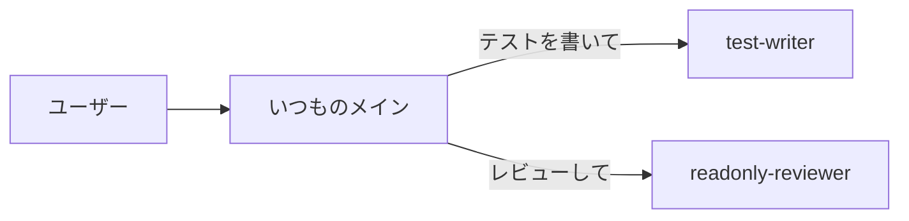

# 01 単体のエージェント

親子関係のない、一番シンプルな形です。いつものメインエージェントが、必要なときにこのエージェントへ仕事を任せます。ガイドの [00 の 3.2・3.4](../../docs/00_subagent-guide.md#3-サブエージェントはカスタマイズできるか) に対応します。

## 構成



| ファイル | 役割 | ポイント |
|---|---|---|
| `test-writer` | 単体テストを書いて実行する | `Bash` を与えてテストを実行させる。モデルは軽い haiku |
| `readonly-reviewer` | コードを読んで問題を指摘する | **書き込み系の道具を与えない**ので、ファイルを絶対に変更できない（3.4「強い制約」の例） |

## ファイル

```text
claude-code/.claude/agents/
├─ test-writer.md
└─ readonly-reviewer.md
copilot/.github/agents/
├─ test-writer.agent.md
└─ readonly-reviewer.agent.md
```

## 呼び方

| 方法 | Claude Code | Copilot |
|---|---|---|
| 自動 | `description` に合う依頼をすると、メインが自分で選ぶ | 同じ |
| 名指し | 「readonly-reviewer で src/ をレビューして」 | 同じ |
| 直接選ぶ | `@agent-readonly-reviewer` | チャット欄のエージェント選択で選ぶ |

## 2つの形式の違い

| | Claude Code | Copilot |
|---|---|---|
| 読み取り専用にする | `tools: Read, Grep, Glob` | `tools: ['read', 'search']` |
| テストを実行させる | `Bash` | `execute` |
