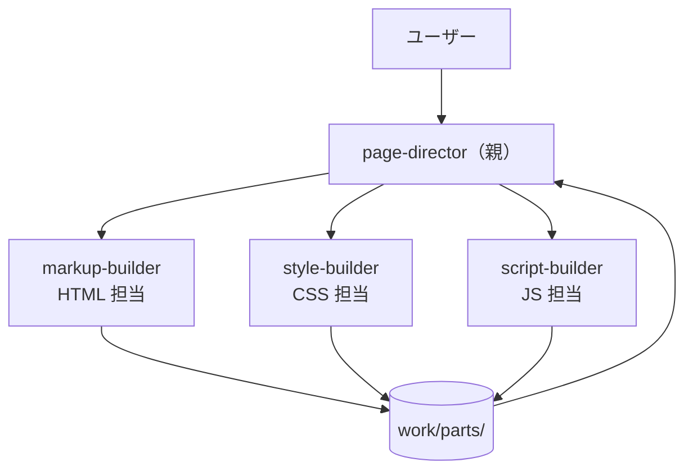

# 02 役割で分ける（親1 → 役割の違う子3）

親が設計し、**役割の違う**子3体（HTML / CSS / JS）に部品を作らせ、最後に統合・検品します。ガイドの [00 の 7章](../../docs/00_subagent-guide.md#7-実践親エージェント1体サブエージェント3体を作る) と [01 の 5章](../../docs/01_copilot-subagent-guide.md#5-実践copilot-版の親1体子3体) に対応します。

> このパターンのファイルは、ワークスペース直下の `.claude/agents/` と `.github/agents/` に置いた「すぐ使えるエージェント」と同じ内容です。

## 構成



| ファイル | 役割 | Claude Code のモデル | Copilot のモデル（例） |
|---|---|---|---|
| `page-director` | 親。設計書を書き、発注・検品・統合 | opus | Claude Opus 5.5 |
| `markup-builder` | `work/parts/body.html` だけを作る | sonnet | Claude Sonnet 5.5 |
| `style-builder` | `work/parts/style.css` だけを作る | sonnet | Gemini 4 Argon |
| `script-builder` | `work/parts/script.js` だけを作る | haiku | GPT-5.3-Codex |

## ファイル

```text
claude-code/.claude/agents/
├─ page-director.md
├─ markup-builder.md
├─ style-builder.md
└─ script-builder.md
copilot/.github/agents/
├─ page-director.agent.md
├─ markup-builder.agent.md
├─ style-builder.agent.md
└─ script-builder.agent.md
```

## 親子をつないでいる行

```yaml
# Claude Code（page-director.md）
tools: Agent(markup-builder, style-builder, script-builder), Read, Write, Edit, Glob, Grep

# Copilot（page-director.agent.md）
tools: ['agent', 'read', 'edit', 'search']
agents: ['markup-builder', 'style-builder', 'script-builder']
```

## 起動

| | 手順 |
|---|---|
| Claude Code | `claude --agent page-director` で起動し、「自己紹介ページを作って。名前は山田太郎、趣味は登山と写真」と頼む |
| Copilot（VS Code） | エージェント選択で `page-director` を選んで同じように頼む |
| Copilot（CLI） | `copilot --agent page-director --prompt "自己紹介ページを作って…"` |
