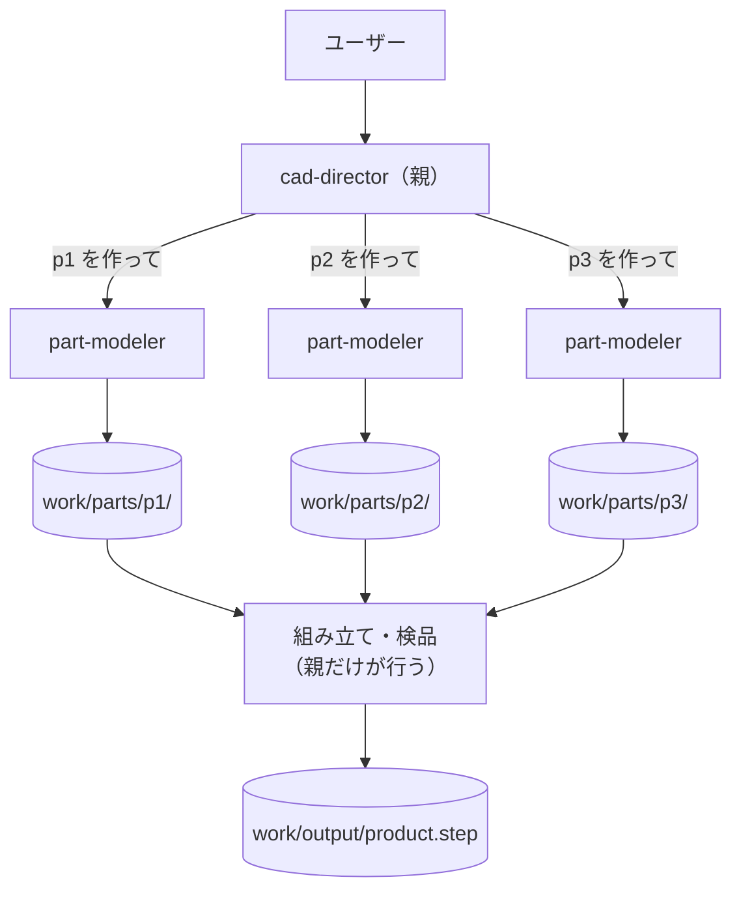
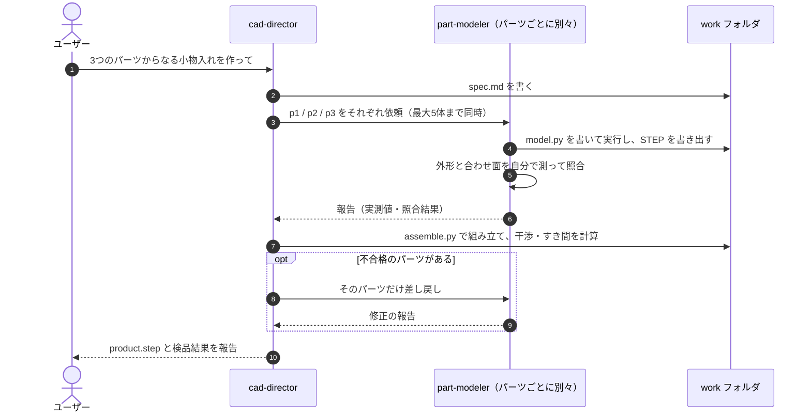

# 03 同じ仕事を並列に（ファンアウト）

親が製品をパーツに分け、**同じ定義の子（part-modeler）をパーツの数だけ呼んで**並列にモデリングさせ、最後に組み立てて数値で検品します。ガイドの [00 の 8.3〜8.6](../../docs/00_subagent-guide.md#8-応用似た作業を並列にする場合cad3d-の部品を組み立てる) に対応します。

## 02 との違い

| | 02 役割で分ける | 03 ファンアウト |
|---|---|---|
| 子の定義ファイル | 役割ごとに3ファイル | **1ファイル（part-modeler）を使い回す** |
| 子の区別 | ファイル（役割）で区別 | **依頼文のパーツ番号**で区別 |
| パーツが増えたら | ファイルを追加 | ファイルはそのまま。呼ぶ回数が増えるだけ |

## 構成



## ファイル

```text
claude-code/.claude/agents/
├─ cad-director.md      ← 親
└─ part-modeler.md      ← 子（1ファイルを N 回使う）
copilot/.github/agents/
├─ cad-director.agent.md
└─ part-modeler.agent.md
```

実行すると、次の作業フォルダができる想定です。

```text
work/
├─ spec.md                 ← 親が書く（共通ルール・占有範囲・合わせ面の表）
├─ parts/
│  ├─ p1/ model.py, p1.step
│  ├─ p2/ model.py, p2.step
│  └─ p3/ model.py, p3.step
├─ assembly/ assemble.py, report.md   ← 親が書く（組み立て・数値検品）
└─ output/ product.step
```

## 呼び出しの流れ



## 起動

| | 手順 |
|---|---|
| Claude Code | `claude --agent cad-director` で起動し、「本体・フタ・仕切りの3パーツからなる小物入れを作って。外形は 100×60×48 mm」のように頼む |
| Copilot（VS Code） | エージェント選択で `cad-director` を選んで同じように頼む |

## ポイント

- **子に `Bash`（Copilot は `execute`）を与えている**：子が自分でコードを実行して STEP を書き出し、寸法を測ってから報告するため。
- **GUI の CAD は子に触らせない**：子は別プロセスで動くコマンド（`python model.py`）だけを使う。共有の道具は親が最後に使う（ガイド 8.5）。
- **同時は最大5体**：6個以上は波に分けるよう、親の本文に書いてある。それ以上増えるなら 04 の階層化を検討する。

## 前提

- Python と [CadQuery](https://cadquery.readthedocs.io/) がインストールされていること（未インストールなら子がエラーを報告します）。
