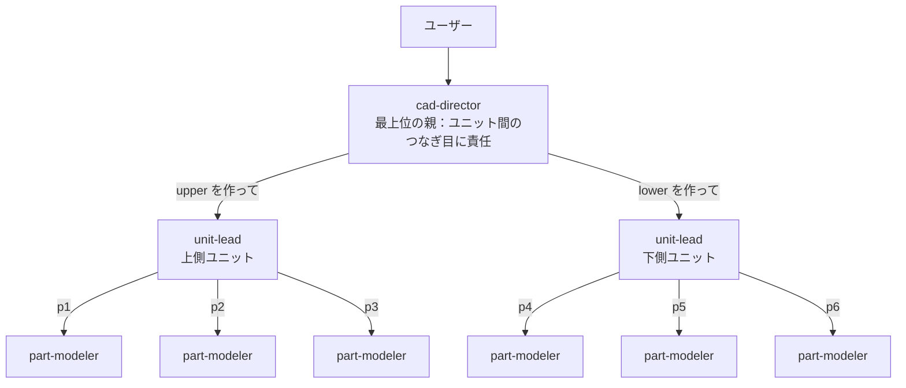

# 04 階層化（親 → 中間の親 → 職人）

パーツが多い製品を、ユニット（サブアセンブリ）ごとに**中間の親（unit-lead）**に任せる3段構えです。ガイドの [00 の 8.7](../../docs/00_subagent-guide.md#87-パーツが-5個10個に増えたらどうなるか) に対応します。

## 構成



**定義ファイルは3つだけ**です。unit-lead も part-modeler も1ファイルを使い回し、依頼文（ユニット名・パーツ番号）で担当を区別します。

| ファイル | 層 | 呼べる相手 | 検品する範囲 |
|---|---|---|---|
| `cad-director` | 最上位 | unit-lead だけ | **ユニット間**の合わせ面 |
| `unit-lead` | 中間 | part-modeler だけ | **ユニット内**の合わせ面 |
| `part-modeler` | 末端 | なし | 自分のパーツの寸法（自己照合） |

part-modeler は [03](../03-fan-out/) と同じファイルです。上位が cad-director でも unit-lead でも使えるように、「出力フォルダは依頼文で受け取る」書き方にしてあります。

## ファイル

```text
claude-code/.claude/agents/
├─ cad-director.md
├─ unit-lead.md
└─ part-modeler.md
copilot/
├─ .github/agents/
│  ├─ cad-director.agent.md
│  ├─ unit-lead.agent.md
│  └─ part-modeler.agent.md
└─ .vscode/settings.json     ← 入れ子を有効にする設定（Copilot だけ必要）
```

実行すると、次の作業フォルダができる想定です。

```text
work/
├─ spec.md                         ← 最上位の親が書く（ユニット一覧を含む）
├─ units/
│  ├─ upper/
│  │  ├─ parts/ p1/, p2/, p3/      ← part-modeler が書く
│  │  ├─ assemble_unit.py, unit.step  ← unit-lead が書く
│  └─ lower/
│     ├─ parts/ p4/, p5/, p6/
│     ├─ assemble_unit.py, unit.step
├─ assembly/ assemble.py, report.md   ← 最上位の親が書く
└─ output/ product.step
```

## 3段をつないでいる行

```yaml
# cad-director（最上位）
tools: Agent(unit-lead), Read, Write, Edit, Bash, Glob, Grep        # Claude Code
tools: ['agent', 'read', 'edit', 'search', 'execute']                # Copilot
agents: ['unit-lead']                                                # Copilot

# unit-lead（中間）
tools: Agent(part-modeler), Read, Write, Edit, Bash, Glob, Grep     # Claude Code
tools: ['agent', 'read', 'edit', 'search', 'execute']                # Copilot
agents: ['part-modeler']                                             # Copilot

# part-modeler（末端）… agent を持たないので、これより下は作れない
tools: Read, Write, Edit, Bash                                       # Claude Code
tools: ['read', 'edit', 'execute']                                   # Copilot
```

## 入れ子の制限（ここが一番の注意点）

| | Claude Code | Copilot（VS Code） | Copilot（CLI） |
|---|---|---|---|
| 入れ子（子が孫を呼ぶ） | 既定で可（メインから3階層下まで） | **既定で不可**。`.vscode/settings.json` の `chat.subagents.allowInvocationsFromSubagents` を `true` にする（最大5階層） | 公式ページで未確認 |
| 中間層の「呼べる相手の限定」 | unit-lead はサブエージェントとして動くので、`Agent(part-modeler)` のカッコ内は**無視される**。本文の禁止事項で縛る | `agents: ['part-modeler']` で限定 | 未確認 |

階層の数え方（Claude Code）：

| 起動のしかた | cad-director | unit-lead | part-modeler | 既定の上限（3）に収まるか |
|---|---|---|---|---|
| `claude --agent cad-director` | メイン | 1階層目 | 2階層目 | ○ |
| いつもの会話から `@agent-cad-director` | 1階層目 | 2階層目 | 3階層目 | ○（ぎりぎり） |

同時に動く数（例：2ユニット × 3パーツ）：unit-lead 2体 ＋ part-modeler 6体 ＝ 8体。Claude Code の既定の同時上限（20体）には収まります。

出典：[Claude Code Docs「Subagents」](https://code.claude.com/docs/en/sub-agents)（検索語：`Let subagents spawn their own subagents`、`Concurrent subagent limit`）、[VS Code Docs「Subagents」](https://code.visualstudio.com/docs/agents/run/subagents)（検索語：`allowInvocationsFromSubagents`）

## 起動

| | 手順 |
|---|---|
| Claude Code | `claude --agent cad-director` で起動し、「上側ユニット（3パーツ）と下側ユニット（3パーツ）からなる卓上ラックを作って」のように頼む |
| Copilot（VS Code） | `.vscode/settings.json` の設定が効いていることを確認してから、エージェント選択で `cad-director` を選んで頼む |

## 前提

- Python と [CadQuery](https://cadquery.readthedocs.io/) がインストールされていること。
