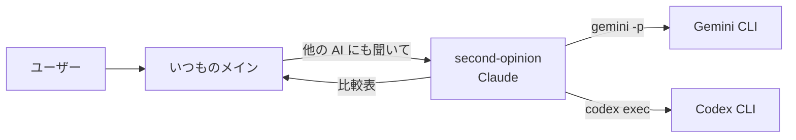

# 05 他社 AI に意見を聞く（Claude Code 用）

Claude Code のサブエージェントに、他社 AI の CLI（Gemini CLI / Codex CLI）を実行させて「セカンドオピニオン」を取る形です。ガイドの [00 の 4章②](../../docs/00_subagent-guide.md#4-別の-ai他社モデルは使えるか) に対応します。

> **Copilot 版はありません。** Copilot では `model:` に Gemini や GPT などを直接指定できるので、CLI を経由する必要がないためです（[01 の 4章](../../docs/01_copilot-subagent-guide.md#4-モデルの選択肢は広がるか)）。

## 構成



## ファイル

```text
claude-code/.claude/agents/
└─ second-opinion.md
```

## ポイント

- **書き込み系の道具を与えていない**（`tools: Read, Grep, Glob, Bash`）。ファイルは変更せず、意見の比較表だけを返す。
- **`Bash` は何でも実行できてしまう**ので、本文で「他社 AI の CLI 以外は実行しない」と縛っている。より確実にしたい場合は、Claude Code の権限設定（`settings.json` の `permissions`）で実行できるコマンドを絞る。
- **社外に情報を送ることになる**：他社 AI に渡した内容は、その会社のサービスに送信される。会社の規程を確認し、秘密情報を送らないこと（本文にも禁止事項として書いてある）。

## 前提

- Gemini CLI（`gemini` コマンド）か Codex CLI（`codex` コマンド）のどちらかがインストール・ログイン済みであること。
- 非対話で使うコマンドの形（`gemini -p "…"`、`codex exec "…"`）は各 CLI のバージョンで変わる可能性があります。動かない場合は各 CLI のヘルプ（`--help`）で確認してください（**このサンプルでは未検証**）。
