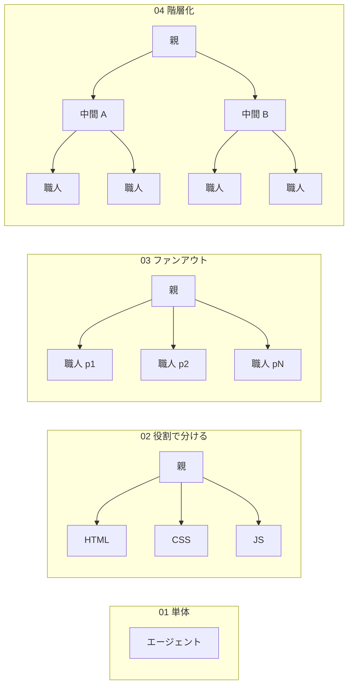

# エージェント定義ファイルのサンプル集

ガイド（[00_subagent-guide.md](../docs/00_subagent-guide.md)、[01_copilot-subagent-guide.md](../docs/01_copilot-subagent-guide.md)）に出てきたエージェント構成を、**そのまま読める・コピーして使える定義ファイル**としてまとめた置き場です。

> ワークスペース直下の [.claude/agents/](../.claude/agents/) と [.github/agents/](../.github/agents/) は「このワークスペースですぐ使えるエージェント」です。こちらの `samples/` は「構成と書き方を見比べるための見本」で、普段は読み込まれません（使い方は下記）。

## パターン一覧

| # | パターン | 構成 | ガイドの該当箇所 | Claude Code | Copilot |
|---|---|---|---|---|---|
| 01 | [単体のエージェント](01-single-agent/) | 子1体（親子なし） | 00 の 3.2、3.4 | ○ | ○ |
| 02 | [役割で分ける](02-role-split/) | 親1 → 役割の違う子3 | 00 の 7章、01 の 5章 | ○ | ○ |
| 03 | [同じ仕事を並列に（ファンアウト）](03-fan-out/) | 親1 → 同じ子 × N | 00 の 8.3〜8.6 | ○ | ○ |
| 04 | [階層化（中間層あり）](04-hierarchical/) | 親1 → 中間の親 × ユニット数 → 同じ子 × N | 00 の 8.7 | ○ | ○ |
| 05 | [他社 AI に意見を聞く](05-other-ai-cli/) | 子1体が他社 AI の CLI を呼ぶ | 00 の 4章② | ○ | —（※） |

※ Copilot では `model` に他社モデルを直接指定できるため、このパターンは不要です（01 の 4章）。



## フォルダの見方

各パターンは同じ形になっています。

```text
samples/<パターン>/
├─ README.md                  ← 構成図・呼び出しの流れ・起動方法
├─ claude-code/
│  └─ .claude/agents/*.md     ← Claude Code 形式
└─ copilot/
   ├─ .github/agents/*.agent.md  ← GitHub Copilot 形式
   └─ .vscode/settings.json      ← 必要なパターンだけ（04）
```

`claude-code/` と `copilot/` の中身は**同じ構成を2つの形式で書いたもの**です。並べて見ると、書き方の違い（3つ）が分かります。

| 違い | Claude Code | Copilot |
|---|---|---|
| 呼べる子の指定 | `tools: Agent(子1, 子2), …` | `tools: ['agent', …]` ＋ `agents: ['子1', '子2']` |
| モデル | `model: sonnet` | `model: Claude Sonnet 5.5 (copilot)` など（補完候補で確認） |
| 親からだけ呼ばれる子 | `description` に書いて名指し運用 | `user-invocable: false` で一覧から隠す |

## 使い方

### Claude Code

- **その場で試す**：パターンの `claude-code/` フォルダに移動して起動します。そのフォルダの `.claude/agents/` が読み込まれます。

  ```bash
  cd samples/03-fan-out/claude-code
  claude --agent cad-director
  ```

- **自分のプロジェクトで使う**：`claude-code/.claude/agents/` の中のファイルを、プロジェクトの `.claude/agents/` にコピーします。

### GitHub Copilot

- **その場で試す**：パターンの `copilot/` フォルダを VS Code で開きます（`code samples/04-hierarchical/copilot`）。VS Code は開いたフォルダ直下の `.github/agents/` を読み込みます。
- **会社のリポジトリで使う**：`copilot/.github/agents/` の中のファイルをリポジトリの `.github/agents/` に、`.vscode/settings.json` があればその設定も、コピーします。
- `model:` の値は会社で有効なモデルに合わせて書き換えてください（エディタで `model:` の補完候補を確認）。

## 注意

- どのサンプルも**書き方の見本**です。このワークスペースで最後まで実行して動作確認したものではありません。
- 03・04 は Python と [CadQuery](https://cadquery.readthedocs.io/) が入っている前提です。05 は Gemini CLI か Codex CLI が入っている前提です。
