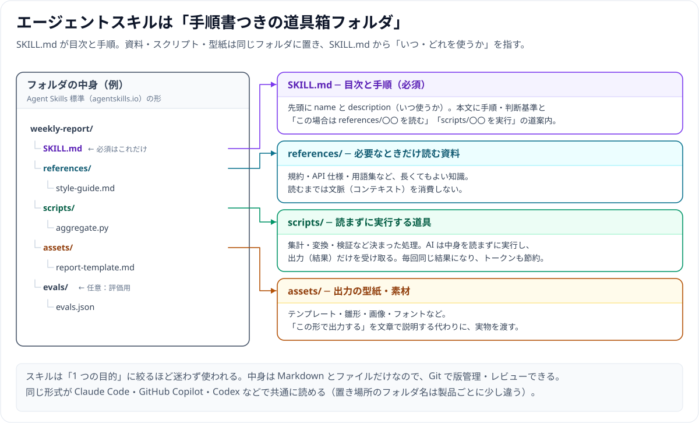
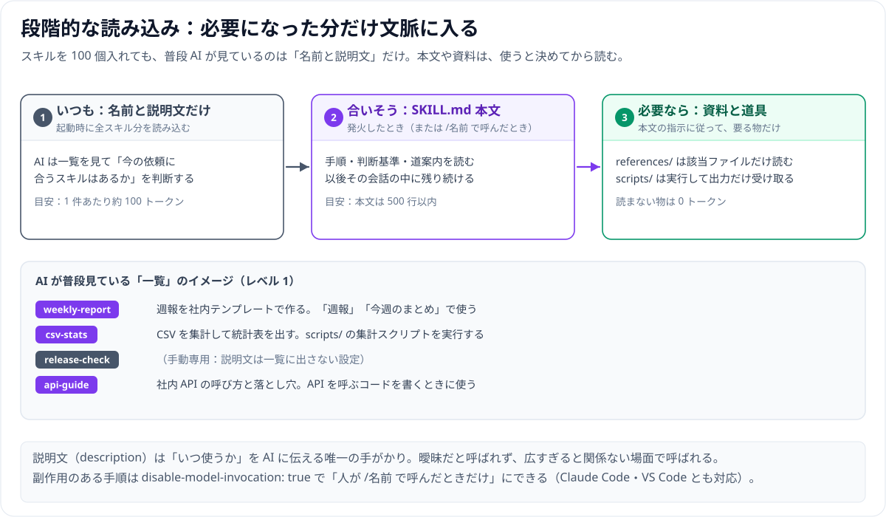
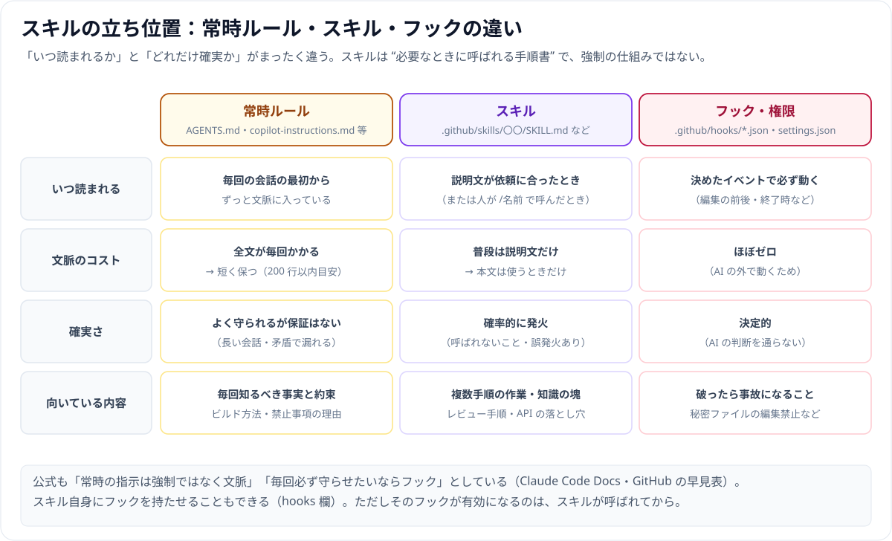
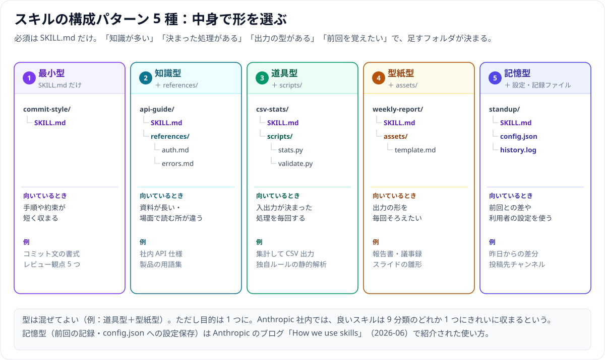
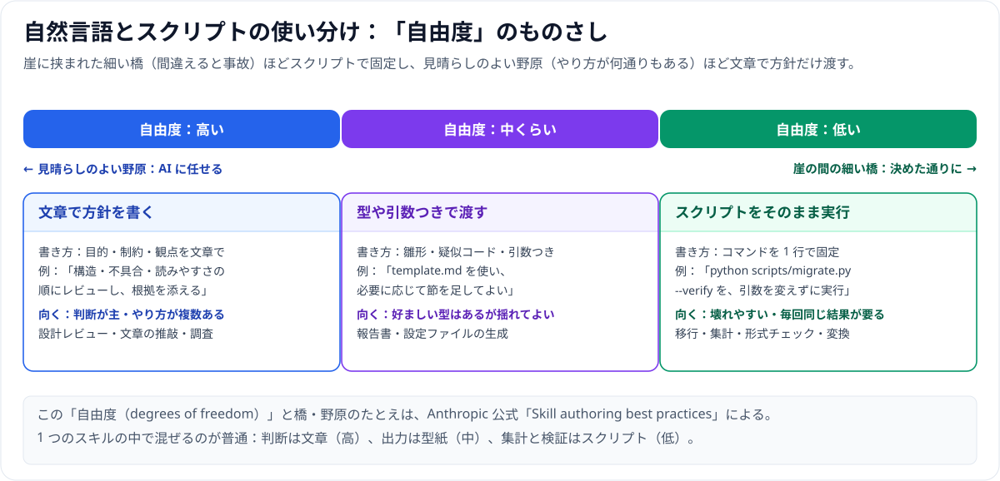
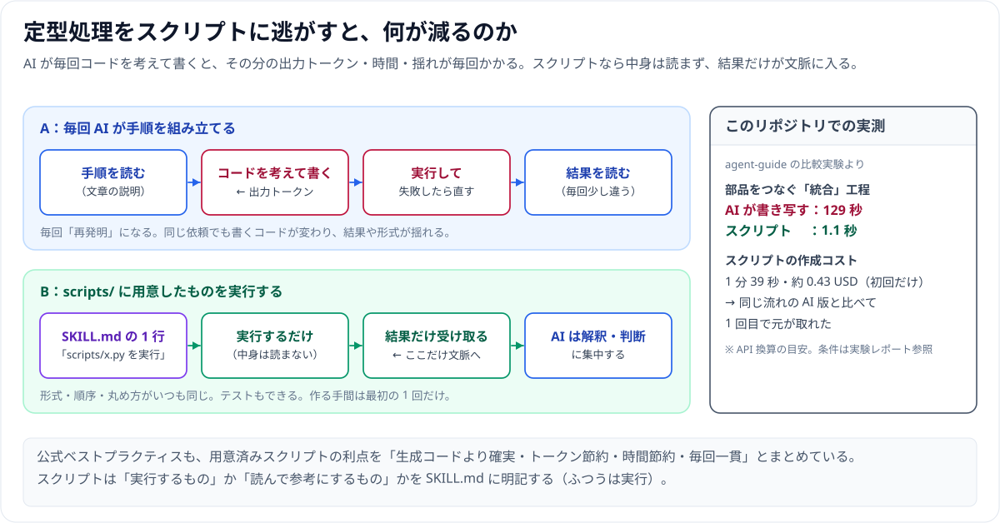
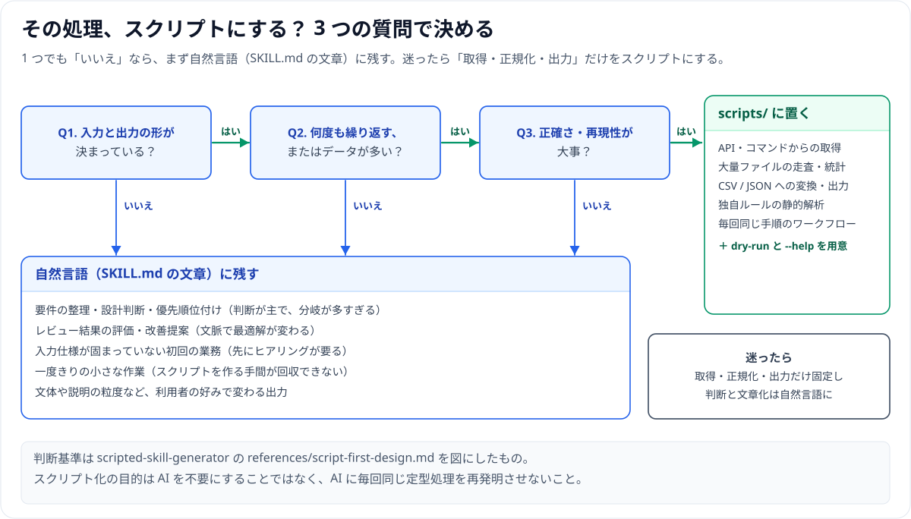
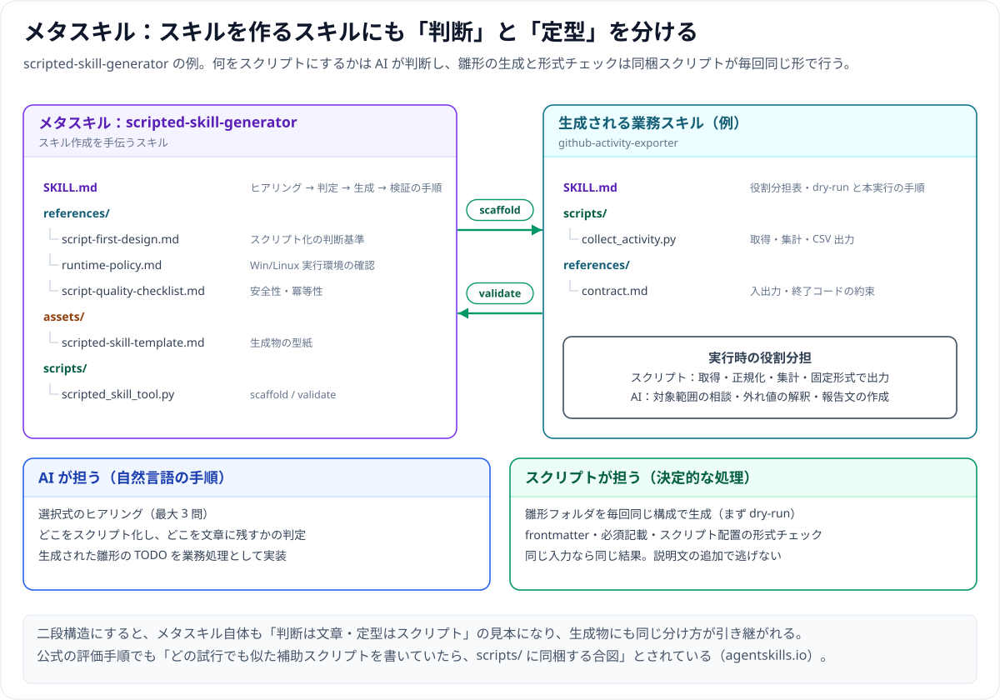

# 00 エージェントスキルの基本 — 何者で、どう組み立てるか

エージェントスキル（Agent Skills）を、人に説明するときにそのまま使える形でまとめた基礎編です。「スキルとは何か」「どんな構成が取れるか」「自然言語とスクリプトをどう使い分けるか」「スキルを作るスキル（メタスキル）をどう分けるか」を、図を中心に整理します。

> **30 秒でわかる要点**
> 1. スキルは **SKILL.md を目次にした“手順書つきの道具箱フォルダ”**。資料（references）・道具（scripts）・型紙（assets）を同じフォルダに置き、SKILL.md から「いつ・どれを使うか」を指す。
> 2. AI が普段見ているのは**名前と説明文だけ**。本文や資料は「使う」と決めてから読む（段階的な読み込み）。だから説明文が発火のすべてを決める。
> 3. **判断は文章、定型はスクリプト**。決まった処理をスクリプトにすると、毎回の再発明（出力トークン・時間・結果の揺れ）が消える。
> 4. スキルは**強制の仕組みではない**。「毎回必ず」はフック・権限で行う（[02](02_layered-rules.md) で詳しく）。

---

## 1. エージェントスキルとは

| 部品 | 役割 | 文脈（コンテキスト）への入り方 |
|---|---|---|
| **SKILL.md**（必須） | 先頭の `name` と `description`（いつ使うか）＋本文（手順・判断基準・道案内） | 名前と説明文は常に。本文は使うときだけ |
| **references/** | 規約・API 仕様・用語集など、長くてもよい資料 | 本文の指示で、必要なファイルだけ読む |
| **scripts/** | 集計・変換・検証など決まった処理 | **中身は読まずに実行**し、出力だけが入る |
| **assets/** | テンプレート・雛形・画像 | 出力を作るときに使う |
| **evals/**（任意） | 評価用の試験ケース | 開発・改善のときだけ使う（[01](01_skill-management-loop.md) 参照） |

- 形式は **Agent Skills というオープン標準**（[agentskills.io](https://agentskills.io)、2025-12 に Anthropic が公開）です。同じ SKILL.md を Claude Code・GitHub Copilot・Codex などが読めます。置き場所のフォルダ名だけが製品ごとに少し違います（表は [02 の 6 章](02_layered-rules.md#6-claude-code-と-github-copilot-の対応)）。
- 標準で決まっている frontmatter は `name`・`description`・`license`・`compatibility`・`metadata`・`allowed-tools` です。製品ごとに独自の欄もあります。

| 欄 | Claude Code | VS Code の Copilot | 意味 |
|---|---|---|---|
| `disable-model-invocation` | ○ | ○ | 自動では呼ばれず、`/名前` のときだけ |
| `user-invocable` | ○ | ○ | `false` で `/` メニューに出さない（自動だけ） |
| `argument-hint` | ○ | ○ | `/名前` のときの引数のヒント |
| `context: fork` | ○ | ○（実験的） | サブエージェントで実行 |
| `paths` | ○ | — | 対象ファイルで自動発火を限定 |
| `hooks`・`model`・`effort` など | ○ | — | スキル実行中だけのフック・モデル・思考量 |

  **独自欄は対応していない製品では無視される**か、claude.ai へのアップロードではエラーになります。共有するスキルでは、独自欄に頼らなくても動く書き方（説明文に対象と除外を書くなど）にしておきます。

### 段階的な読み込み（progressive disclosure）

Anthropic はこれを「Agent Skills を柔軟で拡張しやすくしている中心の設計原則」と呼んでいます。スキルを何十個入れても普段の負担は説明文の分だけで、本文や資料は使うときにだけ読まれます。

### 常時ルール・スキル・フックの違い

スキルを説明するときに一番誤解されやすいのがここです。**スキルは「必要なときに呼ばれる手順書」で、毎回必ず効くルールではありません**。「最初は守ったのに途中から守らない」「呼んでほしいのに呼ばれない」は、ほとんどがこの性質から来ます。

---

## 2. どういう構成が取れるか

| 型 | 足すもの | 使いどころ |
|---|---|---|
| ① 最小型 | なし（SKILL.md だけ） | 約束や手順が短く収まる |
| ② 知識型 | `references/` | 資料が長い、場面ごとに読む所が違う（例：`references/finance.md`・`sales.md` を分け、必要な方だけ読む） |
| ③ 道具型 | `scripts/` | 入出力が決まった処理を毎回する |
| ④ 型紙型 | `assets/` | 出力の形を毎回そろえたい |
| ⑤ 記憶型 | `config.json`・ログ | 利用者ごとの設定や、前回との差を使う（例：投稿先チャンネルを初回に聞いて保存、昨日の記録との差分） |

作るときのコツ（公式の推奨と Anthropic 社内の経験から）：

- **1 スキル 1 目的**。Anthropic 社内の数百のスキルを分類すると 9 つの型（ライブラリ・API の参照／製品の動作検証／データ取得・分析／業務の自動化／雛形生成／品質・レビュー／CI・デプロイ／障害対応手順書／インフラ運用）に分かれ、**良いスキルはそのどれか 1 つにきれいに収まる**そうです。
- **分かりきったことは書かない**。AI が既に知っていることではなく、「この現場ではこうする」「ここで間違えやすい」を書く。特に**落とし穴（Gotchas）の節が最も情報密度が高い**とされています。
- **本文は 500 行以内**、資料へのリンクは **SKILL.md から 1 階層まで**（資料から資料へたどらせると、途中までしか読まないことがある）。
- **説明文は AI 向けに、三人称で、「何をするか」＋「いつ使うか」**。「いろいろ便利なツール」ではなく「PR がマージされるまで見張る。『見ていて』『CI を見て』で使う」のように具体的に。
- **手順を一歩ずつ縛りすぎない**。目的と制約を書き、やり方は AI に任せる部分を残す（次の章の「自由度」）。

---

## 3. 自然言語とスクリプトの使い分け

### 自由度のものさし

公式ベストプラクティスのたとえがわかりやすいです。**見晴らしのよい野原**（どの道を通っても着く）なら方針だけ渡して AI に任せ、**崖に挟まれた細い橋**（一歩間違えると落ちる）なら決まった手順を固定して渡します。1 つのスキルの中で混ぜるのが普通です。

| 自由度 | 書き方 | 例 |
|---|---|---|
| 高い | 文章で目的・観点を書く | 設計レビュー、文章の推敲 |
| 中くらい | 雛形・疑似コード・引数つきの手順 | 報告書、設定ファイルの生成 |
| 低い | スクリプトをそのまま実行させる | DB 移行、集計、形式チェック |

### スクリプトにすると何が減るか

- AI に毎回コードを考えさせると、**出力トークン・時間・結果の揺れ**が毎回かかります。スクリプトなら AI は中身を読まずに実行し、**出力だけ**を受け取ります。
- このリポジトリの実験でも、AI に部品を書き写させていた「統合」工程をスクリプトにしたら **129 秒 → 1.1 秒**になり、スクリプトの作成コスト（1 分 39 秒・約 0.43 USD、API 換算の目安）は**同じ流れの AI 版と比べて 1 回目で回収**できました（[実測レポート](../agent-guide/output/report_01-profile.md)）。
- 公式も、用意済みスクリプトの利点を「生成コードより確実」「トークン節約」「時間節約」「毎回一貫」とまとめています。SKILL.md には、そのスクリプトを**実行する**のか**読んで参考にする**のかを明記します（ふつうは実行）。

### 3 つの質問で決める

スクリプト化しない方がよいもの（判断が主、仕様が未確定、一度きり、好みで変わる出力）を無理にスクリプトにすると、分岐だらけで壊れやすい道具になります。**迷ったら「取得・正規化・出力」だけを固定し、判断と文章化は自然言語に残す**のが安全です。

---

## 4. メタスキル：スキルを作るスキルにも「判断」と「定型」を分ける

`turtle-skills-neo` の **scripted-skill-generator** は、この考え方をスキル作成そのものに当てはめた良い例です。

| 層 | 担当 | 中身 |
|---|---|---|
| メタスキルの SKILL.md（自然言語） | AI | 選択式ヒアリング（1 回最大 3 問）→ スクリプト化する範囲の判定 → 実行環境の確認 → 雛形生成 → 実装 → 検証、の流れ |
| メタスキルの references/ | AI が必要時に読む | `script-first-design.md`（判断基準）・`runtime-policy.md`（Windows/Linux）・`script-quality-checklist.md`（安全性・冪等性） |
| メタスキルの scripts/ | スクリプト | `scripted_skill_tool.py scaffold`（雛形を毎回同じ構成で生成。まず dry-run、`--apply` で作成）・`validate`（形式チェック） |
| 生成される業務スキル | 両方 | 「AI が判断すること」と「スクリプトが処理すること」の役割分担表を SKILL.md に持つ |

**この分け方が効く理由**：

1. **生成物の形がぶれない**。雛形と形式チェックがスクリプトなので、何十個スキルを作っても同じ構成・同じ必須記載になり、あとで一括点検・一括更新ができます。
2. **AI は判断に集中できる**。「どこをスクリプト化するか」「何を聞くか」だけを考えればよく、ファイル作成の手順を毎回組み立て直さない。
3. **分け方が生成物に引き継がれる**。メタスキル自身が「判断は文章・定型はスクリプト」の見本になっているので、作られる業務スキルも同じ構造になります。
4. 公式の評価手順にも「どの試行でも似た補助スクリプトを書いていたら、それは `scripts/` に同梱すべき合図」とあり、方向性は一致しています。

**さらに良くするなら**（小さな提案）：

- **生成する業務スキルに `evals/evals.json` の雛形も含める**。作った直後から「スキルあり／なし」で比べられるようになります（[01 の評価ループ](01_skill-management-loop.md#3-測る評価ループ)）。
- **副作用のある業務スキル**（書き込み・外部送信・同期など）は、生成時に `disable-model-invocation: true`（Claude Code の場合）を選べるようにする。自動発火による事故と、説明文どうしの競合が減ります。
- スクリプトに安全の約束（「勝手にインストールしない」など）を書いたら、**実装が本当にそうなっているか**を validate で機械的に確かめる（同スキルの quality-checklist にある「主張と実装の一致」をスクリプト側でも検査する）。

---

## 5. 基本で見落としやすいこと（チェックリスト）

「基本はわかっている」人でも見落としやすい、**製品に関係なく共通の点**です。製品ごとの数値や仕様（一覧の文字数、圧縮後の扱い、同名スキルの優先順など）は、[Claude Code 編の 8 章](claude/01_claude-code-setup.md#8-見落としやすい点claude-code)と [Copilot 編の 8 章](copilot/01_copilot-setup.md#8-見落としやすい点copilot)にまとめました。

- [ ] **発火は確率的**。説明文が曖昧だと呼ばれず、広すぎると関係ない場面で呼ばれる。「何をするか＋いつ使うか（＋使わない場面）」を具体的に。
- [ ] **「毎回必ず」はスキルでは保証できない**。必須ルールはフック・権限・PR の必須チェックへ。
- [ ] **副作用のある手順は手動専用に**（`disable-model-invocation: true`。Claude Code・VS Code の Copilot とも対応）。
- [ ] **同じ名前のスキルがあると片方しか使われない**。どちらが勝つかは製品で逆（Claude Code は個人が、Copilot CLI はプロジェクトが優先）なので、共有スキルと個人スキルの名前を重ねない。
- [ ] **スキルが増えるほど一覧が重くなる**。使われないスキルは棚卸しで外す（[shared/skill-catalog](shared/README.md)）。
- [ ] **重要な指示は SKILL.md の上の方に**。長い会話の圧縮や途中までの読み込みで、後ろの方は落ちることがある。
- [ ] **スクリプトのパスは `/` 区切り**で書く（Windows でも）。
- [ ] **人が作ったスキルは実行される**。外から持ってきたスキルは、スクリプトと参照先 URL まで読んでから入れる。
- [ ] **モデルが変わったら試し直す**。小さいモデルで足りない説明が、大きいモデルでは冗長、ということがある。
- [ ] **記事の日付を見る**。スキルやフックは 2025 年後半〜2026 年に出そろった新しい仕組みで、制約も変わっている（[04 の年表](04_instruction-limits-and-timeline.md)）。

---

## 参考にした一次情報

出典の要点と確認日は [info/README.md](info/README.md) にまとめています。主なもの：

- Anthropic Engineering「Equipping agents for the real world with Agent Skills」（2025-10-16）
- Claude Docs「Skill authoring best practices」／Claude Code Docs「Extend Claude with skills」「Extend Claude Code」
- Claude Blog「Lessons from building Claude Code: How we use skills」（2026-06-03）
- agentskills.io（Agent Skills 標準）

次は [01 スキルの管理と改善ループ](01_skill-management-loop.md) へ。
