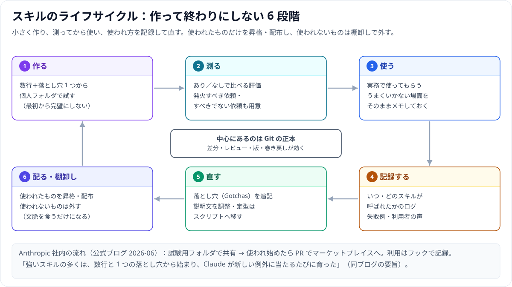
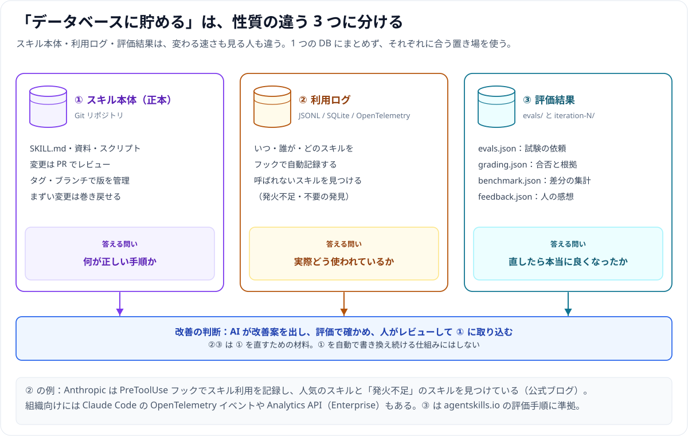
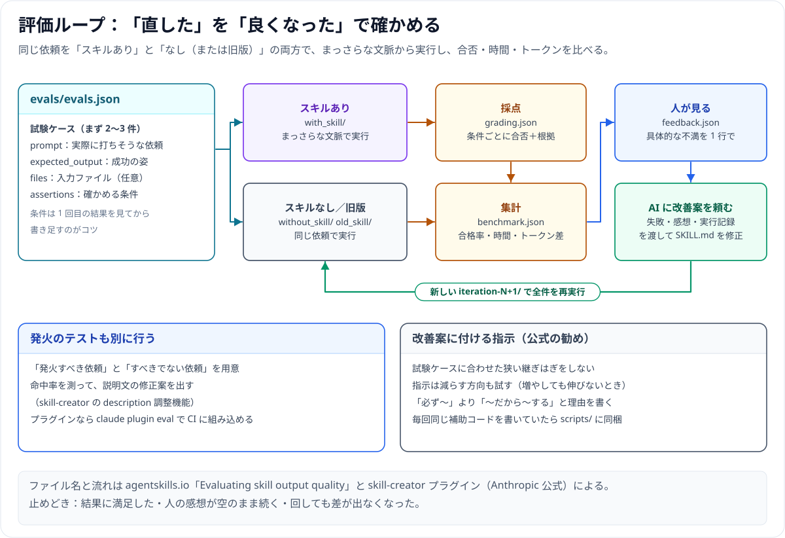
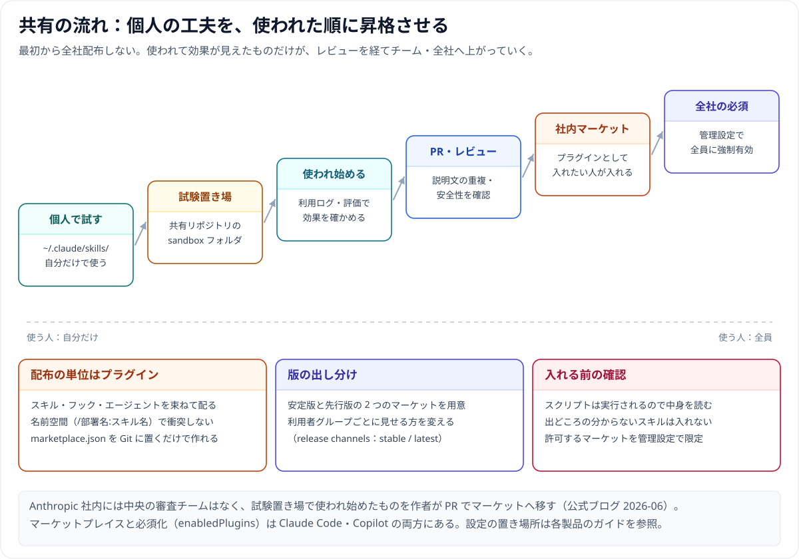
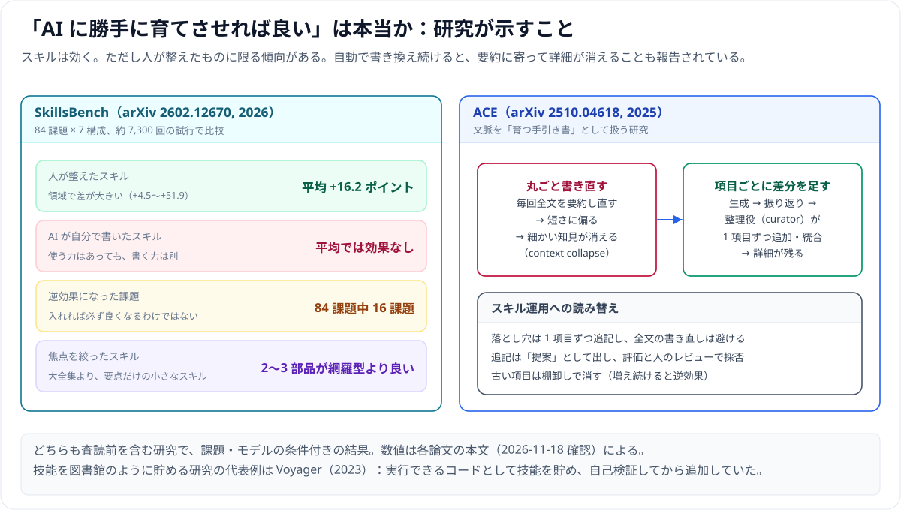
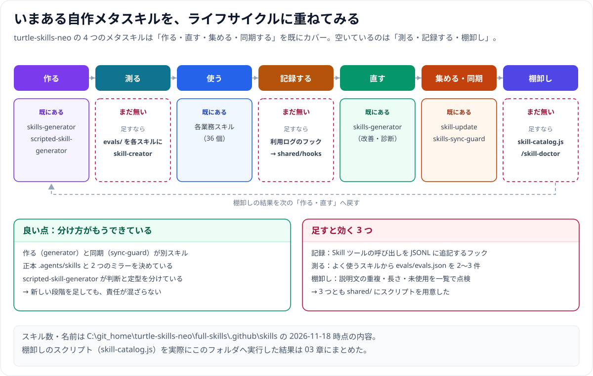

# 01 スキルの管理と改善ループ — 貯めて、回して、共有する

スキルが増えてきたときに「どこに貯め、どう測り、どう直し、どう共有するか」を、**出どころを確かめた事例**から整理します。結論を先に言うと、公式や実績のある事例はどれも「**AI が提案し、評価で確かめ、人が採用する**」形で、AI に勝手に書き換え続けさせる形ではありません。

> **30 秒でわかる要点**
> 1. ライフサイクルは **作る → 測る → 使う → 記録する → 直す → 配る・棚卸し** の 6 段階。最初は「数行＋落とし穴 1 つ」でよい。
> 2. 「データベースに貯める」は **3 つに分ける**：スキル本体は **Git**、利用状況は **ログ（JSONL・SQLite・OpenTelemetry）**、改善の効果は **評価結果（evals/）**。
> 3. 共有は**使われた順に昇格**：個人 → 試験置き場 → PR レビュー → 社内マーケットプレイス（プラグイン）→ 必要なら全社必須。
> 4. 研究では「**人が整えたスキルは効くが、AI が自分で書いたスキルは平均で効果なし**」という結果も出ている。自動ループには評価と人のレビューを必ず挟む。

---

## 1. 全体像：スキルのライフサイクル

| 段階 | やること | 道具（公式・本リポジトリのサンプル） |
|---|---|---|
| 1 作る | 数行＋落とし穴 1 つから。個人フォルダで試す | skill-creator、各自のメタスキル |
| 2 測る | 「スキルあり／なし（旧版）」を同じ依頼で比べる。発火すべき依頼・すべきでない依頼も試す | `evals/evals.json`（共通の形式）、Claude Code は skill-creator・`claude plugin eval` |
| 3 使う | 実務で使う。うまくいかない場面をメモ | — |
| 4 記録する | いつ・どのスキルが・どう呼ばれたかを自動で残す | 利用ログのフック（[shared/hooks](shared/hooks/log-skill-usage.js)。設定は [Claude Code](claude/samples/02-skill-usage-log/README.md)・[Copilot](copilot/samples/02-skill-usage-log/README.md)） |
| 5 直す | 落とし穴を 1 項目ずつ追記、説明文を調整、毎回の定型はスクリプトへ | 評価結果＋人の感想を AI に渡して改善案を出させる |
| 6 配る・棚卸し | 使われたものを昇格・配布、使われないものを外す | プラグイン・マーケットプレイス（両製品）、[skill-catalog.js](shared/README.md)、Claude Code は `/skill-doctor` |

Anthropic の Claude Code チームは「強いスキルの多くは数行と 1 つの落とし穴から始まり、Claude が新しい例外に当たるたびに育った」と書いています（公式ブログ 2026-06-03）。**最初から完璧な大全集を作らない**のが出発点です。

---

## 2. 貯める：3 つの保管庫に分ける

「スキルをデータベースに保存して改善ループを回す」を実際にやると、性質の違う 3 種類のデータが出てきます。

| 保管庫 | 置き場所 | 中身 | 答える問い |
|---|---|---|---|
| ① スキル本体（正本） | Git リポジトリ | SKILL.md・資料・スクリプト | 何が正しい手順か |
| ② 利用ログ | JSONL（1 行 1 件の追記ログ） / SQLite / OpenTelemetry（外部の監視基盤へ送る標準計測） | いつ・どのスキルが・AI か人か | 実際どう使われているか（呼ばれないスキルは？） |
| ③ 評価結果 | `evals/`・`iteration-N/` | 試験ケース・合否・差分・人の感想 | 直したら本当に良くなったか |

- **① を RDB などに入れる必要はありません**。スキルはテキストとファイルなので、Git の差分・レビュー・タグ・巻き戻しがそのまま管理機能になります。Anthropic 社内もリポジトリとマーケットプレイス（＝Git）で管理しています。
- **② は自動で集める**。Anthropic は `PreToolUse` フックでスキル利用を記録し、「人気のスキル」と「期待より呼ばれていないスキル（undertriggering＝発火不足）」を見つけています。Claude Code なら OpenTelemetry イベントや Enterprise の Analytics API も使えます。Copilot のフック資料にはスキル専用のツール名が無いため、SKILL.md の読み取りで推定します（[Copilot 編 7 章](copilot/01_copilot-setup.md#7-利用ログと評価)）。
- スキル自身に**状態を持たせる**こともできます（前回の記録をログや JSON、SQLite に残し、次回は差分だけを見る）。これは「スキルの利用者データ」で、①〜③ とは別物として扱います。
- **依頼文そのものはログに残さない**のがおすすめです。個人情報や機密が混ざるうえ、改善に必要なのは「どのスキルが・いつ・どう呼ばれたか」で足ります（[shared/hooks](shared/hooks/log-skill-usage.js) のフックもそうしています）。

---

## 3. 測る：評価ループ

agentskills.io（Agent Skills 標準のサイト）と Anthropic の skill-creator が示す手順です。評価で使う主なファイルは 4 つあり、順に使っていきます（書き方の実例：[evals.json サンプル](shared/skill-catalog/demo-skills/meeting-minutes/evals/evals.json)）。

| ファイル | 役割 |
|---|---|
| `evals.json` | 試す依頼と期待する合格条件のリスト |
| `grading.json` | 条件ごとの合否と根拠の採点結果 |
| `benchmark.json` | 「あり／なし」の合格率・時間・トークンの集計表 |
| `feedback.json` | 出力を見た人の具体的な改善コメント |

1. **試験ケースを 2〜3 件**、`evals/evals.json` に書く（`prompt`・`expected_output`・`files`）。言い回しやくだけ具合を変え、境界の例も 1 つ入れる。
2. 各ケースを**スキルあり**と**スキルなし（改善時は旧版のコピー）**で、**まっさらな文脈**から実行する（サブエージェントや別セッション）。スキルを作った会話の続きで試すと、会話に残った前提が穴を隠してしまう。
3. 1 回目の結果を見てから**確かめる条件（assertions）**を書き足し、`grading.json` に合否と**根拠**を残す。機械で確かめられる条件（JSON として正しい、行数など）はスクリプトで採点する。
4. `benchmark.json` に**合格率・時間・トークンの差**を集計する。「+50 ポイントで 13 秒増」なら採用、「トークン 2 倍で +2 ポイント」なら見送り、と判断できる。
5. **人が出力を見て** `feedback.json` に具体的な不満を 1 行で書く（「軸ラベルがない」は良い、「見栄えが悪い」は直せない）。
6. 失敗した条件・人の感想・実行記録と現在の SKILL.md を AI に渡して**改善案を出させ**、人が確認して取り込み、`iteration-N+1/` で全件をやり直す。

改善案を出させるときの公式の注意：**試験ケースに合わせた狭い継ぎはぎをしない**／**指示を減らす方向も試す**（増やしても伸びないなら縛りすぎ）／**「必ず〜」より理由を書く**／**毎回同じ補助コードを書いていたら scripts/ に同梱**。止めどきは「満足した」「人の感想が空のまま続く」「回しても差が出ない」。

**発火のテストは別に行います**。Claude Code の skill-creator は「発火すべき依頼」「すべきでない依頼」を作って命中率を測り、説明文の修正案を出します。プラグインとして配るスキルなら `claude plugin eval` で「プラグインあり／なし」を比べ、しきい値を下回ったら CI を失敗させることもできます。Anthropic はこの仕組みを自社の文書作成系の公開スキルに使い、6 つのうち 5 つで発火が改善したと報告しています。

---

## 4. 共有する：使われた順に昇格させる

**Anthropic 社内のやり方**（公式ブログ「How we use skills」2026-06-03）：

- 小さなチーム・少数のリポジトリでは、リポジトリのスキルフォルダにコミットして共有。
- 規模が大きくなったら**社内のプラグインマーケットプレイス**へ。理由は、リポジトリに入れたスキルは全員の文脈を少しずつ消費するので、「入れたい人が入れる」形にしたいから。
- **中央の審査チームはない**。作者が GitHub の試験用フォルダに置き、Slack などで紹介し、**使われ始めたら PR でマーケットプレイスへ移す**。

**仕組みとしての受け皿**（両製品とも「プラグイン＋マーケットプレイス」がある）：

| やりたいこと | Claude Code | GitHub Copilot |
|---|---|---|
| チームのカタログ | `.claude-plugin/marketplace.json`（Git） | `.github/plugin/marketplace.json`（Git。Claude 形式も読める） |
| リポジトリの既定にする | `.claude/settings.json` の `extraKnownMarketplaces`・`enabledPlugins` | `.github/copilot/settings.json` の `enabledPlugins`（利用者は外せる） |
| 全社・部署で必須にする | 管理設定の `enabledPlugins`（利用者は外せない） | エンタープライズの管理設定。エンタープライズ チームごとにも追加できる |
| 出どころを限定する | `strictKnownMarketplaces`・`blockedMarketplaces` | 管理設定でマーケットを不許可にできる |
| スキル単体で配る | claude.ai の組織配布（既定で有効、各自オフ可） | `copilot skill add`、`gh skill` |

具体的な書き方は [Claude Code 編 6 章](claude/01_claude-code-setup.md#6-配る共有する)・[Copilot 編 6 章](copilot/01_copilot-setup.md#6-配る共有する)。Git で管理するなら、**PR・CODEOWNERS・必須チェック**がそのまま「昇格の審査」になります（[Copilot 編 5 章](copilot/01_copilot-setup.md#5-必ずを守らせる)の図 cp-05）。

---

## 5. 「勝手に育てる」ループは本当に効くのか（出どころの精査）

「スキルを DB に貯めて AI に自動で改善させればどんどん良くなる」という主張はよく見かけますが、確かめられた事例は限られます。出どころの確かさで分けると次のとおりです。

| 確かさ | 出どころ | 何が言えるか |
|---|---|---|
| **A：公式（運用実績つき）** | Anthropic の公式ブログ・ドキュメント（How we use skills、skill-creator、Claude Code Docs） | 利用ログで発火不足を見つける／評価で「あり・なし」を比べる／試験置き場から昇格。**改善は人のレビューを通す前提** |
| **A：標準仕様** | agentskills.io | 評価ファイルの形式と反復手順。人のレビュー（feedback.json）が手順に組み込まれている |
| **B：論文（査読前を含む）** | SkillsBench（arXiv 2602.12670, 2026） | 人が整えたスキル：平均 **+16.2 ポイント**（領域で +4.5〜+51.9）。**AI が自分で書いたスキル：平均では効果なし**。84 課題中 16 課題で逆効果。焦点を絞った 2〜3 部品のスキルが網羅的な文書より良い |
| **B：論文** | ACE（arXiv 2510.04618, 2025） | 文脈を丸ごと書き直し続けると短さに偏って細部が消える（**context collapse**：毎回「全文を整理し直して」と頼むうちに、大事な例外や細かい条件が要約されて削られてしまう現象）。**項目単位の差分追加と、整理役（curator）による統合**で改善 |
| **B：論文（古典）** | Voyager（arXiv 2305.16291, 2023） | 技能を「実行できるコード」の図書館として貯め、**自己検証を通ったものだけ**追加・検索して再利用 |
| C：個人ブログ・まとめ記事 | 多数 | 「ループを回せばよい」とだけ書き、評価方法や失敗例が無いものが多い。**このガイドでは根拠に使っていない** |

ここから言える実務上の結論：

1. **自動化してよいのは「記録」と「提案」と「評価の実行」まで**。採用（正本への取り込み）は人が PR で判断する。
2. **全文の書き直しより、落とし穴を 1 項目ずつ足す**。ACE の知見と、Anthropic の「Gotchas を育てる」は同じ方向を向いています。
3. **増やすだけでなく減らす**。SkillsBench では逆効果の課題もあり、公式も「指示を減らして試す」ことを勧めています。棚卸し（使われないスキル・重なる説明文の整理）をループに入れる。

> [!NOTE]
> SkillsBench の課題数は、論文の版や箇所により 84 と 86 の表記があります。本ガイドは本文の集計（84 課題、7 構成、7,308 試行）に合わせています。いずれも条件付きの結果で、自分の業務でも評価して確かめるのが前提です。

---

## 6. 既にあるメタスキルを、このループに重ねると

自作スキル集 `turtle-skills-neo`（[03 章](03_request-and-results.md)）を例にすると、既に **作る**（skills-generator・scripted-skill-generator）、**直す**（skills-generator の改善・診断）、**集める・同期する**（skill-update・skills-sync-guard）がそろっていて、正本（`.agents/skills`）とミラー（`.claude/skills`・`.github/skills`）の分け方も決まっています。役割ごとにスキルが分かれているので、段階を足しても責任が混ざりません。

足すと効くのは次の 3 つです（どれも [shared/](shared/README.md) にスクリプトを用意しました。Claude Code・Copilot 共通）。

1. **記録する**：スキルの呼び出し（Claude Code は Skill ツール、Copilot は SKILL.md の読み取りで推定）と人の `/名前` を JSONL に追記するフック（`log-skill-usage.js`）。
2. **測る**：よく使うスキルから `evals/evals.json` を 2〜3 件ずつ。scripted-skill-generator の雛形に含めておくと、新しいスキルは最初から測れる。
3. **棚卸し**：説明文の重なり・長さ・リンク切れ・未使用を一覧にする（`skill-catalog.js`）。実際に `turtle-skills-neo` に実行した結果は [03 章](03_request-and-results.md#4-実行結果あなたのスキル集を棚卸ししてみた) にあります。

---

## 参考にした一次情報

要点と確認日は [info/README.md](info/README.md) にまとめています。

次は [02 スキルの階層化と、スキル以外の方法](02_layered-rules.md) へ。
