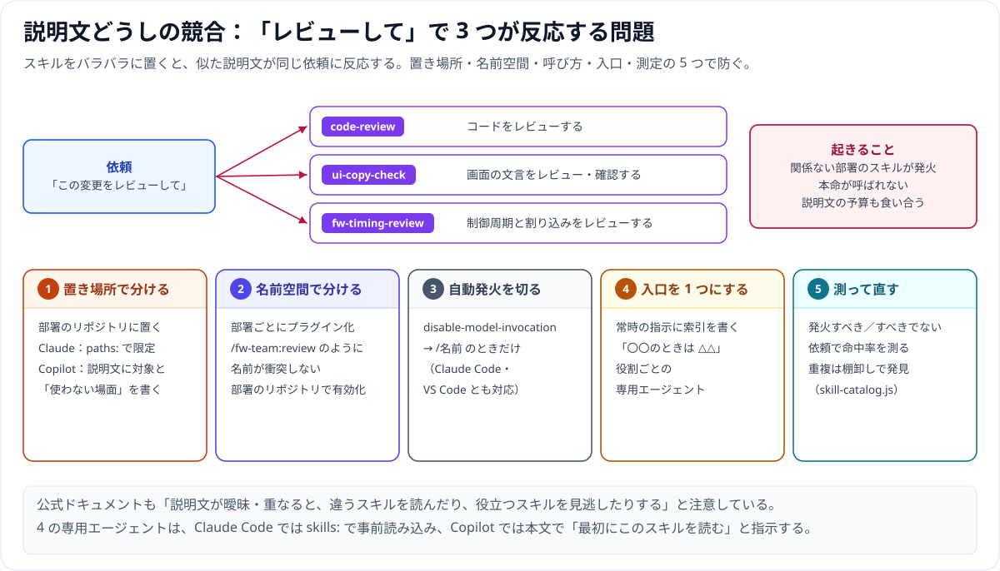
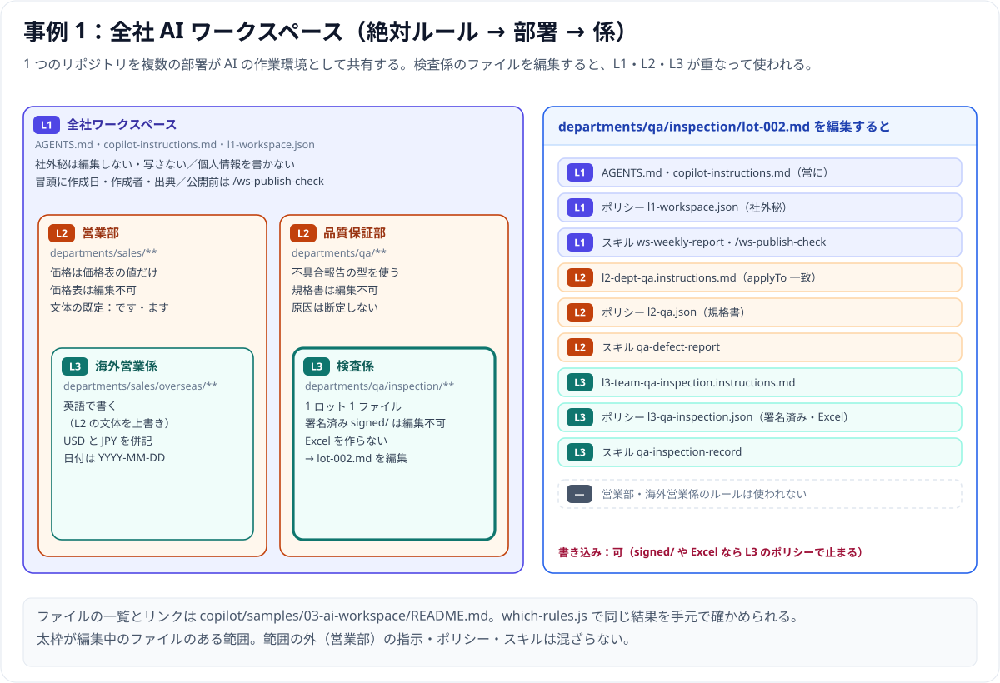
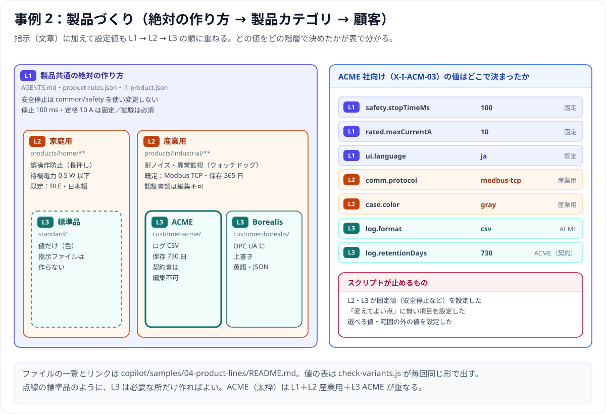
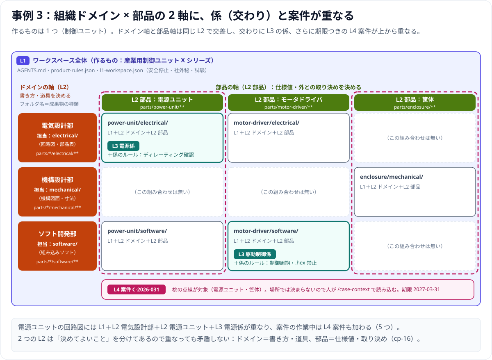

# 02 スキルの階層化と、スキル以外の方法 — 「絶対」「部署」「個人」をどう表すか

「製品として毎回必ず守ってほしいこと」「部署やドメインだけで使う手順」「係や個人だけの工夫」を、階層に分けて AI に渡したい——という問いへの答えです。結論は、**スキルだけで表すのではなく、強さの違う仕組みを層ごとに組み合わせる**ことです。

この章は**製品に共通の考え方**です。実際の置き場所・設定・動くサンプルは、[GitHub Copilot 編](copilot/01_copilot-setup.md)と [Claude Code 編](claude/01_claude-code-setup.md)に同じ形でまとめています。

> **30 秒でわかる要点**
> 1. **「毎回必ず」はスキルにしない**。スキルは説明文で確率的に呼ばれる手順書。必ず守らせることは**フック・権限・PR の必須チェック**（決定的）で止め、理由を**常時の指示（AGENTS.md など）**に 1 行書く。
> 2. 層は**置き場所で表す**：ベース＝組織の設定・製品リポジトリの直下、部署＝パス限定の指示（`applyTo`／`paths`）・部署のスキルやプラグイン、個人＝ホームフォルダ（`~/.copilot/`／`~/.claude/`）。
> 3. 説明文どうしの競合は、**置き場所・名前空間（プラグイン）・手動専用・入口の一本化（索引・専用エージェント）・測定**の 5 つで防ぐ。
> 4. 重なり方は**仕組みごと・製品ごとに違う**（例：同名スキルは Claude Code では個人が、Copilot CLI ではプロジェクトが勝つ）。「どれが勝つか」に頼らず、層ごとに書く内容を分けて矛盾させない。

---

## 1. まず「強さ」で分ける：強制力のはしご

ご質問の「絶対的に毎回実行してほしいもの」は、はしごの**一番上（5 段目）**の仕事です。Claude Code の公式ドキュメントは「常時の指示は強制される設定ではなく文脈」「必ず守るべきことはフックへ」、GitHub の早見表もフックを「必ず行う動作（ツール呼び出しの阻止など）」と位置づけています。

| 段 | 仕組み（Copilot ／ Claude Code） | 確実さ | 置くもの |
|---|---|---|---|
| 5 | `.github/hooks`・PR の必須チェック・ルールセット ／ フック・`permissions.deny`・管理設定 | 決定的（AI の判断を通らない） | 破ったら事故・損害になること |
| 4 | `AGENTS.md`・`copilot-instructions.md` ／ `CLAUDE.md` | 毎回見えるが助言 | 毎回知るべき事実と約束 |
| 3 | `*.instructions.md`（`applyTo`） ／ `.claude/rules/*.md`（`paths`） | 該当ファイルの作業では毎回見える | 特定フォルダ・種類だけの約束 |
| 2 | スキル（自動発火） | 確率的 | 必要なときだけ要る手順・知識 |
| 1 | スキル（手動専用 `/名前`） | 呼べば確実、呼ぶのは人 | 副作用がある・タイミングを人が決める手順 |

> [!TIP]
> 「このスキルを毎回必ず実行してほしい」と思ったら、その中身を分解します。**機械的に確かめられる部分**はスクリプトにして、フックや PR の必須チェックから必ず実行させ、**判断が要る部分**だけをスキルに残します。スキル本体は「確実に呼ばれること」に頼らない作りにします。

---

## 2. 次に「範囲」で分ける：3 つの層

| 層 | 常に知らせる | 必ず止める | 手順を渡す | 配る |
|---|---|---|---|---|
| **ベース**（全社・製品で絶対） | 製品リポジトリ直下の常時の指示（＋組織・管理の指示） | リポジトリのフック、組織・管理のフック／権限、PR の必須チェック | 手動専用の必須スキル、組織のエージェント | リポジトリ・管理設定・必須プラグイン |
| **部署**（ドメイン・担当領域） | パス限定の指示（担当フォルダ） | 同じフックのパス別判定、CODEOWNERS | 部署のスキル・プラグイン・エージェント | 部署のマーケットプレイス |
| **個人**（係・自分だけ） | ホームフォルダの指示 | 個人のフック | ホームフォルダのスキル | 自分で置く（良ければ[試験置き場へ](01_skill-management-loop.md#4-共有する使われた順に昇格させる)） |

| 製品ごとの具体的な置き場所 | 図 |
|---|---|
| [GitHub Copilot 編 2 章](copilot/01_copilot-setup.md#2-3-層の組み方) | [cp-01](copilot/assets/cp-01-layer-matrix.svg) |
| [Claude Code 編 2 章](claude/01_claude-code-setup.md#2-3-層の組み方) | [cc-02](claude/assets/cc-02-layer-matrix.svg) |

共通のポイント：

- **部署の層は「そのファイルを扱うときだけ効く」仕組み**（`applyTo`／`paths`、担当フォルダの指示）に置きます。app/ だけを触る人に firmware の約束は入りません。
- **全社の層は「どこで効くか」を確かめる**。Copilot の組織の指示は GitHub.com 上だけ、Claude Code の管理 CLAUDE.md は配布した PC だけ、です。全員・全画面に効かせたい約束は、**製品リポジトリにも重ねて書き、フックと必須チェックで止める**のが確実です。
- **指示は助言、フック・権限・必須チェックは強制**。同じ約束を両方に置くときは、指示には「なぜ」を書きます。

---

## 3. 重なったときのルール

| 仕組み | Copilot | Claude Code | 共通の対策 |
|---|---|---|---|
| 常時の指示 | GitHub.com は「個人 ＞ リポジトリ ＞ 組織」、VS Code・CLI は順位なしで結合 | 全部つながる（足し算）、近いものほど後 | 層ごとに書く内容を分け、矛盾を書かない |
| 同名スキル | CLI は「プロジェクト ＞ 個人 ＞ プラグイン」 | 「管理 ＞ 個人 ＞ プロジェクト」 | 共有スキルと個人スキルの名前を重ねない |
| フック | 全部動く（cloud agent は `.github/hooks` だけ） | 全部動く | 必須の検査は PR の必須チェックにも |
| プラグイン | VS Code ではプラグイン名が前に付く | `/プラグイン名:スキル名` | 部署ごとにプラグインを分ける |
| AGENTS.md（標準） | 入れ子は画面による | CLAUDE.md があると既定で直接は読まない（`@AGENTS.md` で取り込む） | 一番近い AGENTS.md が優先、チャットの指示がすべてに優先 |

詳細の図：[cp-02（Copilot）](copilot/assets/cp-02-how-layers-combine.svg)・[cc-03（Claude Code）](claude/assets/cc-03-how-layers-combine.svg)。

---

## 4. 説明文どうしの競合を防ぐ 5 つの方法

スキルをバラバラに置いて説明文だけで振り分けると、ご懸念のとおり**発火してほしくないタイミングで発火**します。公式ドキュメントも「説明文が曖昧だったり重なったりすると、違うスキルを読んだり、役立つスキルを見逃したりする」と注意しています。

| # | 方法 | Copilot | Claude Code |
|---|---|---|---|
| 1 | **置き場所で分ける** | 部署の約束は `applyTo` へ。スキルは説明文に対象と「使わない場面」を書く（`paths` に当たる欄は無い） | スキルに `paths: ["firmware/**"]`、または担当フォルダ内の `.claude/skills/` |
| 2 | **名前空間で分ける** | 部署ごとのプラグイン（VS Code では `/fw-team:review`）。CLI は `name` で重複排除なので `name` を部署名で始める | 部署ごとのプラグイン（`/fw-team:review`） |
| 3 | **自動発火を切る** | `disable-model-invocation: true`（VS Code） | `disable-model-invocation: true`、`skillOverrides` |
| 4 | **入口を 1 つにする** | AGENTS.md に索引、部署エージェントの本文で「最初にこのスキルを読む」 | CLAUDE.md に索引、エージェントの `skills:` で事前読み込み |
| 5 | **測って直す** | 発火すべき／すべきでない依頼で試す、[棚卸し](shared/README.md)で重なりを発見 | 同左＋skill-creator の発火調整 |

---

## 5. どこに書くかの判断

公式の目安（Claude Code の「Extend Claude Code」）は「同じ間違いを 2 回されたら常時の指示」「同じ手順を 3 回貼ったらスキル」「毎回自動でやりたいならフック」「別のリポジトリでも同じ設定が要るならプラグイン」です。GitHub の早見表も、常時の指示＝広い基準、スキル＝資料つきの複数手順、フック＝必ず行う動作、と同じ分け方をしています。

**3 階層のわかりやすい事例**（全社 AI ワークスペース／製品づくり）は [8 章](#8-わかりやすい事例3-階層とその複合github-copilot) にあります。

**動くサンプル**は製品ごとにあります（同じ題材「製品 X：firmware と app の 2 部署」）。

| | サンプル | 構成図 |
|---|---|---|
| GitHub Copilot | [copilot/samples/01-layered-rules](copilot/samples/01-layered-rules/README.md) | [cp-04](copilot/assets/cp-04-sample-product-repo.svg) |
| Claude Code | [claude/samples/01-layered-rules](claude/samples/01-layered-rules/README.md) | [cc-04](claude/assets/cc-04-sample-product-repo.svg) |

---

## 6. Claude Code と GitHub Copilot の対応

**共通にできる部分**は、AGENTS.md（常時の約束）とスキル（SKILL.md の形式）です。**製品ごとに書き分ける部分**は、置き場所（`.github/` ↔ `.claude/`）、パス限定の指示（`applyTo` ↔ `paths`）、強制（フックの設定形式）、同名スキルの優先順です。両方を使うなら、スキルは Copilot に確実な `.github/skills` を正本にし、Claude Code 用の `.claude/skills` へは同期する（turtle-skills-neo の skills-sync-guard のような仕組み）のが扱いやすい形です。フックの書き分けは [hook-guide](../hook-guide/README.md) を参照してください。

---

## 7. スキル以外の方法も含めた選択肢

ご質問の「スキルでうまく表現できるのか、別の形がよいのか」への整理です。

| 方法 | 向いている層・内容 | 長所 | 短所・注意 |
|---|---|---|---|
| **フック・権限・PR の必須チェック**（はしご 5 段目） | ベースの「絶対」 | 決定的。AI の判断を通らない | 判断が要るルールは書けない。理由を常時の指示に添える |
| **組織・管理の設定**（組織の指示・管理 CLAUDE.md・管理設定・ポリシーフック） | 全社の「絶対」 | 利用者が外せない | 効く画面が限られる（Copilot の組織の指示は GitHub.com だけ）。配布の手間 |
| **常時の指示の階層**（AGENTS.md・copilot-instructions.md・CLAUDE.md） | ベース・部署の「毎回知るべきこと」 | 置くだけ。多くの画面で読まれる | 助言にとどまる。長いほど守られにくい。矛盾に注意（[04](04_instruction-limits-and-timeline.md)） |
| **パス限定の指示**（`applyTo`・`paths`） | 部署・ドメインの約束 | 担当外の人の文脈を汚さない | 「フォルダ＝部署」で分けられない組織には合いにくい |
| **スキル**（自動・手動） | 必要なときだけの手順・知識 | 普段の負担が小さい。スクリプトや資料を同梱できる | 確率的。競合対策（4 章）が要る |
| **専用エージェント** | 役割ごとの「この手順を必ず使う」 | 人が選べば手順が毎回使われる（Claude Code は `skills:` で事前読み込み） | エージェントを選ぶのは人（または AI） |
| **プラグイン＋マーケットプレイス** | 部署・全社への配布、版の管理 | 名前空間・版・必須化がそろう（両製品にある） | 作る手間。設定の置き場所が製品ごとに違う |
| **CODEOWNERS・ルールセット**（GitHub） | 仕組みそのものの変更管理 | 指示・スキル・フックが勝手に変わらない | AI の実行時には効かない（変更時の関所） |
| **出力スタイル**（Claude Code） | 個人の応答の口調・形式 | 指示の効きが最も強い部類 | 効きが強いので乱用しない。内容のルールには向かない |
| **MCP サーバーで規程を配る** | 全社の最新規程・データを参照させる | 1 か所の更新が全員に届く | AI が呼ばないと読まれない。強制力はない |

> [!IMPORTANT]
> **おすすめの組み方**：ベースの「絶対」は**フックと PR の必須チェックで強制し、理由を AGENTS.md に 1 行**。部署は**パス限定の指示（`applyTo`／`paths`）＋部署のスキル**（部署が多く名前が重なるならプラグイン）。個人はホームフォルダ。「この役割は必ずこの手順」は**専用エージェント**。スキルは「呼ばれたら最高の仕事をする手順書」として磨き、「必ず呼ばれること」はスキル以外の仕組みに任せます。

---

## 8. わかりやすい事例：3 階層と、その複合（GitHub Copilot）

「1 つの絶対ルール」の下に「複数のドメイン（部署・製品カテゴリ）」があり、その下にさらに「個別のルール（係・顧客）」がある場合の組み方を、GitHub Copilot の事例で示しました。事例 3 は、**組織ドメインと部品の 2 軸が交差し、その交わりの係と、期限つきの案件が重なる**複合の場合です。詳しい解説・各ファイルへのリンク・図は [copilot/02 階層の組み方の事例](copilot/02_layered-examples.md) にあります。

| 事例 | L1（絶対） | L2（ドメイン） | L3（個別） | サンプル |
|---|---|---|---|---|
| **1. 全社 AI ワークスペース** | 社外秘・個人情報・出典・公開前チェック | 営業部／品質保証部 | 海外営業係／検査係 | [03-ai-workspace](copilot/samples/03-ai-workspace/README.md) |
| **2. 製品づくり** | 安全停止・定格・試験・型番 | 家庭用／産業用 | （標準品）／ACME 社／Borealis 社 | [04-product-lines](copilot/samples/04-product-lines/README.md) |
| **3. 複合ワークスペース** | 安全停止・社外秘・試験 | **組織ドメイン × 部品**（2 軸） | 交わりの係（＋L4 案件は手動で読み込む） | [05-composite-workspace](copilot/samples/05-composite-workspace/README.md) |

事例 3 の要点：**①2 つの軸を同じパスで表す**（`parts/<部品>/<種類>/`）、**②軸ごとに決めてよいことを分ける**（ドメイン＝書き方、部品＝値）、**③場所で表せない軸（案件）は人が `/case-context` で読み込む**。各サンプルには、ファイル構成図（どのファイルが・どの階層の・どの仕組みか）と、階層 × 仕組みの表も付けています。

**組み方の 5 つの原則**（両事例に共通）：

1. **範囲はフォルダで表す**（L2・L3 は `*.instructions.md` の `applyTo`。深いフォルダのファイルには L1＋L2＋L3 が重なる）。
2. **L1 に「変えてよい点」を書く**（事例 1 は文体・様式など、事例 2 は通信方式・言語・ログ形式などを JSON で）。
3. **下は足す・狭めるだけ**（絶対ルールは緩めない。禁止は足してよい）。
4. **既定値は「下の指定があればそちらに従う」と書く**（Copilot は指示を順位なしで結合するため）。
5. **強制は 1 つのフックが全階層のポリシーを読む**（許可のキーが無いので、下は厳しくするだけ）。

1 階層から始めて、違いが出た所にだけ 2 階層目・3 階層目を足していく育て方は [cp-09](copilot/assets/cp-09-growing-levels.svg)、「このファイルにどのルールが効くか」は [which-rules.js](copilot/tools/which-rules.js) で確かめられます。

---

## 参考にした一次情報

要点と確認日は [info/README.md](info/README.md) にまとめています。主なもの：Claude Code Docs（Memory・Skills・Extend Claude Code・Plugins for your organization）、Claude Blog「Steering Claude Code」（2026-06-18）、GitHub Docs（Custom instructions・customization cheat sheet・hooks reference・CLI plugin reference）、VS Code Docs（Agent skills・Custom instructions・Custom agents）、agents.md。

次は [03 依頼の整理と得られた結果](03_request-and-results.md) へ。
