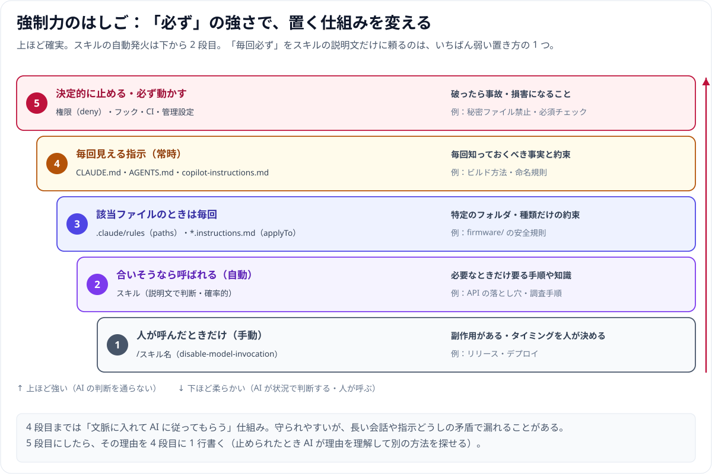
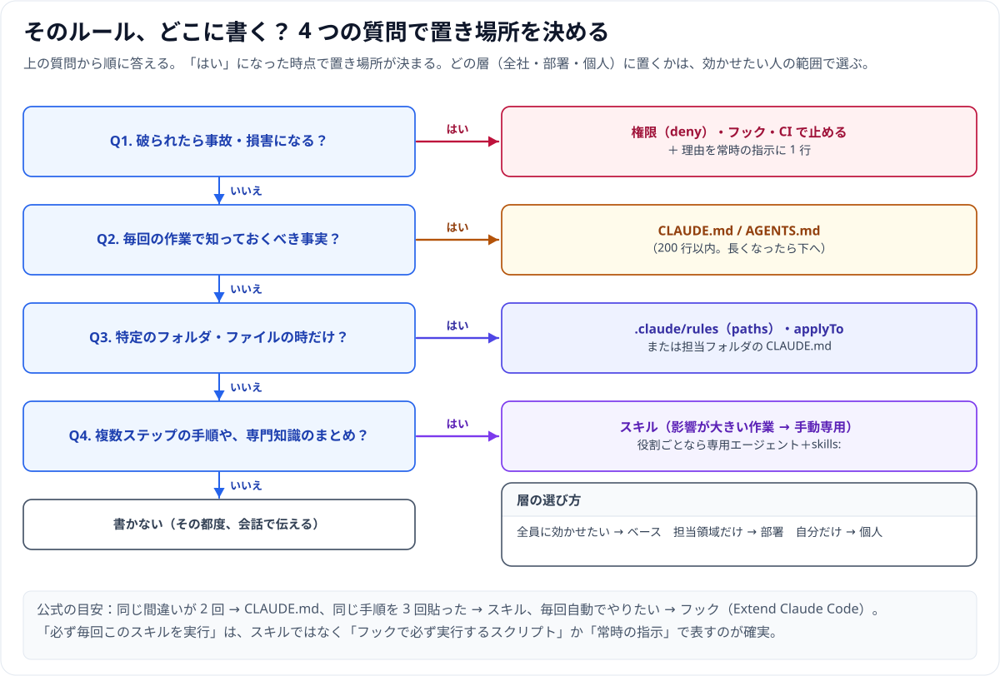
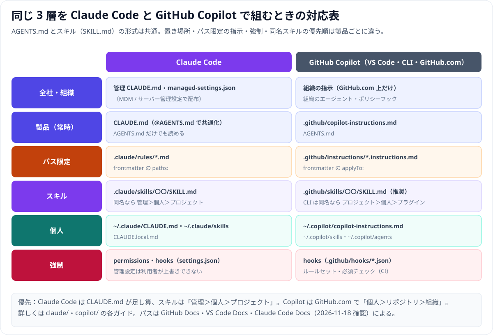
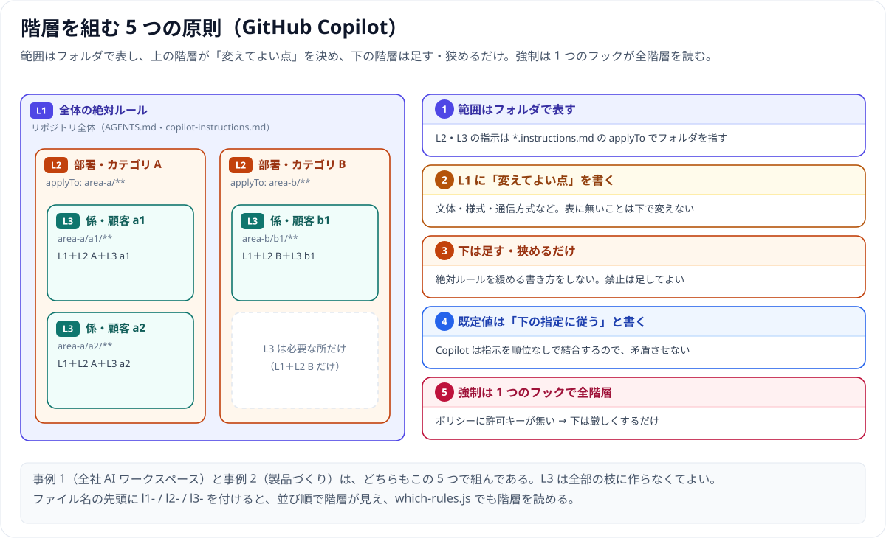

# 02 スキルの階層化と、スキル以外の方法 — 「絶対」「部署」「個人」をどう表すか

「製品として毎回必ず守ってほしいこと」「部署やドメインだけで使う手順」「係や個人だけの工夫」を、階層に分けて AI に渡したい——という問いへの答えです。結論は、**スキルだけで表すのではなく、強さの違う仕組みを層ごとに組み合わせる**ことです。

この章は**製品に共通の考え方**です。実際の置き場所・設定・動くサンプルは、[GitHub Copilot 編](copilot/01_copilot-setup.md)と [Claude Code 編](claude/01_claude-code-setup.md)に同じ形でまとめています。

> **30 秒でわかる要点**
> 1. **「毎回必ず」はスキルにしない**。スキルは説明文から確率的に呼ばれる手順書なので、必ず守らせることは**フック・権限・PR の必須チェック**（決定的）で止め、その理由を**常時の指示（`AGENTS.md` など）**に 1 行書く。
> 2. **層は置き場所で表す**。ベース（全社・製品共通）＝組織の設定やリポジトリ直下、部署＝パス限定の指示（`applyTo`／`paths`）や部署のスキル・プラグイン、個人＝自分のホームフォルダ（`~/.copilot/`／`~/.claude/`）。
> 3. **説明文どうしの競合は 5 つで防ぐ**。置き場所を分ける／プラグインで名前空間を分ける／手動専用にする／入口（索引・専用エージェント）を 1 つにする／測って直す。
> 4. **重なり方は仕組み・製品ごとに違う**（例：同名スキルは Claude Code では個人が、Copilot CLI ではプロジェクトが勝つ）。「どちらが勝つか」に頼らず、層ごとに書く内容を分けて矛盾させない。

---

## 1. まず「強さ」で分ける：強制力のはしご

ご質問の「絶対的に毎回実行してほしいもの」は、はしごの**一番上（5 段目）**の仕事です。Claude Code の公式ドキュメントは「常時の指示は強制される設定ではなく文脈」「必ず守るべきことはフックへ」、GitHub の早見表もフックを「必ず行う動作（ツール呼び出しの阻止など）」と位置づけています。

| 段 | 仕組み（Copilot ／ Claude Code） | 確実さ | 置くもの |
|---|---|---|---|
| 5 | `.github/hooks`・PR の必須チェック・ルールセット ／ フック・`permissions.deny`（特定操作やファイル読み取りの禁止設定）・管理設定 | 決定的（AI の判断を通らない） | 破ったら事故・損害になること |
| 4 | `AGENTS.md`・`copilot-instructions.md` ／ `CLAUDE.md` | 毎回見えるが助言 | 毎回知るべき事実と約束 |
| 3 | `*.instructions.md`（`applyTo`＝対象ファイルをパスで絞る設定） ／ `.claude/rules/*.md`（`paths`＝同左） | 該当ファイルの作業では毎回見える | 特定フォルダ・種類だけの約束 |
| 2 | スキル（自動発火） | 確率的 | 必要なときだけ要る手順・知識 |
| 1 | スキル（手動専用 `/名前`） | 呼べば確実、呼ぶのは人 | ファイル変更や外部送信など影響が大きい・タイミングを人が決める手順 |

> [!TIP]
> 「このスキルを毎回必ず実行してほしい」と思ったら、その中身を分解します。**機械的に確かめられる部分**はスクリプトにして、フックや PR の必須チェックから必ず実行させ、**判断が要る部分**だけをスキルに残します。スキル本体は「確実に呼ばれること」に頼らない作りにします。

---

## 2. 次に「範囲」で分ける：3 つの層

1 章のはしごは「どの仕組みで守るか」、次の表は「誰と共有するか」を表します。例えば、全員に「変更には試験を付ける」と伝える常時の指示も、試験に失敗した変更のマージを止める必須チェックも、共有範囲は同じ「ベース」です。

| 層 | 常に知らせる | 必ず止める | 手順を渡す | 配る |
|---|---|---|---|---|
| **ベース**（全社・製品で共通） | 製品リポジトリ直下の常時の指示（＋組織・管理の指示） | リポジトリのフック、組織・管理のフック／権限、PR の必須チェック | 担当者が呼ぶ共通スキル、組織のエージェント | リポジトリ・管理設定・必須プラグイン |
| **部署**（係を含む担当領域） | パス限定の指示（担当フォルダ） | 同じフックのパス別判定。PR は `CODEOWNERS` ＋ブランチ保護で担当の承認を必須に（[GitHub の設定例](https://docs.github.com/en/repositories/managing-your-repositorys-settings-and-features/customizing-your-repository/about-code-owners#codeowners-and-branch-protection)） | 部署のスキル・プラグイン・エージェント | 部署のマーケットプレイス |
| **個人**（自分だけの工夫） | ホームフォルダの指示 | 個人のフック | ホームフォルダのスキル | 自分で置く（良ければ[試験置き場へ](01_skill-management-loop.md#4-共有する使われた順に昇格させる)） |

| 製品ごとの具体的な置き場所 | 図 |
|---|---|
| [GitHub Copilot 編 2 章](copilot/01_copilot-setup.md#2-3-層の組み方) | [cp-01](copilot/assets/cp-01-layer-matrix.svg) |
| [Claude Code 編 2 章](claude/01_claude-code-setup.md#2-3-層の組み方) | [cc-02](claude/assets/cc-02-layer-matrix.svg) |

共通のポイント：

- **部署の層は「そのファイルを扱うときだけ効く」仕組み**（`applyTo`／`paths`、担当フォルダの指示）に置きます。たとえばアプリ画面（`app/`）だけを触る人の作業には、基板制御（`firmware/`）の約束は読み込まれません。
- **全社の層は「どこで効くか」を確かめる**。Copilot の組織の指示は GitHub.com 上だけ、Claude Code の管理 CLAUDE.md は配布した PC だけ、です。全員・全画面に効かせたい約束は、**製品リポジトリにも重ねて書き、フックと必須チェックで止める**のが確実です。
- **指示は助言、フック・権限・必須チェックは強制**。同じ約束を両方に置くときは、指示には「なぜ」を書きます。

---

## 3. 重なったときのルール

| 仕組み | Copilot | Claude Code | 共通の対策 |
|---|---|---|---|
| 常時の指示 | GitHub.com は「個人 ＞ リポジトリ ＞ 組織」、VS Code・CLI は順位なしで結合 | 全部つながる（足し算）、近いものほど後 | 層ごとに書く内容を分け、矛盾を書かない |
| 同名スキル | CLI は「プロジェクト ＞ 個人 ＞ プラグイン」 | 「管理 ＞ 個人 ＞ プロジェクト」 | 共有スキルと個人スキルの名前を重ねない |
| フック | 全部動く（cloud agent は `.github/hooks` だけ） | 全部動く | 必須の検査は PR の必須チェックにも |
| プラグイン | VS Code ではプラグイン名が前に付く | `/プラグイン名:スキル名` | 部署ごとにプラグインを分ける |
| AGENTS.md（標準） | 入れ子は画面による | CLAUDE.md があると既定で直接は読まない（`@AGENTS.md` と書いて別ファイルを取り込む） | チャットの個別依頼が指示より優先されるため、変えてよい項目を明記し、絶対ルールは権限や必須チェックで守る |

> [!NOTE]
> **「順位なしで結合」で困ること**：VS Code や CLI で複数の指示ファイルがそのまま連結されると、たとえば上の階層に「日本語の『です・ます調』で書く」、下の階層に「英語で書く」と書いたとき、AI はどちらが優先か判断できず迷います。これを防ぐため、後の [8 章](#8-わかりやすい事例3-階層とその複合github-copilot) では既定値に「下の指定があればそちらに従う」と明記してあります。

詳細の図：[cp-02（Copilot）](copilot/assets/cp-02-how-layers-combine.svg)・[cc-03（Claude Code）](claude/assets/cc-03-how-layers-combine.svg)。

---

## 4. 説明文どうしの競合を防ぐ 5 つの方法

スキルをバラバラに置いて説明文だけで振り分けると、ご懸念のとおり**発火してほしくないタイミングで発火**します。公式ドキュメントも「説明文が曖昧だったり重なったりすると、違うスキルを読んだり、役立つスキルを見逃したりする」と注意しています。

| # | 方法 | Copilot | Claude Code |
|---|---|---|---|
| 1 | **置き場所で分ける** | 部署の約束は `applyTo` へ。スキルは説明文に対象と「使わない場面」を書く（`paths` に当たる欄は無い） | スキルに `paths: ["firmware/**"]`、または担当フォルダ内の `.claude/skills/` |
| 2 | **名前空間で分ける** | 部署ごとのプラグイン（VS Code では `/fw-team:review`）。CLI は `name` で重複排除なので `name` を部署名で始める | 部署ごとのプラグイン（`/fw-team:review`） |
| 3 | **自動発火を切る** | `disable-model-invocation: true`（VS Code） | `disable-model-invocation: true`、`skillOverrides` |
| 4 | **入口を 1 つにする** | AGENTS.md に索引、部署エージェントの本文で「最初にこのスキルを読む」 | CLAUDE.md に索引、エージェントの `skills:` で事前読み込み |
| 5 | **測って直す** | 発火すべき／すべきでない依頼で試す、[棚卸し](shared/README.md)で重なりを発見 | 同左＋skill-creator の発火調整 |

---

## 5. どこに書くかの判断

公式ドキュメント（Claude Code の「Extend Claude Code」）でも、次の目安が示されています。

- 同じ間違いを **2 回** されたら → **常時の指示**
- 同じ手順を **3 回** 貼ったら → **スキル**
- 毎回自動で実行したいなら → **フック**
- 別のリポジトリでも同じ設定が要るなら → **プラグイン**

GitHub の早見表も同様に、常時の指示＝広い基準、スキル＝資料つきの複数手順、フック＝必ず行う動作、と役割を分けています。

[8 章](#8-わかりやすい事例3-階層とその複合github-copilot) では、全社 AI ワークスペース（事例 1）と製品づくり（事例 2）を見たあと、部署の手順と部品の仕様を一つの案件で使う例（事例 3）をたどります。

**動くサンプル**は製品ごとにあります（同じ題材「製品 X：firmware と app の 2 部署」）。

| | サンプル | 構成図 |
|---|---|---|
| GitHub Copilot | [copilot/samples/01-layered-rules](copilot/samples/01-layered-rules/README.md) | [cp-04](copilot/assets/cp-04-sample-product-repo.svg) |
| Claude Code | [claude/samples/01-layered-rules](claude/samples/01-layered-rules/README.md) | [cc-04](claude/assets/cc-04-sample-product-repo.svg) |

---

## 6. Claude Code と GitHub Copilot の対応

- **共通にできる部分**：`AGENTS.md`（常時の約束）とスキル（`SKILL.md` の形式）。
- **製品ごとに書き分ける部分**：置き場所（`.github/` ↔ `.claude/`）、パス限定の指示（`applyTo` ↔ `paths`）、強制（フックの設定形式）、同名スキルの優先順。
- **両方を使うときのコツ**：スキルは Copilot で確実な `.github/skills` を正本にし、Claude Code 用の `.claude/skills` へ同期する（`turtle-skills-neo` の `skills-sync-guard` のような仕組み）と扱いやすくなります。フックの書き分けは [hook-guide](../hook-guide/README.md) を参照してください。

---

## 7. スキル以外の方法も含めた選択肢

ご質問の「スキルでうまく表現できるのか、別の形がよいのか」への整理です。

| 方法 | 向いている層・内容 | 長所 | 短所・注意 |
|---|---|---|---|
| **フック・権限・PR の必須チェック**（はしご 5 段目） | ベースの「絶対」 | 決定的。AI の判断を通らない | 判断が要るルールは書けない。理由を常時の指示に添える |
| **組織・管理の設定**（組織の指示・管理 CLAUDE.md・管理設定・ポリシーフック） | 全社の「絶対」 | 利用者が外せない | 効く画面が限られる（Copilot の組織の指示は GitHub.com だけ）。配布の手間 |
| **常時の指示の階層**（AGENTS.md・copilot-instructions.md・CLAUDE.md） | ベース・部署の「毎回知るべきこと」 | 置くだけ。多くの画面で読まれる | 助言にとどまる。長いほど守られにくい。矛盾に注意（[04](04_instruction-limits-and-timeline.md)） |
| **パス限定の指示**（`applyTo`・`paths`） | 部署・ドメインの約束 | 担当外の人の文脈を汚さない | 「フォルダ＝部署」で分けられない組織には合いにくい |
| **スキル**（自動・手動） | 必要なときだけの手順・知識 | 普段の負担が小さい。スクリプトや資料を同梱できる | 確率的。競合対策（4 章）が要る |
| **専用エージェント** | 同じ役割の作業を決まった手順から始める | 選んだ役割に応じて手順を渡せる（Claude Code は `skills:` で事前読み込み） | 手順に沿って作業するのは AI。合否を機械的に判定するには別途チェックが要る |
| **プラグイン＋マーケットプレイス** | 部署・全社への配布、版の管理 | 名前空間・版・必須化がそろう（両製品にある） | 作る手間。設定の置き場所が製品ごとに違う |
| **CODEOWNERS・ルールセット**（GitHub） | 仕組みそのものの変更管理 | 指示・スキル・フックが勝手に変わらない | AI の実行時には効かない（変更時の関所） |
| **出力スタイル**（Claude Code） | 個人の応答の口調・形式 | 指示の効きが最も強い部類 | 効きが強いので乱用しない。内容のルールには向かない |
| **MCP サーバーで規程を配る** | 全社の最新規程・データを参照させる | 1 か所の更新が全員に届く | AI が呼ばないと読まれない。強制力はない |

> [!IMPORTANT]
> **おすすめの組み方**：ベースの「絶対」は**フックと PR の必須チェックで強制し、理由を AGENTS.md に 1 行**。部署は**パス限定の指示（`applyTo`／`paths`）＋部署のスキル**（部署が多く名前が重なるならプラグイン）。個人はホームフォルダ。役割ごとに最初に読む手順をそろえるには**専用エージェント**を使います。

---

## 8. わかりやすい事例：3 階層と、その複合（GitHub Copilot）

> [!TIP]
> **図で読みたいとき**は [copilot/03 図で読む：ルールの階層の組み方](copilot/03_layered-visual-guide.md)。「透明シートを重ねる」たとえ、applyTo の動き方と「使ってよいか」、早見表、事例 3 を 1 枚の回路図でたどる図 ①〜⑤ にまとめてあります。
>
> **applyTo を多用してよいのか**：よいです。パス別の指示は GitHub の正式な仕組みで、フォルダで分けられるルール（部署・係・製品・部品）に向きます。人・案件・必須の守りは別の仕組みに任せます（[理由と注意](copilot/03_layered-visual-guide.md#2-applyto-の正体とありか)）。

「1 つの絶対ルール」の下に「複数のドメイン（部署・製品カテゴリ）」があり、その下にさらに「個別のルール（係・顧客）」がある場合の組み方を、GitHub Copilot の事例で示しました。事例 3 は、**組織ドメインと部品の 2 軸が交差し、その交わりの係と、期限つきの案件が重なる**複合の場合です。詳しい解説・各ファイルへのリンク・図は [copilot/02 階層の組み方の事例](copilot/02_layered-examples.md) にあります。

表の L1〜L4 は、共有リポジトリの中で「どの仕事にこの知識が当てはまるか」を表します。2 章の「個人」に置いた工夫は本人の仕事について回ります。事例 3 の L4 に置いた顧客条件は、担当者が替わってもその案件に引き継がれます。

| 事例 | L1（全体の約束） | L2（部署・カテゴリ・部品） | L3（係・顧客）／ L4（案件） | サンプル |
|---|---|---|---|---|
| **1. 全社 AI ワークスペース** | 社外秘・個人情報・出典・公開前チェック | 営業部／品質保証部 | 海外営業係／検査係 | [03-ai-workspace](copilot/samples/03-ai-workspace/README.md) |
| **2. 製品づくり** | 安全停止・定格・試験・型番 | 家庭用／産業用 | （標準品）／ACME 社／Borealis 社 | [04-product-lines](copilot/samples/04-product-lines/README.md) |
| **3. 複合ワークスペース** | 安全停止・社外秘・試験 | **組織ドメイン × 部品**（2 軸） | L3 は交わりの係。L4 は人が指定した案件 | [05-composite-workspace](copilot/samples/05-composite-workspace/README.md) |

> 社内業務やドキュメント中心の組織分けなら **事例 1**、製品シリーズや顧客別の設定値を扱うなら **事例 2**、その両方が交差し一時的な案件対応もある現場なら **事例 3** をたたき台にすると選びやすいです。

事例 3 の要点：**①2 つの軸を同じパスで表す**（`parts/<部品>/<種類>/`）、**②軸ごとに決めてよいことを分ける**（ドメイン＝書き方、部品＝値）、**③場所で表せない軸（案件）は人が `/case-context` で読み込む**。各サンプルには、ファイル構成図（どのファイルが・どの階層の・どの仕組みか）と、階層 × 仕組みの表も付けています。

**事例 1・2 の入れ子の構成に共通する 5 つの原則**

1. **範囲はフォルダで表す**（L2・L3 は `*.instructions.md` の `applyTo`。深いフォルダのファイルには L1＋L2＋L3 が重なる）。
2. **L1 に「変えてよい点」を書く**（事例 1 は文体・様式など、事例 2 は通信方式・言語・ログ形式などを JSON で）。
3. **禁止は下の層で追加できる**。全体で決めた保護は引き継ぐ。値の上書きは、L1 で「変えてよい」とした項目に限る。
4. **既定値は「下の指定があればそちらに従う」と書く**（Copilot は指示を順位なしで結合するため）。
5. **保護パスへの書き込みは 1 つのフックで止める**。サンプルのフックは各層のポリシーを読み、一つでも禁止に該当すれば書き込みを拒否する。

1 階層から始めて、違いが出た所にだけ 2 階層目・3 階層目を足していく育て方は [cp-09](copilot/assets/cp-09-growing-levels.svg)、「このファイルにどのルールが効くか」は [which-rules.js](copilot/tools/which-rules.js) で確かめられます。

### 事例 3 の図を、電源ユニットの回路図で読む

事例 1 の検査係では「どの部署・係の手順を使うか」、事例 2 の ACME 社向け製品では「どの仕様値を使うか」が、フォルダをたどると分かりました。事例 3 では、**一枚の回路図について、この二つを同時に考えます。**

たとえば `parts/power-unit/electrical/schematic.md` というパスを見ると、`power-unit` が「電源ユニットの仕様を使う」、`electrical` が「電気設計の様式で書く」という目印になります。この二つがそろうと、電源係の部品選定手順も自動で加わります。ここまでは通常品でも顧客向けでも共通です（[元の回路図](copilot/samples/05-composite-workspace/parts/power-unit/electrical/schematic.md)・[この一枚に重なる指示を示した図](copilot/assets/cp-17-case3-applied-stack.svg)）。

では「ACME 社向けの変更案を作って」と頼むと何が変わるでしょうか。同じ回路図を複数の顧客が使うため、ここで初めて人が案件を指定します。サンプルではチャットで `/case-context C-2026-031` を呼び、期限と変更できる値を確認してから、次のように頼みます（[案件を読み込むスキル](copilot/samples/05-composite-workspace/.github/skills/case-context/SKILL.md)）。

> 電源ユニットの回路図をもとに、今回の入力電圧で使えるかを電源係の手順で確認してください。選び直す部品とその理由を、案件用の新しい図面案に表で示してください。

| 元図の部品 | 通常品での判断 | ACME 社向け図面案に書く判断 |
|---|---|---|
| C1（コンデンサ・定格 63 V） | 部品仕様の 24 V で計算すると、使用率は約 38%（24 ÷ 63）。電源係の基準である 70% 以下に収まる。 | 案件指定の 48 V では約 76%（48 ÷ 63）。同じ基準を超えるので、C1 は再選定する。 |

48 V の根拠は案件に、通常の 24 V は部品仕様に、使用率の計算方法と判定基準は電源係の手順にあります。こう分けると、次の通常品の依頼でも同じ手順を使って、その仕事に合った結論を出せます（[案件の値](copilot/samples/05-composite-workspace/cases/C-2026-031/case.json)・[部品仕様](copilot/samples/05-composite-workspace/parts/power-unit/part.json)・[電源係の手順](copilot/samples/05-composite-workspace/.github/skills/power-derating-check/SKILL.md)）。

### 最初の案件から、図の構成までどう育てるか

先ほどの「ドメイン × 部品」の図は、一つの仕事で使う知識の組み合わせです。次の図は、**案件を重ねるうちに、その知識がどこから集まるか**を示します。まず、この製品の全案件で守る約束（L1）を決めます。そのうえで、日々の案件で見つけた知識と、すでに仕様書や設計基準にある知識を、次に使う範囲に合わせて整理します。

1. **全員の約束を決める（L1）。** 「安全停止の共通部分を保護する」「変更には試験を付ける」など、案件が変わっても守ることを `AGENTS.md` に書きます。保護する場所への書き込みは、1 章で説明したフックや権限で制限します。
2. **その案件で分かったことを残す（L4）。** 個人で試した結果のうち、次の担当者にも必要な「48 V は顧客要求書にある」「C1 の再選定が必要」という判断と根拠を、案件の `CASE.md` に残します。最初はこのメモと既存の部品表を AI に指定すれば引き継げます。サンプルでは対象・期限・値を `case.json` に分け、`/case-context` で案件を選べる形まで整えています。[サンプルの案件メモ](copilot/samples/05-composite-workspace/cases/C-2026-031/CASE.md)
3. **同じ部品の別案件で使えたものをまとめる（L2 部品）。** 次の担当者も通常入力を調べたなら、24 V の参照先を電源ユニットの `part.json` にそろえます。電気設計とソフト開発がこの部品を使うときも、双方が同じ仕様値を参照できます。ACME 社向けの 48 V と期限はその案件に残します。
4. **次に誰が使えるかを確かめる。** 電源とモータドライバの両方で「定格と使用値を並べた表」が役立てば、その様式を電気設計で共有します（L2 ドメイン）。電源の回路で繰り返す 70% 判定は、電源係の手順にまとめます（L3 係）。[電気設計のレビュー手順](copilot/samples/05-composite-workspace/.github/skills/elec-schematic-review/SKILL.md)

**既存資料から始める場合。** すでに部品仕様書に「通常入力 24 V」、電源係の設計基準に「使用値は定格の 70% 以下」と定まっていれば、L1 を決めた時点で、前者を L2 部品、後者を L3 電源係の手順に直接反映できます。手順には根拠にした資料を示し、L4 には新しく届いた案件固有の条件や判断を書きます。

**次の案件で使い、見つかった点を足す。** 案件メモと部品仕様で引き継げる間は、その形で十分です。運用しながら、次のように仕組みを足していきます。

- **繰り返す確認はスキルへ**：別案件でも「今回の入力電圧で使用率を再計算してほしい」と指摘されたら、計算と判定のしかたを電源係のスキルにまとめます（[電源係のスキル](copilot/samples/05-composite-workspace/.github/skills/power-derating-check/SKILL.md)）。
- **機械で判定できる禁止はフックへ**：「リリース済みの回路図への書き込みを止める」という約束は対象パスで判定できるため、共通フックの保護条件へ登録して書き込みを止めます（[回路図の保護条件](copilot/samples/05-composite-workspace/.github/policies/l2-domain-electrical.json)）。

こうしておくと、次の担当者は共有された手順とガードを使いながら、新しい判断だけを案件に残せます。

---

## 参考にした一次情報

要点と確認日は [info/README.md](info/README.md) にまとめています。主なもの：Claude Code Docs（Memory・Skills・Extend Claude Code・Plugins for your organization）、Claude Blog「Steering Claude Code」（2026-06-18）、GitHub Docs（Custom instructions・customization cheat sheet・hooks reference・CLI plugin reference）、VS Code Docs（Agent skills・Custom instructions・Custom agents）、agents.md。

次は [03 依頼の整理と得られた結果](03_request-and-results.md) へ。
