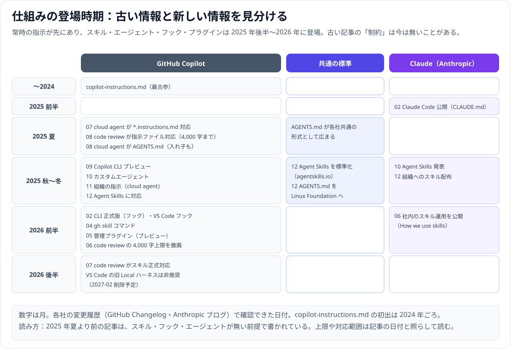
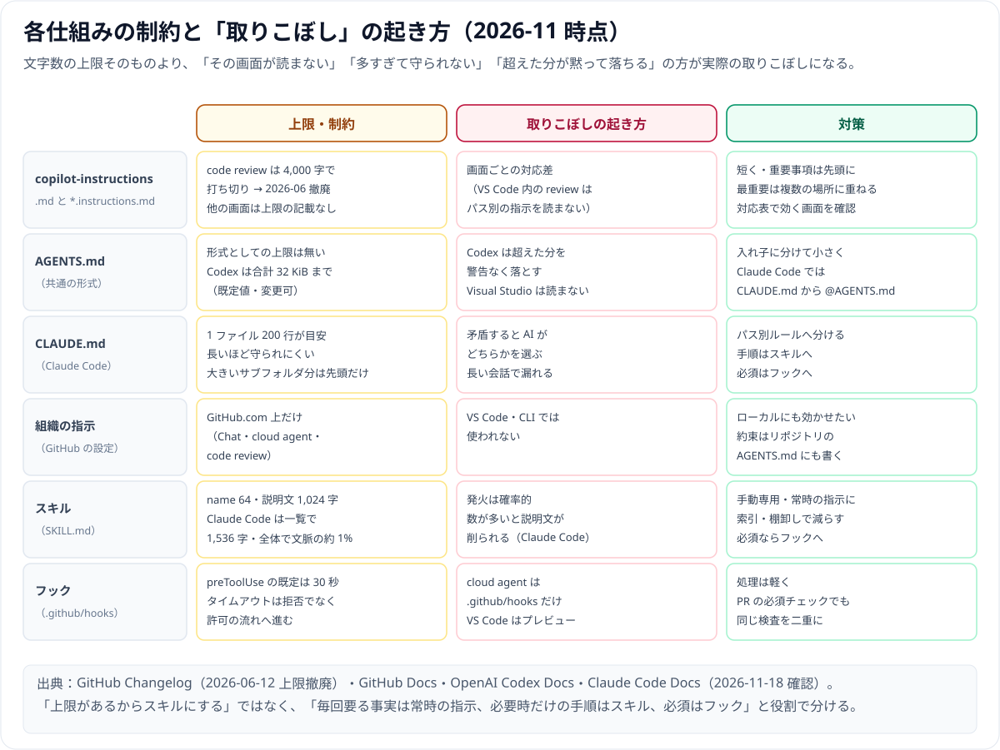
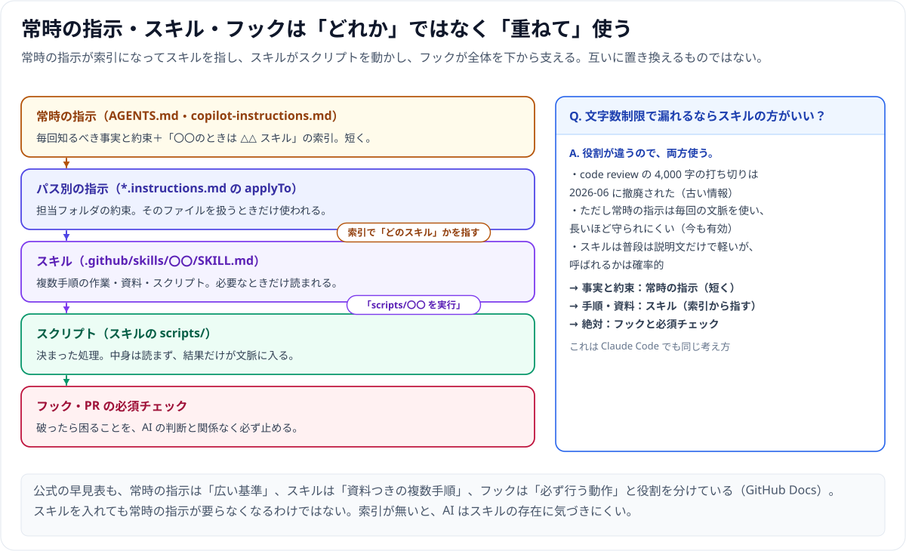

# 04 指示ファイルの制約と年表 — 古い情報と新しい情報を見分ける

`copilot-instructions.md`・`AGENTS.md`・`CLAUDE.md`・スキルなどには、「文字数の上限がある」「取りこぼす」「だからスキルの方がいい」といった情報が出回っています。ところが、これらの仕組みは**登場時期がばらばら**で、制約も**途中で変わっています**。この章では、2026-11-18 時点の一次情報で、**今も有効な制約**と**古くなった情報**を分け、仕組みどうしがどう連携するかを整理します。

> **30 秒でわかる要点**
> 1. よく聞く「**code review は指示ファイルを 4,000 文字で打ち切る**」は事実だったが、**2026-06-12 に撤廃**された。それ以前の記事の「4,000 字以内に」は今は当てはまらない。
> 2. 今も有効な「取りこぼし」は、文字数より **①その画面が読まない（組織の指示はローカルで無効など）**、**②長すぎ・矛盾で守られない**、**③超えた分が黙って落ちる（Codex の AGENTS.md は合計 32 KiB）**、**④スキルの発火は確率的**、の 4 つ。
> 3. 「制限があるからスキルにする」ではなく、**役割で重ねる**：毎回要る事実と約束は常時の指示（短く・スキルの索引つき）、必要時だけの手順はスキル、絶対はフックと PR の必須チェック。これらは互いに連携する前提で作られている。

---

## 1. 登場時期：どれが古く、どれが新しいか

| 時期 | GitHub Copilot | 共通の標準 | Claude（Anthropic） |
|---|---|---|---|
| 〜2024 | `copilot-instructions.md`（最古参の常時の指示） | — | — |
| 2025 前半 | — | — | 2025-02 Claude Code 公開（`CLAUDE.md`） |
| 2025 夏 | 07-23 cloud agent が `*.instructions.md` 対応／08-06 code review が `copilot-instructions.md` 正式対応（**4,000 字まで**）／08-28 cloud agent が `AGENTS.md`（入れ子も）対応 | `AGENTS.md` が各社共通の形式として広まる | — |
| 2025 秋〜冬 | 09-03 code review がパス別の指示に対応／09-25 Copilot CLI プレビュー／10-28 カスタムエージェント／11-05 組織の指示（cloud agent）／12-18 **Agent Skills に対応** | 12 Agent Skills を標準化（agentskills.io）／12 AGENTS.md を Linux Foundation（Agentic AI Foundation）へ | 10-16 **Agent Skills 発表**／12-18 組織へのスキル配布 |
| 2026 前半 | 02-25 CLI 正式版（**フック**）・VS Code のフック（1.110）／04-16 `gh skill`／05-06 管理プラグイン（プレビュー）／06-02 code review でスキル（プレビュー）／**06-12 code review の 4,000 字上限を撤廃**／06-18 code review が `AGENTS.md` 対応 | — | 06-03 社内のスキル運用を公開（How we use skills） |
| 2026 後半 | 07-29 code review でスキル・MCP 正式対応／VS Code の旧 Local ハーネスは非推奨（2027-02 削除予定） | — | — |

**読み方のコツ**：

- **2025 年夏より前の記事**は、スキル・カスタムエージェント・フック・プラグインが無い前提です。「全部を copilot-instructions.md に書く」「長くなったら分割する」といった工夫は、当時の唯一の手段だったためです。
- **2025 年後半〜2026 年前半の記事**は、仕組みが出そろう途中の情報です。「code review は 4,000 字まで」「Copilot はフック非対応」「VS Code は .claude/skills を読む（旧 Local ハーネス）」などは、日付によって正しかったり古かったりします。
- `copilot-instructions.md` の初出は 2024 年ごろですが、GitHub の変更履歴で日付を確かめられたのは 2025 年以降の項目です。表の Copilot の日付は GitHub Changelog、Claude の日付は Anthropic の公式ブログによります。

---

## 2. 制約と「取りこぼし」の起き方

| 仕組み | 上限・制約（2026-11 時点） | 取りこぼしの起き方 | 対策 |
|---|---|---|---|
| `copilot-instructions.md`・`*.instructions.md` | code review の 4,000 字の打ち切りは **2026-06 に撤廃**。他の画面に公式の文字数上限の記載は見当たらない | **画面ごとの対応差**（VS Code 内の code review はパス別の指示を使わない、Visual Studio はパス別を Chat だけで使う など） | 短く、重要事項は先頭に。最重要は複数の場所に重ねる。[対応表（cp-03）](copilot/assets/cp-03-where-it-works.svg)で効く画面を確認 |
| `AGENTS.md` | 形式としての上限は無い。**Codex は合計 32 KiB まで**（`project_doc_max_bytes` の既定値、変更可） | Codex は**超えた分を警告なく落とす**。Visual Studio は読まない。Claude Code は CLAUDE.md があると既定で直接は読まない | 入れ子のフォルダに分けて小さく。Claude Code では CLAUDE.md から `@AGENTS.md` |
| `CLAUDE.md` | 1 ファイル **200 行以内が目安**（公式）。大きすぎるサブフォルダの CLAUDE.md は先頭だけ | 長いほど・矛盾するほど守られにくい。長い会話で漏れる | `.claude/rules`（`paths`）へ分ける。手順はスキル、必須はフックへ |
| 組織の指示（GitHub の設定） | **GitHub.com 上だけ**（Chat・cloud agent・code review） | **VS Code・CLI では使われない** | ローカルにも効かせたい約束は、リポジトリの AGENTS.md にも書く |
| スキル（SKILL.md） | name 64 文字・説明文 1,024 文字（標準）。Claude Code は一覧で 1 件 1,536 文字、一覧全体で文脈の約 1% | **発火は確率的**。数が多いと説明文が削られる（Claude Code）。本文は呼ばれた時点の内容のまま | 手動専用・常時の指示に索引・棚卸しで減らす。必須ならフックへ |
| フック | Copilot の `preToolUse` は既定 30 秒で**タイムアウトすると許可の流れ**へ進む。VS Code のフックはプレビュー | cloud agent は `.github/hooks` だけを読む | 処理は軽く。PR の必須チェックでも同じ検査を二重に |

> [!IMPORTANT]
> **「文字数の上限」が問題になる場面は減っています**が、**「常時の指示は毎回の文脈を使う」「長いほど・矛盾するほど守られにくい」**は、上限が無くなっても変わりません。Claude Code の公式は「長い CLAUDE.md は文脈を食い、守られにくくなる」、GitHub の公式も「矛盾する指示を書かない」と明記しています。

---

## 3. では「スキルの方がいい」のか — 連携のさせ方

結論：**どれか 1 つを選ぶものではなく、役割を分けて重ねる**のが、今の公式の勧めです。GitHub の早見表も、常時の指示は「広い基準（コーディング規約・レビューの観点）」、スキルは「資料つきの複数手順」、フックは「必ず行う動作」と役割を分けています。

| 重ねる順 | 仕組み | 書くこと | 連携のしかた |
|---|---|---|---|
| 1 | 常時の指示（AGENTS.md・copilot-instructions.md・CLAUDE.md） | 毎回知るべき事実と約束、**スキルの索引** | 索引で「こんなときはこのスキル」と指す。索引が無いと AI はスキルに気づきにくい |
| 2 | パス別の指示（`applyTo`・`paths`） | 担当フォルダの約束 | 部署の「約束」はスキルの発火に頼らず、ここで確実に効かせる |
| 3 | スキル | 複数手順の作業・資料・スクリプト | 呼ばれたときだけ読まれる。中で `scripts/` を実行させる |
| 4 | スクリプト | 決まった処理 | 中身は読まれず、結果だけが文脈に入る |
| 5 | フック・PR の必須チェック | 破ったら困ること | 1〜4 が漏れても必ず止める。止めた理由は 1 に書いておく |

**「4,000 字の制限があるからスキルに逃がす」という過去の判断は、結果として正しい方向**でした（手順を常時の指示から外すと、常時の指示が短くなり守られやすくなる）。ただし理由は「上限」ではなく「**毎回の文脈コストと守られやすさ**」です。上限が撤廃された今も、同じ分け方を続けるのがおすすめです。

---

## 4. 情報を読むときのチェックリスト

- [ ] **記事の日付**を見る。2025 年夏より前なら、スキル・フック・エージェントが無い前提。
- [ ] **どの画面の話か**を見る（VS Code・CLI・GitHub.com の cloud agent・code review・Visual Studio・JetBrains で対応が違う）。
- [ ] VS Code なら**どのハーネスか**を見る（Copilot ハーネスと旧 Local ハーネスで読むフォルダが違う）。
- [ ] 「上限」「非対応」の話は、**一次情報（GitHub Docs・Changelog・Claude Code Docs）で現在の状態を確かめる**。
- [ ] 「スキルにすれば確実」という話は疑う。スキルは**呼ばれれば良い仕事をする**が、**呼ばれることは保証されない**。

---

## 参考にした一次情報

GitHub Changelog（2025-07-23・2025-08-06・2025-08-28・2025-09-03・2025-10-28・2025-11-05・2025-12-18・2026-02-25・2026-06-12・2026-06-18・2026-07-29 ほか）、GitHub Docs（Support for different types of custom instructions、Copilot customization cheat sheet）、OpenAI Codex Docs（Custom instructions with AGENTS.md）、Claude Code Docs。要点は [info/README.md](info/README.md) の A15〜A20。

次は [05 大容量データは Git の外に置く](05_large-files-outside-git.md) へ。
