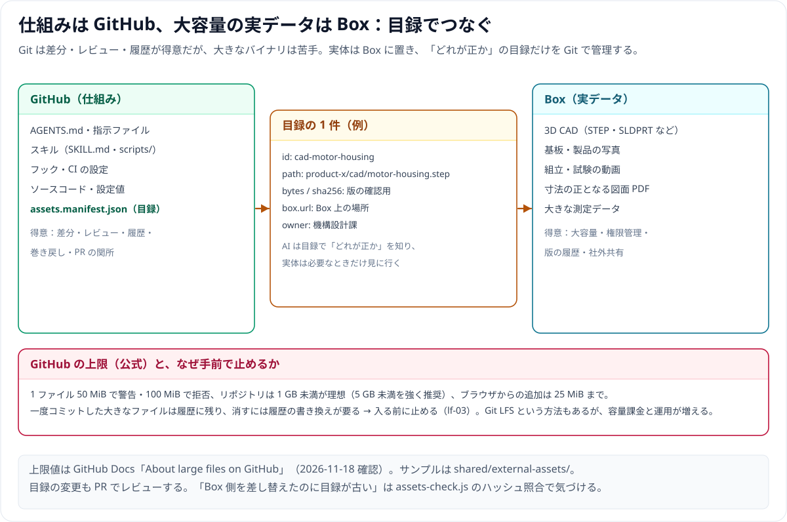
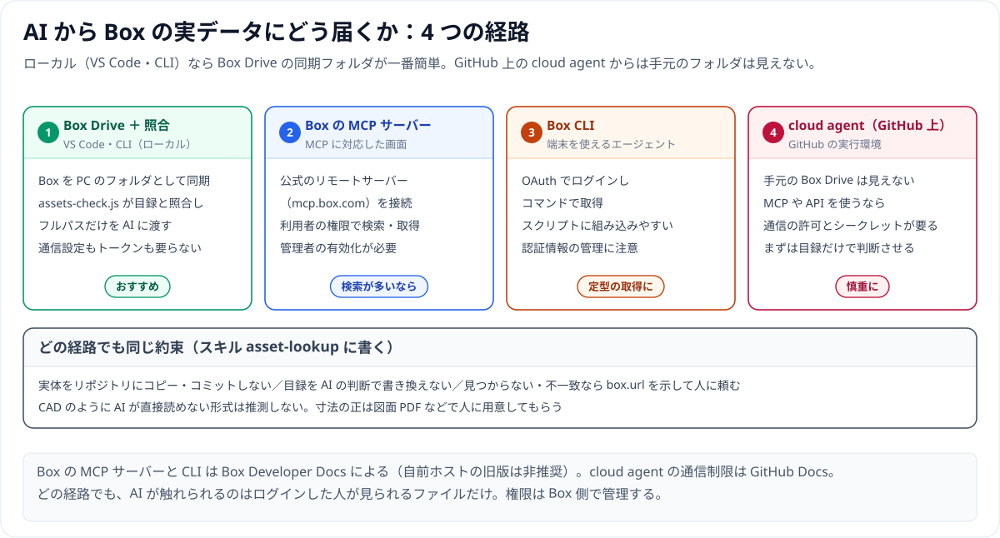
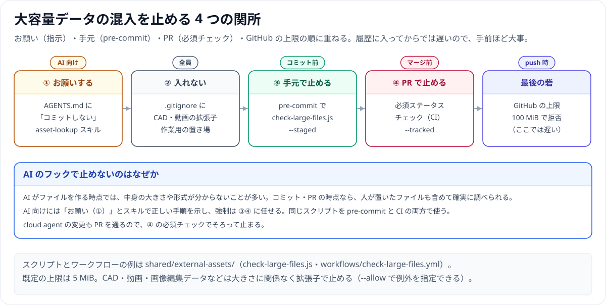

# 05 大容量データは Git の外に置く — 仕組みは GitHub、実データは Box

画像・動画・3D CAD のような大きなファイルは Box などのクラウドストレージに置き、**スキル・指示・フック・スクリプトといった「仕組み」だけを GitHub で管理する**——という運用の組み方です。AI エージェント（Copilot・Claude Code）から見て、どうつなぐと迷わず・壊さずに使えるかを整理します。

> **30 秒でわかる要点**
> 1. **目録（`assets.manifest.json`）でつなぐ**。Git には「どのデータが・Box のどこにあり・どれが正か（サイズ・ハッシュ・担当）」だけを入れ、実体は Box に置く。
> 2. AI からの届き方は 4 つ：**Box Drive の同期フォルダ＋照合スクリプト**（ローカルなら一番簡単）、**Box の MCP サーバー**、**Box CLI**、そして **GitHub 上の cloud agent は手元のフォルダが見えない**ので要注意。
> 3. 混入は**手前で止める**：お願い（AGENTS.md・スキル）→ `.gitignore` → pre-commit → **PR の必須チェック** → GitHub の上限（100 MiB）は最後の砦。

---

## 1. なぜ分けるのか：Git と Box の得意・不得意



| | GitHub（Git） | Box |
|---|---|---|
| 得意 | テキストの差分・レビュー・履歴・巻き戻し・PR の関所 | 大容量・細かい権限管理・版の履歴・社外共有・プレビュー |
| 不得意 | 大きなバイナリ（差分が取れず、履歴に残り続ける） | 「どのファイルが正か」をコードと一緒にレビューすること |
| 置くもの | AGENTS.md・指示ファイル・スキル・スクリプト・フック・CI・**目録** | 3D CAD・写真・動画・図面 PDF・大きな測定データ |

**GitHub の公式の上限**（About large files on GitHub）：1 ファイル **50 MiB で警告、100 MiB で拒否**。リポジトリは **1 GB 未満が理想、5 GB 未満を強く推奨**。ブラウザからの追加は 25 MiB まで。100 MiB を超えるファイルを Git で扱うには Git LFS が必要で、大きなバイナリはリリースに添付する方法も勧められています。

> [!TIP]
> **Git LFS との比較**：Git LFS は「Git のまま大きなファイルを扱う」方法で、コードと同じ PR で差し替えを見られるのが利点です。一方、容量と転送量の課金、全員の環境への導入、Box で既に管理している権限や共有との二重管理が増えます。**既に Box で管理していて、AI に必要なのは「どれが正か」と「どこにあるか」だけ**なら、目録方式の方が軽く済みます。

---

## 2. 目録（assets.manifest.json）の作り方

```json
{
  "version": 1,
  "storage": { "type": "box", "localRootEnv": "ASSET_ROOT" },
  "assets": [
    {
      "id": "cad-motor-housing",
      "path": "product-x/cad/motor-housing.step",
      "kind": "3d-cad",
      "bytes": 116,
      "sha256": "5d2642…b461",
      "box": { "fileId": "000000000001", "url": "https://example.app.box.com/file/000000000001" },
      "owner": "機構設計課",
      "updated": "2026-11-10",
      "note": "モーター筐体。寸法の正は図面番号 MX-1203 の PDF（Box 側）"
    }
  ]
}
```

| 項目 | 役割 |
|---|---|
| `id` | AI や人が呼ぶ名前（スキルや会話で使う） |
| `path` | Box Drive の同期フォルダの中での相対パス |
| `bytes`・`sha256` | **今手元にあるファイルが、目録が指す版と同じか**を機械的に確かめる |
| `box.url`・`fileId` | 手元に無いとき、人が開く場所 |
| `owner`・`updated`・`note` | 誰に聞けばよいか、何が正かの補足 |

- 目録の変更は**コードと同じく PR でレビュー**します（CODEOWNERS で担当課をオーナーに）。
- Box 側を差し替えたのに目録を直し忘れると、照合スクリプトが**ハッシュ不一致**で知らせます。目録の更新は人が確認してから行い、**AI に勝手に書き換えさせない**のが安全です。

---

## 3. AI から Box の実データにどう届くか



| 経路 | 使える場所 | 仕組み | 向いている場面 |
|---|---|---|---|
| ① **Box Drive ＋ 照合スクリプト** | VS Code・Copilot CLI・Claude Code（ローカル） | Box を PC のフォルダとして同期。[assets-check.js](shared/external-assets/scripts/assets-check.js) が目録と照合し、フルパスだけを AI に渡す | **まずはこれ**。通信設定もトークンも要らない |
| ② **Box の MCP サーバー** | MCP に対応した画面 | Box 公式のリモートサーバー（`https://mcp.box.com`）を接続。ログインした人の権限で検索・取得（管理者による有効化が必要） | ファイルを探す・中身を検索する場面が多い |
| ③ **Box CLI** | 端末を使えるエージェント | OAuth でログインし、コマンドで取得 | 決まったファイルの取得をスクリプトに組み込む |
| ④ **GitHub 上の cloud agent** | GitHub の実行環境 | 手元の Box Drive は見えない。MCP や API を使うなら、通信の許可（ファイアウォール）とシークレットの設定が要る | 慎重に。**まずは目録だけで「どれが正か」を判断させる** |

どの経路でも守らせたい約束は、スキル [asset-lookup](shared/external-assets/skills/asset-lookup/SKILL.md) に書いてあります。

- 実体をリポジトリに**コピー・コミットしない**。
- 目録を AI の判断で**書き換えない**。見つからない・不一致なら `box.url` を示して人に頼む。
- 3D CAD のように **AI が直接読めない形式は推測しない**。寸法の正は図面 PDF などで人に用意してもらう。
- AI が触れられるのは**ログインした人が見られるファイルだけ**。権限は Box 側で管理する。

---

## 4. 混入を止める関所



| 段 | 何で | 誰に効くか |
|---|---|---|
| ① お願い | AGENTS.md に「大きなバイナリはコミットしない」、スキル asset-lookup | AI |
| ② 入れない | `.gitignore`（[例](shared/external-assets/.gitignore.example)：`.step`・`.sldprt`・`.mp4` など） | 全員 |
| ③ 手元で止める | pre-commit で `node check-large-files.js --staged` | コミットする人・ローカルの AI |
| ④ PR で止める | GitHub Actions で `--tracked` を実行し、**ルールセットで必須ステータスチェック**にする（[ワークフロー例](shared/external-assets/.github/workflows/check-large-files.yml)） | **全員・cloud agent も含めて必ず** |
| 最後の砦 | GitHub の 100 MiB の拒否 | push のとき（ここで止まっても履歴の手直しが要る） |

**AI のフックで止めない理由**：AI がファイルを作る時点では、大きさや形式が分からないことが多いからです。コミットや PR の時点なら、人が置いたファイルも含めて確実に調べられます。AI には ① で正しい手順を示し、強制は ③④ に任せます。同じスクリプト（[check-large-files.js](shared/external-assets/scripts/check-large-files.js)）を pre-commit と CI の両方で使います。

---

## 5. サンプルと試し方

[shared/external-assets/](shared/external-assets/README.md) に、目録・照合スクリプト・混入チェック・スキル・ワークフローの例があります（Box Drive の代わりに、数十バイトのダミーファイルを入れた `demo-box-drive/` で試せます）。

```powershell
cd agent-skill/shared/external-assets
node scripts/assets-check.js --root demo-box-drive                          # 3 件とも一致
node scripts/assets-check.js --root demo-box-drive --id cad-motor-housing   # 1 件のフルパス
node scripts/check-large-files.js demo-box-drive                            # .step・.mp4 を検出
```

実際の運用では、各自の PC で環境変数 `ASSET_ROOT` に Box Drive の同期フォルダ（例：`C:\Users\<you>\Box\製品X\技術データ`）を設定します。

---

## 参考にした一次情報

GitHub Docs「About large files on GitHub」、Box Developer Docs「Box MCP server」、GitHub Docs「Customizing the development environment for Copilot cloud agent」。要点は [info/README.md](info/README.md) の A21〜A23。
