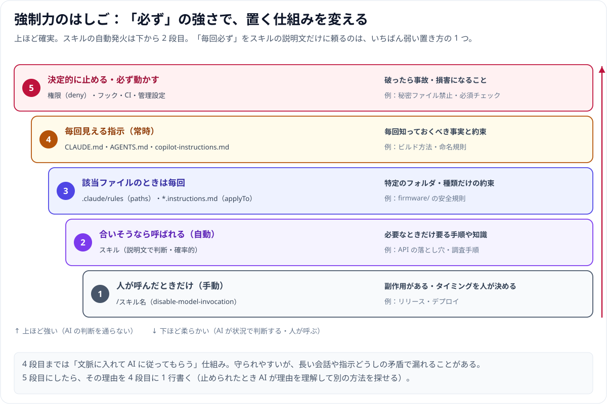

# エージェントスキル — 基本・管理と改善ループ・階層化を図で学ぶ（GitHub Copilot ／ Claude Code）

エージェントスキル（Agent Skills）を、**人に説明できる基本**から、**増えたスキルの管理・改善・共有**、**「全社で絶対」「部署だけ」「個人だけ」の階層をどう表すか（スキル以外の方法も含めて）**、**指示ファイルの制約と新旧の見分け方**、**大容量データを Git の外に置く運用**まで、ベクター図（SVG）中心に整理したガイドです。

**共通の考え方**（00〜05）と、**製品ごとの具体的な置き場所・設定・サンプル**（[copilot/](copilot/README.md)・[claude/](claude/README.md)）を分けています。初めて読むときは、まず **00〜02 で全体の考え方**をつかんでから、自分が使う製品（GitHub Copilot 編 または Claude Code 編）へ進むと迷いません。



## どこから読むか

| 目的 | 入口 |
|---|---|
| **ルールの階層の組み方を、図でつかみたい** | [copilot/03 図で読む：ルールの階層の組み方](copilot/03_layered-visual-guide.md)（透明シートのたとえ・applyTo の正体・早見表・1 枚の回路図でたどる・作る順番） |
| スキルを人に説明したい | [00 基本](00_agent-skill-basics.md) |
| GitHub Copilot で実際に組みたい | [copilot/01 GitHub Copilot での組み方](copilot/01_copilot-setup.md) → [copilot のサンプル](copilot/samples/README.md) |
| 「絶対ルール → 部署・カテゴリ → 係・顧客」の階層の具体例を見たい（組織 × 部品 × 案件の複合も） | [copilot/02 階層の組み方の事例 3 つ](copilot/02_layered-examples.md) |
| Claude Code で実際に組みたい | [claude/01 Claude Code での組み方](claude/01_claude-code-setup.md) → [claude のサンプル](claude/samples/README.md) |
| 「文字数制限」「取りこぼし」の真偽を知りたい | [04 制約と年表](04_instruction-limits-and-timeline.md) |
| CAD・動画を Box に置いて仕組みだけ GitHub で | [05 大容量データ](05_large-files-outside-git.md) |
| 依頼と結果の対応を見たい | [03 依頼と結果](03_request-and-results.md) |

## ガイド一覧

### 共通の考え方

| 順番 | ガイド | 主に分かること |
|---|---|---|
| **0** | [エージェントスキルの基本](00_agent-skill-basics.md) | スキルの正体（フォルダ構成と段階的な読み込み）、構成パターン 5 種、自然言語とスクリプトの使い分け（自由度）、メタスキルの分け方（scripted-skill-generator の例）、見落としやすい基本 |
| **1** | [スキルの管理と改善ループ](01_skill-management-loop.md) | ライフサイクル 6 段階、3 つの保管庫（Git・ログ・評価）、評価ループ、使われた順の昇格と配布、自動改善ループの確かさ（公式事例と研究の精査） |
| **2** | [スキルの階層化と、スキル以外の方法](02_layered-rules.md) | 強制力のはしご、3 つの層、重なり方の違い、説明文の競合を防ぐ 5 つの方法、置き場所の決め方、Claude Code と Copilot の対応、スキル以外の選択肢 |
| **3** | [依頼の整理と得られた結果](03_request-and-results.md) | 依頼の原文（追加依頼を含む）、意図の整理、要望ごとの答え、実際のスキル集（turtle-skills-neo）の棚卸し結果 |
| **4** | [指示ファイルの制約と年表](04_instruction-limits-and-timeline.md) | copilot-instructions.md・AGENTS.md・CLAUDE.md・スキル・フックの制約と取りこぼし、登場時期（古い情報の見分け方）、連携のさせ方 |
| **5** | [大容量データは Git の外に置く](05_large-files-outside-git.md) | 仕組みは GitHub・実データは Box、目録でつなぐ、AI からの届き方 4 経路、混入を止める関所 |

### 製品ごとの資料（同じ形）

| | GitHub Copilot | Claude Code |
|---|---|---|
| 入口 | [copilot/README.md](copilot/README.md) | [claude/README.md](claude/README.md) |
| 組み方のガイド | [01 GitHub Copilot での組み方](copilot/01_copilot-setup.md) | [01 Claude Code での組み方](claude/01_claude-code-setup.md) |
| 階層の事例 | [02 階層の組み方の事例 3 つ](copilot/02_layered-examples.md)（サンプル [03](copilot/samples/03-ai-workspace/README.md)・[04](copilot/samples/04-product-lines/README.md)・[05](copilot/samples/05-composite-workspace/README.md)） | （同じ構成は claude 編の置き換えで組める） |
| 3 層のサンプル | [samples/01-layered-rules](copilot/samples/01-layered-rules/README.md) | [samples/01-layered-rules](claude/samples/01-layered-rules/README.md) |
| 利用ログの設定 | [samples/02-skill-usage-log](copilot/samples/02-skill-usage-log/README.md) | [samples/02-skill-usage-log](claude/samples/02-skill-usage-log/README.md) |

### 共通の道具・出典

| | 内容 |
|---|---|
| [shared/](shared/README.md) | 利用ログのスクリプト、棚卸し（skill-catalog）、評価ファイルの例、大容量データの目録と照合・混入チェック |
| [info/README.md](info/README.md) | 根拠にした公式ドキュメント・公式ブログ・変更履歴・標準仕様・論文と、確かさのラベル |

## 図の一覧（59 枚）

> ※ 番号のうち `sk-09`・`sk-17`・`sk-18`・`sk-20` が飛んでいますが、これらは製品ごとの図（[cc-01〜04](claude/README.md#図4-枚)・[cp-01〜04](copilot/README.md#図30-枚)）へ分離したため欠番になっています（図の抜けはありません）。

| 図 | 内容 | 章 |
|---|---|---|
| [sk-01](assets/sk-01-skill-is-a-folder.svg) | スキルは「手順書つきの道具箱フォルダ」 | 0 |
| [sk-02](assets/sk-02-progressive-disclosure.svg) | 段階的な読み込み | 0 |
| [sk-03](assets/sk-03-rule-skill-hook.svg) | 常時ルール・スキル・フックの違い | 0 |
| [sk-04](assets/sk-04-folder-patterns.svg) | 構成パターン 5 種 | 0 |
| [sk-05](assets/sk-05-degrees-of-freedom.svg) | 自然言語とスクリプトの使い分け（自由度） | 0 |
| [sk-06](assets/sk-06-script-saves-tokens.svg) | 定型処理をスクリプトにすると何が減るか（実測つき） | 0 |
| [sk-07](assets/sk-07-meta-skill.svg) | メタスキルの二段構造（scripted-skill-generator） | 0 |
| [sk-08](assets/sk-08-script-or-not.svg) | スクリプトにするかを 3 つの質問で決める | 0 |
| [sk-10](assets/sk-10-skill-lifecycle.svg) | スキルのライフサイクル 6 段階 | 1 |
| [sk-11](assets/sk-11-three-stores.svg) | 3 つの保管庫（Git・ログ・評価） | 1 |
| [sk-12](assets/sk-12-promotion-flow.svg) | 使われた順に昇格させる共有の流れ | 1 |
| [sk-13](assets/sk-13-eval-loop.svg) | 評価ループ | 1 |
| [sk-14](assets/sk-14-evidence-on-auto-loops.svg) | 自動改善ループについて研究が示すこと | 1 |
| [sk-15](assets/sk-15-your-meta-skills-on-loop.svg) | 既存の自作メタスキルをライフサイクルに重ねる | 1 |
| [sk-16](assets/sk-16-enforcement-ladder.svg) | 強制力のはしご | 2 |
| [sk-19](assets/sk-19-trigger-conflicts.svg) | 説明文どうしの競合と 5 つの対策 | 2 |
| [sk-21](assets/sk-21-where-to-write.svg) | どこに書くかの判断フロー | 2 |
| [sk-22](assets/sk-22-claude-copilot-mapping.svg) | Claude Code と Copilot の対応表 | 2 |
| [sk-23](assets/sk-23-from-case-to-shared-rules.svg) | 案件の経験と既存資料を、部品・ドメイン・係で共有して次の案件に生かす | 2 |
| [tl-01](assets/tl-01-timeline.svg) | 仕組みの登場時期 | 4 |
| [tl-02](assets/tl-02-limits-and-drops.svg) | 各仕組みの制約と取りこぼしの起き方 | 4 |
| [tl-03](assets/tl-03-how-they-work-together.svg) | 常時の指示・スキル・フックを重ねて使う | 4 |
| [lf-01](assets/lf-01-git-and-box.svg) | 仕組みは GitHub、実データは Box | 5 |
| [lf-02](assets/lf-02-how-agents-reach-box.svg) | AI から Box の実データに届く 4 経路 | 5 |
| [lf-03](assets/lf-03-keep-big-files-out.svg) | 大容量データの混入を止める関所 | 5 |
| [cp-01〜30](copilot/README.md#図30-枚) | Copilot：イメージ（透明シート・会社の書類）・applyTo の動き方と「ありか」・3 層・重なり方・画面ごとの対応・サンプル・GitHub の関所・階層の事例（原則・事例 1〜3・ファイル構成図・階層 × 仕組み・育て方・強制）・図で読む（早見表・1 枚の回路図で読む①〜⑤・作る 6 ステップ） | copilot |
| [cc-01〜04](claude/README.md#図4-枚) | Claude Code：会話の中のスキル・3 層・重なり方・サンプル | claude |

## 図の色分けルール

| 色 | 意味 |
|---|---|
| 紫 | スキル |
| 青 | AI の判断・自然言語の手順 |
| 緑 | スクリプト・決定的な処理 |
| 黄土 | 常に読み込まれる指示（AGENTS.md・copilot-instructions.md・CLAUDE.md） |
| 赤 | 強制（フック・権限・CI）・注意 |
| 水色 | データ・ログ・評価 |
| 藍・橙・青緑 | 層（ベース・部署・個人） |

## フォルダ構成と再生成

```text
agent-skill/
├─ README.md                        ← この案内
├─ 00〜05 *.md                      ← 共通の考え方
├─ assets/                          ← 共通の図 25 枚
├─ copilot/                         ← GitHub Copilot 編（ガイド 3 本・図 30 枚・サンプル 5 つ・which-rules.js）
├─ claude/                          ← Claude Code 編（ガイド・図 4 枚・サンプル）
├─ shared/                          ← 共通の道具（利用ログ・棚卸し・大容量データの目録）
├─ info/README.md                   ← 一次情報の出典メモ
└─ scripts/
    ├─ generate-diagrams.js         ← 図の再生成（3 フォルダへ出力）
    └─ test-samples.js              ← サンプルの動作確認（82 項目）
```

```powershell
npm run test:skills                              # リポジトリ直下からサンプル一式をテスト
node agent-skill/scripts/test-samples.js        # 同上（直接実行・82項目）
node agent-skill/scripts/generate-diagrams.js   # 図を再生成（文字のはみ出しは [幅チェック] で警告）
```

- **確認時点**：仕様・数値は 2026-11-18 に公式ドキュメント・変更履歴で確認しています。Copilot・Claude Code の仕様は更新が速いので、運用前に最新版を確認してください（[04](04_instruction-limits-and-timeline.md) の年表も参考に）。
- **サンプルの数値・社名**：製品 X・Example Corp・校正値・Box の URL などはすべて説明用の架空の値です。
