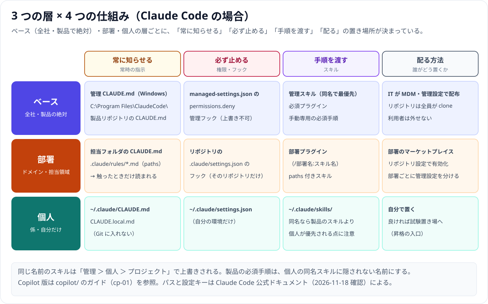
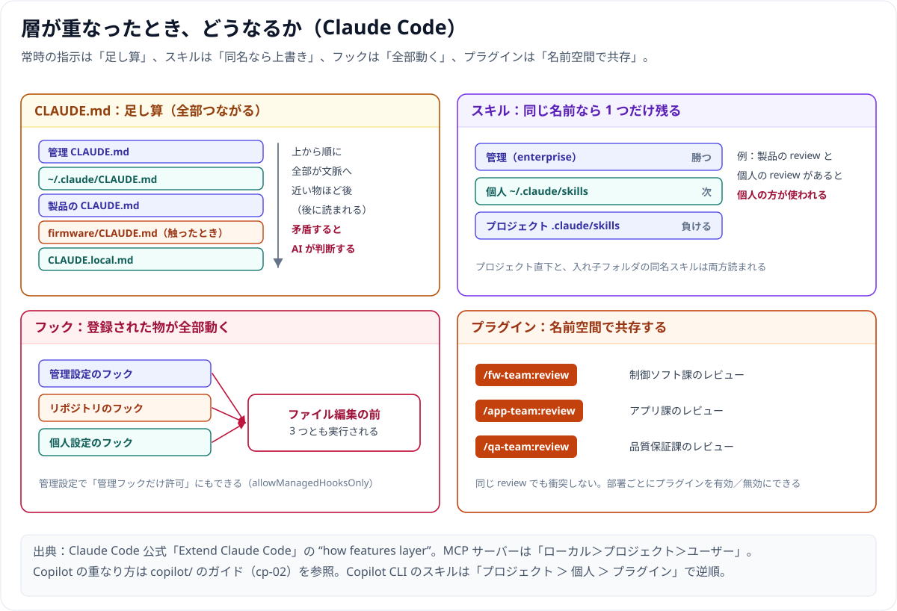
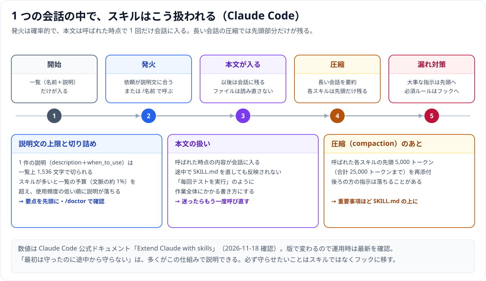
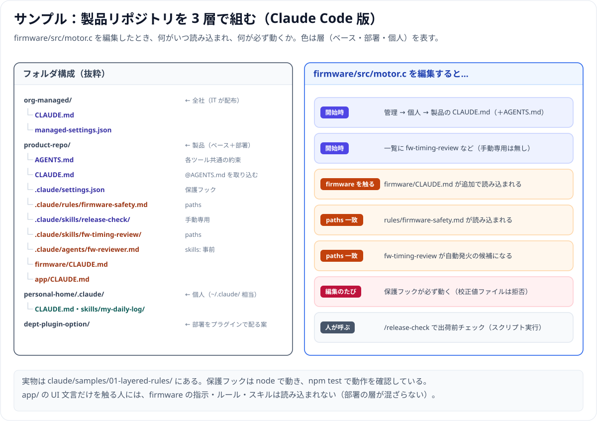

# Claude Code での組み方 — 置き場所・設定・サンプル

共通の考え方（[00](../00_agent-skill-basics.md)〜[02](../02_layered-rules.md)）を、**Claude Code で実際にどう置き、どう設定するか**に落としたガイドです。GitHub Copilot 版は [copilot/01_copilot-setup.md](../copilot/01_copilot-setup.md) で、同じ章立てにしてあります。

> **30 秒でわかる要点**
> 1. 常時の指示は `CLAUDE.md`（足し算で全部読まれる）。各ツール共通にしたいなら `AGENTS.md` に書き、`CLAUDE.md` から `@AGENTS.md` で取り込む。
> 2. 部署の約束は**担当フォルダの `CLAUDE.md`** と **`.claude/rules/*.md` の `paths`**、部署の手順は **`paths` 付きスキル**か**部署プラグイン**。
> 3. 「必ず」は **フック・`permissions.deny`・管理設定**。同名スキルは「**管理 ＞ 個人 ＞ プロジェクト**」で上書きされる。
> 4. 役割ごとに必ず使わせたい手順は、専用エージェントの **`skills:`** で事前読み込みできる（Copilot には無い仕組み）。

---

## 1. 置き場所の早見表

| 仕組み | 置き場所 | 読まれ方 |
|---|---|---|
| 全社の常時の指示 | 管理 CLAUDE.md（Windows：`C:\Program Files\ClaudeCode\CLAUDE.md`、Linux・WSL：`/etc/claude-code/CLAUDE.md`） | 毎回。利用者は除外できない |
| 製品の常時の指示 | `./CLAUDE.md` または `./.claude/CLAUDE.md`（`@AGENTS.md` で共通化） | 毎回 |
| 部署の常時の指示 | `firmware/CLAUDE.md` など担当フォルダの CLAUDE.md | そのフォルダのファイルを触ったとき |
| パス限定の約束 | `.claude/rules/*.md`（frontmatter の `paths:`） | 一致するファイルを触ったとき |
| 個人の常時の指示 | `~/.claude/CLAUDE.md`、`~/.claude/rules/`、`./CLAUDE.local.md`（Git に入れない） | 毎回 |
| スキル | 管理・`~/.claude/skills/`・`.claude/skills/`・入れ子の `<dir>/.claude/skills/`・プラグイン | 説明文は毎回、本文は呼ばれたとき |
| エージェント | `.claude/agents/*.md`（`skills:` で事前読み込み） | 呼ばれたとき |
| フック・権限 | `.claude/settings.json`・`~/.claude/settings.json`・管理設定（`managed-settings.json`） | イベントごとに必ず |
| 配布 | プラグイン＋マーケットプレイス（`.claude-plugin/marketplace.json`） | 有効化したとき |

---

## 2. 3 層の組み方

| 層 | 常に知らせる | 必ず止める | 手順を渡す | 配る |
|---|---|---|---|---|
| **ベース** | 管理 CLAUDE.md、製品の CLAUDE.md / AGENTS.md | `permissions.deny`・管理フック・リポジトリの保護フック | 管理スキル、手動専用の必須手順、必須プラグイン | MDM・管理設定（`enabledPlugins` で必須化） |
| **部署** | 担当フォルダの CLAUDE.md、`.claude/rules`（`paths`） | リポジトリの `.claude/settings.json` のフック | `paths` 付きスキル、部署プラグイン（`/fw-team:review`）、専用エージェント | 部署のマーケットプレイス、リポジトリ設定 |
| **個人** | `~/.claude/CLAUDE.md`、`CLAUDE.local.md` | `~/.claude/settings.json` | `~/.claude/skills/` | 自分で置く |

- 管理 CLAUDE.md は**行動の指針**、技術的な強制は**管理設定**（`permissions.deny`・`sandbox` など）。公式もこの使い分けを示しています。
- 部署ごとに管理設定自体を分けるなら、利用者グループごとに別の管理設定を配ります（MDM のプロファイル、Enterprise の管理画面のグループ設定）。

---

## 3. 重なり方

| 仕組み | 重なり方 | 気をつけること |
|---|---|---|
| CLAUDE.md | **足し算**。上位フォルダから順に全部つながり、近いものほど後に読まれる（同じフォルダでは CLAUDE.local.md が最後） | 矛盾すると AI がどちらかを選ぶ。`/doctor` の prompt audit で掃除 |
| AGENTS.md | CLAUDE.md（または CLAUDE.local.md）があると、既定では**直接は読まない** | CLAUDE.md に `@AGENTS.md` と書いて取り込む |
| スキル | **同名なら 1 つ**：管理 ＞ 個人 ＞ プロジェクト | 個人の同名スキルが製品の必須手順を隠す |
| フック | **全部動く** | 管理設定で「管理フックだけ許可」（`allowManagedHooksOnly`）にもできる |
| プラグイン | **名前空間で共存**（`/fw-team:review`） | `skillOverrides` はプラグインのスキルには効かない（`/plugin` で管理） |

---

## 4. 説明文の競合を防ぐ（Claude Code のつまみ）

| つまみ | 書き方 | 効果 |
|---|---|---|
| `paths` | スキルの frontmatter に `paths: ["firmware/**"]` | 一致するファイルの作業中だけ自動発火の候補になる |
| 入れ子のスキル | `firmware/.claude/skills/` に置く | そのフォルダで作業し始めたときに読み込まれる |
| `disable-model-invocation: true` | スキルの frontmatter | 自動では呼ばれず、説明文も一覧に出ない（`/名前` で呼ぶ） |
| `skillOverrides` | 設定で `"name-only"`・`"user-invocable-only"`・`"off"` | 自分で書いていないスキルも一覧から外せる |
| `skills:`（エージェント） | `.claude/agents/fw-reviewer.md` の frontmatter | 説明文の判定を通さず、起動時にスキル本文を読み込む |
| プラグイン | 部署ごとのプラグイン | `/部署名:スキル名` で名前が衝突しない |

---

## 5. 「必ず」を守らせる

- **フック**：`.claude/settings.json` の `hooks`。`PreToolUse` で終了コード 2 を返すと、その操作を止められ、stderr の文章が AI に伝わる。サンプルの [guard-protected-paths.js](samples/01-layered-rules/product-repo/.claude/hooks/guard-protected-paths.js) は校正値と `.env` への書き込みを止める。
- **権限**：`permissions.deny`（例：`Read(**/.env)`）。管理設定に書けば利用者は上書きできない。
- **スキルのフック**：スキルの `hooks` 欄に書いたフックは、そのスキルが呼ばれてから会話の終わりまで有効（Anthropic 社内の `/careful`・`/freeze` の例）。「呼ばれたら厳しくする」には使えるが、「必ず」には使えない。
- 公式の言い方：「CLAUDE.md は強制ではなく文脈」「必ず守るべきことはフックへ」。

---

## 6. 配る・共有する

| やりたいこと | 仕組み |
|---|---|
| チームのカタログを作る | Git リポジトリに `.claude-plugin/marketplace.json`（非公開リポジトリでも可） |
| リポジトリの参加者に入れてもらう | リポジトリの `.claude/settings.json` に `extraKnownMarketplaces` と `enabledPlugins` |
| 全社で必須にする | 管理設定の `enabledPlugins`（利用者は外せない） |
| 出どころを限定する | 管理設定の `strictKnownMarketplaces`（許可リスト）・`blockedMarketplaces`・`disableSideloadFlags` |
| 安定版と先行版を出し分ける | マーケットプレイスを 2 つ用意し、利用者グループごとに見せる方を変える |
| claude.ai（Team / Enterprise）で配る | 管理者が組織に配布（既定で有効、各自がオフにできる） |
| 監査する | OpenTelemetry の `claude_code.plugin_installed`・`plugin_loaded`、Enterprise の Analytics API |

---

## 7. 利用ログと評価

- **利用ログ**：[samples/02-skill-usage-log](samples/02-skill-usage-log/README.md)。`PreToolUse`（matcher: `Skill`）と `UserPromptSubmit` で、共通スクリプト [shared/hooks/log-skill-usage.js](../shared/hooks/log-skill-usage.js) を呼ぶ。
- **未使用の発見**：`/skill-doctor`（使われていないスキルと文脈のコスト）、`/doctor`（一覧の大きさ）、`/context`。
- **評価**：skill-creator プラグイン（`evals/evals.json`、あり／なし比較、説明文の発火調整）。プラグインとして配るスキルは `claude plugin eval` で CI に組み込める。
- **棚卸し**：[shared/skill-catalog](../shared/README.md)（Claude Code・Copilot 共通）。

---

## 8. 見落としやすい点（Claude Code）

- [ ] 説明文（`description`＋`when_to_use`）は一覧で **1 件 1,536 文字**まで。スキルが多いと一覧の予算（**文脈の約 1%**）を超え、使用頻度の低いものから説明文が落ちる。
- [ ] 本文は**呼ばれた時点で 1 回だけ**会話に入る。途中で SKILL.md を直しても、その会話には反映されない。
- [ ] 長い会話の**圧縮後は各スキルの先頭 5,000 トークン**（合計 25,000 まで）だけが再添付される。重要なことほど上に。
- [ ] CLAUDE.md は **200 行以内**が目安。大きすぎるサブフォルダの CLAUDE.md は先頭しか読まれない。
- [ ] スクリプトのパスは **`${CLAUDE_SKILL_DIR}`** で書く（どこに置かれても動く）。
- [ ] claude.ai や Skills API へアップロードするスキルでは、標準以外の欄（`paths`・`disable-model-invocation` など）は**エラー**になる。
- [ ] `CLAUDE.local.md` を置くと、既定では AGENTS.md を直接読まなくなる（`@AGENTS.md` の取り込みなら影響なし）。

---

## 9. サンプル

| サンプル | 内容 |
|---|---|
| [samples/01-layered-rules](samples/01-layered-rules/README.md) | 製品リポジトリを 3 層で組んだ例（保護フック、手動専用スキル＋スクリプト、`paths` 付きのルールとスキル、`skills:` 付きエージェント、管理設定、個人設定、部署プラグイン） |
| [samples/02-skill-usage-log](samples/02-skill-usage-log/README.md) | スキル利用ログのフック設定 |

出典は [info/README.md](../info/README.md) の A1〜A11。
