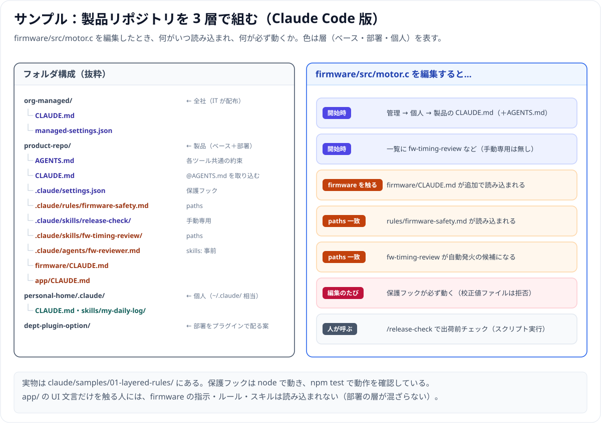

# サンプル 01：製品リポジトリを 3 層で組む（Claude Code 版）

「製品として絶対に守ること（ベース）」「部署だけの約束と手順」「個人の工夫」を、**スキルの説明文ではなく、置き場所と仕組みの強さ**で分けた例です。考え方は [02 スキルの階層化](../../../02_layered-rules.md)、Claude Code での設定は [01 Claude Code での組み方](../../01_claude-code-setup.md) にあります。同じ題材の Copilot 版は [copilot/samples/01-layered-rules](../../../copilot/samples/01-layered-rules/README.md)。



## 構成

```text
01-layered-rules/
├─ org-managed/                       ← ベース（全社）。実際は IT が配布し、利用者は外せない
│   ├─ CLAUDE.md                      … 守秘・秘密ファイル・出荷数値の約束（理由つき）
│   └─ managed-settings.json          … permissions.deny・必須プラグイン・許可するマーケット
├─ product-repo/                      ← 製品リポジトリ（ベース＋部署）
│   ├─ AGENTS.md                      … 各ツール共通の約束とスキルの索引（ベース）
│   ├─ CLAUDE.md                      … @AGENTS.md を取り込み、Claude Code 用の補足だけ書く
│   ├─ CLAUDE.local.md.example        … 個人用メモの例（Git に入れない）
│   ├─ CHANGELOG.md
│   ├─ .claude/
│   │   ├─ settings.json              … 保護フックの登録（ベースの強制）
│   │   ├─ hooks/guard-protected-paths.js
│   │   ├─ rules/firmware-safety.md   … paths: firmware/**（部署：制御ソフト課）
│   │   ├─ rules/app-ui-text.md       … paths: app/ui/**（部署：アプリ課）
│   │   ├─ skills/release-check/      … 手動専用の出荷前チェック＋スクリプト（ベース）
│   │   ├─ skills/fw-timing-review/   … paths 付きのレビュー手順（部署）
│   │   └─ agents/fw-reviewer.md      … skills: で fw-timing-review を事前読み込み（部署）
│   ├─ firmware/                      … 部署：制御ソフト課（CLAUDE.md・src・calibration）
│   └─ app/                           … 部署：アプリ課（CLAUDE.md・ui）
├─ personal-home/.claude/             ← 個人（実際は ~/.claude/）
│   ├─ CLAUDE.md
│   └─ skills/my-daily-log/
└─ dept-plugin-option/                ← 部署のスキルをプラグイン（名前空間つき）で配る案
```

## 層ごとの見どころ

| 層 | 仕組み | 見どころ |
|---|---|---|
| ベース：強制 | `.claude/hooks/guard-protected-paths.js` | 校正値（`firmware/calibration/`）と `.env` への書き込みを、AI の判断に関係なく**必ず**止める。止めた理由を stderr で返し、「回避せず人に依頼する」よう促す。Copilot の入力形にも対応 |
| ベース：常時 | `AGENTS.md` ＋ `CLAUDE.md` | 毎回知るべき事実と約束、**スキルの索引**（どの場面でどのスキルか）。強制している約束にも「なぜ」を 1 行添える |
| ベース：手順 | `skills/release-check/` | `disable-model-invocation: true` で人が `/release-check` と呼んだときだけ動く。決まった確認は `scripts/check-release.js` が行い、AI は NG の説明と人への確認事項だけを書く |
| 部署：常時 | `firmware/CLAUDE.md`・`.claude/rules/*.md` | 担当フォルダのファイルを触ったときだけ読まれる。app/ の作業に firmware の約束は入らない |
| 部署：手順 | `skills/fw-timing-review/`・`agents/fw-reviewer.md` | `paths` で firmware の作業中だけ自動発火の候補に。専用エージェントは `skills:` で説明文の判定を通さずに手順を持つ |
| 個人 | `personal-home/.claude/` | 自分だけの約束と日誌スキル。共有スキルと**同じ名前にしない**（個人が優先されて共有スキルを隠すため） |

## 試し方

```powershell
# 保護フック：校正値の編集は拒否（終了コード 2）
'{"tool_name":"Edit","tool_input":{"file_path":"firmware/calibration/motor-params.json"}}' | node agent-skill/claude/samples/01-layered-rules/product-repo/.claude/hooks/guard-protected-paths.js
$LASTEXITCODE

# 出荷前チェック：わざと入れたバージョン不一致（1.4.0 / 1.3.2）が NG で 1 件出る
node agent-skill/claude/samples/01-layered-rules/product-repo/.claude/skills/release-check/scripts/check-release.js --root agent-skill/claude/samples/01-layered-rules/product-repo
```

Claude Code で実際に試すときは、`product-repo/` フォルダを開いて起動します（フックは `$CLAUDE_PROJECT_DIR` 基準）。管理設定（`org-managed/`）と個人設定（`personal-home/`）は、実際の配置場所にコピーしたときだけ効きます。
