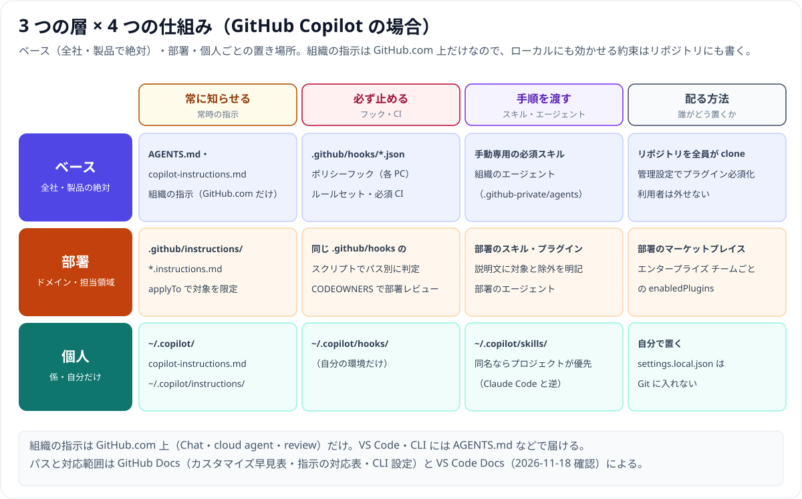
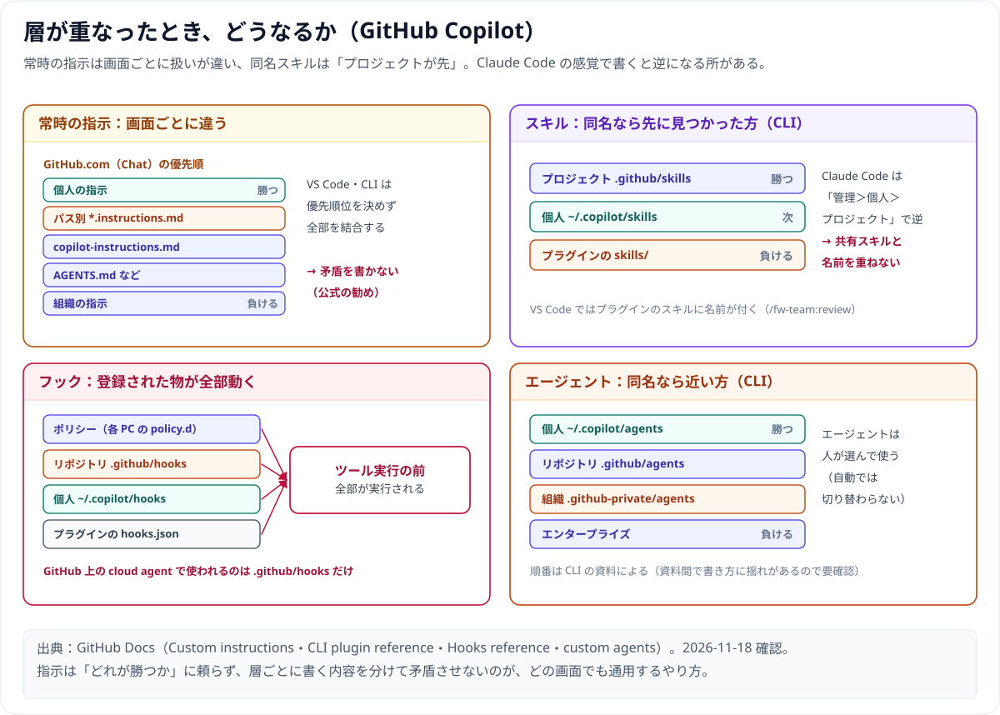
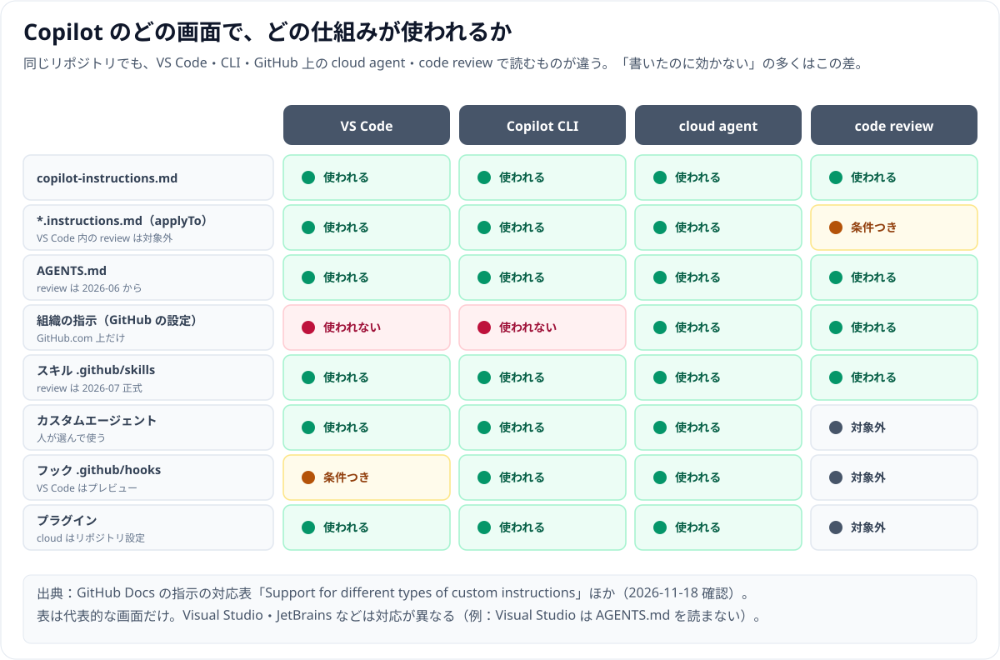
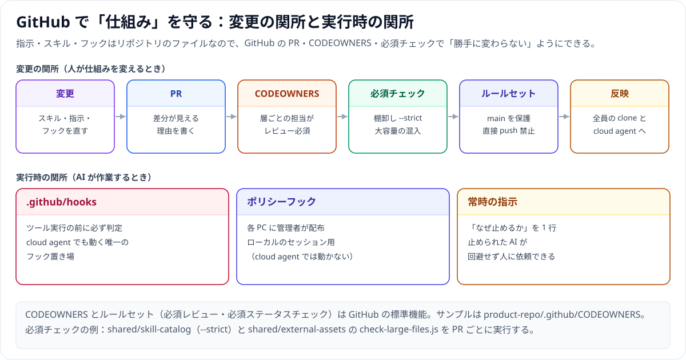
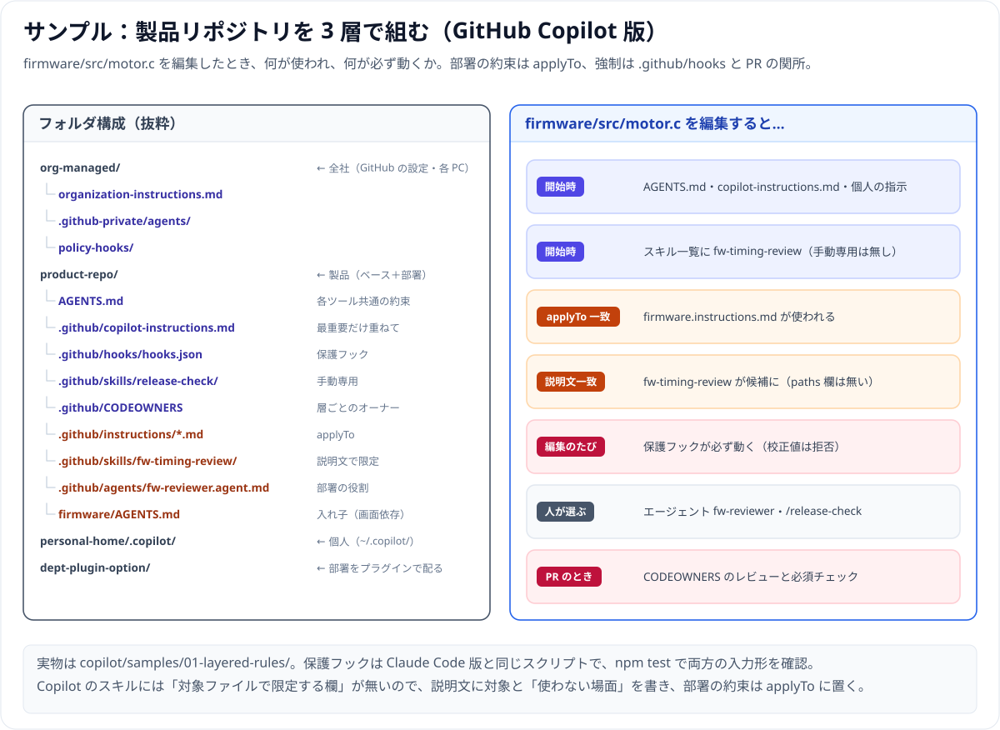

# GitHub Copilot での組み方 — 置き場所・設定・サンプル

共通の考え方（[00](../00_agent-skill-basics.md)〜[02](../02_layered-rules.md)）を、**GitHub Copilot（VS Code・Copilot CLI・GitHub 上の cloud agent・code review）で実際にどう置き、どう設定するか**に落としたガイドです。Claude Code 版の [claude/01_claude-code-setup.md](../claude/01_claude-code-setup.md) と同じ章立てにしてあります。

> **30 秒でわかる要点**
> 1. 常時の指示は **`AGENTS.md`** と **`.github/copilot-instructions.md`**。**組織の指示は GitHub.com 上だけ**で、VS Code・CLI には届かない。全社の約束でも、ローカルで効かせたいならリポジトリに書く。
> 2. 部署の約束は **`.github/instructions/*.instructions.md` の `applyTo`** が一番確実。スキルには Claude Code の `paths` に当たる欄が無いので、**説明文に対象と「使わない場面」**を書く。
> 3. 「必ず」は **`.github/hooks/*.json`**（cloud agent でも動く唯一の置き場）と、**PR の CODEOWNERS・必須チェック・ルールセット**。
> 4. 同名スキルは CLI で「**プロジェクト ＞ 個人 ＞ プラグイン**」。Claude Code（個人が勝つ）と**逆**。

> [!NOTE]
> VS Code では、セッションごとに実行環境（Copilot ハーネス・Claude など）を選べます。このガイドは **Copilot ハーネス**の仕様です。旧 Local ハーネスは非推奨（2027-02 削除予定）で、読むフォルダが少し違います（例：Local は `.claude/skills` も読む）。詳しくは [copilot-fusion](../../copilot-fusion/01_harness-local-vs-copilot.md)。

---

## 1. 置き場所の早見表

| 仕組み | 置き場所 | 読まれ方 |
|---|---|---|
| 組織の指示 | GitHub の Organization settings → Copilot → Custom instructions（画面に文章を書く） | **GitHub.com 上だけ**（Chat・cloud agent・code review） |
| 製品の常時の指示 | `AGENTS.md`、`.github/copilot-instructions.md` | 毎回（対応は画面による。[3 章の表](#3-重なり方と画面ごとの違い)） |
| パス限定の約束 | `.github/instructions/*.instructions.md`（frontmatter の `applyTo:`） | 一致するファイルを扱うとき |
| 入れ子の AGENTS.md | `firmware/AGENTS.md` など | cloud agent は対応（2025-08）。VS Code・CLI は環境で確認 |
| 個人の常時の指示 | `~/.copilot/copilot-instructions.md`、`~/.copilot/instructions/*.instructions.md`（CLI）、GitHub.com の個人設定（`~` は自分のホームフォルダ。Windows なら `C:\Users\<ユーザー名>`） | 毎回 |
| スキル | `.github/skills/<名前>/SKILL.md`（推奨）、個人 `~/.copilot/skills/` | 説明文は毎回、本文は呼ばれたとき |
| エージェント | `.github/agents/*.agent.md`、個人 `~/.copilot/agents/`、組織 `.github-private/agents/` | 人がエージェントを選んだとき |
| フック | `.github/hooks/*.json`、個人 `~/.copilot/hooks/`、各 PC のポリシー（`C:\ProgramData\GitHub\Copilot\policy.d\`） | イベントごとに必ず |
| リポジトリ設定 | `.github/copilot/settings.json`（共有）、`settings.local.json`（個人・Git に入れない） | CLI ほか |
| 配布 | プラグイン＋マーケットプレイス（`.github/plugin/marketplace.json`） | 有効化したとき |

> [!TIP]
> GitHub の資料ではプロジェクトのスキルの置き場所として `.github/skills`・`.claude/skills`・`.agents/skills` が並んでいますが、VS Code の Copilot ハーネスの資料に載っているのは `.github/skills` です。**Copilot で使うなら `.github/skills` に置く**のが確実です。

---

## 2. 3 層の組み方

| 層 | 常に知らせる | 必ず止める | 手順を渡す | 配る |
|---|---|---|---|---|
| **ベース** | `AGENTS.md`・`copilot-instructions.md`（ローカルにも効く本命）、組織の指示（GitHub.com 用） | `.github/hooks/*.json`、各 PC のポリシーフック、ルールセット＋必須チェック | 手動専用の必須スキル、組織のエージェント（`.github-private/agents/`） | リポジトリ（全員が clone）、エンタープライズ管理設定でプラグイン必須化 |
| **部署** | `.github/instructions/<部署>.instructions.md`（`applyTo`）、入れ子の AGENTS.md（画面依存） | 同じ `.github/hooks` のスクリプトでパス別に判定、CODEOWNERS で部署レビュー | 部署のスキル（説明文で限定）・プラグイン、部署のエージェント | 部署のマーケットプレイス、エンタープライズ チームごとの `enabledPlugins` |
| **個人** | `~/.copilot/copilot-instructions.md`、`~/.copilot/instructions/` | `~/.copilot/hooks/` | `~/.copilot/skills/`、`~/.copilot/agents/` | 自分で置く。`.github/copilot/settings.local.json` は Git に入れない |

ベース層のポイント：**組織の指示だけに頼らない**。VS Code や CLI で作業する人には届かないので、全社で絶対の約束は次の 3 か所に重ねます。

1. 製品リポジトリの `AGENTS.md`（＋最重要の数行を `copilot-instructions.md` にも）
2. `.github/hooks/`（機械的に止める。GitHub 上の cloud agent でも動く）
3. PR の必須チェック（CI）とルールセット（人も AI も通る関所）

---

## 3. 重なり方と画面ごとの違い

| 仕組み | 重なり方 | 気をつけること |
|---|---|---|
| 常時の指示 | GitHub.com（Chat）は「個人 ＞ リポジトリ（パス別 ＞ 全体 ＞ AGENTS.md）＞ 組織」。**VS Code・CLI は優先順位を決めずに結合** | 公式も「矛盾する指示を書かない」よう勧めている |
| スキル | CLI は**先に見つかった方**：プロジェクト ＞ 個人 ＞ プラグイン（プラグインは上書きできない） | Claude Code と逆。共有スキルと個人スキルの名前を重ねない |
| エージェント | 同名なら「個人 ＞ リポジトリ ＞ 組織 ＞ エンタープライズ」（CLI の資料。資料間で記述に揺れあり） | 人が選んで使うので、名前を分けておけば問題になりにくい |
| フック | **全部動く**（ポリシー・リポジトリ・個人・プラグイン） | GitHub 上の cloud agent で使われるのは `.github/hooks` だけ |
| リポジトリ設定 | 既定 → MDM（企業の端末一括管理システム）の管理設定 → `~/.copilot/settings.json` → `.github/copilot/settings.json` → `settings.local.json` → 環境変数 → コマンド引数（後ろが勝つ） | CLI の設定の順序 |

Copilot は動かす画面（自分の PC 上の VS Code／CLI、GitHub クラウド上の cloud agent、PR 上の code review など）によって動く環境が異なるため、読み込める設定も変わります。「書いたのに効かない」の多くはこの表の差です。特に、**組織の指示はローカルで使われない**、**VS Code 内の code review はパス別の指示を使わない**、**Visual Studio は AGENTS.md を読まない**、**フックは VS Code ではプレビュー**、の 4 点は押さえておきます。

---

## 4. 説明文の競合を防ぐ（Copilot のつまみ）

| つまみ | 書き方 | 効果 |
|---|---|---|
| 説明文で対象と除外を書く | 「firmware/ の C コードの…。app/ のレビューには使わない」 | `paths` が無い代わりに、誤発火を減らす |
| `disable-model-invocation: true` | スキルの frontmatter（VS Code） | 自動では読み込まれず、`/名前` のときだけ |
| `user-invocable: false` | スキルの frontmatter（VS Code） | `/` メニューに出さず、自動読み込みだけにする |
| パス別の指示に寄せる | 部署の約束は `*.instructions.md`（`applyTo`） | 「約束」はスキルの発火に頼らず、ファイルで確実に効かせる |
| 部署のエージェント | `.github/agents/fw-reviewer.agent.md` の本文で「最初にスキル fw-timing-review を読む」 | 人がエージェントを選べば手順が毎回使われる（`skills:` のような事前読み込み欄は公式資料に見当たらない） |
| プラグイン | 部署ごとのプラグイン | VS Code では `/fw-team:review` と名前が付く。CLI は `name` で重複排除なので、`name` 自体を `fw-review` のように部署名で始めると安全 |
| 常時の指示に索引 | `AGENTS.md` に「こんなとき → このスキル」の表 | AI がスキルの存在と使い分けに気づきやすくなる |

---

## 5. 「必ず」を守らせる

- **フック**：`.github/hooks/hooks.json`（`"version": 1`、イベント名は `preToolUse` など小文字始まり、`bash`／`powershell` でコマンド指定）。止めるときは終了コード 2、またはトップレベルの `permissionDecision: "deny"`。サンプルの [hooks.json](samples/01-layered-rules/product-repo/.github/hooks/hooks.json) と [guard-protected-paths.js](samples/01-layered-rules/product-repo/.github/hooks/scripts/guard-protected-paths.js)（Claude Code 版と同じスクリプト）。
- **注意**：`preToolUse` が**タイムアウト（既定 30 秒）すると拒否ではなく許可の流れ**に進みます。重い処理は入れない。`matcher`（フックをどのツール実行時だけ動かすかの条件指定）を使わない場合は、スクリプト側でツール名（`edit`・`create` など）を確認します。フックの詳細は [hook-guide の Copilot 編](../../hook-guide/docs/01_copilot-hook-guide.md)。
- **ポリシーフック**：管理者が各 PC の `policy.d` に置く全マシン共通のフック（ローカルのセッション用。cloud agent では動かない）。
- **GitHub の関所**：`.github/CODEOWNERS` で「AI 向けの仕組み」のファイルに層ごとのオーナーを付け、ルールセットで**コードオーナーのレビュー必須**・**必須ステータスチェック**（[skill-catalog --strict](../shared/README.md)、[check-large-files](../shared/external-assets/README.md)）にする。サンプル：[CODEOWNERS](samples/01-layered-rules/product-repo/.github/CODEOWNERS)。

---

## 6. 配る・共有する

| やりたいこと | 仕組み |
|---|---|
| チームのカタログを作る | Git リポジトリに `.github/plugin/marketplace.json`（`.claude-plugin/marketplace.json` も読める） |
| プラグインを作る | ルートに `plugin.json`（Agent Plugins 1.0 は `$schema` を書く）、`skills/<名前>/SKILL.md`、`com.github.copilot/agents/`・`com.github.copilot/hooks/hooks.json` |
| 個人で入れる | `copilot plugin marketplace add <owner>/<repo>` → `copilot plugin install <plugin>@<marketplace>`。VS Code は Chat の **Customize** |
| リポジトリの既定にする | `.github/copilot/settings.json` の `enabledPlugins`（利用者は外せる） |
| 全社・部署で必須にする | エンタープライズの管理設定（必須・禁止・マーケットの不許可）。**エンタープライズ チームごと**に `enabledPlugins` を追加できる |
| スキルだけ入れる | `copilot skill add ./my-skill/SKILL.md`（`--project` でリポジトリへ）、`gh skill` コマンド |
| 組織全体に役割を配る | 組織の `.github-private`（または `.github`）リポジトリの `/agents/` にエージェントを置く |

---

## 7. 利用ログと評価

- **利用ログ**：[samples/02-skill-usage-log](samples/02-skill-usage-log/README.md)。Copilot のフック資料には**スキル専用のツール名が載っていない**ため、`preToolUse` で「`…/skills/<名前>/SKILL.md` の読み取り」を拾う**推定**と、`userPromptSubmitted` の `/名前` を記録します（共通スクリプト [shared/hooks/log-skill-usage.js](../shared/hooks/log-skill-usage.js)）。
- **評価**：Copilot 専用の評価ツールは公式には見当たりません。形式は Agent Skills 標準の `evals/evals.json`（[01 の評価ループ](../01_skill-management-loop.md#3-測る評価ループ)）を使い、まっさらなセッション（新しいチャット・新しい CLI セッション）で「あり／なし」を比べます。
- **棚卸し**：[shared/skill-catalog](../shared/README.md)。PR の必須チェックに `--strict` で入れると、壊れたスキルを配らずに済みます。
- **組織の利用状況**：Copilot の利用状況の指標（使用量・利用者数）は GitHub の管理画面・API で見られますが、スキル単位の集計は上の利用ログで補います。

---

## 8. 見落としやすい点（Copilot）

- [ ] **組織の指示は VS Code・CLI では使われない**（GitHub.com 上だけ）。
- [ ] code review が指示ファイルを **4,000 文字で打ち切る制限は 2026-06 に撤廃**。古い記事の「4,000 字以内に」は今は当てはまらない（ただし短い方が守られやすいのは変わらない）。→ [04 の制約と年表](../04_instruction-limits-and-timeline.md)
- [ ] スキルの `name` は**フォルダ名と同じ**にする（VS Code の資料で必須）。英小文字・数字・ハイフン 64 文字以内、説明文 1,024 文字以内。
- [ ] スキルには **`paths` に当たる欄が無い**。部署の約束は `applyTo` へ、スキルの説明文には対象と除外を書く。
- [ ] 同名スキルは CLI で**プロジェクトが優先**（Claude Code と逆）。
- [ ] GitHub 上の **cloud agent が読むフックは `.github/hooks` だけ**。個人やポリシーのフックは効かない。
- [ ] **VS Code のフックはプレビュー**。必須の検査は PR の必須チェックにも入れて二重にする。
- [ ] VS Code の旧 **Local ハーネスは非推奨**。古い記事の設定（例：`chat.agentSkillsLocations`）は Copilot ハーネスでは効かないことがある。

---

## 9. サンプル

| サンプル | 内容 |
|---|---|
| [samples/01-layered-rules](samples/01-layered-rules/README.md) | 製品リポジトリを 3 層で組んだ例（AGENTS.md、copilot-instructions.md、applyTo の部署指示、手動専用スキル＋スクリプト、部署エージェント、`.github/hooks`、CODEOWNERS、組織の指示・エージェント・ポリシーフック、個人設定、部署プラグイン） |
| [samples/02-skill-usage-log](samples/02-skill-usage-log/README.md) | スキル利用ログのフック設定 |
| [shared/external-assets](../shared/external-assets/README.md) | 大容量データを Box に置き、目録だけを GitHub で管理する例（[05](../05_large-files-outside-git.md)） |

出典は [info/README.md](../info/README.md) の A12〜A20。
