# 階層の組み方の事例 3 つ（GitHub Copilot）— 絶対ルール → 部署・カテゴリ → 係・顧客

[02 スキルの階層化](../02_layered-rules.md)の考え方を、**GitHub Copilot で実際に 3 階層を組み上げる**わかりやすい事例 3 つで示します。どれも動くサンプルがあり、各階層のファイルへのリンクを表にしてあります。

| 事例 | 階層 | サンプル |
|---|---|---|
| **1. 全社 AI ワークスペース** | 全社の絶対ルール → 部署（営業部・品質保証部）→ 係（海外営業係・検査係） | [samples/03-ai-workspace](samples/03-ai-workspace/README.md) |
| **2. 製品づくり** | 製品共通の絶対の作り方 → 製品カテゴリ（家庭用・産業用）→ 顧客（ACME 社・Borealis 社） | [samples/04-product-lines](samples/04-product-lines/README.md) |
| **3. 複合ワークスペース** | 全体 → **組織ドメイン × 部品**（2 軸）→ 交わりの係 → 案件（期限つき・手動で読み込む） | [samples/05-composite-workspace](samples/05-composite-workspace/README.md) |

> **30 秒でわかる要点**
> 1. **範囲はフォルダで表す**。L1 はリポジトリ全体（`AGENTS.md`）、L2・L3 は `.github/instructions/*.instructions.md` の `applyTo` でフォルダを指す。深いフォルダのファイルには **L1＋L2＋L3 が重なって**使われる。
> 2. **L1 に「変えてよい点」を書き、下の階層はそれだけを決める**。絶対ルールは下で緩めない。下は「足す・狭める」だけ。
> 3. **Copilot は指示を順位なしで結合する**ので、上の階層の既定値には「下の指定があればそちらに従う」と書いて矛盾を防ぐ。
> 4. **強制は 1 つのフックが全階層のポリシーを読む**。ポリシーに「許可」のキーを持たせないので、下の階層は厳しくすることしかできない。
> 5. **最初から 3 階層を作らない**。違いが出た所にだけファイルを足す（L3 は全部の枝に要らない）。
> 6. **軸が交差するとき（事例 3）**は、軸ごとに「決めてよいこと」を分け（ドメイン＝書き方、部品＝値）、**場所で表せない軸（案件）は人が手動で読み込む**。

---

## 1. 組み方の 5 つの原則

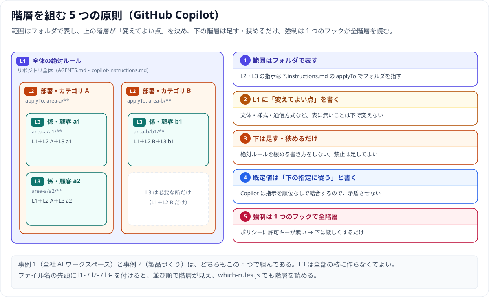

| # | 原則 | Copilot での書き方 |
|---|---|---|
| 1 | 範囲はフォルダで表す | L2：`applyTo: "departments/qa/**"`、L3：`applyTo: "departments/qa/inspection/**"`。ファイル名の先頭に `l2-`・`l3-` を付けて階層を見えるようにする |
| 2 | L1 に「変えてよい点」を書く | `AGENTS.md` に表で書く。値なら機械が読める JSON（事例 2 の `product-rules.json`） |
| 3 | 下は足す・狭めるだけ | L2・L3 の指示は「L1 に足すルール」と冒頭に明記。禁止を足すのは自由、緩めるのは不可 |
| 4 | 既定値は「下の指定に従う」と書く | 例：営業部「文体の既定はです・ます。係の指定があればそちらに従う」 |
| 5 | 強制は 1 つのフックで全階層 | `.github/hooks/hooks.json` → `layered-guard.js` が `.github/policies/*.json` を全部読む |

---

## 2. 事例 1：全社 AI ワークスペース（絶対ルール → 部署 → 係）

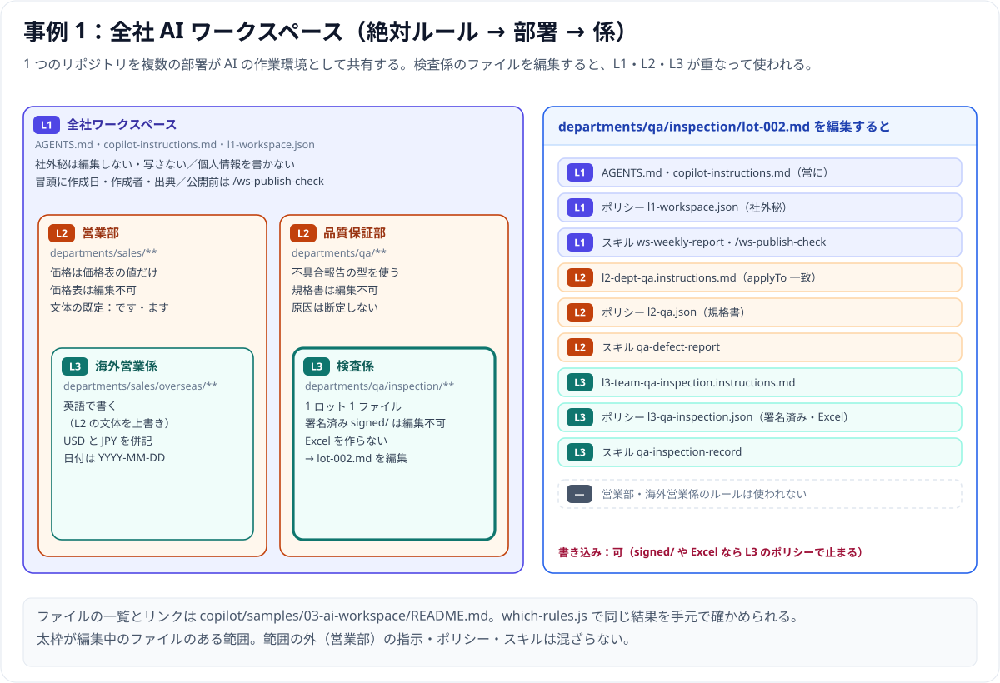

**どんな場面か**：1 つのリポジトリを、営業部と品質保証部が「AI で資料を作る環境」として共有する。全社で絶対に守ること（社外秘・個人情報・出典・公開前チェック）があり、部署ごとに使う様式や資料が違い、さらに係ごとに言語や記録の作り方が違う。

### 階層ごとのファイル

| 階層 | 範囲 | 指示 | 強制 | スキル |
|---|---|---|---|---|
| **L1 全社** | 全体 | [AGENTS.md](samples/03-ai-workspace/AGENTS.md)・[copilot-instructions.md](samples/03-ai-workspace/.github/copilot-instructions.md) | [l1-workspace.json](samples/03-ai-workspace/.github/policies/l1-workspace.json) | [ws-weekly-report](samples/03-ai-workspace/.github/skills/ws-weekly-report/SKILL.md)・[ws-publish-check](samples/03-ai-workspace/.github/skills/ws-publish-check/SKILL.md)（手動） |
| **L2 営業部** | `departments/sales/**` | [l2-dept-sales](samples/03-ai-workspace/.github/instructions/l2-dept-sales.instructions.md) | [l2-sales.json](samples/03-ai-workspace/.github/policies/l2-sales.json) | [sales-proposal](samples/03-ai-workspace/.github/skills/sales-proposal/SKILL.md) |
| **L2 品質保証部** | `departments/qa/**` | [l2-dept-qa](samples/03-ai-workspace/.github/instructions/l2-dept-qa.instructions.md) | [l2-qa.json](samples/03-ai-workspace/.github/policies/l2-qa.json) | [qa-defect-report](samples/03-ai-workspace/.github/skills/qa-defect-report/SKILL.md) |
| **L3 海外営業係** | `departments/sales/overseas/**` | [l3-team-sales-overseas](samples/03-ai-workspace/.github/instructions/l3-team-sales-overseas.instructions.md) | — | — |
| **L3 検査係** | `departments/qa/inspection/**` | [l3-team-qa-inspection](samples/03-ai-workspace/.github/instructions/l3-team-qa-inspection.instructions.md) | [l3-qa-inspection.json](samples/03-ai-workspace/.github/policies/l3-qa-inspection.json) | [qa-inspection-record](samples/03-ai-workspace/.github/skills/qa-inspection-record/SKILL.md) |

全階層の共通部品：[hooks.json](samples/03-ai-workspace/.github/hooks/hooks.json)・[layered-guard.js](samples/03-ai-workspace/.github/hooks/scripts/layered-guard.js)・[CODEOWNERS](samples/03-ai-workspace/.github/CODEOWNERS)・部署のエージェント（[sales-assistant](samples/03-ai-workspace/.github/agents/sales-assistant.agent.md)・[qa-assistant](samples/03-ai-workspace/.github/agents/qa-assistant.agent.md)）。

### 各階層に何を書いたか（抜粋）

| 階層 | 書いたこと | ポイント |
|---|---|---|
| L1 | 社外秘は編集しない・写さない／個人情報を書かない／冒頭に作成日・作成者・出典／公開前は `/ws-publish-check`。**下で決めてよいこと**：文体・言語、様式、用語・資料、追加の禁止 | 「変えてよい点」を表にして、それ以外は下で触れない |
| L2 営業部 | 価格は価格表の値だけ／価格表は編集不可／**文体の既定はです・ます、係の指定があればそちらに従う** | 既定値に「下の指定に従う」を添える |
| L2 品質保証部 | 不具合報告の型／規格書は編集不可／原因は断定しない | 部署の様式はスキルに、約束は指示に |
| L3 海外営業係 | 英語で書く（L2 の文体の既定を上書き）／USD と JPY 併記 | L1 が「変えてよい」とした点だけを上書き |
| L3 検査係 | 1 ロット 1 ファイル／署名済み `signed/` は編集不可／Excel を作らない | 禁止を足す（ポリシーにも書く） |

### このファイルを編集すると、どれが使われるか

| 編集するファイル | 使われる階層 | 書き込み |
|---|---|---|
| `departments/qa/inspection/lot-002.md` | L1 全社＋L2 品質保証部＋L3 検査係 | 可 |
| `departments/qa/inspection/signed/lot-001.md` | 同上 | **不可**（L3 のポリシー） |
| `departments/sales/overseas/quote.md` | L1 全社＋L2 営業部＋L3 海外営業係 | 可 |
| `departments/sales/price-master/prices.csv` | L1 全社＋L2 営業部 | **不可**（L2 のポリシー） |
| `confidential/plan.md` | L1 全社だけ | **不可**（L1 のポリシー） |

### ファイル構成図と、階層ごとの仕組み

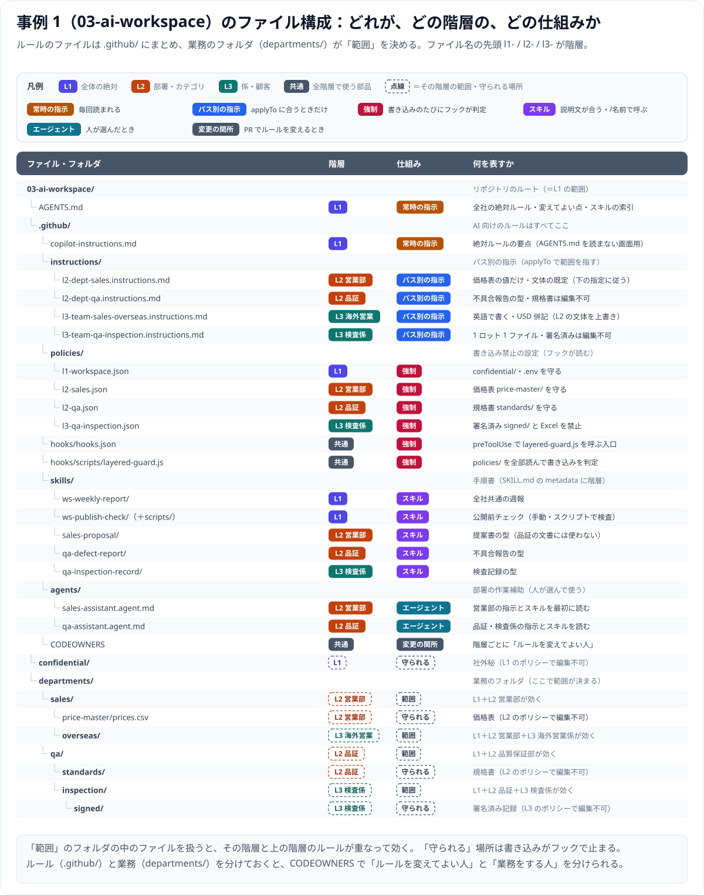

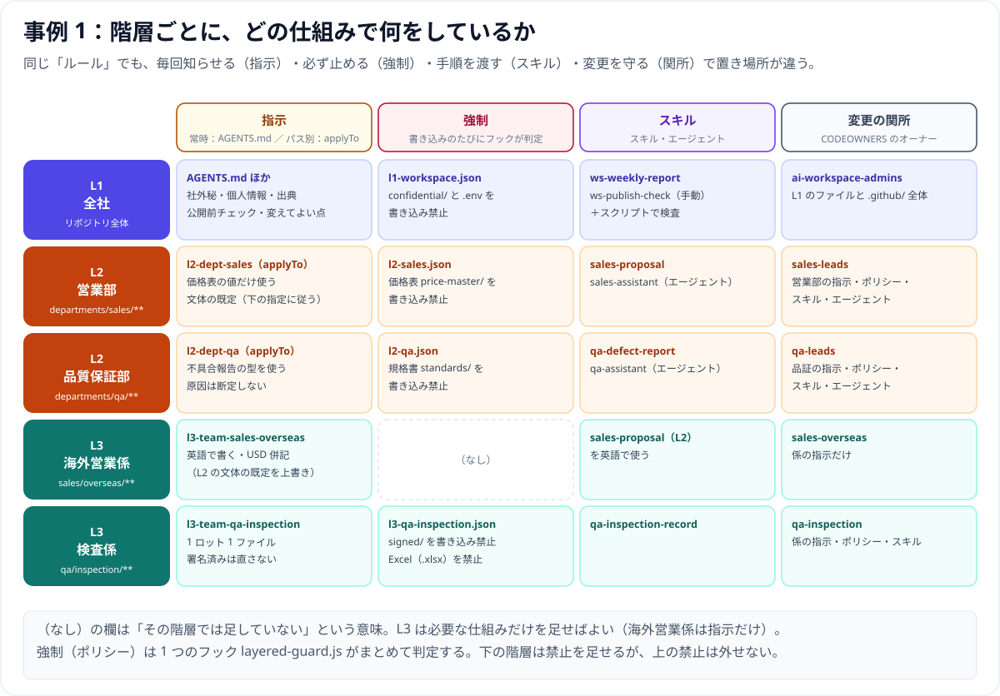

注釈つきのフォルダ構成（テキスト版）は [samples/03-ai-workspace/README.md](samples/03-ai-workspace/README.md#ファイル構成図どのファイルがどの階層のどの仕組みか) にあります。

---

## 3. 事例 2：製品づくり（絶対の作り方 → 製品カテゴリ → 顧客）

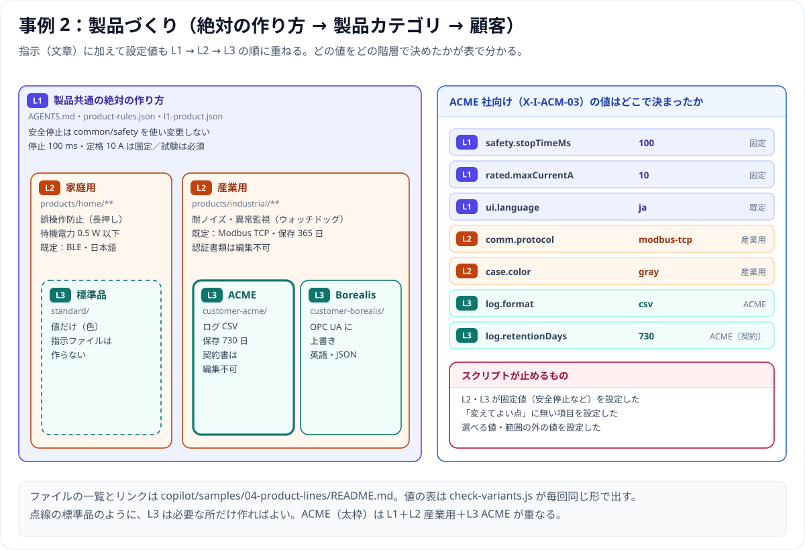

**どんな場面か**：同じ制御基板を元に、家庭用と産業用の製品を作り、産業用はさらに顧客ごとに通信方式やログの仕様が違う。どの製品でも安全停止の作り方と定格は絶対に変えない。

事例 1 との違いは、**文章の指示に加えて「設定値」も階層で重ねる**ことです。値は AI に推測させず、ファイルに書いて機械で確かめます。

### 階層ごとのファイル

| 階層 | 範囲 | 指示 | 設定値 | 強制 | スキル |
|---|---|---|---|---|---|
| **L1 製品共通** | 全体 | [AGENTS.md](samples/04-product-lines/AGENTS.md)・[copilot-instructions.md](samples/04-product-lines/.github/copilot-instructions.md) | [product-rules.json](samples/04-product-lines/.github/product-rules.json)（固定値・既定値・変えてよい点） | [l1-product.json](samples/04-product-lines/.github/policies/l1-product.json) | [product-variant-check](samples/04-product-lines/.github/skills/product-variant-check/SKILL.md)（手動＋[スクリプト](samples/04-product-lines/.github/skills/product-variant-check/scripts/check-variants.js)） |
| **L2 家庭用** | `products/home/**` | [l2-line-home](samples/04-product-lines/.github/instructions/l2-line-home.instructions.md) | [line.json](samples/04-product-lines/products/home/line.json) | — | [home-ux-review](samples/04-product-lines/.github/skills/home-ux-review/SKILL.md) |
| **L2 産業用** | `products/industrial/**` | [l2-line-industrial](samples/04-product-lines/.github/instructions/l2-line-industrial.instructions.md) | [line.json](samples/04-product-lines/products/industrial/line.json) | [l2-industrial.json](samples/04-product-lines/.github/policies/l2-industrial.json) | [industrial-env-review](samples/04-product-lines/.github/skills/industrial-env-review/SKILL.md) |
| **L3 標準品** | `products/home/standard/**` | （作らない） | [variant.json](samples/04-product-lines/products/home/standard/variant.json) | — | — |
| **L3 ACME 社** | `products/industrial/customer-acme/**` | [l3-customer-acme](samples/04-product-lines/.github/instructions/l3-customer-acme.instructions.md) | [variant.json](samples/04-product-lines/products/industrial/customer-acme/variant.json) | [l3-acme.json](samples/04-product-lines/.github/policies/l3-acme.json) | [acme-protocol-check](samples/04-product-lines/.github/skills/acme-protocol-check/SKILL.md) |
| **L3 Borealis 社** | `products/industrial/customer-borealis/**` | [l3-customer-borealis](samples/04-product-lines/.github/instructions/l3-customer-borealis.instructions.md) | [variant.json](samples/04-product-lines/products/industrial/customer-borealis/variant.json) | — | — |

全階層の共通部品：[hooks.json](samples/04-product-lines/.github/hooks/hooks.json)・[layered-guard.js](samples/04-product-lines/.github/hooks/scripts/layered-guard.js)（事例 1 と同じ）・[CODEOWNERS](samples/04-product-lines/.github/CODEOWNERS)（L3 の変更には L2 の責任者もレビューに入る）。

### 値はどの階層で決まったか（`/product-variant-check` の出力）

| 項目 | 家庭用 標準品 | ACME 社向け | Borealis 社向け |
|---|---|---|---|
| 安全停止 `safety.stopTimeMs` | 100（L1 固定） | 100（L1 固定） | 100（L1 固定） |
| 通信 `comm.protocol` | ble（L2） | modbus-tcp（L2） | **opc-ua（L3 で上書き）** |
| 言語 `ui.language` | ja（L2） | ja（L1 既定） | **en（L3）** |
| ログ形式 `log.format` | csv（L1 既定） | **csv（L3）** | **json（L3）** |
| ログ保存日数 `log.retentionDays` | 30（L2） | **730（L3・契約）** | 365（L2） |
| 筐体の色 `case.color` | **white（L3）** | gray（L2） | gray（L2） |

`variant.json` に「変えてよい点」に無い項目（例：`safety.stopTimeMs`）を書くと、スクリプトが **NG** にします。選べる値の外（例：`comm.protocol: "can"`）や範囲の外（保存 1,000 日）も NG です。

### ファイル構成図と、階層ごとの仕組み

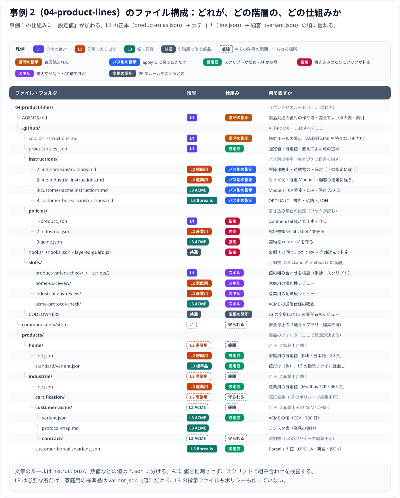

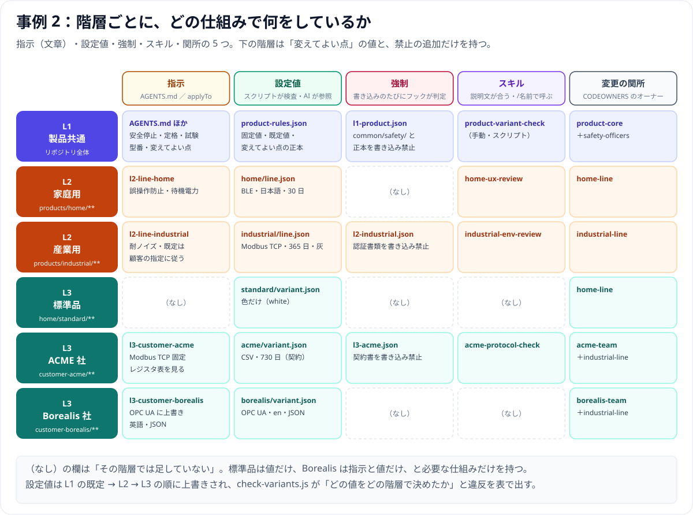

注釈つきのフォルダ構成（テキスト版）は [samples/04-product-lines/README.md](samples/04-product-lines/README.md#ファイル構成図どのファイルがどの階層のどの仕組みか) にあります。

---

## 4. 事例 3：事例 1 と 2 が組み合わさる場合（組織ドメイン × 部品 → 係 → 案件）

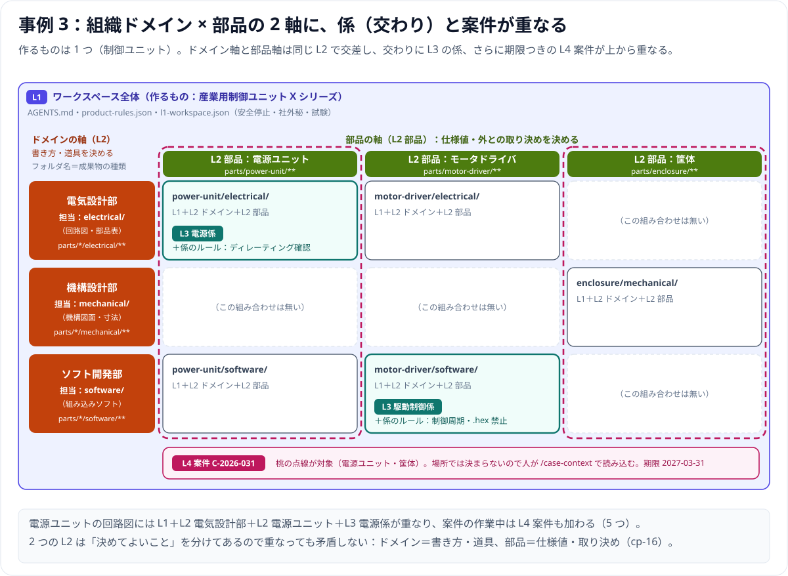

**どんな場面か**：ワークスペースで**作るものは決まっている**（産業用制御ユニット）。でも作り方は、①**組織ドメイン**（電気設計部・機構設計部・ソフト開発部）ごとに違い、②**部品**（電源ユニット・モータドライバ・筐体）ごとにも違う。さらに③その**交わりを担当する係**（電源係＝電気設計部 × 電源ユニット）の細かい手順があり、④**案件**（顧客ごとの一時的な対応）でまた変わる。サンプルは [samples/05-composite-workspace](samples/05-composite-workspace/README.md)。

### 枠組み：3 つの工夫

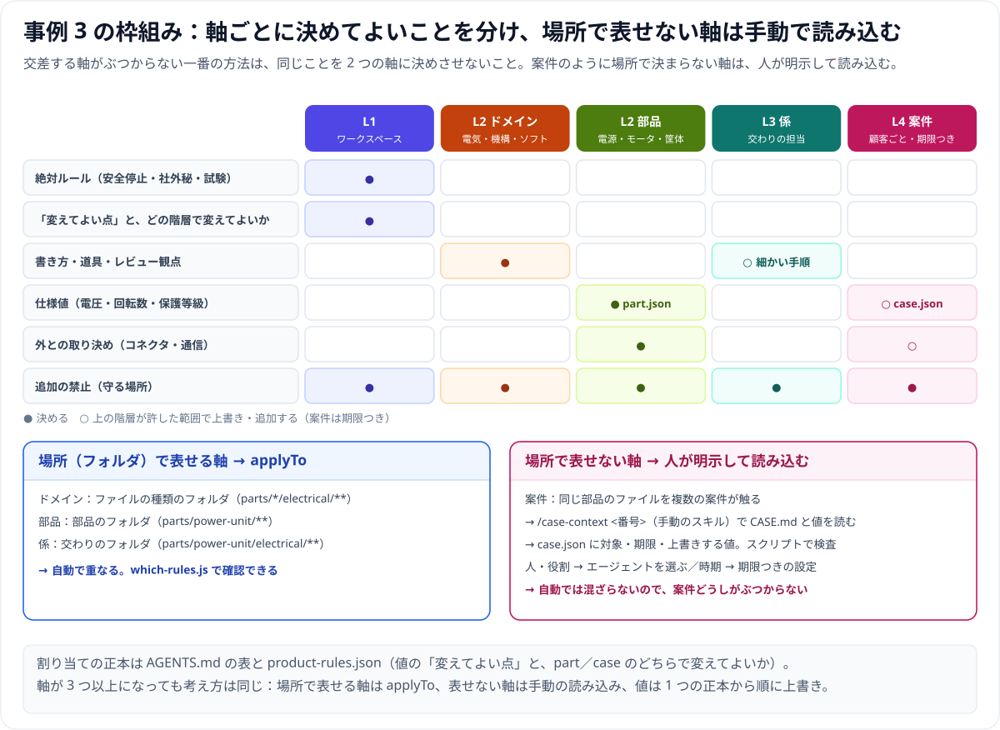

| 工夫 | やり方 | なぜ |
|---|---|---|
| **① 2 つの軸を同じパスで表す** | `parts/<部品>/<成果物の種類>/`（`electrical/`・`mechanical/`・`software/`）。ドメインは `applyTo: parts/*/electrical/**`、部品は `parts/power-unit/**`、係は交わり `parts/power-unit/electrical/**` | 交差する軸も、`applyTo` だけで自動的に重なる |
| **② 軸ごとに「決めてよいこと」を分ける** | ドメイン＝書き方・道具・レビュー観点、部品＝仕様値・外との取り決め、係＝交わりの細かい手順、案件＝期限つきの値の上書き（[AGENTS.md の表](samples/05-composite-workspace/AGENTS.md)） | 同じことを 2 つの軸に決めさせないので、Copilot が順位なしで結合しても矛盾しない |
| **③ 場所で表せない軸は手動で読み込む** | 案件は `cases/<番号>/` に CASE.md（ルール）と case.json（対象・期限・値）をまとめ、人が `/case-context <番号>` で読み込む | 同じ部品を複数の案件が触るので、場所では決められない。手動にすれば案件どうしが混ざらない |

> [!NOTE]
> **ドメインのフォルダ名が部署名でない理由**：`electrical/`・`mechanical/`・`software/` は、あえて部署名ではなく**成果物の種類**にしています。部署は組織変更で名前が変わったり統合されたりしますが、成果物の種類（回路・機構・ソフト）はほとんど変わらないためです。Copilot の `applyTo` はファイルの場所しか見ないので、場所には「そのファイルが何か」を書き、「誰が担当か」は [AGENTS.md の対応表](samples/05-composite-workspace/AGENTS.md#フォルダ名と担当ドメインの対応) と CODEOWNERS で決めます。組織変更のときはその表・指示ファイルの部署名・CODEOWNERS を直すだけで、ファイルは動かさずに済みます。
>
> 組織がほとんど変わらず、フォルダを見て部署が分かる方がよい場合は、`elec-design/`（電気設計部）・`mech-design/`（機構設計部）・`soft-dev/`（ソフト開発部）のような**部署寄りの名前**にしても仕組みは同じです（`applyTo` の値を合わせて変えるだけ）。その場合、組織変更のたびにフォルダの移動と `applyTo`・ポリシーの書き換えが要ります。

### 階層ごとのファイル

| 階層・軸 | 範囲 | 指示 | 設定値 | 強制 | スキル |
|---|---|---|---|---|---|
| **L1** | 全体 | [AGENTS.md](samples/05-composite-workspace/AGENTS.md)・[copilot-instructions.md](samples/05-composite-workspace/.github/copilot-instructions.md) | [product-rules.json](samples/05-composite-workspace/.github/product-rules.json) | [l1-workspace.json](samples/05-composite-workspace/.github/policies/l1-workspace.json) | [ws-design-review](samples/05-composite-workspace/.github/skills/ws-design-review/SKILL.md) |
| **L2 ドメイン** | `parts/*/<種類>/**` | [electrical](samples/05-composite-workspace/.github/instructions/l2-domain-electrical.instructions.md)・[mechanical](samples/05-composite-workspace/.github/instructions/l2-domain-mechanical.instructions.md)・[software](samples/05-composite-workspace/.github/instructions/l2-domain-software.instructions.md) | （決めない） | [l2-domain-electrical.json](samples/05-composite-workspace/.github/policies/l2-domain-electrical.json) | [elec-schematic-review](samples/05-composite-workspace/.github/skills/elec-schematic-review/SKILL.md) |
| **L2 部品** | `parts/<部品>/**` | [power-unit](samples/05-composite-workspace/.github/instructions/l2-part-power-unit.instructions.md)・[motor-driver](samples/05-composite-workspace/.github/instructions/l2-part-motor-driver.instructions.md)・[enclosure](samples/05-composite-workspace/.github/instructions/l2-part-enclosure.instructions.md) | 各 [part.json](samples/05-composite-workspace/parts/power-unit/part.json) | [l2-part-power-unit.json](samples/05-composite-workspace/.github/policies/l2-part-power-unit.json) | — |
| **L3 係** | 交わりのフォルダ | [電源係](samples/05-composite-workspace/.github/instructions/l3-team-power.instructions.md)・[駆動制御係](samples/05-composite-workspace/.github/instructions/l3-team-drive-control.instructions.md) | （決めない） | [l3-team-drive-control.json](samples/05-composite-workspace/.github/policies/l3-team-drive-control.json) | [power-derating-check](samples/05-composite-workspace/.github/skills/power-derating-check/SKILL.md) |
| **L4 案件** | 人が読み込む | [CASE.md](samples/05-composite-workspace/cases/C-2026-031/CASE.md)・[l4-cases](samples/05-composite-workspace/.github/instructions/l4-cases.instructions.md) | [case.json](samples/05-composite-workspace/cases/C-2026-031/case.json)（期限つき） | [l4-case-c-2026-031.json](samples/05-composite-workspace/.github/policies/l4-case-c-2026-031.json) | [case-context](samples/05-composite-workspace/.github/skills/case-context/SKILL.md)（手動）・[case-worker](samples/05-composite-workspace/.github/agents/case-worker.agent.md) |

### 電源ユニットの回路図を、案件の作業中に編集すると

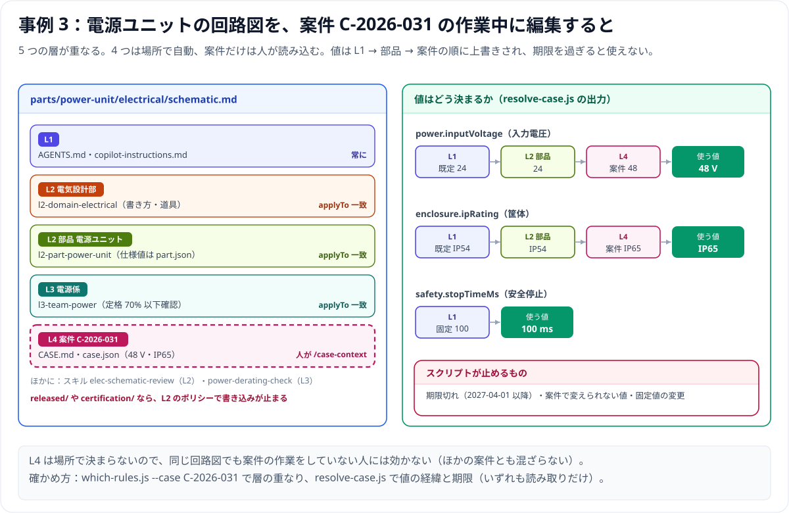

| 層 | 何が | どう効くか |
|---|---|---|
| L1 | AGENTS.md・copilot-instructions.md | 常に |
| L2 ドメイン | 電気設計部の指示（書き方・道具） | applyTo 一致（`parts/*/electrical/**`） |
| L2 部品 | 電源ユニットの指示（値は part.json） | applyTo 一致（`parts/power-unit/**`） |
| L3 係 | 電源係の指示（ディレーティング確認） | applyTo 一致（`parts/power-unit/electrical/**`） |
| L4 案件 | CASE.md・case.json（48 V・IP65） | **人が `/case-context C-2026-031` で読み込んだときだけ** |

値は `L1 既定 24 V → L2 部品 24 V → L4 案件 48 V` の順に上書きされ、[resolve-case.js](samples/05-composite-workspace/.github/skills/case-context/scripts/resolve-case.js) が経緯を表で出します。期限（2027-03-31）を過ぎた案件や、案件で変えてはいけない値（モータの回転数は部品だけが決める）を設定すると NG です。`which-rules.js --case C-2026-031` で、案件の作業中に効く層も確かめられます。

### ファイル構成図と、階層ごとの仕組み

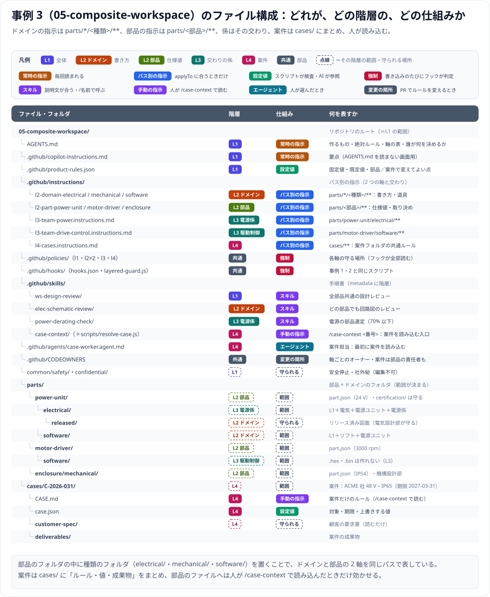

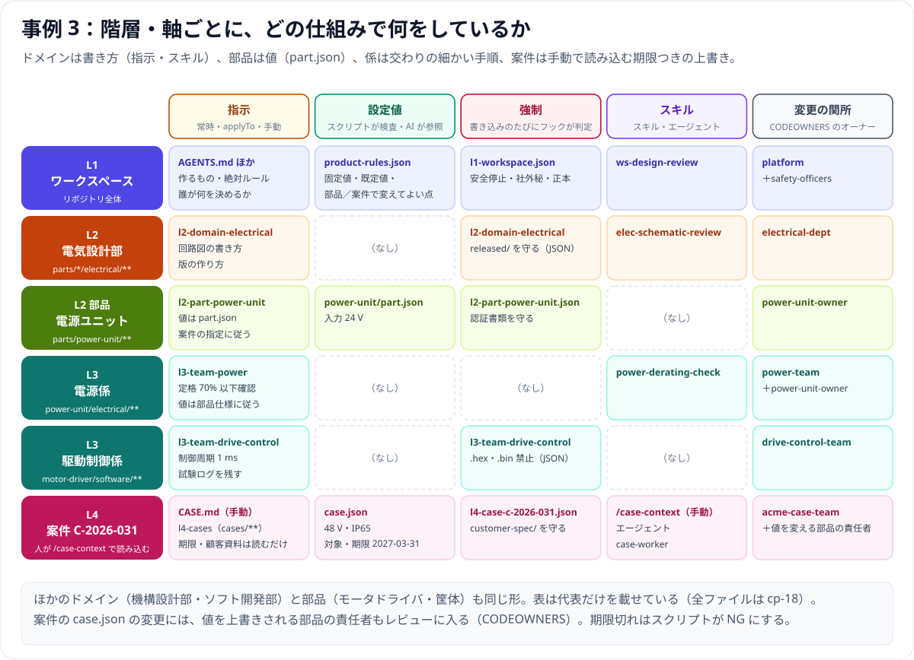

注釈つきのフォルダ構成（テキスト版）は [samples/05-composite-workspace/README.md](samples/05-composite-workspace/README.md#ファイル構成図どのファイルがどの階層のどの仕組みか) にあります。

### 軸がさらに増えたら

- **場所で表せる軸**（ファイルの種類・部品・サブシステム）→ フォルダの段にして `applyTo` で指す。段を増やしすぎないよう、決めてよいことが重ならない軸だけを段にする。
- **場所で表せない軸**（案件・顧客の一時対応・担当者・時期）→ 手動の読み込み（スキル・エージェント）か、期限つきの設定ファイル。
- **値**は 1 つの正本（`product-rules.json`）に「どの軸・階層で変えてよいか」を項目ごとに書き、スクリプトで重ねて検査する。

---

## 5. 1 階層 → 2 階層 → 3 階層と育てる

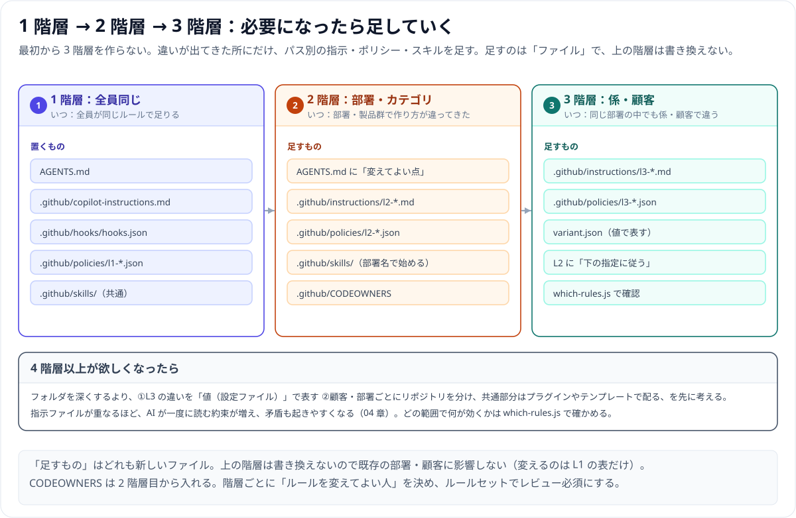

| 段階 | いつ | 足すもの |
|---|---|---|
| 1 階層 | 全員が同じルールで足りる | `AGENTS.md`・`copilot-instructions.md`・`.github/hooks/`・`l1-*.json`・共通スキル |
| 2 階層 | 部署・製品群で作り方が違ってきた | `AGENTS.md` に「変えてよい点」の表、`l2-*.instructions.md`（applyTo）、`l2-*.json`、部署名で始まるスキル、`CODEOWNERS` |
| 3 階層 | 同じ部署の中でも係・顧客で違う | `l3-*.instructions.md`、`l3-*.json`、値なら `variant.json`、L2 の既定に「下の指定に従う」、`which-rules.js` での確認 |

**4 階層以上が欲しくなったら**：フォルダを深くするより、①L3 の違いを値（設定ファイル）で表す、②顧客・部署ごとにリポジトリを分け、共通部分はプラグイン（[01 の 6 章](01_copilot-setup.md#6-配る共有する)）やテンプレートで配る、を先に考えます。指示ファイルが重なるほど、AI が一度に読む約束が増え、矛盾も起きやすくなります（[04](../04_instruction-limits-and-timeline.md)）。

---

## 6. 階層つきの強制

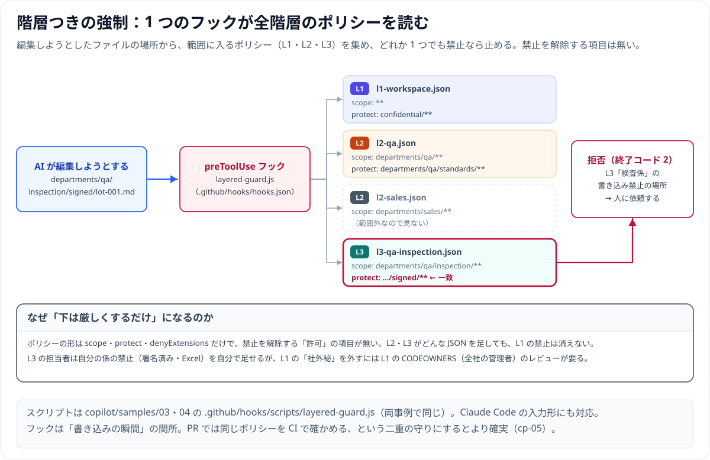

ポリシー（`.github/policies/*.json`）の形：

```json
{
  "level": "L3",
  "name": "検査係",
  "scope": ["departments/qa/inspection/**"],
  "protect": ["departments/qa/inspection/signed/**"],
  "denyExtensions": [".xlsx", ".xls"],
  "reason": "署名済みの検査記録は編集しない。検査記録は Markdown で作る"
}
```

- フックは、編集しようとしたファイルが `scope` に入るポリシーだけを集め、**どれか 1 つでも** `protect` か `denyExtensions` に当たれば止めます（終了コード 2・理由を AI に返す）。
- **「許可」のキーが無い**ので、L2・L3 がどんなポリシーを足しても、L1 の禁止は消えません。L1 の禁止を変えるには L1 のポリシーファイルを直す必要があり、それは CODEOWNERS で全社の管理者のレビューが必須になります。
- 読み取り（`view` など）は止めません。書き込み系のツール（`edit`・`create` など）だけが対象です。

---

## 7. 自分の環境で「どれが効くか」を確かめる

[tools/which-rules.js](tools/which-rules.js) は、ファイルのパスを渡すと、使われる指示・ポリシー・スキルを階層ごとに並べ、書き込みできるかを示します（読み取りだけ）。

```powershell
node agent-skill/copilot/tools/which-rules.js --root agent-skill/copilot/samples/03-ai-workspace departments/qa/inspection/lot-002.md
```

```text
■ departments/qa/inspection/lot-002.md
  L1
    指示　　AGENTS.md（常に）
    指示　　.github/copilot-instructions.md（常に）
    ポリシー.github/policies/l1-workspace.json（全社ワークスペース）
    スキル　ws-publish-check（手動 /ws-publish-check）
    スキル　ws-weekly-report
  L2
    指示　　.github/instructions/l2-dept-qa.instructions.md（applyTo: departments/qa/**）
    ポリシー.github/policies/l2-qa.json（品質保証部）
    スキル　qa-defect-report
  L3
    指示　　.github/instructions/l3-team-qa-inspection.instructions.md（applyTo: departments/qa/inspection/**）
    ポリシー.github/policies/l3-qa-inspection.json（検査係）
    スキル　qa-inspection-record
  書き込み：可
```

- 階層は、指示ファイル名の先頭（`l1-`・`l2-`・`l3-`）、ポリシーの `level`、スキルの `metadata.layer` から読みます。
- スキルの `metadata.scope` は**人と道具のための目印**で、Copilot 自身はこの欄で発火を絞りません。スキルの誤発火は、説明文に対象と「使わない場面」を書いて防ぎます（[01 の 4 章](01_copilot-setup.md#4-説明文の競合を防ぐcopilot-のつまみ)）。

---

## 8. よくある迷い

| 迷い | 答え |
|---|---|
| L3 で L1 の約束を「この係だけ例外」にしたい | 指示で例外を書かない。L1 の「変えてよい点」に加えるかを L1 の担当（CODEOWNERS）と相談し、L1 の表を直す |
| 部署がフォルダで分かれていない（同じファイルを複数部署が触る） | `applyTo` は場所でしか分けられない。役割で分けたいなら部署のエージェント（`*.agent.md`）を作り、人が選んで使う |
| 部署ごとにリポジトリが分かれている | 共通の L1 は各リポジトリの `AGENTS.md`・`.github/hooks` にテンプレートとして配る（または同期の仕組み）。スキル・エージェント・フックはプラグインで配り、エンタープライズ チームごとに有効化できる |
| 入れ子の `AGENTS.md`（`departments/qa/AGENTS.md`）ではだめか | cloud agent は入れ子に対応するが、VS Code・CLI での扱いは環境で確認が要る。確実に効かせるなら `applyTo` を本命にし、入れ子の AGENTS.md は補助にする |
| Claude Code でも同じ構成にできるか | できる。`applyTo` → `.claude/rules/*.md` の `paths`、`.github/hooks` → `.claude/settings.json` の hooks（`layered-guard.js` は両方の入力形に対応）に置き換える（[claude 編](../claude/01_claude-code-setup.md)） |
