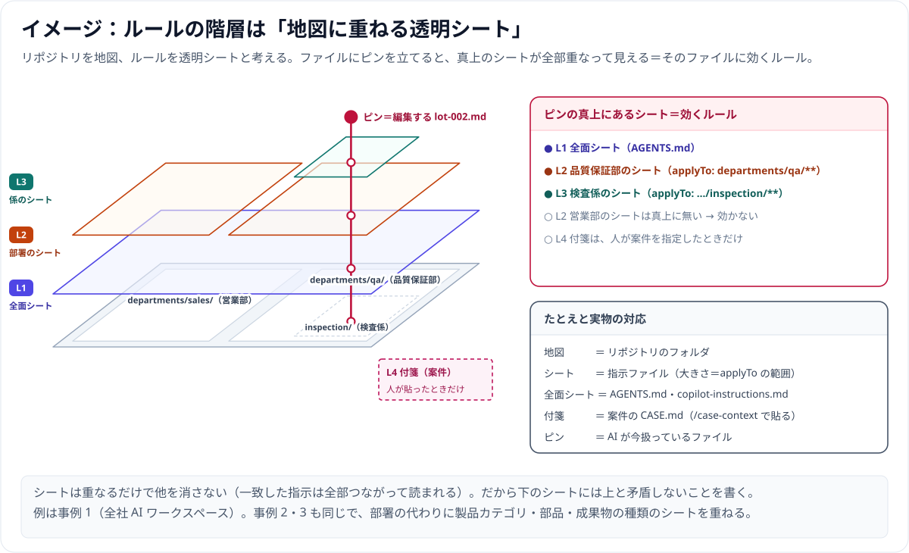
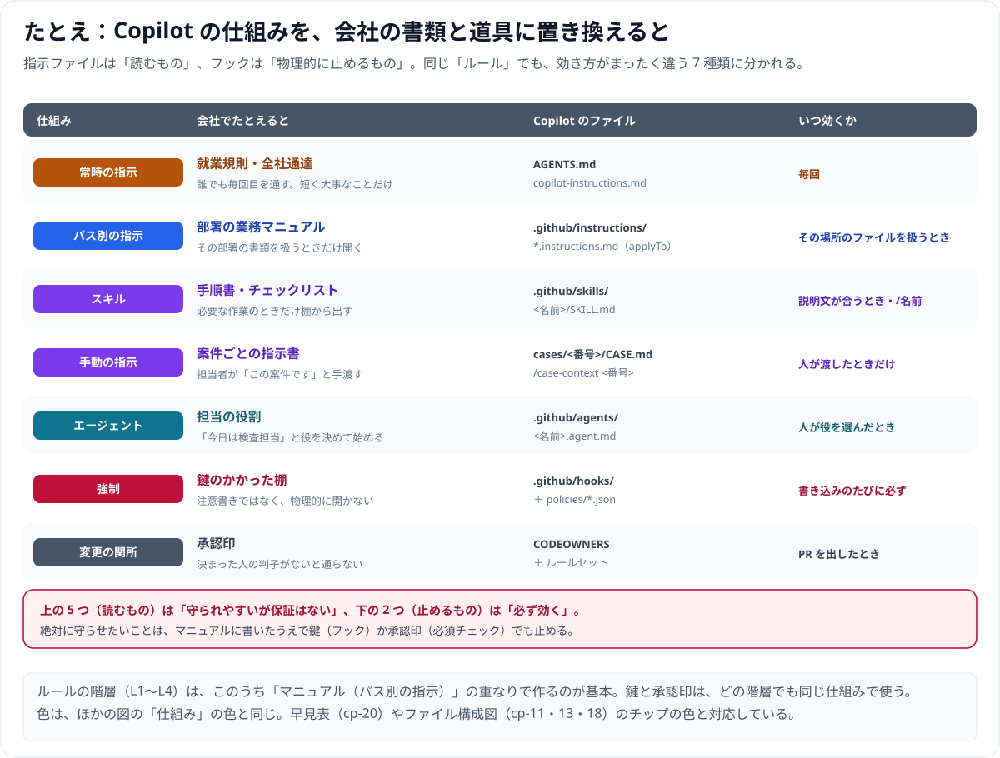
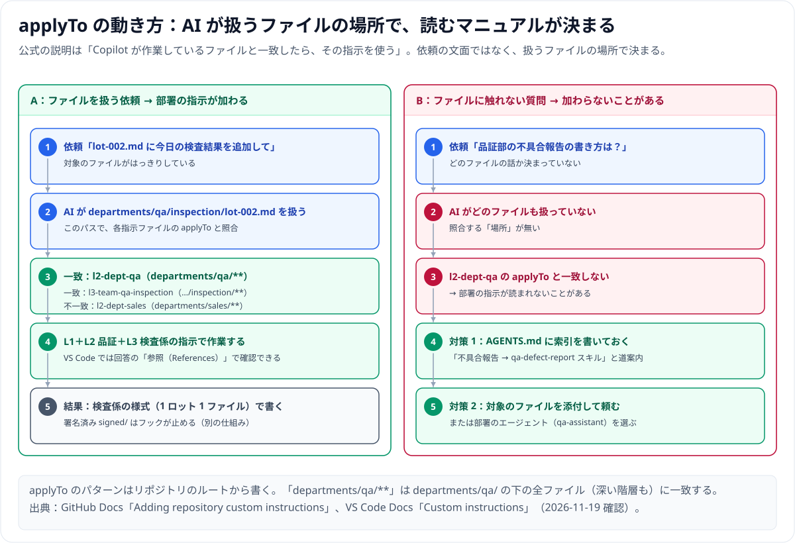
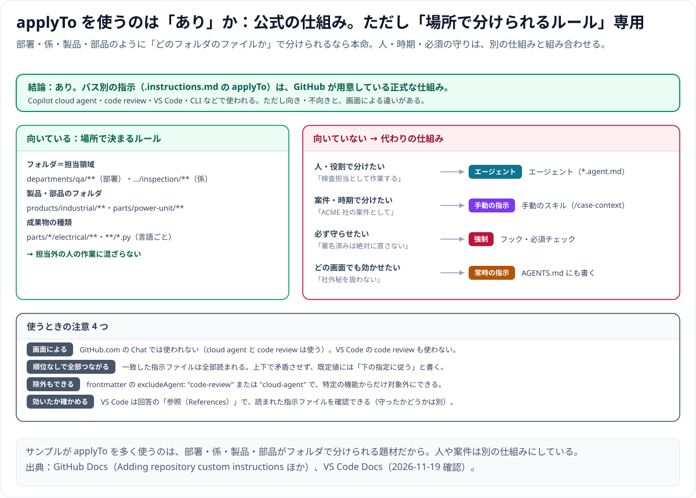
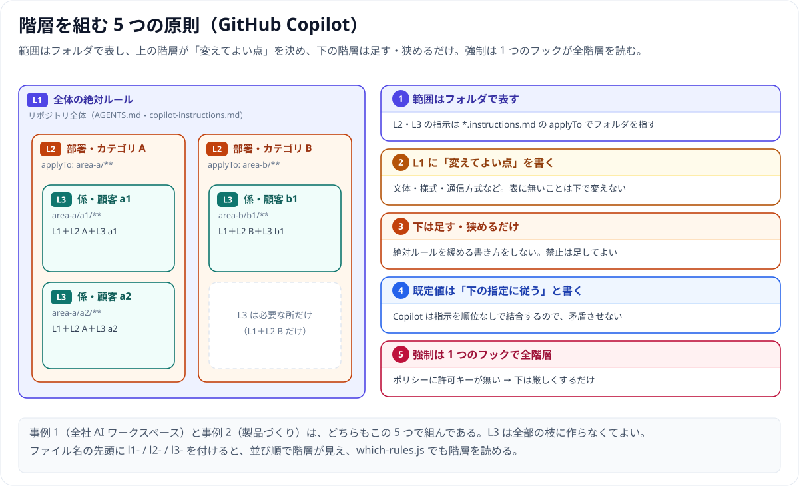
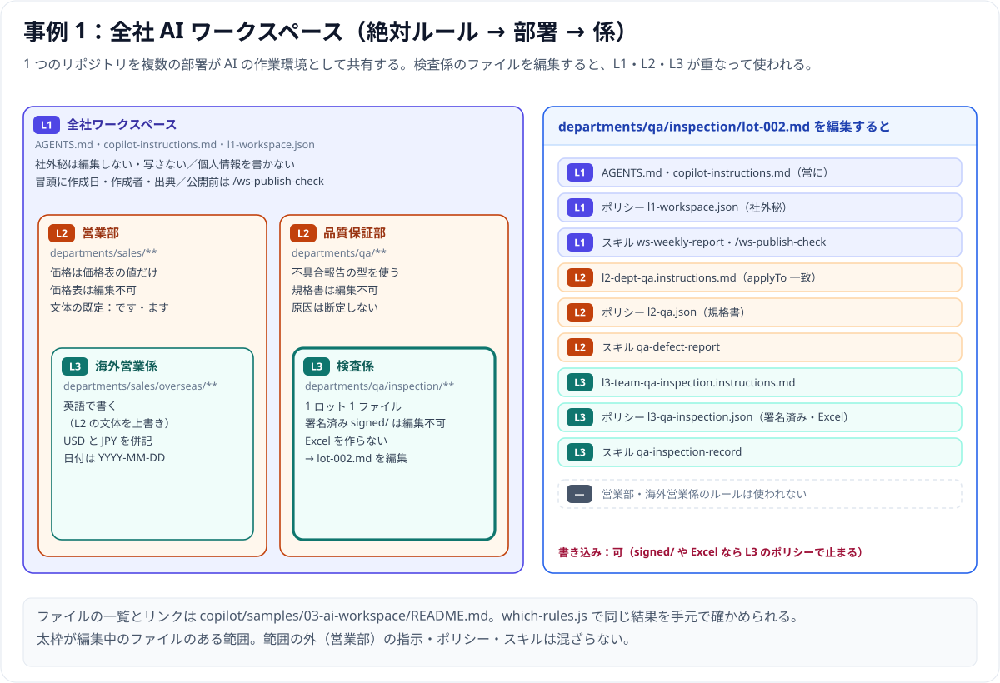
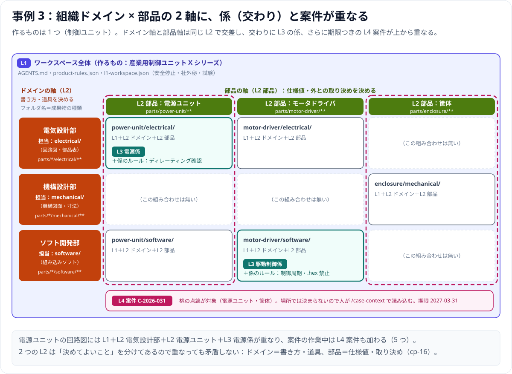
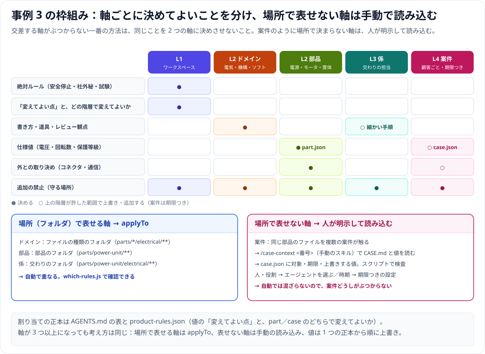
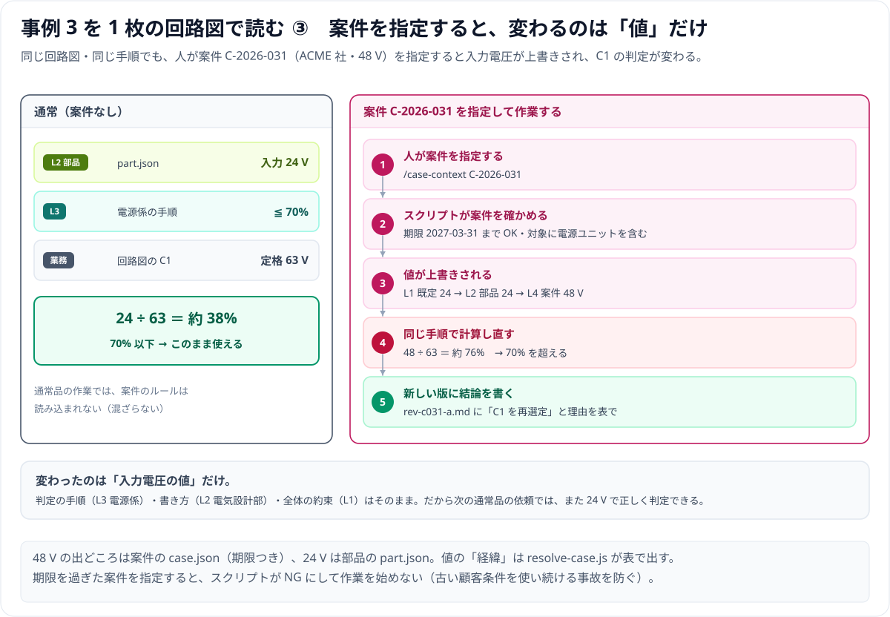
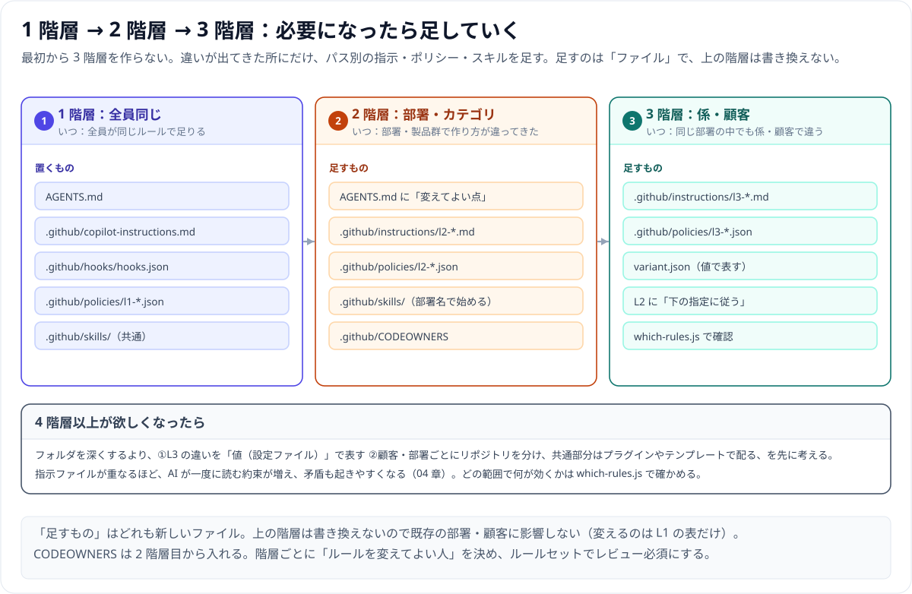

# 図で読む：ルールの階層の組み方（GitHub Copilot）

このページだけで、ルールの階層（L1〜L4）の考え方と作り方が分かるようにまとめました。**まずイメージ → 仕組みの正体（applyTo）→ 早見表 → 事例を 1 枚のファイルでたどる → 作る順番**の順に読むと、つながりが見えます。各図の下に「この図で言いたいこと」と「見るところ」を短く付けています。

| 読む順番 | 内容 | 図 |
|---|---|---|
| 1 | [イメージでつかむ](#1-イメージでつかむ)：透明シート・会社の書類にたとえる | cp-27・cp-28 |
| 2 | [applyTo の正体と「ありか」](#2-applyto-の正体とありか) | cp-29・cp-30 |
| 3 | [早見表：こんなときは、このファイルを作る](#3-早見表こんなときはこのファイルを作る) | cp-20 |
| 4 | [基本形：3 階層を重ねる（事例 1）](#4-基本形3-階層を重ねる事例-1) | cp-06・cp-07 |
| 5 | [応用形：2 つの軸が交差する（事例 3）](#5-応用形2-つの軸が交差する事例-3) | cp-15・cp-16 |
| 6 | [1 枚の回路図でたどる ①〜⑤](#6-1-枚の回路図でたどる) | cp-21〜25 |
| 7 | [作る順番と育て方](#7-作る順番と育て方) | cp-26・cp-09・sk-23 |

---

## 1. イメージでつかむ

### 透明シートを重ねる

> **この図で言いたいこと**：ルールの階層は「上下関係」より「**重ね合わせ**」です。リポジトリという地図の上に、範囲の違う透明シート（指示ファイル）を重ね、ファイルの場所にピンを立てると、真上にあるシートが全部効きます。
>
> **見るところ**
> - 全面シート（L1）はどこにピンを立てても必ず真上にある＝全員に効く。
> - 部署のシート（L2）は自分の部署の上にしか無い。営業部のシートは、検査係のピンの真上に無いので効かない。
> - 付箋（L4 案件）だけは、場所ではなく**人が貼る**。だから同じファイルでも、案件の作業のときだけ効く。

### 会社の書類と道具にたとえる

> **この図で言いたいこと**：同じ「ルール」でも、Copilot には**読むもの**（就業規則・マニュアル・手順書…）と**止めるもの**（鍵・承認印）があります。階層は主に「部署の業務マニュアル」＝パス別の指示の重なりで作ります。
>
> **見るところ**
> - 上の 5 つは AI が「読んで従う」もの。守られやすいが保証はない。
> - 下の 2 つ（フック・CODEOWNERS）は「必ず効く」もの。絶対に守らせたいことはここでも止める。

---

## 2. applyTo の正体と「ありか」

### applyTo はどう動くか

> **この図で言いたいこと**：applyTo は「**AI が今扱っているファイル**のパス」と照合されます。依頼の文面ではなく、扱うファイルの場所で、読まれる部署・係の指示が決まります。
>
> **見るところ**
> - A（ファイルを扱う依頼）：lot-002.md のパスが `departments/qa/**` と `…/inspection/**` に一致 → 品証と検査係の指示が加わる。
> - B（ファイルに触れない質問）：照合する場所が無いので、部署の指示が加わらないことがある。→ AGENTS.md の**索引**と、**ファイルの添付**・**部署のエージェント**で補う。

### applyTo を使うのは「あり」か

> **結論**：**あり**です。パス別の指示（`.instructions.md` の `applyTo`）は GitHub が用意している正式な仕組みで、まさに「フォルダごとにルールを変える」ためのものです。このガイドのサンプルが多用しているのは、部署・係・製品・部品がどれもフォルダで分けられる題材だからです。
>
> **ただし、次の 3 つは applyTo に任せない**
> - **人・役割**で分けたい → エージェント（`*.agent.md`）
> - **案件・時期**で分けたい → 手動のスキル（`/case-context`）
> - **必ず**守らせたい → フック・必須チェック（applyTo の指示は「助言」）
>
> **注意**：GitHub.com の Chat ではパス別の指示は使われません（cloud agent と code review は使う）。一致した指示は順位なしで全部つながるので、上下で矛盾させないこと。

---

## 3. 早見表：こんなときは、このファイルを作る

> **この図で言いたいこと**：自分の状況に当てはまる行だけ、ファイルを作れば足ります。
>
> **見るところ**
> - チップの色＝仕組みの種類（cp-28 と同じ色）。青（パス別の指示＝applyTo）が L2・L3 の本体。
> - 最初は 1 行目（L1）と「守る場所」だけで十分。違いが出てから下の行を足す。

---

## 4. 基本形：3 階層を重ねる（事例 1）

> **この図で言いたいこと**：透明シートの図（cp-27）を真上から見た形です。大きい箱（L1）の中に部署の箱（L2）、その中に係の箱（L3）。右の 5 原則は、シートを重ねても矛盾しないための約束です。
>
> **見るところ**
> - 「L3 は必要な所だけ」：係のシートが無い所もある（右下の点線）。
> - 原則 4「既定値は『下の指定に従う』と書く」：シートは順位なしで重なるため、上の既定値と下の指定がぶつからないようにする工夫。

> **この図で言いたいこと**：検査係のファイルを編集すると、全社・品証・検査係の 3 枚が重なり、営業部の 1 枚は重ならない。
>
> **見るところ**：右の一覧の色（藍＝L1、橙＝L2、青緑＝L3）が、左の箱の色と対応している。全ファイルの一覧は [サンプル 03](samples/03-ai-workspace/README.md)。

---

## 5. 応用形：2 つの軸が交差する（事例 3）

> **この図で言いたいこと**：シートを**縦（部品）と横（ドメイン＝成果物の種類）の 2 方向**に置いた形です。部品のシート（電源ユニット）とドメインのシート（電気設計部）が重なる所に、係のシート（電源係）があります。
>
> **見るところ**
> - 格子の 1 マス＝1 つのフォルダ（例：`power-unit/electrical/`）。そこに L1＋ドメイン＋部品（＋係）が重なる。
> - 桃色の点線＝案件の付箋を貼る範囲。人が `/case-context` で指定したときだけ。

> **この図で言いたいこと**：2 方向のシートがぶつからないのは、**同じことを 2 つの軸に決めさせない**からです（ドメイン＝書き方、部品＝値）。
>
> **見るところ**：下の 2 枚の箱。左は applyTo で表せる軸、右は表せない軸（案件）＝手動で読み込む。cp-30 の「向いている／向いていない」と同じ分け方。

---

## 6. 1 枚の回路図でたどる

題材は `parts/power-unit/electrical/schematic.md`（電源ユニットの回路図）。cp-15 の格子の左上のマスです。

### ① パスを分解する

> **この図で言いたいこと**：パスの `power-unit/` が部品のシート、`electrical/` がドメインのシートを呼び、2 つがそろうと係のシートも重なる。透明シートのピンを、実際のパスで見た図です。
>
> **見るところ**：4 枚のカードの本文は、実際の指示ファイルの中身の要約。カードの上の小さな文字が、そのファイル名。

### ② 通常の作業（案件なし）

> **この図で言いたいこと**：1 つの答えに、4 枚のシートの情報がそれぞれ使われる。値（24 V）は部品、基準（70%）は係、書き方（表）はドメイン。
>
> **見るところ**：下の「答え」のチップに、どの情報がどこから来たかが書いてある。

### ③ 案件を指定すると

> **この図で言いたいこと**：案件の付箋を貼ると、変わるのは**値だけ**（24 V → 48 V）。手順も書き方も同じなので、判定（38% → 76%）だけが自然に変わる。
>
> **見るところ**：右の手順 1〜2。付箋を貼るのは人で、スクリプトが期限と対象を確かめてから値を上書きする。

### ④ 直してはいけない所を直そうとすると

> **この図で言いたいこと**：シート（指示）とは別に、**鍵（フック）**がかかっている。どの階層の「守る場所」かに関係なく、1 つのフックが書き込みの瞬間に止める。
>
> **見るところ**：2 行目だけ「通す」。リリース済みの図面は直せないが、新しい版は作れる。

### ⑤ PR を出すと

> **この図で言いたいこと**：最後は**承認印（CODEOWNERS）**。変えたファイルの場所で、レビューする人が自動で決まる。
>
> **見るところ**：案件の値（case.json）を変えると、値を上書きされる部品の責任者もレビューに入る。

---

## 7. 作る順番と育て方

> **この図で言いたいこと**：シートは 1 枚目（L1）と鍵から作り、違いが出てきた所にだけ 2 枚目・3 枚目を足す。
>
> **見るところ**：各ステップの「作るファイル」。ステップ 3〜6 は必要になってからでよい。

> **この図で言いたいこと**：足すのはいつも**新しいファイル**。上のシートは書き換えないので、既存の部署・顧客に影響しない。

> **この図で言いたいこと**：案件の付箋に書いた知識のうち、何度も使ったものを部品・ドメイン・係のシートへ移していく。

---

## もっと詳しく

| 知りたいこと | 行き先 |
|---|---|
| 3 つの事例の解説とファイルへのリンク | [02 階層の組み方の事例](02_layered-examples.md) |
| 事例ごとの全ファイル（注釈つきの構成） | [サンプル 03](samples/03-ai-workspace/README.md)・[04](samples/04-product-lines/README.md)・[05](samples/05-composite-workspace/README.md) |
| 自分の環境で効くルールを確かめる | [tools/which-rules.js](tools/which-rules.js)（`--case` で案件の作業中も） |
| Copilot の置き場所・設定の一覧 | [01 GitHub Copilot での組み方](01_copilot-setup.md) |
| 指示ファイルの制約と、古い情報の見分け方 | [04 制約と年表](../04_instruction-limits-and-timeline.md) |
