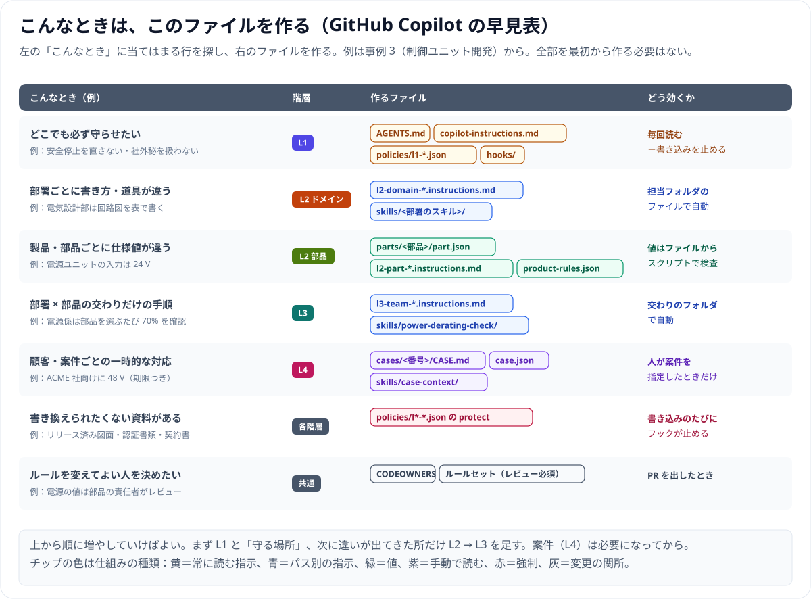
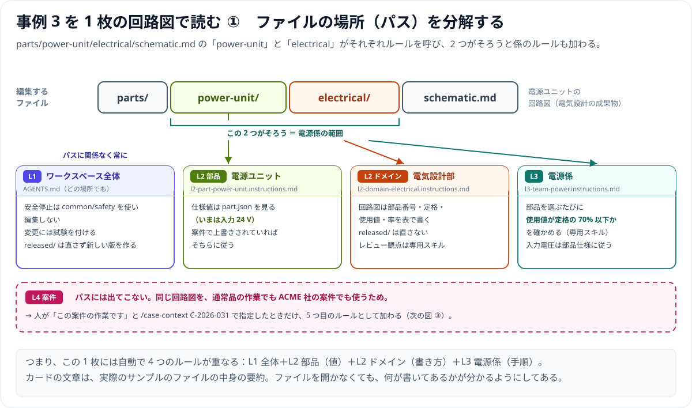
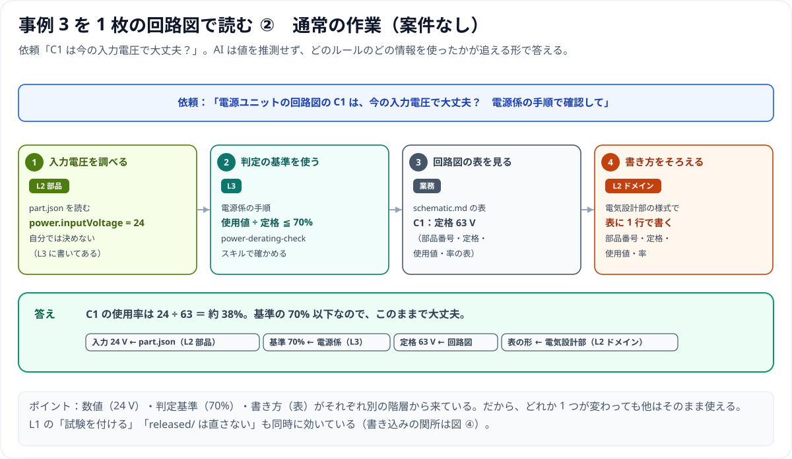
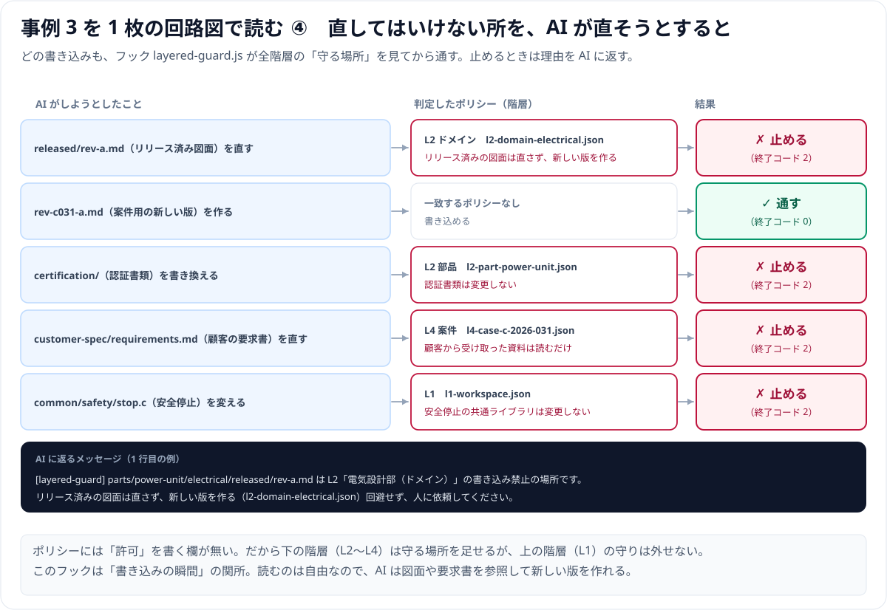
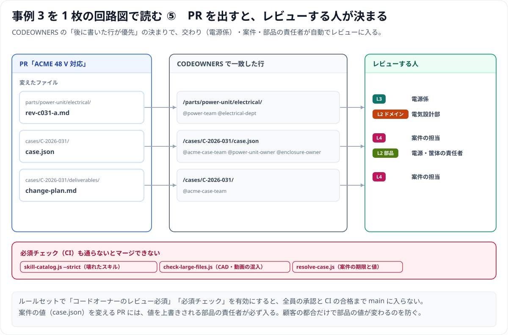
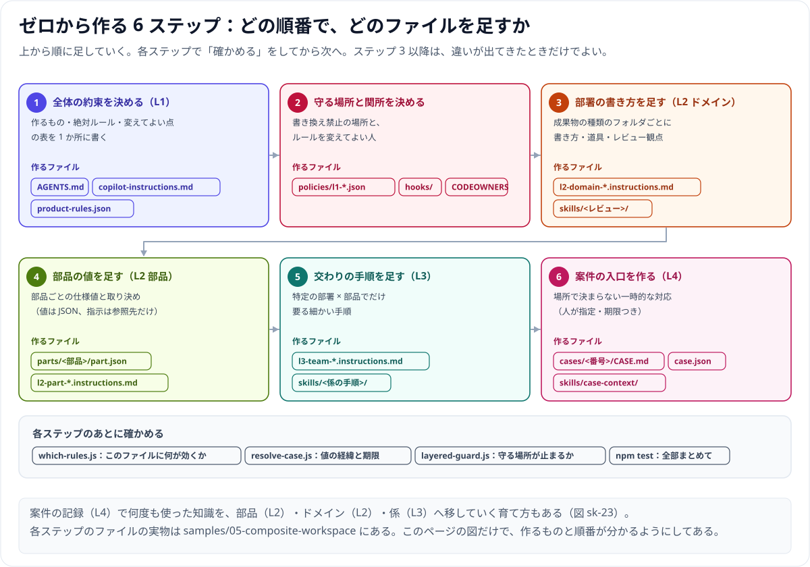
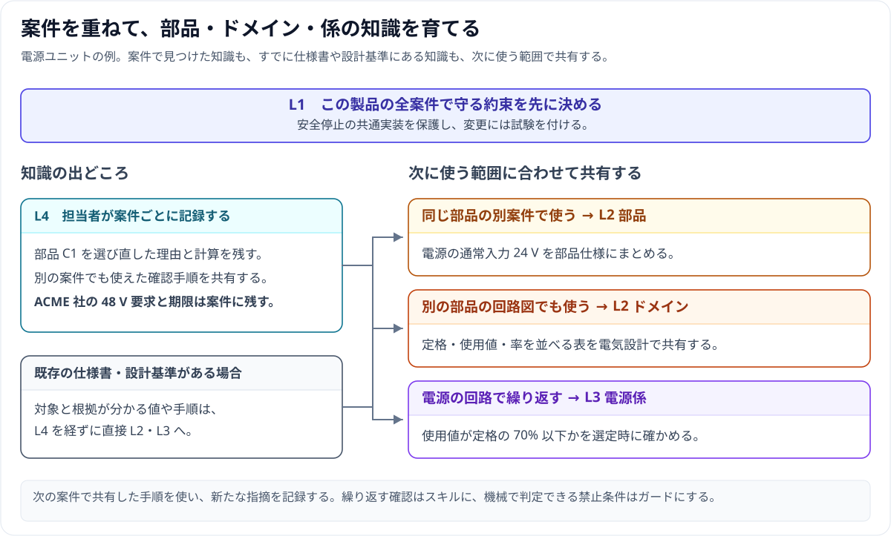

# 図で読む：ルールの階層の組み方（GitHub Copilot）

このページは**図だけで読めるように**作りました。サンプルのフォルダを開かなくても、「どんなときに・何を作るか」と「1 枚のファイルに何が効くか」が分かります。文章は図ごとに 1〜2 行だけです。詳しい解説は [02 階層の組み方の事例](02_layered-examples.md)、実物は [samples/05-composite-workspace](samples/05-composite-workspace/README.md) にあります。

| 読む順番 | 図 | 分かること |
|---|---|---|
| 1 | [早見表](#1-こんなときはこのファイルを作る) | どんなときに、どの階層の、どのファイルを作るか |
| 2 | [事例 3 の全体](#2-事例-3-の全体像) | 組織ドメイン × 部品の 2 軸に、係と案件が重なる形 |
| 3 | [1 枚の回路図で読む ①〜⑤](#3-1-枚の回路図で読む) | パス → 効くルール → 通常の作業 → 案件 → 書き込みの関所 → PR の関所 |
| 4 | [作る順番](#4-ゼロから作る順番と育て方) | ゼロから作る 6 ステップと、案件から知識を育てる流れ |

---

## 1. こんなときは、このファイルを作る

当てはまる行のファイルだけを作ります。最初は 1 行目（L1）と「守る場所」だけで十分です。

---

## 2. 事例 3 の全体像

作るものは 1 つ（制御ユニット）。**ドメイン（書き方）と部品（値）**がフォルダで交差し、交わりに**係**、さらに人が指定したときだけ**案件**が重なります。

2 つの軸がぶつからないのは、**同じことを 2 つの軸に決めさせない**からです。

---

## 3. 1 枚の回路図で読む

題材は `parts/power-unit/electrical/schematic.md`（電源ユニットの回路図）です。

### ① ファイルの場所（パス）を分解する

`power-unit/` が部品のルール、`electrical/` がドメインのルールを呼び、2 つがそろうと電源係のルールも加わります。

### ② 通常の作業（案件なし）

値（24 V）・基準（70%）・書き方（表）は、それぞれ別の階層から来ます。

### ③ 案件を指定すると

案件で変わるのは**値だけ**です。手順と書き方はそのまま使えます。

### ④ 直してはいけない所を直そうとすると

どの書き込みも、1 つのフックが全階層の「守る場所」を確かめます。

### ⑤ PR を出すと

変えたファイルの場所で、レビューする人が自動で決まります。

---

## 4. ゼロから作る順番と育て方

ステップ 3 以降は、違いが出てきたときに足せば十分です。

案件で何度も使った知識は、部品・ドメイン・係のルールへ移していきます。

---

## もっと詳しく

| 知りたいこと | 行き先 |
|---|---|
| 3 つの事例の解説とファイルへのリンク | [02 階層の組み方の事例](02_layered-examples.md) |
| 事例 3 の全ファイル（注釈つきの構成） | [samples/05-composite-workspace](samples/05-composite-workspace/README.md) |
| 自分の環境で効くルールを確かめる | [tools/which-rules.js](tools/which-rules.js)（`--case` で案件の作業中も） |
| Copilot の置き場所・設定の一覧 | [01 GitHub Copilot での組み方](01_copilot-setup.md) |
