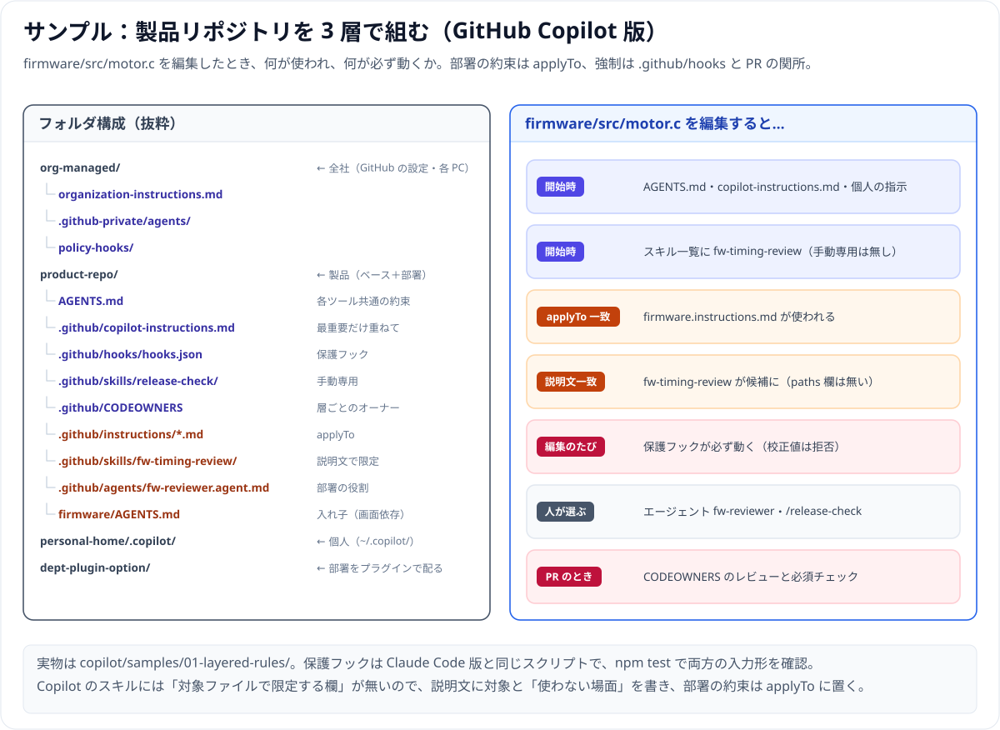

# サンプル 01：製品リポジトリを 3 層で組む（GitHub Copilot 版）

「製品として絶対に守ること（ベース）」「部署だけの約束と手順」「個人の工夫」を、**スキルの説明文ではなく、置き場所と仕組みの強さ**で分けた例です。考え方は [02 スキルの階層化](../../../02_layered-rules.md)、Copilot での設定は [01 GitHub Copilot での組み方](../../01_copilot-setup.md) にあります。同じ題材の Claude Code 版は [claude/samples/01-layered-rules](../../../claude/samples/01-layered-rules/README.md)。



## 構成

```text
01-layered-rules/
├─ org-managed/                          ← ベース（全社）。GitHub の組織設定と各 PC の管理者配布
│   ├─ README.md                         … どこに置き、どこまで効くかの表
│   ├─ organization-instructions.md      … 組織のカスタム指示に貼る文章（GitHub.com 上だけで使われる）
│   ├─ .github-private/agents/           … 組織のエージェント（全メンバーが使える）
│   └─ policy-hooks/guard-secrets.json   … 各 PC の policy.d に置くポリシーフックの例
├─ product-repo/                         ← 製品リポジトリ（ベース＋部署）
│   ├─ AGENTS.md                         … 各ツール共通の約束とスキルの索引（ベース）
│   ├─ CHANGELOG.md
│   ├─ .github/
│   │   ├─ copilot-instructions.md       … Copilot 用の補足。最重要の 3 行は重ねて書く（ベース）
│   │   ├─ instructions/firmware.instructions.md … applyTo: firmware/**（部署：制御ソフト課）
│   │   ├─ instructions/app-ui.instructions.md   … applyTo: app/ui/**（部署：アプリ課）
│   │   ├─ skills/release-check/         … 手動専用の出荷前チェック＋スクリプト（ベース）
│   │   ├─ skills/fw-timing-review/      … 説明文で対象と除外を明記したレビュー手順（部署）
│   │   ├─ agents/fw-reviewer.agent.md   … 部署のレビュー役（本文で「最初にスキルを読む」）
│   │   ├─ hooks/hooks.json              … 保護フックの登録（ベースの強制。cloud agent でも動く）
│   │   ├─ hooks/scripts/guard-protected-paths.js
│   │   └─ CODEOWNERS                    … AI 向けの仕組みのファイルに、層ごとのオーナー
│   ├─ firmware/                         … 部署：制御ソフト課（入れ子の AGENTS.md・src・calibration）
│   └─ app/                              … 部署：アプリ課（入れ子の AGENTS.md・ui）
├─ personal-home/.copilot/               ← 個人（実際は ~/.copilot/）
│   ├─ copilot-instructions.md
│   ├─ instructions/my-python-style.instructions.md
│   └─ skills/my-daily-log/
└─ dept-plugin-option/                   ← 部署のスキルをプラグインで配る案（.github/plugin/marketplace.json）
```

## 層ごとの見どころ

| 層 | 仕組み | 見どころ |
|---|---|---|
| ベース：強制 | `.github/hooks/hooks.json` ＋ `scripts/guard-protected-paths.js` | 校正値と `.env` への**書き込みだけ**を必ず止める（`view` などの読み取りは止めない）。Claude Code 版と同じスクリプト |
| ベース：変更の関所 | `.github/CODEOWNERS` | 指示・スキル・フックの変更に、層ごとの担当のレビューを必須にする（ルールセットと組み合わせる） |
| ベース：常時 | `AGENTS.md` ＋ `.github/copilot-instructions.md` | AGENTS.md に共通の約束と索引。AGENTS.md を読まない画面に備え、最重要だけ copilot-instructions.md にも |
| ベース：全社 | `org-managed/` | 組織の指示は GitHub.com 上だけ → ローカルにも効かせたい約束はリポジトリにも書く |
| ベース：手順 | `.github/skills/release-check/` | `disable-model-invocation: true` で `/release-check` のときだけ。決まった確認はスクリプト |
| 部署：常時 | `.github/instructions/*.instructions.md` | `applyTo` で担当フォルダだけ。部署の約束はここが一番確実 |
| 部署：手順 | `.github/skills/fw-timing-review/`・`.github/agents/fw-reviewer.agent.md` | `paths` が無いので説明文に「firmware/ の C コード」「app/ には使わない」と明記。人が選ぶ部署エージェントからも使う |
| 部署：入れ子 | `firmware/AGENTS.md`・`app/AGENTS.md` | cloud agent は入れ子に対応。VS Code・CLI での扱いは環境で確認するので、同じ約束を applyTo にも書いてある |
| 個人 | `personal-home/.copilot/` | 自分だけの指示とスキル。CLI では同名ならプロジェクトのスキルが優先（Claude Code と逆） |

## 試し方

```powershell
# 保護フック：Copilot の入力形（toolArgs は JSON 文字列）で校正値の編集は拒否（終了コード 2）
'{"toolName":"edit","toolArgs":"{\"path\":\"firmware/calibration/motor-params.json\"}","cwd":"."}' | node agent-skill/copilot/samples/01-layered-rules/product-repo/.github/hooks/scripts/guard-protected-paths.js
$LASTEXITCODE

# 出荷前チェック：わざと入れたバージョン不一致（1.4.0 / 1.3.2）が NG で 1 件出る
node agent-skill/copilot/samples/01-layered-rules/product-repo/.github/skills/release-check/scripts/check-release.js --root agent-skill/copilot/samples/01-layered-rules/product-repo
```

実際に Copilot で試すときは、`product-repo/` の中身を新しいリポジトリにコピーして開きます（`.github/` はリポジトリのルートにある必要があるため）。組織の設定（`org-managed/`）と個人設定（`personal-home/`）は、実際の場所に置いたときだけ効きます。
