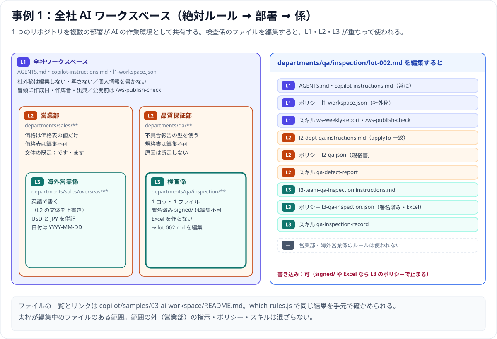
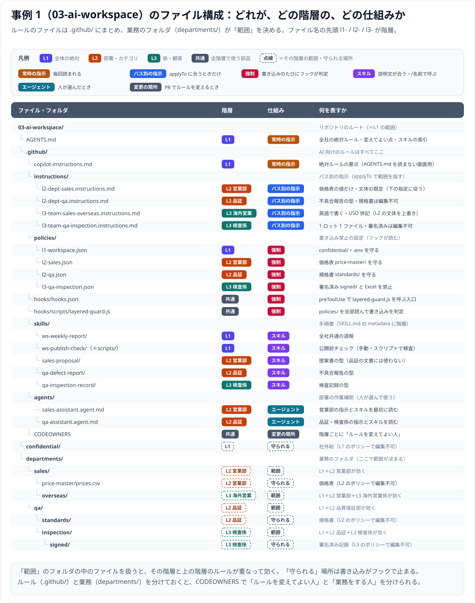
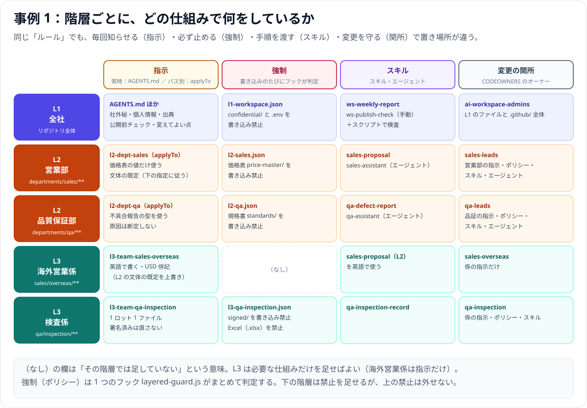

# サンプル 03：全社 AI ワークスペース（絶対ルール → 部署 → 係）

1 つのリポジトリを、複数の部署が「AI で作業する環境」として共有する例です。**ワークスペース全体の絶対ルール（L1）**の下に、**部署（L2：営業部・品質保証部）**、さらにその下に**係（L3：海外営業係・検査係）**のルールとスキルがあります。解説は [02 階層の組み方の事例](../../02_layered-examples.md)。



## ファイル構成図：どのファイルが、どの階層の、どの仕組みか



```text
03-ai-workspace/
├─ AGENTS.md                                   [L1・常時の指示] 全社の絶対ルール・変えてよい点・スキルの索引
├─ .github/                                    ← AI 向けのルールはすべてここ（業務のファイルとは分ける）
│   ├─ copilot-instructions.md                 [L1・常時の指示] 絶対ルールの要点（AGENTS.md を読まない画面用）
│   ├─ instructions/                           ← パス別の指示（applyTo でフォルダを指す）
│   │   ├─ l2-dept-sales.instructions.md       [L2 営業部]   applyTo: departments/sales/**
│   │   ├─ l2-dept-qa.instructions.md          [L2 品証]     applyTo: departments/qa/**
│   │   ├─ l3-team-sales-overseas.instructions.md [L3 海外営業係] applyTo: departments/sales/overseas/**
│   │   └─ l3-team-qa-inspection.instructions.md  [L3 検査係]     applyTo: departments/qa/inspection/**
│   ├─ policies/                               ← 書き込み禁止の設定（フックが全部読む）
│   │   ├─ l1-workspace.json                   [L1]   confidential/・.env
│   │   ├─ l2-sales.json                       [L2]   価格表 price-master/
│   │   ├─ l2-qa.json                          [L2]   規格書 standards/
│   │   └─ l3-qa-inspection.json               [L3]   署名済み signed/・Excel 禁止
│   ├─ hooks/hooks.json                        [共通・強制の入口] preToolUse で下を呼ぶ
│   ├─ hooks/scripts/layered-guard.js          [共通・強制の本体] policies/ を読んで判定
│   ├─ skills/                                 ← 手順書（metadata.layer に階層）
│   │   ├─ ws-weekly-report/                   [L1] 週報
│   │   ├─ ws-publish-check/（＋scripts/）     [L1・手動] 公開前チェック
│   │   ├─ sales-proposal/                     [L2 営業部] 提案書
│   │   ├─ qa-defect-report/                   [L2 品証] 不具合報告
│   │   └─ qa-inspection-record/               [L3 検査係] 検査記録
│   ├─ agents/                                 ← 部署の作業補助（人が選ぶ）
│   │   ├─ sales-assistant.agent.md            [L2 営業部]
│   │   └─ qa-assistant.agent.md               [L2 品証]
│   └─ CODEOWNERS                              [共通・変更の関所] 階層ごとに「ルールを変えてよい人」
├─ confidential/                               (L1 が守る) 社外秘
└─ departments/                                ← 業務のフォルダ。ここで「範囲」が決まる
    ├─ sales/                                  (L2 営業部の範囲)
    │   ├─ price-master/prices.csv             (L2 が守る) 価格表
    │   └─ overseas/                           (L3 海外営業係の範囲)
    └─ qa/                                     (L2 品証の範囲)
        ├─ standards/                          (L2 が守る) 規格書
        └─ inspection/                         (L3 検査係の範囲)
            └─ signed/                         (L3 が守る) 署名済み記録
```

## 階層ごとに、どの仕組みで何をしているか



| 仕組み | いつ効くか | この事例での使い方 |
|---|---|---|
| 常時の指示（AGENTS.md・copilot-instructions.md） | 毎回 | L1 の絶対ルールと「変えてよい点」、スキルの索引 |
| パス別の指示（*.instructions.md） | applyTo に合うファイルを扱うとき | L2（部署）・L3（係）の約束。下の階層ほど狭いフォルダを指す |
| 強制（policies＋フック） | 書き込みのたび | 各階層の「守る場所」。下は禁止を足すだけ |
| スキル | 説明文が合う・/名前で呼ぶ | 各階層の様式（週報・提案書・不具合報告・検査記録）。公開前チェックは手動 |
| エージェント | 人が選んだとき | 部署の作業補助。最初に部署の指示とスキルを読む |
| 変更の関所（CODEOWNERS） | PR でルールを変えるとき | 階層ごとに「ルールを変えてよい人」を分ける |

## 階層ごとのファイル（クリックで開けます）

| 階層 | 範囲 | 常時・パス別の指示 | 強制（書き込み禁止） | スキル | エージェント |
|---|---|---|---|---|---|
| **L1 全社** | リポジトリ全体 | [AGENTS.md](AGENTS.md)・[copilot-instructions.md](.github/copilot-instructions.md) | [l1-workspace.json](.github/policies/l1-workspace.json)（`confidential/`・`.env`） | [ws-weekly-report](.github/skills/ws-weekly-report/SKILL.md)・[ws-publish-check](.github/skills/ws-publish-check/SKILL.md)（手動＋[スクリプト](.github/skills/ws-publish-check/scripts/check-publish.js)） | — |
| **L2 営業部** | `departments/sales/**` | [l2-dept-sales.instructions.md](.github/instructions/l2-dept-sales.instructions.md) | [l2-sales.json](.github/policies/l2-sales.json)（価格表） | [sales-proposal](.github/skills/sales-proposal/SKILL.md) | [sales-assistant](.github/agents/sales-assistant.agent.md) |
| **L2 品質保証部** | `departments/qa/**` | [l2-dept-qa.instructions.md](.github/instructions/l2-dept-qa.instructions.md) | [l2-qa.json](.github/policies/l2-qa.json)（規格書） | [qa-defect-report](.github/skills/qa-defect-report/SKILL.md) | [qa-assistant](.github/agents/qa-assistant.agent.md) |
| **L3 海外営業係** | `departments/sales/overseas/**` | [l3-team-sales-overseas.instructions.md](.github/instructions/l3-team-sales-overseas.instructions.md) | （追加なし） | （L2 のスキルを英語で使う） | — |
| **L3 検査係** | `departments/qa/inspection/**` | [l3-team-qa-inspection.instructions.md](.github/instructions/l3-team-qa-inspection.instructions.md) | [l3-qa-inspection.json](.github/policies/l3-qa-inspection.json)（署名済み・Excel 禁止） | [qa-inspection-record](.github/skills/qa-inspection-record/SKILL.md) | — |
| 共通の強制 | 全階層 | — | [hooks.json](.github/hooks/hooks.json) → [layered-guard.js](.github/hooks/scripts/layered-guard.js) が上の JSON を全部読む | — | — |
| 変更の関所 | 全階層 | — | [CODEOWNERS](.github/CODEOWNERS)（階層ごとのオーナー） | — | — |

## 「このファイルを編集すると、どれが使われるか」

| 編集するファイル | L1 | L2 | L3 | 書き込み |
|---|---|---|---|---|
| `departments/qa/inspection/lot-002.md` | 全社 | 品質保証部 | 検査係 | 可 |
| `departments/qa/inspection/signed/lot-001.md` | 全社 | 品質保証部 | 検査係 | **不可**（L3 のポリシー） |
| `departments/qa/standards/inspection-standard.md` | 全社 | 品質保証部 | — | **不可**（L2 のポリシー） |
| `departments/sales/overseas/quote.md` | 全社 | 営業部 | 海外営業係 | 可 |
| `departments/sales/price-master/prices.csv` | 全社 | 営業部 | — | **不可**（L2 のポリシー） |
| `confidential/plan.md` | 全社 | — | — | **不可**（L1 のポリシー） |

手元で確かめる：

```powershell
node agent-skill/copilot/tools/which-rules.js --root agent-skill/copilot/samples/03-ai-workspace departments/qa/inspection/lot-002.md
```

## 組み方のポイント

1. **L1 に「変えてよい点」を書く**（[AGENTS.md](AGENTS.md) の表）。下の階層は、そこに挙げた点（文体・様式・用語・追加の禁止）だけを決める。
2. **既定値は「下の指定があればそちらに従う」と書く**。Copilot は指示ファイルを順位なしで結合するので、営業部の「です・ます調」と海外営業係の「英語」がぶつからないよう、営業部側に一言添えてある。
3. **強制は 1 つのスクリプトが全階層のポリシーを読む**。ポリシーには「許可」のキーが無いので、下の階層は禁止を足すことしかできない。
4. **ファイル名の先頭に階層（`l1-`・`l2-`・`l3-`）**。並び順で階層が見え、[which-rules.js](../../tools/which-rules.js) も名前から階層を読む。
5. **スキルの `metadata` に `layer`・`scope`** を書く。Copilot はこの欄で発火を絞らないが、人と道具が「どの階層のスキルか」を判断できる（説明文にも対象と「使わない場面」を書いてある）。

実際に Copilot で試すときは、このフォルダの中身を新しいリポジトリにコピーして開きます（`.github/` はリポジトリのルートにある必要があるため）。
