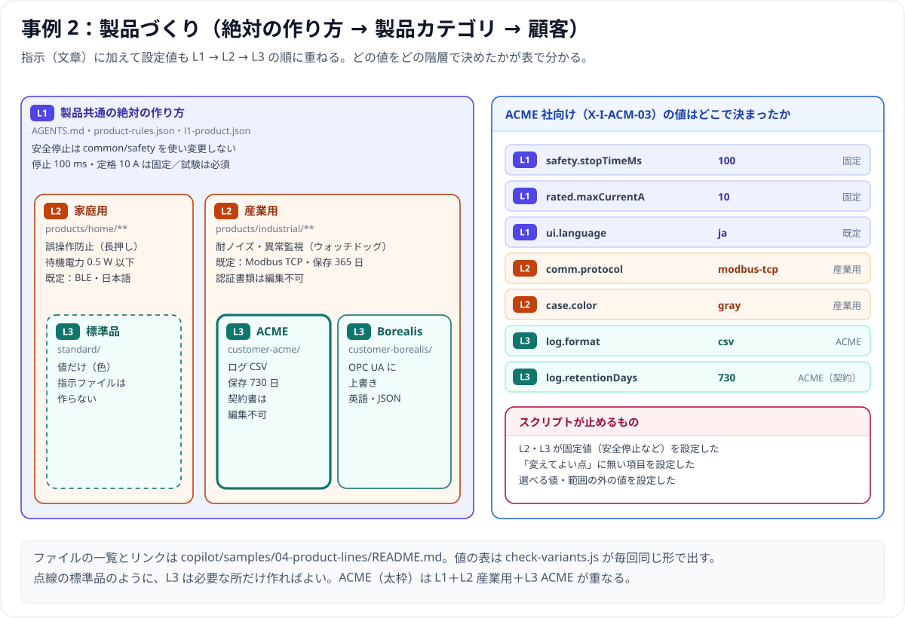
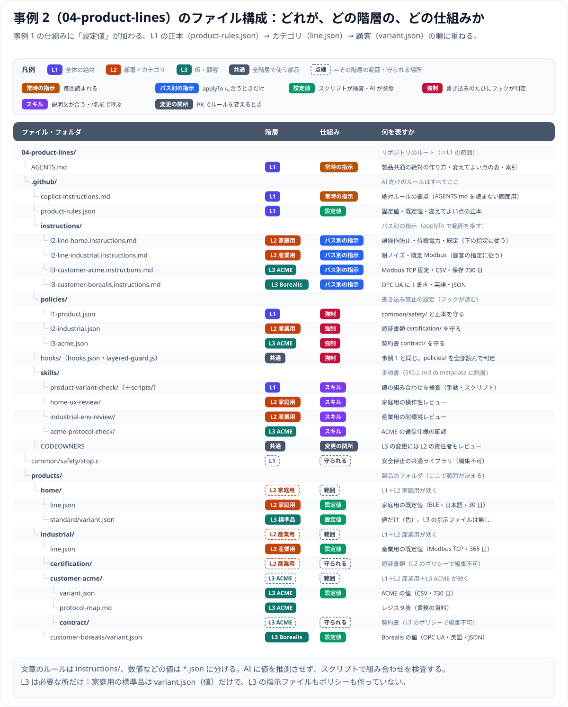
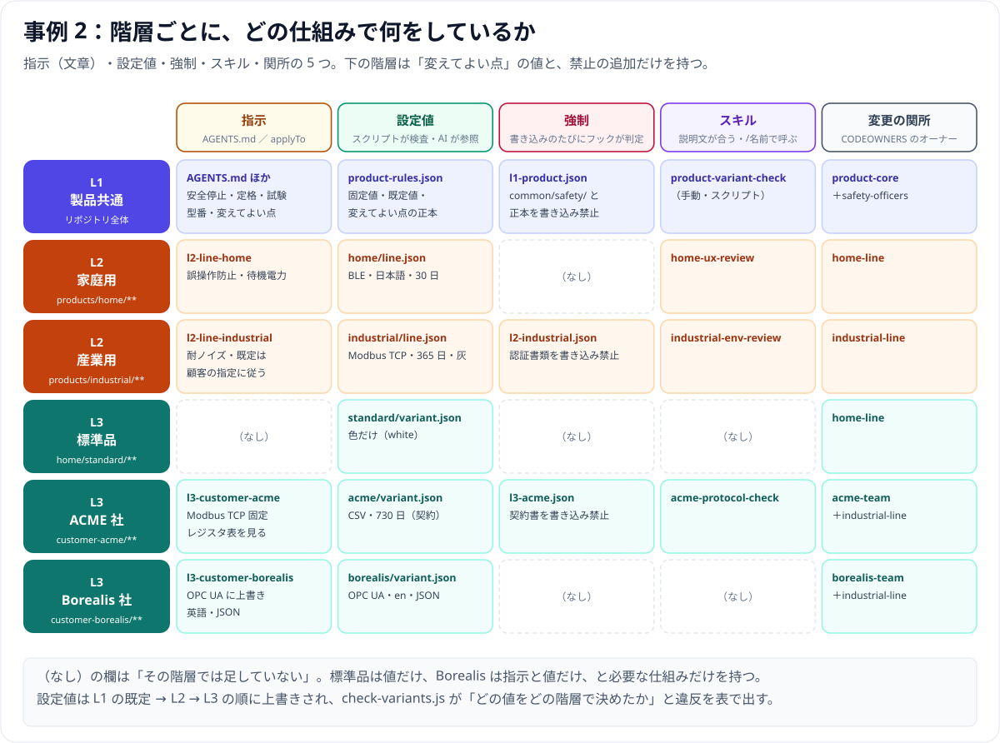

# サンプル 04：製品づくり（絶対の作り方 → 製品カテゴリ → 顧客）

1 つのリポジトリで、**製品共通の絶対の作り方（L1）**を守りながら、**製品カテゴリ（L2：家庭用・産業用）**ごとに作り方を変え、さらに**顧客（L3：ACME 社・Borealis 社）**ごとに仕様を変える例です。**指示（文章）**の階層に加えて、**設定値**も L1 → L2 → L3 の順に重ね、「どの値をどの階層で決めたか」を確かめられるようにしています。解説は [02 階層の組み方の事例](../../02_layered-examples.md)。



## ファイル構成図：どのファイルが、どの階層の、どの仕組みか



```text
04-product-lines/
├─ AGENTS.md                                   [L1・常時の指示] 製品共通の絶対の作り方・変えてよい点の表・索引
├─ .github/
│   ├─ copilot-instructions.md                 [L1・常時の指示] 絶対ルールの要点
│   ├─ product-rules.json                      [L1・設定値] 固定値・既定値・変えてよい点の正本
│   ├─ instructions/
│   │   ├─ l2-line-home.instructions.md        [L2 家庭用]   applyTo: products/home/**
│   │   ├─ l2-line-industrial.instructions.md  [L2 産業用]   applyTo: products/industrial/**
│   │   ├─ l3-customer-acme.instructions.md    [L3 ACME]     applyTo: products/industrial/customer-acme/**
│   │   └─ l3-customer-borealis.instructions.md [L3 Borealis] applyTo: products/industrial/customer-borealis/**
│   ├─ policies/
│   │   ├─ l1-product.json                     [L1]  common/safety/・正本
│   │   ├─ l2-industrial.json                  [L2]  認証書類 certification/
│   │   └─ l3-acme.json                        [L3]  契約書 contract/
│   ├─ hooks/（hooks.json・scripts/layered-guard.js） [共通・強制] 事例 1 と同じ
│   ├─ skills/
│   │   ├─ product-variant-check/（＋scripts/check-variants.js） [L1・手動] 値の組み合わせを検査
│   │   ├─ home-ux-review/                     [L2 家庭用]
│   │   ├─ industrial-env-review/              [L2 産業用]
│   │   └─ acme-protocol-check/                [L3 ACME]
│   └─ CODEOWNERS                              [共通・変更の関所] L3 の変更には L2 の責任者もレビュー
├─ common/safety/stop.c                        (L1 が守る) 安全停止の共通ライブラリ
└─ products/                                   ← 製品のフォルダ。ここで「範囲」が決まる
    ├─ home/                                   (L2 家庭用の範囲)
    │   ├─ line.json                           [L2・設定値] BLE・日本語・30 日
    │   └─ standard/variant.json               [L3・設定値] 色だけ（L3 の指示ファイルは無し）
    └─ industrial/                             (L2 産業用の範囲)
        ├─ line.json                           [L2・設定値] Modbus TCP・365 日
        ├─ certification/                      (L2 が守る) 認証書類
        ├─ customer-acme/                      (L3 ACME の範囲)
        │   ├─ variant.json                    [L3・設定値] CSV・730 日
        │   ├─ protocol-map.md                 業務の資料（レジスタ表）
        │   └─ contract/                       (L3 が守る) 契約書
        └─ customer-borealis/variant.json      [L3・設定値] OPC UA・英語・JSON
```

## 階層ごとに、どの仕組みで何をしているか



| 仕組み | いつ効くか | この事例での使い方 |
|---|---|---|
| 常時の指示 | 毎回 | 製品共通の絶対の作り方と「変えてよい点」の表 |
| パス別の指示 | applyTo に合うファイルを扱うとき | カテゴリ（L2）・顧客（L3）の作り方。既定値には「下の指定に従う」 |
| 設定値（*.json） | スクリプトが検査・AI が参照 | L1 の正本 → line.json → variant.json の順に上書き。変えてよい点だけ |
| 強制（policies＋フック） | 書き込みのたび | 安全ライブラリ・認証書類・契約書を守る |
| スキル | 説明文が合う・/名前で呼ぶ | 値の検査（手動）、カテゴリ・顧客ごとのレビュー |
| 変更の関所（CODEOWNERS） | PR でルールを変えるとき | 顧客のルールの変更には、カテゴリの責任者もレビューに入る |

## 階層ごとのファイル（クリックで開けます）

| 階層 | 範囲 | 常時・パス別の指示 | 設定値 | 強制 | スキル |
|---|---|---|---|---|---|
| **L1 製品共通** | リポジトリ全体 | [AGENTS.md](AGENTS.md)・[copilot-instructions.md](.github/copilot-instructions.md) | [product-rules.json](.github/product-rules.json)（固定値・既定値・**変えてよい点**） | [l1-product.json](.github/policies/l1-product.json)（`common/safety/`・正本） | [product-variant-check](.github/skills/product-variant-check/SKILL.md)（手動＋[スクリプト](.github/skills/product-variant-check/scripts/check-variants.js)） |
| **L2 家庭用** | `products/home/**` | [l2-line-home.instructions.md](.github/instructions/l2-line-home.instructions.md) | [line.json](products/home/line.json) | （追加なし） | [home-ux-review](.github/skills/home-ux-review/SKILL.md) |
| **L2 産業用** | `products/industrial/**` | [l2-line-industrial.instructions.md](.github/instructions/l2-line-industrial.instructions.md) | [line.json](products/industrial/line.json) | [l2-industrial.json](.github/policies/l2-industrial.json)（認証書類） | [industrial-env-review](.github/skills/industrial-env-review/SKILL.md) |
| **L3 家庭用 標準品** | `products/home/standard/**` | （不要なので作らない） | [variant.json](products/home/standard/variant.json) | — | — |
| **L3 ACME 社** | `products/industrial/customer-acme/**` | [l3-customer-acme.instructions.md](.github/instructions/l3-customer-acme.instructions.md) | [variant.json](products/industrial/customer-acme/variant.json) | [l3-acme.json](.github/policies/l3-acme.json)（契約書） | [acme-protocol-check](.github/skills/acme-protocol-check/SKILL.md) |
| **L3 Borealis 社** | `products/industrial/customer-borealis/**` | [l3-customer-borealis.instructions.md](.github/instructions/l3-customer-borealis.instructions.md) | [variant.json](products/industrial/customer-borealis/variant.json) | — | — |
| 共通の強制 | 全階層 | — | — | [hooks.json](.github/hooks/hooks.json) → [layered-guard.js](.github/hooks/scripts/layered-guard.js)（事例 1 と同じスクリプト） | — |
| 変更の関所 | 全階層 | — | — | [CODEOWNERS](.github/CODEOWNERS)（L3 の変更には L2 の責任者もレビューに入る） | — |

## 設定値がどの階層で決まったか（`/product-variant-check` の出力から）

| 項目 | 家庭用 標準品 | ACME 社向け | Borealis 社向け |
|---|---|---|---|
| 安全停止 `safety.stopTimeMs` | 100（L1 固定） | 100（L1 固定） | 100（L1 固定） |
| 通信 `comm.protocol` | ble（L2 家庭用） | modbus-tcp（L2 産業用） | **opc-ua（L3 で上書き）** |
| 言語 `ui.language` | ja（L2 家庭用） | ja（L1 既定） | **en（L3）** |
| ログ形式 `log.format` | csv（L1 既定） | **csv（L3）** | **json（L3）** |
| ログ保存日数 `log.retentionDays` | 30（L2 家庭用） | **730（L3・契約）** | 365（L2 産業用） |
| 筐体の色 `case.color` | **white（L3）** | gray（L2 産業用） | gray（L2 産業用） |

手元で確かめる：

```powershell
node agent-skill/copilot/samples/04-product-lines/.github/skills/product-variant-check/scripts/check-variants.js --root agent-skill/copilot/samples/04-product-lines
node agent-skill/copilot/tools/which-rules.js --root agent-skill/copilot/samples/04-product-lines products/industrial/customer-acme/protocol-map.md
```

## 組み方のポイント

1. **「変えてよい点」を機械が読める形で 1 か所に**（[product-rules.json](.github/product-rules.json)）。項目ごとに、変えてよい階層（L2・L3）と選べる値を決める。安全停止などの**固定値は L2・L3 から設定できない**。
2. **文章の指示と設定値を分ける**。指示（`*.instructions.md`）には作り方の考え方、値（`line.json`・`variant.json`）には具体的な数値。AI には値を推測させず、ファイルを見させる。
3. **L3 は必要な所だけ作る**。家庭用の標準品は値（色）だけで、指示ファイルは無い。階層は全部の枝で同じ深さにそろえなくてよい。
4. **上書きの関係を両側に書く**。産業用（L2）は「顧客の指定があればそちらに従う」、Borealis（L3）は「L2 の既定を上書き」と書いてあるので、順位なしで結合されても矛盾しない。
5. **組み合わせの検査はスクリプトで**。どの値がどの階層で決まったかを毎回同じ表で出せるので、レビューで「ACME の 730 日はどこで決めた？」がすぐ分かる。
