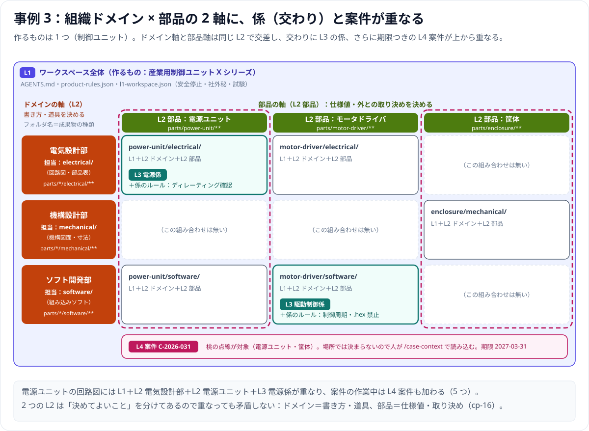
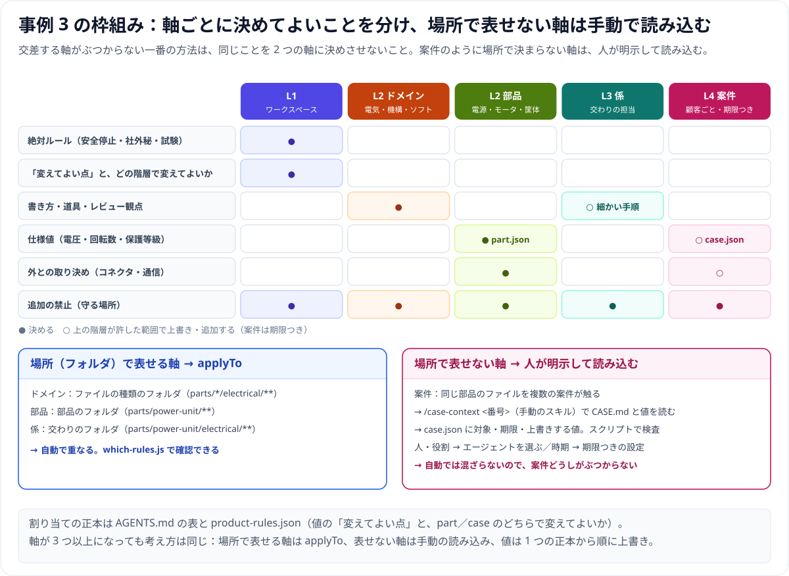
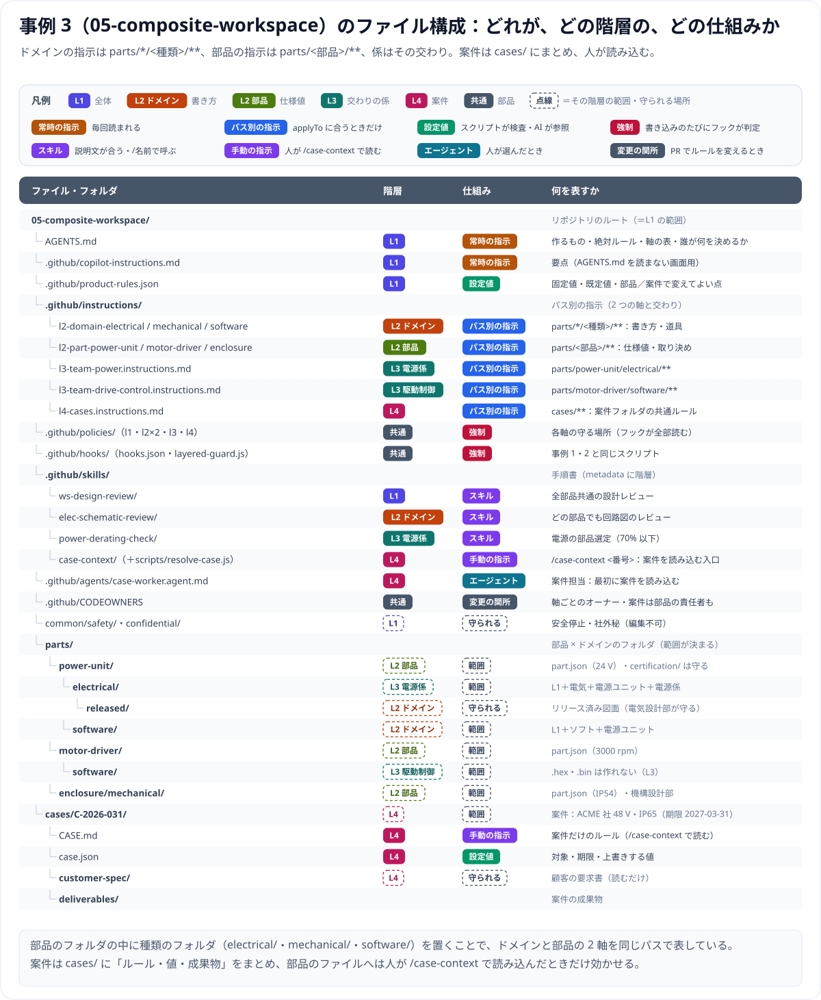
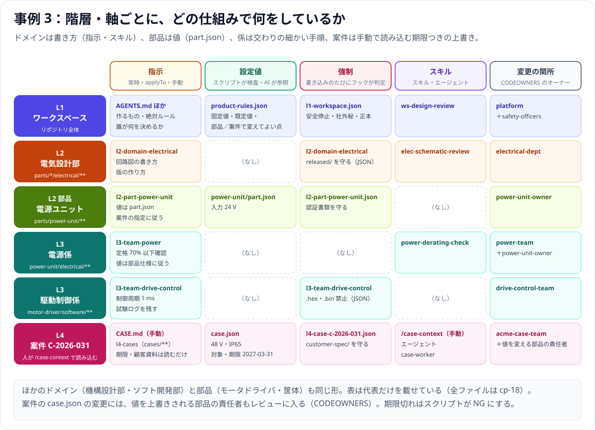
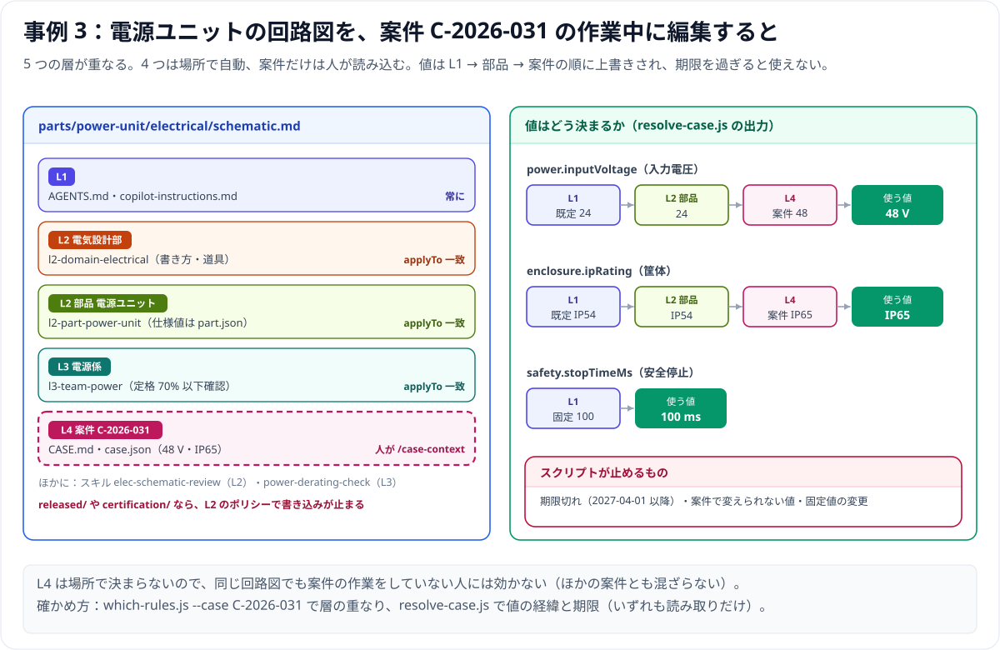

# サンプル 05：複合ワークスペース（組織ドメイン × 部品 → 係 → 案件）

事例 1（組織の階層）と事例 2（製品の階層）が**組み合わさった**例です。このワークスペースで**作るものは決まっている**（産業用制御ユニット）が、作り方は次の 4 つで変わります。解説は [02 階層の組み方の事例](../../02_layered-examples.md#4-事例-3事例-1-と-2-が組み合わさる場合組織ドメイン--部品--係--案件)。

| 階層 | 軸 | 例 | 範囲の表し方 |
|---|---|---|---|
| L1 | ワークスペース全体 | 安全停止・社外秘・試験 | リポジトリ全体 |
| L2 | **組織ドメイン** | 電気設計部・機構設計部・ソフト開発部 | `parts/*/electrical/**` のように**ファイルの種類**のフォルダ |
| L2 | **部品** | 電源ユニット・モータドライバ・筐体 | `parts/power-unit/**` のように**部品**のフォルダ |
| L3 | **係**（ドメイン × 部品の交わり） | 電源係・駆動制御係 | `parts/power-unit/electrical/**`（交わりのフォルダ） |
| L4 | **案件**（顧客ごと・期限つき） | C-2026-031（ACME 社 48 V・IP65） | **場所では決まらない** → 人が `/case-context` で読み込む |



## 枠組み：軸ごとに「決めてよいこと」を分ける



2 つの L2（ドメインと部品）は**決めてよいことを分けて**あります。ドメインは「書き方・道具・レビュー観点」、部品は「仕様値・外との取り決め」。同じことを 2 つの軸に決めさせないので、重なっても矛盾しません（割り当ての表は [AGENTS.md](AGENTS.md)）。

案件は、同じ部品のファイルを複数の案件が触るため、フォルダの場所では表せません。そこで**人が `/case-context <案件番号>` で明示して読み込み**、値は [case.json](cases/C-2026-031/case.json) で期限つきで上書きします。

> [!NOTE]
> **ドメインのフォルダ名が部署名でない理由**：`electrical/`・`mechanical/`・`software/` は、あえて部署名ではなく**成果物の種類**にしています。部署は組織変更で名前が変わったり統合されたりしますが、成果物の種類（回路・機構・ソフト）はほとんど変わらないためです。Copilot の `applyTo` はファイルの場所しか見ないので、場所には「そのファイルが何か」を書き、「誰が担当か」は [AGENTS.md の対応表](AGENTS.md#フォルダ名と担当ドメインの対応) と CODEOWNERS で決めます。組織変更のときはその表・指示ファイルの部署名・CODEOWNERS を直すだけで、ファイルは動かさずに済みます。
>
> 組織がほとんど変わらず、フォルダを見て部署が分かる方がよい場合は、`elec-design/`（電気設計部）・`mech-design/`（機構設計部）・`soft-dev/`（ソフト開発部）のような**部署寄りの名前**にしても仕組みは同じです（`applyTo` の値を合わせて変えるだけ）。その場合、組織変更のたびにフォルダの移動と `applyTo`・ポリシーの書き換えが要ります。

## ファイル構成図：どのファイルが、どの階層の、どの仕組みか



```text
05-composite-workspace/
├─ AGENTS.md                                       [L1・常時の指示] 作るもの・絶対ルール・軸の表・誰が何を決めるか・索引
├─ .github/
│   ├─ copilot-instructions.md                     [L1・常時の指示] 要点
│   ├─ product-rules.json                          [L1・設定値] 固定値・既定値・部品／案件で変えてよい点
│   ├─ instructions/
│   │   ├─ l2-domain-electrical.instructions.md    [L2 ドメイン] applyTo: parts/*/electrical/**
│   │   ├─ l2-domain-mechanical.instructions.md    [L2 ドメイン] applyTo: parts/*/mechanical/**
│   │   ├─ l2-domain-software.instructions.md      [L2 ドメイン] applyTo: parts/*/software/**
│   │   ├─ l2-part-power-unit.instructions.md      [L2 部品]     applyTo: parts/power-unit/**
│   │   ├─ l2-part-motor-driver.instructions.md    [L2 部品]     applyTo: parts/motor-driver/**
│   │   ├─ l2-part-enclosure.instructions.md       [L2 部品]     applyTo: parts/enclosure/**
│   │   ├─ l3-team-power.instructions.md           [L3 電源係]   applyTo: parts/power-unit/electrical/**
│   │   ├─ l3-team-drive-control.instructions.md   [L3 駆動制御] applyTo: parts/motor-driver/software/**
│   │   └─ l4-cases.instructions.md                [L4 共通]     applyTo: cases/**
│   ├─ policies/                                   [強制] 各軸の「守る場所」（フックが全部読む）
│   │   ├─ l1-workspace.json                       安全停止・社外秘・値の正本
│   │   ├─ l2-domain-electrical.json               リリース済み図面 parts/*/electrical/released/
│   │   ├─ l2-part-power-unit.json                 認証書類 parts/power-unit/certification/
│   │   ├─ l3-team-drive-control.json              .hex・.bin を作らない
│   │   └─ l4-case-c-2026-031.json                 顧客の要求書 customer-spec/
│   ├─ hooks/（hooks.json・scripts/layered-guard.js） [共通・強制] 事例 1・2 と同じスクリプト
│   ├─ skills/
│   │   ├─ ws-design-review/                       [L1] 全部品共通の設計レビュー
│   │   ├─ elec-schematic-review/                  [L2 ドメイン] どの部品でも回路図のレビュー
│   │   ├─ power-derating-check/                   [L3 電源係] 部品選定（70% 以下）
│   │   └─ case-context/（＋scripts/resolve-case.js） [L4 の入口・手動] /case-context <番号>
│   ├─ agents/case-worker.agent.md                 [L4・エージェント] 最初に案件を読み込む案件担当
│   └─ CODEOWNERS                                  [共通・変更の関所] 軸ごとのオーナー。案件の値には部品の責任者も
├─ common/safety/・confidential/                   (L1 が守る)
├─ parts/                                          ← 部品 × ドメインのフォルダ（ここで範囲が決まる）
│   ├─ power-unit/                                 (L2 部品の範囲) part.json：入力 24 V
│   │   ├─ electrical/                             (L3 電源係の範囲＝電気設計部 × 電源ユニット)
│   │   │   ├─ schematic.md
│   │   │   └─ released/                           (L2 ドメインが守る) リリース済み図面
│   │   ├─ software/                               (ソフト開発部 × 電源ユニット)
│   │   └─ certification/                          (L2 部品が守る) 認証書類
│   ├─ motor-driver/                               (L2 部品の範囲) part.json：3000 rpm
│   │   ├─ electrical/
│   │   └─ software/control/                       (L3 駆動制御係の範囲)
│   └─ enclosure/mechanical/                       (機構設計部 × 筐体) part.json：IP54
└─ cases/C-2026-031/                               (L4 案件) ACME 社 48 V・IP65・期限 2027-03-31
    ├─ CASE.md                                     [L4・手動の指示] 案件だけのルール
    ├─ case.json                                   [L4・設定値] 対象（targets）・期限・上書きする値
    ├─ customer-spec/                              (L4 が守る) 顧客の要求書
    └─ deliverables/                               案件の成果物
```

## 階層・軸ごとに、どの仕組みで何をしているか



| 階層・軸 | 指示 | 設定値 | 強制 | スキル・エージェント | 変更の関所 |
|---|---|---|---|---|---|
| **L1** | [AGENTS.md](AGENTS.md)・[copilot-instructions.md](.github/copilot-instructions.md) | [product-rules.json](.github/product-rules.json) | [l1-workspace.json](.github/policies/l1-workspace.json) | [ws-design-review](.github/skills/ws-design-review/SKILL.md) | [CODEOWNERS](.github/CODEOWNERS) |
| **L2 ドメイン** | [electrical](.github/instructions/l2-domain-electrical.instructions.md)・[mechanical](.github/instructions/l2-domain-mechanical.instructions.md)・[software](.github/instructions/l2-domain-software.instructions.md) | （決めない） | [l2-domain-electrical.json](.github/policies/l2-domain-electrical.json) | [elec-schematic-review](.github/skills/elec-schematic-review/SKILL.md) | 各部 |
| **L2 部品** | [power-unit](.github/instructions/l2-part-power-unit.instructions.md)・[motor-driver](.github/instructions/l2-part-motor-driver.instructions.md)・[enclosure](.github/instructions/l2-part-enclosure.instructions.md) | [power-unit](parts/power-unit/part.json)・[motor-driver](parts/motor-driver/part.json)・[enclosure](parts/enclosure/part.json) の part.json | [l2-part-power-unit.json](.github/policies/l2-part-power-unit.json) | — | 部品の責任者 |
| **L3 係** | [電源係](.github/instructions/l3-team-power.instructions.md)・[駆動制御係](.github/instructions/l3-team-drive-control.instructions.md) | （決めない） | [l3-team-drive-control.json](.github/policies/l3-team-drive-control.json) | [power-derating-check](.github/skills/power-derating-check/SKILL.md) | 係＋部品の責任者 |
| **L4 案件** | [CASE.md](cases/C-2026-031/CASE.md)（手動）・[l4-cases](.github/instructions/l4-cases.instructions.md)（cases/**） | [case.json](cases/C-2026-031/case.json)（期限つき） | [l4-case-c-2026-031.json](.github/policies/l4-case-c-2026-031.json) | [case-context](.github/skills/case-context/SKILL.md)（手動）＋[resolve-case.js](.github/skills/case-context/scripts/resolve-case.js)・[case-worker](.github/agents/case-worker.agent.md) | 案件の担当＋部品の責任者 |

## 電源ユニットの回路図を、案件の作業中に編集すると



手元で確かめる（どちらも読み取りだけ）：

```powershell
# 層の重なり（--case を付けると、案件の作業中として L4 も表示）
node agent-skill/copilot/tools/which-rules.js --root agent-skill/copilot/samples/05-composite-workspace parts/power-unit/electrical/schematic.md --case C-2026-031

# 案件の値の経緯と期限（L1 既定 24 → L2 部品 24 → L4 案件 48）
node agent-skill/copilot/samples/05-composite-workspace/.github/skills/case-context/scripts/resolve-case.js --root agent-skill/copilot/samples/05-composite-workspace --case C-2026-031
```

## 組み方のポイント

1. **2 つの軸を同じパスで表す**：`parts/<部品>/<成果物の種類>/` にすると（種類のフォルダ名は部署名にせず、部署との対応は AGENTS.md の表で決める）、ドメインは `parts/*/<種類>/**`、部品は `parts/<部品>/**`、係は `parts/<部品>/<種類>/**` と、どれも `applyTo` で指せる。
2. **軸ごとに決めてよいことを分ける**：ドメイン＝書き方・道具、部品＝仕様値・取り決め。値はドメインの指示に書かない（「part.json を見る」とだけ書く）。
3. **場所で表せない軸（案件）は手動で読み込む**：案件のルールが勝手に混ざらないので、複数の案件が同じ部品を触っても衝突しない。期限が過ぎたらスクリプトが NG にする。
4. **値は 1 つの正本から順に上書き**：`product-rules.json` に「部品で変えてよい」「案件で変えてよい」を項目ごとに書く（例：回転数は部品だけ。案件では変えられない）。
5. **関所も軸ごと**：CODEOWNERS で、案件の `case.json` の変更には、値を上書きされる部品の責任者もレビューに入るようにする。

実際に Copilot で試すときは、このフォルダの中身を新しいリポジトリにコピーして開きます（`.github/` はリポジトリのルートにある必要があるため）。
