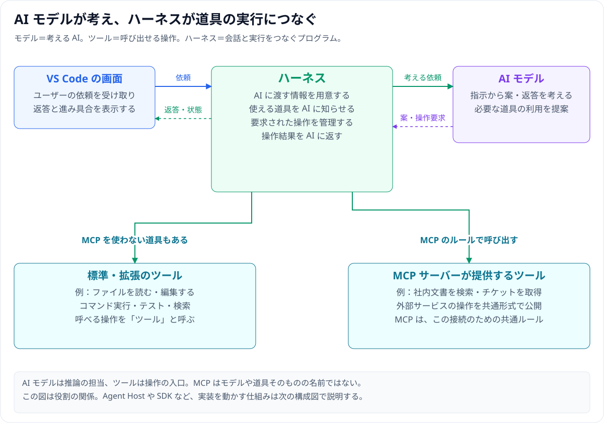
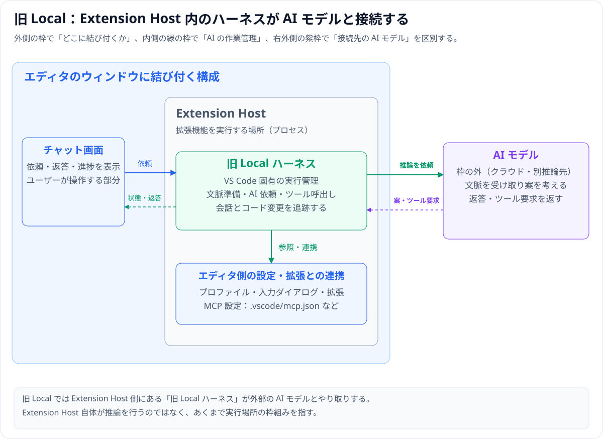
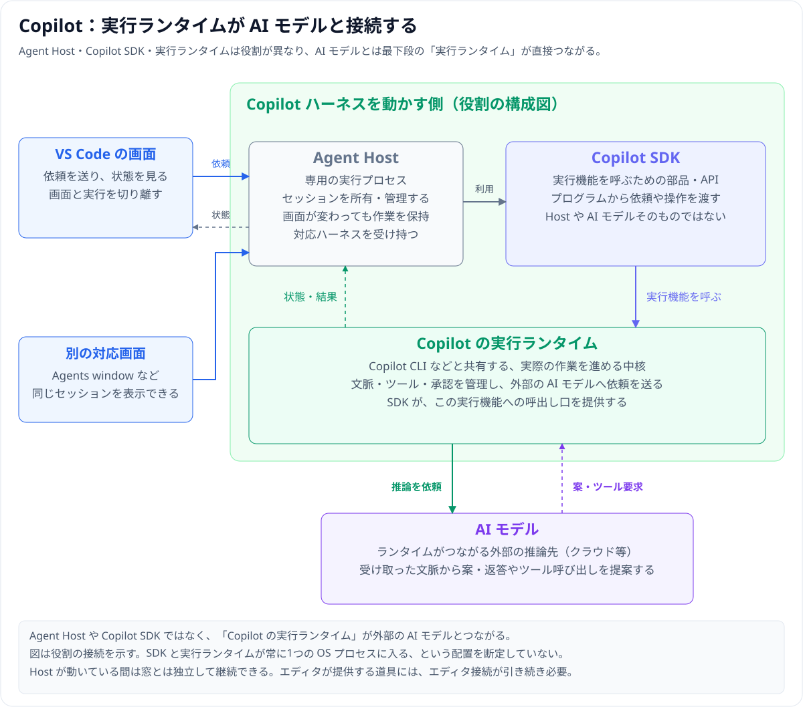
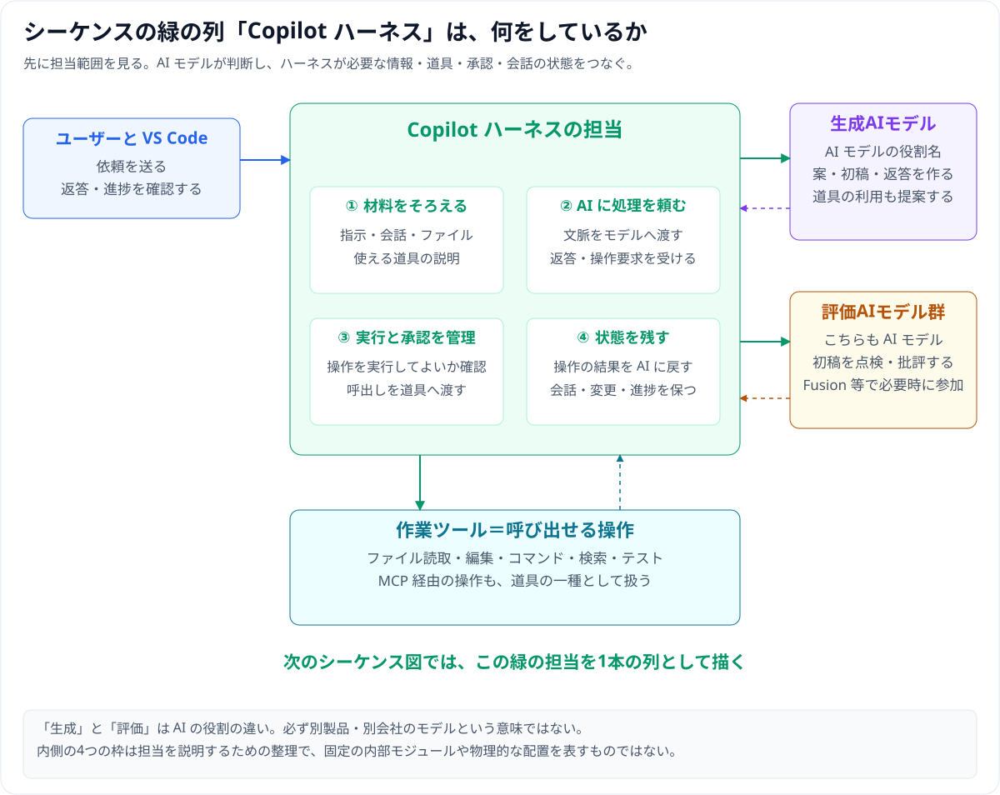
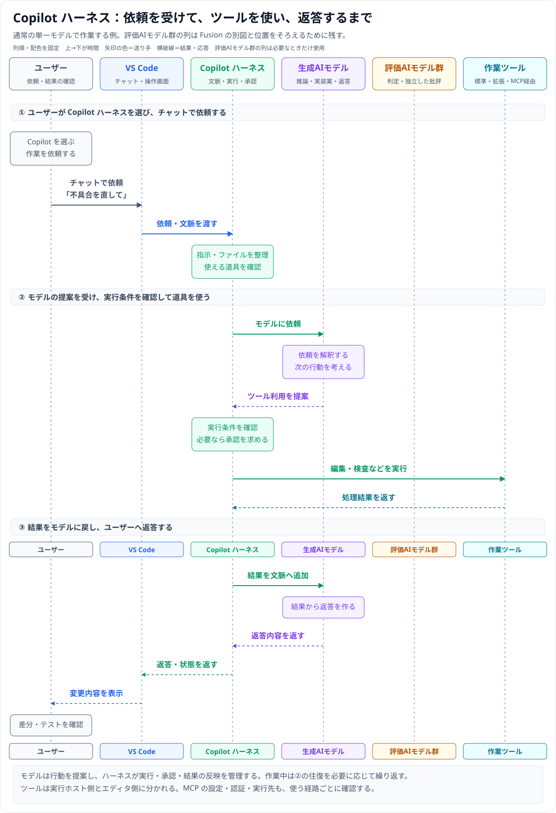
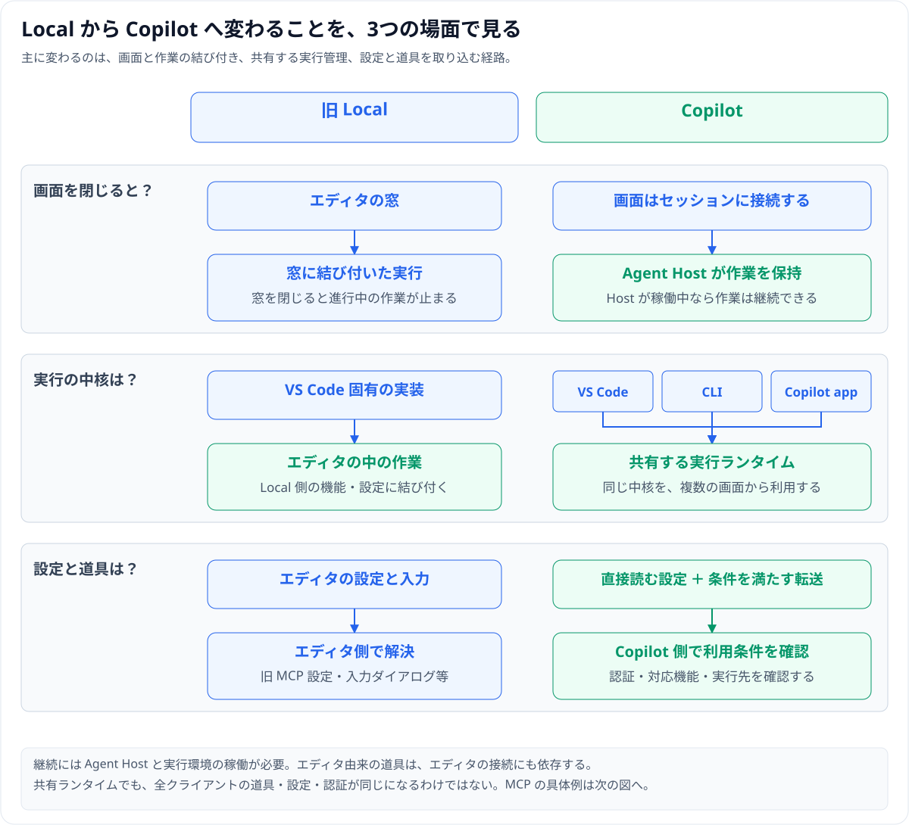
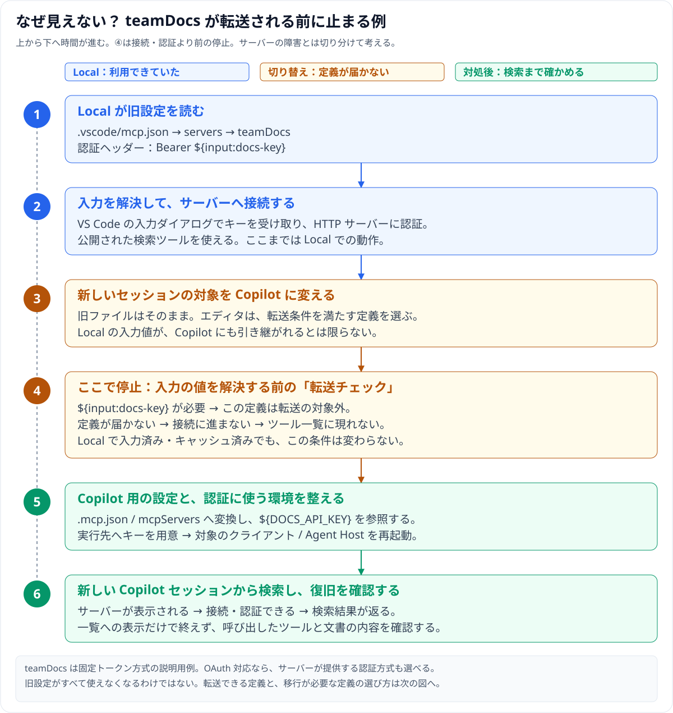
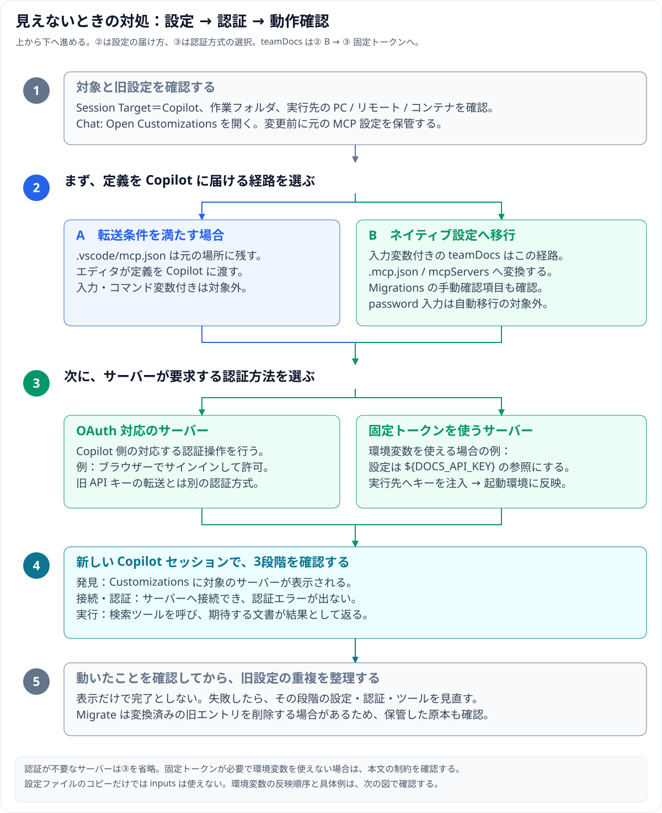
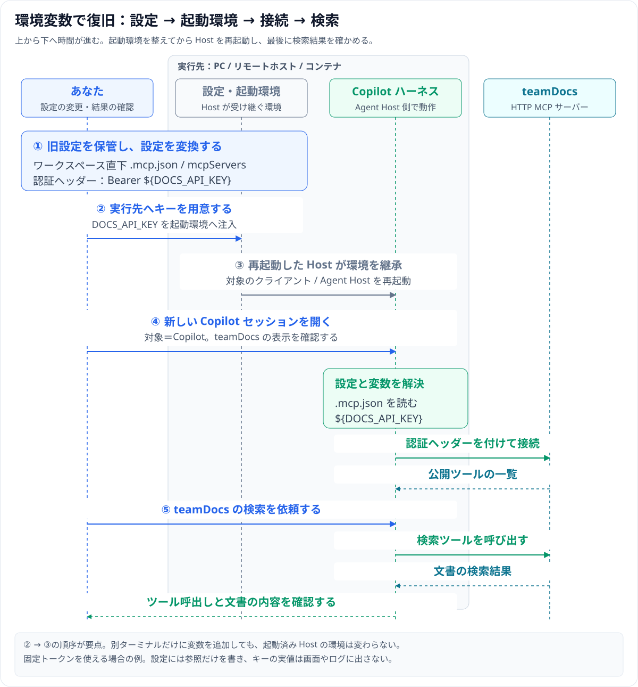

# Local と Copilot ハーネス — 何が変わり、既存の MCP をどう移すか

AI に作業を頼むときは、**考える AI、実際に操作する道具、その間をつなぐプログラム**が協力します。この資料では、先にその役割を図で見て、Local / Copilot の構成、依頼から返答までの動き、MCP の移行へと進みます。

本稿は **2026-11-12 に確認した公式資料**に基づき、第4節の MCP 転送条件と環境変数への移行手順は **2026-11-13 に再確認**しています。公式資料では旧 Local を非推奨とし、**2027年2月までに削除予定**と案内しています。これは予定として扱います。[Local の現在の扱い](https://code.visualstudio.com/docs/agents/run/agent-harnesses)

| 読む順 | 分かること |
|---|---|
| [1. 登場するものと構成](#1-aiモデル道具実行管理を分ける) | モデル・ツール・MCP・ハーネスの意味、Extension Host と Agent Host・SDK の違い |
| [2. 担当を知ってから動きを追う](#2-copilot-ハーネスの担当を知ってから動きを追う) | 緑の箱の中で何をするか、シーケンスの各列は誰か |
| [3. Local と Copilot の違い](#3-local-と-copilot-で変わること) | 画面を閉じたとき、実行の中核、設定の受け渡しの違い |
| [4. MCP が見えなくなる理由](#4-mcp-が見えなくなるのはなぜか) | Local で動いた設定が、切り替え後に届かなくなる具体例 |
| [5. 移行の進め方](#5-既存の環境を-copilot-へ移す手順) | 設定・認証・環境変数・実行先を順に確かめる |
| [6. トラブルの切り分け](#6-症状から切り分ける) | 症状ごとの原因と対処 |

## 1. AIモデル・道具・実行管理を分ける

### まず、AI が考える部分と、操作する部分を見る

例えば「コードを直して」と送ると、AI モデルは変更案や必要な操作を考えます。ファイルを読む・書く・テストするといった操作は、ツールを呼び出して行います。その受け渡しを取り持つプログラムが **ハーネス**です。



**この図の用語**

| 用語 | この資料での意味 | 具体例・区別 |
|---|---|---|
| **AIモデル / モデル** | 指示や情報を読み、案・返答・次に必要な操作を考える AI | 文章やコードを扱う言語モデル。この資料で「モデル」と書いたら AI モデルを指す |
| **ツール / 道具** | モデルが呼び出しを要求できる、名前の付いた操作 | ファイルを読む、編集する、コマンドを実行する、文書を検索する。モデルそのものの名前ではない |
| **MCP** | AI アプリと外部の機能・データをつなぐ共通の通信ルール | 道具の名前や使い方を知らせ、呼出しと結果をやり取りする。すべての道具が MCP を使うわけではない |
| **MCPサーバー** | MCP のルールで道具やデータを提供するプログラム | 社内文書の検索、チケット取得などの機能を公開する。通信ルールと、それを実装するサーバーを分ける |
| **ハーネス** | AI・情報・道具・会話の状態をつなぎ、作業を進める実行管理のプログラム | モデルに依頼し、操作要求を受け、承認を適用し、結果をモデルへ返す |
| **文脈 / コンテキスト** | その処理のためにモデルへ渡す材料 | ユーザーの指示、会話履歴、ファイル内容、ツールの結果など |
| **画面・クライアント** | 依頼を送り、返答や状態を見る側のアプリ | この資料では VS Code のチャット画面などを指す |
| **エージェント** | AI モデルと実行管理・道具を組み合わせ、目的に向けて作業を続ける全体 | モデル1つの名前とは区別する |

「ツール」は操作の入口としての呼び方で、内部で AI を使う道具もあり得ます。ここでは **考える役割と、呼べる操作としての役割**を分けています。[ハーネスとモデルの役割](https://code.visualstudio.com/docs/agents/concepts/agent-harnesses)、[ツールの説明](https://code.visualstudio.com/docs/agents/run/tools)、[MCP の機能](https://code.visualstudio.com/api/extension-guides/ai/mcp)

### 旧 Local：どこでその実行管理を動かしていたか

旧 Local は、VS Code の拡張機能を動かす **Extension Host** 側に実行管理があり、作業がエディタのウィンドウと結び付きます。外側の入れ物と、内側の実行管理を分けて見てください。



**この構成図の用語**

| 用語 | 何を指すか | ハーネスとの関係 |
|---|---|---|
| **Extension Host** | VS Code の拡張機能を実行する場所。実行環境に応じてローカル・リモート等のプロセスがある | 旧 Local ハーネスが動く側。Extension Host 自体が AI モデルという意味ではない |
| **プロセス** | コンピューター上で動作中のプログラムの単位 | 「何をする機能か」と「どの実行場所に載るか」を区別するための用語 |
| **旧 Local ハーネス** | VS Code 固有の、従来の AI 実行管理 | Extension Host という場所と、その中で行う仕事は別の名前 |

図は重要な関係を抜き出した構成図です。拡張機能がある場所と、モデルの推論が行われる場所が同じとは限りません。[Extension Host の公式説明](https://code.visualstudio.com/api/advanced-topics/extension-host)、[旧 Local の実装](https://code.visualstudio.com/docs/agents/run/agent-harnesses#what-is-the-difference-between-local-and-copilot)

### Copilot：Agent Host と SDK を別の部品として見る

Copilot では、**Agent Host がセッションを所有し、画面を作業の実行から切り離します。** セッションとは、1つの会話と、その作業の状態のまとまりです。Copilot SDK は、その実行機能をプログラムから利用するための部品です。



**この構成図の用語**

| 用語 | やさしく言うと | 担当 |
|---|---|---|
| **Agent Host** | AI の作業を受け持つ専用の実行プロセス | 対応ハーネスを動かし、会話や作業のセッションを管理する。画面とは別に状態を持つ |
| **Copilot SDK** | Copilot の実行機能を呼ぶための部品・API の集まり | アプリ側のプログラムから、依頼やセッション操作を実行機能へ渡す。SDK は AI モデルでも Host の別名でもない |
| **API** | プログラムから機能を使うための呼出し口 | この文脈では、SDK が提供する操作方法を指す |
| **実行ランタイム** | 実際の処理を進める中核 | Copilot CLI などと共有する、モデル呼出し・道具・会話の進行の実行機能 |
| **Copilot ハーネス** | それらを使って AI の作業を管理する実装 | この後のシーケンスでは、モデルと道具を取り持つ担当として1列にまとめる |

**Agent Host と SDK を「＋」で足した一語として覚える必要はありません。** Host は作業とセッションの管理を担い、SDK は実行機能への呼出し口を提供します。SDK の公式説明でも、SDK と呼び出されるランタイムは分かれています。図は役割の接続を示し、ランタイムが常に Host と同じ OS プロセスにいるという配置までは断定していません。[Agent Host の構成](https://code.visualstudio.com/docs/agents/concepts/agent-host#process-architecture)、[SDK とランタイムの関係](https://github.com/github/copilot-sdk#architecture)

Agent Host と実行環境が稼働していれば、エディタのウィンドウを閉じても作業を継続できます。ただし、VS Code アプリ全体や Host の終了とは別です。接続したエディタが提供する道具は、引き続きその接続が必要です。[継続性とクライアントへの依存](https://code.visualstudio.com/docs/agents/concepts/agent-host#session-lifetime-and-client-dependencies)

### 画面・ハーネス・モデル・実行場所は別々に選ぶ

| 選択 | 何を決めるか | 例 |
|---|---|---|
| **画面** | 依頼や進捗を見る場所 | Chat view、Agents window |
| **ハーネス** | 実行管理の実装 | Copilot、旧 Local |
| **モデル** | 推論・返答を行う AI、またはモデル選択の仕組み | 個別の AI モデル、Fusion |
| **実行環境** | コードを編集し、コマンドを動かす場所 | 手元の PC、リモート、コンテナ、Cloud |

Copilot ハーネスも手元の PC で使えます。Copilot を選んだだけでファイルがクラウドへ移るわけではなく、Local もモデルのオフライン実行を意味しません。Claude 系モデルを選ぶ操作も、Claude ハーネスへ切り替える操作とは別です。[選択の区別](https://code.visualstudio.com/docs/agents/run/agent-harnesses)

## 2. Copilot ハーネスの担当を知ってから、動きを追う

### 緑の箱は、何を引き受けるのか

まずは時間の順序より、担当する仕事を見ます。ハーネスが材料や道具を整え、AI モデルに処理を頼み、要求された操作を管理し、結果と会話の状態をつなぎます。



**この図と、次のシーケンスに登場するもの**

| 列・役割 | 何をするか | AI モデルなのか |
|---|---|---|
| **ユーザー** | 目的を伝え、変更と結果を確認する | 人間 |
| **VS Code** | 依頼を受け取り、返答や進捗を表示する | 操作するアプリ・画面 |
| **Copilot ハーネス** | 文脈・モデル呼出し・道具・承認・作業状態を管理する | 実行管理のプログラム |
| **生成AIモデル** | 案・コード・初稿・返答を作る | **AI モデル**。この資料では「作る担当」という役割名 |
| **評価AIモデル群** | 案の問題を見つけ、評価・批評を返す | **こちらも AI モデル**。「点検する担当」。複数なら「群」と表記 |
| **作業ツール** | ファイルを読み書きする、コマンドを動かす、外部を検索する | 呼び出せる操作。MCP 経由の道具もこの列に含める |

生成AIモデルと評価AIモデルは、必ず別会社・別種類の AI という意味ではありません。**ここでは役割を分けた名前**です。通常の単一モデルの例では評価AIモデル群は使わず、Fusion の説明と列順をそろえるため列を残しています。Fusion での点検・修正は [2本目のガイド](02_copilot-fusion.md)で図解します。[モデルの役割](https://code.visualstudio.com/docs/agents/concepts/language-models)、[Fusion の方式](https://docs.github.com/en/copilot/concepts/models/copilot-fusion#how-copilot-fusion-works)

### 依頼から返答まで、順番に追う

上の緑の箱を、今度は1本の列にして動きを追います。ユーザーが「不具合を直して」と頼むと、モデルが次の行動を提案し、ハーネスが道具への呼出しを管理します。



この往復が **エージェントのループ**です。「② モデルの提案から道具を使う」を必要に応じて繰り返し、その結果から返答を作ります。準備する情報、使える道具、承認の条件が違えば、同じ AI モデルでも行動が変わります。[公式のターンの説明](https://code.visualstudio.com/docs/agents/concepts/agent-harnesses#follow-a-turn-through-an-agent-harness)

## 3. Local と Copilot で変わること

構成を知ったところで、実際の使い方にどう差が出るかを3つの場面で比べます。



**図の補助説明**：Local はエディタの窓との結び付きが強く、Copilot は Agent Host がセッションを保持します。Copilot の中核を複数のクライアントで使えても、設定・認証・すべての道具が自動で同じになるわけではありません。詳しい対応を表でも確認できます。

| 項目 | 旧 Local ハーネス | Copilot ハーネス |
|---|---|---|
| 実行管理の実装 | VS Code 固有の従来実装 | Copilot SDK を使う共通ランタイム |
| 主な実行プロセス | VS Code の extension host | Agent Host |
| 画面との関係 | エディタの Chat view に結び付く | Chat view と Agents window など、対応する画面から同じセッションを扱う |
| ウィンドウを閉じた後 | そのウィンドウの進行中の作業は止まる | Agent Host が動いている間は継続可能。窓に依存するツールには制約が残る |
| ツール・MCP・カスタマイズ | エディタ側の保存場所・設定・実装を利用 | 共通形式を直接読み、適格なエディタ定義は転送経由でも利用。すべてが同等ではない |
| 現在の位置付け | 非推奨。移行中の互換用途 | 新しい作業の出発点として公式が案内 |

実装と継続性は[ハーネスの比較](https://code.visualstudio.com/docs/agents/run/agent-harnesses#compare-agent-harnesses)、カスタマイズの差は[移行ガイド](https://code.visualstudio.com/docs/agent-customization/migrate-customizations)を参照してください。

Copilot を選ぶ利点は、まず **エディタの一つの窓に閉じない作業の継続性**と、**Copilot 製品で共通の実行管理を使えること**です。さらに Fusion によるモデル協調、assisted permissions、ローカルのサンドボックス、対応サービスへの connectors などを組み合わせられます。利用可否やプレビュー機能、組織での制限は個別に確認します。[Copilot ハーネスへ移る理由](https://code.visualstudio.com/docs/agents/run/move-to-copilot#why-move-to-the-copilot-harness)

共通ランタイムであることは、**すべての製品に同じツール・同じモデル・同じ設定があることや、個人設定と認証が自動同期することまでは保証しません。** 例えば拡張機能のツールはエディタの接続に依存します。[Copilot の要件と制限](https://code.visualstudio.com/docs/agents/run/agent-harnesses#copilot)

### 切り替え方

新しいチャットを開き、最初の依頼を送る前に **Session Target → Copilot** を選びます。その後、利用できるモデルとエージェントを選びます。VS Code には必要なランタイムが含まれるため、このためだけに Copilot CLI や SDK を別途インストールする必要はありません。[開始手順](https://code.visualstudio.com/docs/agents/run/move-to-copilot#start-a-copilot-session)、[CLI / SDK の要否](https://code.visualstudio.com/docs/agents/run/move-to-copilot#do-i-need-to-install-copilot-cli-or-the-sdk)

既存の Local 会話から Copilot へ引き継ぐ経路もありますが、履歴を渡すことと設定・ツールの互換性は別です。一時的に別ハーネスへ移って戻れる双方向スイッチとして扱わず、新しいセッションで移行後の道具を確認します。[既存会話の引き継ぎ](https://code.visualstudio.com/docs/agents/run/move-to-copilot#continue-an-existing-local-conversation)

## 4. MCP が見えなくなるのはなぜか

切り替え後に MCP が使えなくても、サーバー自体が壊れたとは限りません。**旧設定を読むクライアント、定義を転送する条件、認証情報を渡す方法が変わる**ためです。

### Local で動いていたのに、切り替えると見えない具体例

社内文書を検索する HTTP MCP サーバー **`teamDocs`** を例に、Local で使えていた時点から復旧までを追います。**図は上から下へ時間が進みます。** 青は Local での動作、橙は切り替え時に止まる箇所、緑は対処後です。



ポイントは図の **④「転送チェック」**です。Local では `${input:docs-key}` を VS Code が解決していましたが、Copilot への転送では、その変数を必要とする定義が**値を解決する前に除外**されます。Local でキーを入力済みでも、この条件は変わりません。定義が届かないので、この経路では接続に進めず、ツールが一覧に現れません。[入力付き定義の制限](https://code.visualstudio.com/docs/agents/reference/mcp-configuration#editor-forwarding-to-copilot)

この例は、**サーバーへの接続前に止まるケース**です。一覧に表示されるが認証に失敗するケースは、その先の段階として切り分けます。すべての旧設定が使えなくなるわけではなく、条件を満たす定義を転送する経路もあります。

### 対処を選ぶ：設定を届ける → 認証を整える → 実際に呼ぶ

次の図も**上から下へ**進みます。②では、転送条件を満たす定義は **A**、この例の `teamDocs` は **B** を選びます。③でサーバーが要求する認証方式を選び、④で動作を確かめます。**設定の届け方と認証方式は、別々に選ぶ項目です。**



| 経路 | 何が起きるか | 主な確認点 |
|---|---|---|
| **エディタからの転送（forwarding）** | 旧 `.vscode/mcp.json`、プロファイル、拡張機能が提供する定義のうち、条件を満たすものを Copilot に渡す。元ファイルは動かさない | エディタの機能や入力変数がそのまま使えるわけではない。拡張による定義解決にはエディタ・拡張が必要 |
| **ネイティブ設定への移行（migration）** | Copilot が直接読むファイルへ、対応する定義を変換する | 移行画面は変換できない項目を示す。移行に成功した旧エントリが元ファイルから削除される場合がある |

転送と移行は別機能です。自動的にファイルを移す **Migrate** と、agent に適応を手伝わせる **Migrate with Agent** も区別します。後者は原本を残すのが既定で、編集や実行に Copilot の利用枠を使います。[転送の条件](https://code.visualstudio.com/docs/agents/reference/mcp-configuration#editor-forwarding-to-copilot)、[移行方法の選択](https://code.visualstudio.com/docs/agent-customization/migrate-customizations#choose-a-migration-path)

| 項目 | エディタ管理の旧設定 | Copilot が直接読むネイティブ設定 |
|---|---|---|
| ワークスペース | `.vscode/mcp.json` | ワークスペース直下の `.mcp.json` |
| ユーザー | VS Code プロファイルの `mcp.json` | `$COPILOT_HOME/mcp-config.json`。未指定なら `~/.copilot/mcp-config.json` |
| 最上位キー | `servers` | `mcpServers` |
| 環境変数参照 | `${env:NAME}` | `${NAME}` または非秘密の既定値付き `${NAME:-default}` |
| 入力ダイアログ・環境ファイル | `inputs`、`${input:...}`、`envFile` | 同じ仕組みは持ち込めない |

Windows での `~` は、**実際にハーネスを動かすユーザーのホーム**として読み替えます。リモートや Dev Container では実行先のホームです。[設定の保存場所と形式](https://code.visualstudio.com/docs/agents/reference/mcp-configuration#configure-mcp-for-copilot)

### 認証方法を選ぶ

入力値を求める機能は、JSON を `.mcp.json` にコピーしても使えるようになりません。また、**`password: true` の入力は自動移行の対象外**なので、下の `teamDocs` の例では認証ヘッダーを手作業で変換します。非秘密の入力には自動変換できるものもあるため、移行画面の手動確認項目を確かめます。[入力付き定義の制約](https://code.visualstudio.com/docs/agent-customization/migrate-customizations#why-are-mcp-servers-with-input-prompts-missing)、[自動移行できる項目](https://code.visualstudio.com/docs/agent-customization/migrate-customizations#check-mcp-values-before-migration)

対処はサーバーが要求する認証方法で選びます。

- OAuth 対応なら、Copilot 側でサポートされた認証フローを使う。OAuth は、入力済み API キーを運ぶ方法ではなく別の認証方式です。
- 固定トークンが必要で環境変数を利用できるなら、実行先へ資格情報を注入し、設定には参照だけを書きます。
- 固定トークンが必要で「環境変数にもファイルにも置けない」という要件なら、旧入力ダイアログと同等の組み込み経路は現時点ではありません。対応する認証方法を検討し、その間の Local 利用可否を組織の管理者と確認します。

認証済みであること、サーバーを起動してよいという信頼判断、個々のツールを実行してよいという承認は別です。[認証と秘密情報](https://code.visualstudio.com/docs/agents/reference/mcp-configuration#authentication-and-secrets)、[固定トークンの制約](https://code.visualstudio.com/docs/agent-customization/migrate-customizations#can-copilot-pass-a-prompted-secret-to-an-http-mcp-server-without-an-environment-variable-or-a-file)

### 設定例：秘密値を書かず、環境変数を参照する

以下は、HTTP の MCP サーバーが固定トークンを必要とする場合の**説明用の例**です。URL は実在の接続先ではありません。設定ファイルに API キー自体は書きません。

旧 `.vscode/mcp.json` の例：

```json
{
  "servers": {
    "teamDocs": {
      "type": "http",
      "url": "https://mcp.example.com/mcp",
      "headers": { "Authorization": "Bearer ${input:docs-key}" }
    }
  },
  "inputs": [
    {
      "id": "docs-key",
      "type": "promptString",
      "description": "Documentation API key",
      "password": true
    }
  ]
}
```

Copilot 用の、**ワークスペース直下の `.mcp.json`** の例：

```json
{
  "mcpServers": {
    "teamDocs": {
      "type": "http",
      "url": "https://mcp.example.com/mcp",
      "headers": { "Authorization": "Bearer ${DOCS_API_KEY}" },
      "tools": ["*"]
    }
  }
}
```

`DOCS_API_KEY` は、サーバーへ接続する **Agent Host の実行環境**で利用可能にします。別のターミナルで環境変数を設定しても、起動済み Agent Host の環境は変わりません。起動環境を変えたら、該当クライアントまたは Agent Host を再起動して受け継がせます。`tools: ["*"]` は説明用に全ツールを対象とする例なので、実運用では必要なツールの範囲を確認します。[環境変数への移行例](https://code.visualstudio.com/docs/agent-customization/migrate-customizations#replace-input-prompts-with-environment-variables)

### 具体例を実行する：キーを用意 → Host を再起動 → 検索

左から **操作する人 → 設定・起動環境 → Copilot ハーネス → teamDocs** の4列です。実行先を囲む枠の中に、設定・起動環境とハーネスを並べています。上から下へ読み、特に **② キーを用意してから、③ 対象のクライアント / Agent Host を再起動する**順序を確認してください。[実行環境への反映](https://code.visualstudio.com/docs/agent-customization/migrate-customizations#replace-input-prompts-with-environment-variables)



例えば **Dev Container で実行する場合**、`DOCS_API_KEY` はコンテナ内で Agent Host が受け継げる起動環境へ用意します。PC 側だけに設定して完了にせず、コンテナ側の該当プロセスへ反映してから、新しい Copilot セッションで試します。

確認用の依頼例は「**teamDocs の検索ツールで、開発環境のセットアップ手順を探して**」です。`teamDocs` はこの資料で付けたサーバー名であり、実際のツール名はサーバーの公開内容に依存します。ツールの呼び出しと返された文書の内容を確認し、失敗したら次のように戻ります。

| 止まった段階 | この例で戻って確認すること |
|---|---|
| サーバーが一覧にない | **① 設定・④ セッション**へ。実行先のワークスペース直下の `.mcp.json`、最上位キー `mcpServers`、対象が Copilot かを確認 |
| 表示されるが認証できない | **② 起動環境・③ 再起動**へ。接続する Host への `DOCS_API_KEY` の継承と、キーの有効性を確認 |
| 接続できるが検索できない | **⑤ ツール呼出し**へ。公開ツールと `tools` の指定、有効化、承認・組織ポリシー、呼び出し結果を確認 |

環境変数は秘密情報の保管庫ではありません。個人用ファイルも含め、設定には秘密値を直接書かず、参照だけを残します。

ワークスペース用の設定フォームで `${...}` が拒否されても、Copilot のランタイムが環境変数参照に非対応という意味ではありません。**Other Properties から元の `.mcp.json` を開き、参照を書きます。** 設定フォームの制限と、実行時の対応範囲を分けて確認してください。[フォームと環境変数参照の制約](https://code.visualstudio.com/docs/agents/reference/mcp-configuration#environment-variable-references)

## 5. 既存の環境を Copilot へ移す手順

1. **比較する小さな作業を決める。** Local で動く MCP 取得・編集・検査などを1つ選び、必要なサーバー、instructions、skills、hooks、承認を控えます。
2. **元の設定を保管する。** ワークスペースだけでなく、プロファイルやユーザー設定も対象にします。
3. **新しい Copilot セッションを作る。** Session Target を選び、実行先のマシン・コンテナ・フォルダも確認します。
4. **Chat: Open Customizations → Migrations を確認する。** 移行元・移行先と、手作業が必要な項目を見て、必要なものから移します。
5. **MCP の認証と環境を整える。** 入力変数、`envFile`、`cwd`、実行コマンドの依存、OAuth の設定などを実行先で確認します。
6. **表示と実行を分けて確認する。** Customizations に出ることは発見できたという確認です。最初の作業を再実行し、ツール結果、instructions の適用、hook ログ、承認の挙動まで比べます。
7. **重複を整理する。** 移行後が動いてから旧設定を退役させ、二重に有効な定義やフックを残さないようにします。

これは設定一式を一度に置き換える操作ではなく、必要なワークフローごとの移行です。[移行前の準備](https://code.visualstudio.com/docs/agents/run/move-to-copilot#before-you-start)、[移行の検証手順](https://code.visualstudio.com/docs/agent-customization/migrate-customizations#verify-the-migration)

サーバーの **無効状態は `.mcp.json` / `mcp-config.json` の中には保存されません。** 別クライアントや別マシンでは有効として扱われる場合があるため、有効・無効の状態も利用先ごとに確認します。[移行時の有効状態](https://code.visualstudio.com/docs/agent-customization/migrate-customizations#migrate-mcp-servers)

### MCP 以外も、保存場所と契約を見直す

| これまでの資産 | Copilot での確認・移行先 |
|---|---|
| `*.prompt.md` | 再利用ワークフローを skills に変換。変換では `agent` / `model` / `tools` の選択がそのまま残らないので見直す |
| プロファイルにある個人 agent / instructions | 例：`~/.copilot/agents` / `~/.copilot/instructions` へ。共有用は `.github/agents` / `.github/instructions` |
| skills の独自検索場所 | ネイティブの `.github/skills` / `.agents/skills`、個人用の対応フォルダへ。エディタの検索場所設定を別クライアントが読むとは限らない |
| Local 用 hooks | 自動変換はない。イベント、JSON の入力・出力、スクリプトの場所、失敗時の挙動を確認する |
| Local 固有の tool set / `@participant` | そのまま使えない。利用可能なツール、agents、skills、MCP、plugins に必要な機能を割り当て直す |
| 拡張機能が提供するツール | 対象拡張を動かすエディタの接続が必要。Agent Host が単独で継続できる機能と分ける |

[prompt の変換](https://code.visualstudio.com/docs/agent-customization/migrate-customizations#convert-prompt-files-to-skills)、[個人カスタマイズの移行](https://code.visualstudio.com/docs/agent-customization/migrate-customizations#move-user-agents-and-instructions)、[自動移行されないもの](https://code.visualstudio.com/docs/agent-customization/migrate-customizations#customizations-without-automatic-migration)

移した個人用 agents / instructions は VS Code の Settings Sync に含まれません。別のマシンにも同じ構成が自動で届いた、と考えず実行先で確認します。[個人設定の扱い](https://code.visualstudio.com/docs/agent-customization/migrate-customizations#move-user-agents-and-instructions)

特に自作の司令塔 agent が Local の `runSubagent` を指定していた場合、Copilot のネイティブな委任ツールは `task` なので、指示文と `tools` の両方を検証します。ツール名の文字置換だけで引数や権限制約まで同等になるとは限りません。[サブエージェント呼び出しの違い](https://code.visualstudio.com/docs/agent-customization/migrate-customizations#why-does-my-coordinators-subagent-invocation-stop-working)

## 6. 症状から切り分ける

| 症状 | 主な確認先・原因候補 | 改善の進め方 |
|---|---|---|
| サーバー自体が一覧に出ない | 間違ったセッション文脈、旧保存場所、`${input:...}` / `${command:...}` の転送対象外 | Copilot を選んで Customizations を開く。転送の可否を確認し、必要ならネイティブ形式へ移行 |
| ファイルをコピーしたが使えない | `servers` と `mcpServers` の違い、エディタ専用フィールド | ファイル名だけでなくスキーマを変換。移行画面の手動確認項目を解消 |
| Local では認証済みなのに失敗する | 保存された秘密値やクライアント間の認証状態が同じではない | Copilot の認証操作を行うか、対応する環境変数参照へ。認証方式を変えず秘密をベタ書きする対処は避ける |
| コマンドが見つからない・別のファイルを読む | Agent Host の PATH / `cwd` / 依存関係、実行マシンの違い | サーバーを動かすホストでコマンドとパスを検証。`cwd` は必要な場合に手動設定する |
| 環境変数を設定しても反映されない | 起動済み Agent Host が新しい値を受け継いでいない | 実行先の起動環境へ設定し、該当クライアント / Agent Host を再起動 |
| 接続できるがツールが使えない | `tools` フィルター、セッションの利用可能ツール、承認・組織ポリシー | ツールの有効化と呼び出し結果を確認。認証と権限を別々に調べる |
| 起動後にファイル・通信が拒否される | サンドボックスとアクセス制約 | 必要な範囲の設定を確認。旧 per-server 設定が移った前提にしない |
| MCP の prompt / resource の見え方が違う | プロトコル機能とクライアント UI の差 | `/mcp...` prompt は skills などへ。resource はツール結果で必要な情報を返す方法も検討 |
| ウィンドウを閉じると一部のツールが消える | 拡張・エディタから提供される道具への依存 | エディタを接続して使うか、ネイティブ MCP / plugin 等で同等機能を提供できるか確認 |

設定・認証は[MCP リファレンス](https://code.visualstudio.com/docs/agents/reference/mcp-configuration)、機能と UI の差は[MCP の対応範囲](https://code.visualstudio.com/api/extension-guides/ai/mcp#mcp-support-in-copilot)、起動後の問題は[MCP の管理とトラブルシュート](https://code.visualstudio.com/docs/agents/run/manage-mcp-servers)を確認してください。

Copilot が MCP の tools しか扱えない、と一括りにするのも正確ではありません。現行資料には sampling、elicitation、MCP Apps、OAuth などの対応があり、稼働中のターンや接続クライアントによる条件があります。一方、旧 `/mcp.<server>.<prompt>` の UI や resource browser が同じ形で引き継がれるわけではありません。[機能別の制限](https://code.visualstudio.com/api/extension-guides/ai/mcp#mcp-support-in-copilot)

### Local を一時的に残す場合

移行できない連携がある場合、公式には Local を一時利用する経路があります。ただし組織の制限が優先され、Copilot ランタイム専用の権限・サンドボックス制御を旧 Local が同等に強制するわけではありません。互換性のための一時的な選択とし、削除予定までに代替を確認します。[一時利用と制約](https://code.visualstudio.com/docs/agents/run/agent-harnesses#can-i-keep-the-local-harness-available-while-migrating)

## 7. Fusion へ進む前に

まず Copilot ハーネスで、通常の依頼・MCP・編集・テストが意図どおり動くことを確認します。その土台の上で、Fusion がモデルの選択と生成・評価の協調を担当します。Fusion 自体の仕組みは [02 Copilot Fusion](02_copilot-fusion.md)で説明します。

## 参照した公式資料

以下は随時更新される公式ドキュメントです。**初回確認日は 2026-11-12**。第4節の転送条件と環境変数への移行手順は **2026-11-13 に再確認**しています。ページ末尾の更新表示と、本稿で実際に確認した日は区別しています。

| 資料 | 本稿で使った内容 |
|---|---|
| [Understand agent harnesses](https://code.visualstudio.com/docs/agents/concepts/agent-harnesses) | ハーネスの役割、モデル・ツールとのループ |
| [Choose an agent harness](https://code.visualstudio.com/docs/agents/run/agent-harnesses) | Local / Copilot / Cloud、選択方法、継続性、非推奨の案内 |
| [Extension Host](https://code.visualstudio.com/api/advanced-topics/extension-host) | 拡張機能を実行する場所の定義 |
| [Copilot SDK](https://github.com/github/copilot-sdk#architecture) | SDK と実行ランタイムの役割の区別 |
| [Use tools with agents](https://code.visualstudio.com/docs/agents/run/tools) | ツールとは何か、実行場所・承認 |
| [Agent Host architecture](https://code.visualstudio.com/docs/agents/concepts/agent-host) | プロセス・クライアント・実行場所の境界 |
| [Move from Local to Copilot](https://code.visualstudio.com/docs/agents/run/move-to-copilot) | 利点、開始手順、会話の引き継ぎ |
| [Migrate customizations](https://code.visualstudio.com/docs/agent-customization/migrate-customizations) | 資産別の移行、入力・秘密情報の制限と検証 |
| [MCP configuration reference](https://code.visualstudio.com/docs/agents/reference/mcp-configuration) | 保存場所、portable 形式、転送、認証 |
| [MCP integration reference](https://code.visualstudio.com/api/extension-guides/ai/mcp) | tools 以外の機能とクライアント依存 |
| [Manage MCP servers](https://code.visualstudio.com/docs/agents/run/manage-mcp-servers) | 管理・認証・サンドボックス・トラブルシュート |

ページ末尾の更新表示は、ハーネス選択・カスタマイズ移行などで **2026-11-11** を確認しています。個別の機能がその日に初めて提供された、という意味ではありません。
