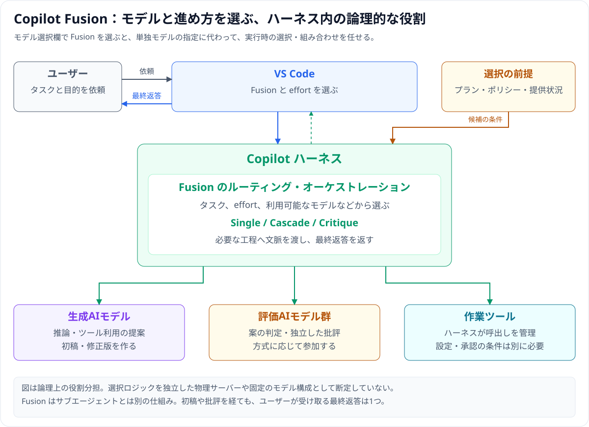
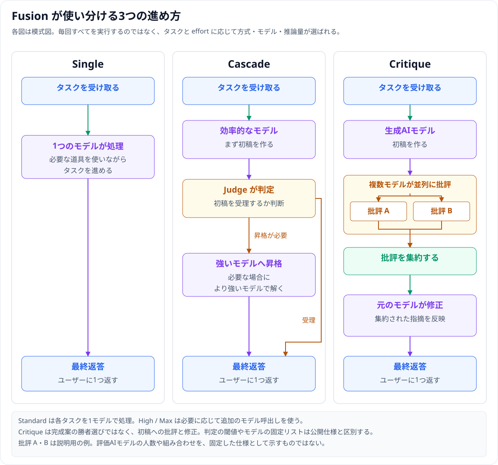
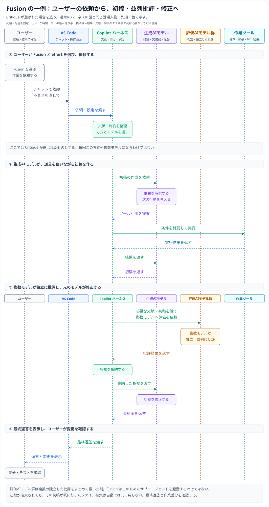
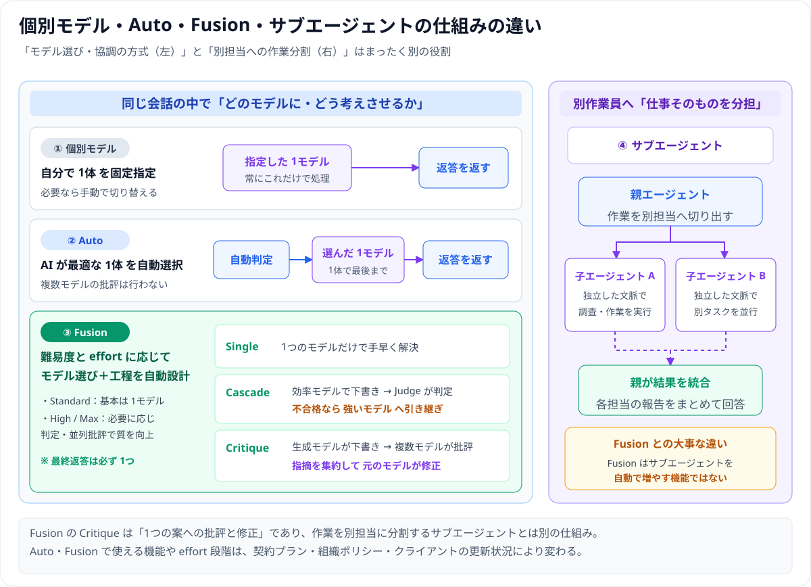

# Copilot Fusion — モデル選択と、下書き・評価・修正の組み立てを任せる

**Copilot Fusion** は、依頼内容と **effort**（品質・時間・コストの優先度）に応じて、AI モデルの選び方と「評価・修正の組み立て」を自動で行う仕組みです。

> **30 秒でわかる要点**
> 1. タスクに応じて **Single**（1 モデルで処理）／**Cascade**（効率的な案を判定し、必要なら強いモデルへ昇格）／**Critique**（別モデル群の並列批評を元のモデルが反映）を使い分けます。
> 2. **Critique は「勝者を選ぶ投票」ではありません。** 複数の評価モデルが指摘を返し、元のモデルが修正して 1 つの返答を作ります（[現行の処理方式](https://docs.github.com/en/copilot/concepts/models/copilot-fusion#how-copilot-fusion-works)）。
> 3. **サブエージェントとは別機能**です。Fusion は別の担当エージェントを自動起動するのではなく、1 つの会話内でのモデル選択・品質向上を担います（[Fusion の制約](https://docs.github.com/en/copilot/concepts/models/copilot-fusion#copilot-fusion-limitations)）。

GitHub が **2026-10-28 に一般提供を発表**しました（[GitHub の一般提供発表](https://github.blog/changelog/2026-10-28-route-and-orchestrate-models-with-github-copilot-fusion/)）。本稿の仕様・プラン対応は **2026-11-12 確認**の公式ドキュメントに基づきます。ハーネスと MCP の土台から確認したい場合は [Local と Copilot ハーネス](01_harness-local-vs-copilot.md) を先に読んでください。

---

## 1. Fusion の仕組みと 3 つの進め方

モデル選択欄で Fusion を選ぶと、ハーネスの中で「タスクと effort に合ったモデルと工程を選ぶ役割」を任せられます。

次のシーケンス図は、**Critique が選ばれた場合**のタイムラインです。

- **effort は処理方式の固定スイッチではない**：**Standard / High / Max** は品質・速度・コストの優先度を伝える設定であり、会話のたびに最適な方式やモデルが選ばれます（[Fusion の概要](https://docs.github.com/en/copilot/concepts/models/copilot-fusion#overview)、[VS Code の Fusion の説明](https://code.visualstudio.com/docs/agents/concepts/language-models#copilot-fusion)）。
- **使われたモデルの確認方法**：処理中の進捗表示や、返答後の effort 名へのホバーで確認できます。中間の案と最終返答は分けて確認してください（[一般提供時の方式説明](https://github.blog/changelog/2026-10-28-route-and-orchestrate-models-with-github-copilot-fusion/#smarter-choices-for-developers)）。
- **公開範囲と内部ロジック**：judge の採点しきい値や使われるモデルの固定リストは公開されておらず、構成は更新され得ます。

---

## 2. 個別モデル・Auto・Fusion・サブエージェントの使い分け

- **Auto との違い**：Auto は「1 モデルの自動選択」までですが、Fusion はモデル選択に加えて必要に応じた「評価・修正の組み立て」まで行います。VS Code では設定とアカウントへの提供状況に応じて、従来の Auto の位置に Fusion が表示されます（[Auto の公式説明](https://docs.github.com/en/copilot/concepts/models/auto-model-selection)、[VS Code のモデル選択の概念](https://code.visualstudio.com/docs/agents/concepts/language-models#auto-model-selection)）。
- **サブエージェントとの違い**：仕事を分割して別担当へ委任するのがサブエージェント、主会話の 1 手の中でモデル選択と批評を行うのが Fusion です。

---

## 3. VS Code での始め方と effort の選び方

1. VS Code と Copilot 関連機能を更新し、GitHub へサインインする。
2. Settings で **`chat.copilot.dynamicAutoTiers.enabled`** が有効か確認する（変更時は実行中リクエスト完了後に実行環境が再起動）。
3. **Copilot ハーネスで新しいチャット**を開き、モデル選択で **Copilot Fusion** → **Standard / High / Max** を選ぶ。
4. 対象範囲・通したいテスト・禁止事項を明確にして依頼し、返答と差分を確かめる（[VS Code の設定手順](https://code.visualstudio.com/docs/agent-customization/language-models#use-copilot-fusion)）。

| effort | 向く作業のイメージ | 対応プラン（2026-11-12 確認） |
|---|---|---|
| **Standard** | 日常的な作業（基本はタスクごとに 1 モデルを選択） | 全 Copilot プラン |
| **High** | 範囲が明確で、追加評価が役立つ難しい修正 | Pro+ / Max / Business / Enterprise |
| **Max** | 特に深い検討が必要な複雑な問題 | Pro+ / Max / Business / Enterprise |

※ 表示は契約や組織ポリシーに左右されます。なお **Fusion Fast** は inline chat 用であり、この 3 段階とは別の位置づけです（[公式の effort とプラン別対応表](https://docs.github.com/en/copilot/concepts/models/copilot-fusion#copilot-fusion-effort-level-availability-by-copilot-plan)、[VS Code 1.144 の一般提供案内](https://code.visualstudio.com/updates/v1_144/#_route-and-orchestrate-models-with-github-copilot-fusion)）。

---

## 4. 運用上の注意点とつまずき解消

- **変更差分の自動ロールバックはない**：破棄された中間案がすでに行ったファイル編集は自動で元に戻りません。返答だけでなく必ず Git 差分やテスト結果を確認します。
- **課金と消費量**：Fusion 専用の追加料金はありませんが、使用モデルの標準レートで課金されます。High / Max で複数回モデルを呼ぶタスクは Standard より多くの **AI credits** を消費する場合があります（有料プラン向け 30% 割引は **2026-11-30 まで**の期間限定案内です：[利用料金と制約](https://docs.github.com/en/copilot/concepts/models/copilot-fusion#billing-for-copilot-fusion)、[VS Code の AI credits の説明](https://code.visualstudio.com/docs/agents/concepts/language-models#ai-credits-and-model-costs)）。
- **コンテキスト上限と組織ポリシー**：Fusion 専用の巨大なコンテキスト枠があるわけではなく、各工程を担当するモデルの上限および管理者ポリシーに従います（[Fusion のポリシー](https://docs.github.com/en/copilot/concepts/models/copilot-fusion#policies-and-availability)）。
- **ローカルモデル候補（公開プレビュー）**：対応ローカルモデルを Standard 候補に含めるプレビュー機能がありますが、オフライン完結や旧 Local ハーネスとは別概念です（[Fusion のローカルモデル対応](https://docs.github.com/en/copilot/concepts/models/copilot-fusion#selecting-local-models-in-copilot-fusion)、[モデルの実行場所と作業場所](https://code.visualstudio.com/docs/agents/concepts/language-models#model-access-and-hosting)）。
- **Fusion が出ない／MCP が消えたとき**：Auto のままなら「Copilot ハーネスの新規チャットか・`dynamicAutoTiers` 設定・契約プラン」を確認します。MCP やツールが見えない問題は Fusion ではなくハーネス設定側を確認してください（[Local と Copilot ハーネス](01_harness-local-vs-copilot.md)）。

---

## 5. 参照した公式資料

以下はいずれも **2026-11-12** 確認時点の公式資料です（ページ更新表示：**2026-11-11**）。

- [GitHub Changelog：Fusion 一般提供](https://github.blog/changelog/2026-10-28-route-and-orchestrate-models-with-github-copilot-fusion/)（2026-10-28 発表）
- [GitHub Docs：About GitHub Copilot Fusion](https://docs.github.com/en/copilot/concepts/models/copilot-fusion)（処理方式・effort・プラン・制約・課金）
- [VS Code：AI language models](https://code.visualstudio.com/docs/agent-customization/language-models#use-copilot-fusion)（VS Code での開始手順）
- [VS Code：Understand language models](https://code.visualstudio.com/docs/agents/concepts/language-models)（Auto との差、概念整理）
- [VS Code 1.144 リリースノート](https://code.visualstudio.com/updates/v1_144/)（一般提供案内）
