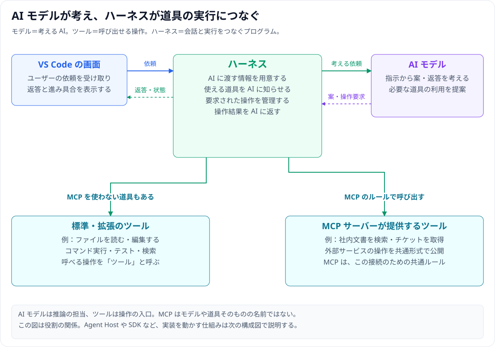

# Copilot Fusion とハーネス — 図で理解する使い方と移行

**ハーネス**（AI モデルと各種ツールをつなぐ実行管理）と、**Copilot Fusion**（タスクに応じて AI モデルと評価工程を選ぶ仕組み）を、図を中心に整理したガイドです。まず 1 本目でハーネスの基本と MCP の移行を押さえ、その土台の上で 2 本目の Fusion を読む流れにしています。



## ガイド一覧

| 順番 | ガイド | 主に分かること |
|---|---|---|
| **1** | [Local と Copilot ハーネス](01_harness-local-vs-copilot.md) | ハーネスの働き、旧 Local との違いと切り替え方、MCP や環境変数が動かなくなる理由と復旧手順 |
| **2** | [Copilot Fusion](02_copilot-fusion.md) | Single / Cascade / Critique の 3 方式、Auto やサブエージェントとの違い、始め方と注意点 |

## 図の見方と再生成

- **シーケンス図の共通ルール**：**ユーザー → VS Code → Copilot ハーネス → 生成AIモデル → 評価AIモデル群 → 作業ツール** の列順を固定し、使わない列も残して途中にも列名を入れています（環境変数の復旧例のみ設定〜接続を追う 4 列構成）。
- **確認時点**：初回確認日は **2026-11-12**、MCP 転送条件と環境変数への移行手順は **2026-11-13** に公式資料を再確認しています。

```text
copilot-fusion/
├─ README.md                         ← この案内
├─ 01_harness-local-vs-copilot.md     ← ハーネスの基本・比較・MCP 移行
├─ 02_copilot-fusion.md              ← Fusion の仕組み・始め方・利用条件
├─ assets/                           ← SVG 図 13 枚
└─ scripts/                          ← Node.js 標準機能だけで図を再生成
   ├─ generate-diagrams.js
   ├─ harness-primer-diagrams.js
   └─ harness-mcp-diagrams.js
```

図を編集したときは、次のコマンドで `assets/` 内の SVG 13 枚を再生成できます。

```powershell
node copilot-fusion/scripts/generate-diagrams.js
```

関連する基礎資料：[サブエージェント](../agent-guide/docs/00_subagent-guide.md) / [フックの動き](../hook-guide/docs/03_hook-flow-examples.md) / [MCP 入門](../mcp-guide/docs/00_mcp-guide.md)
