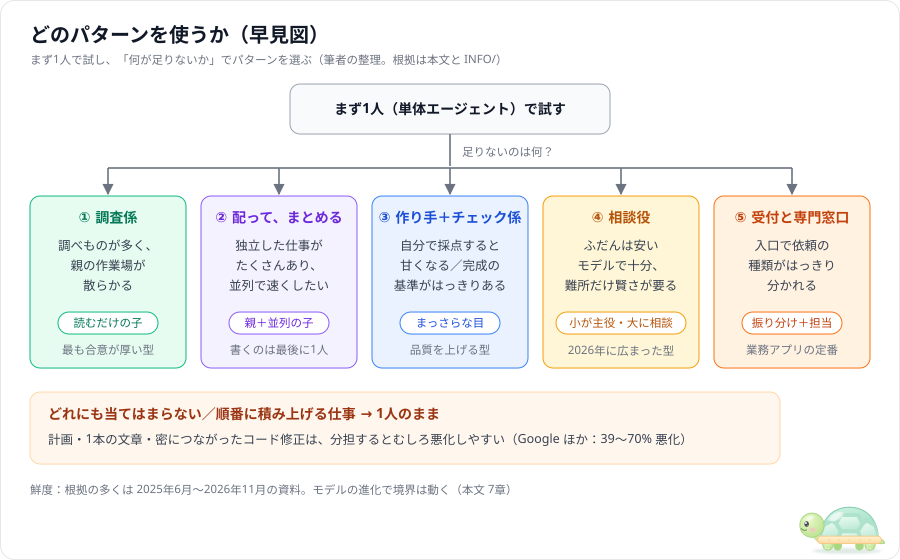
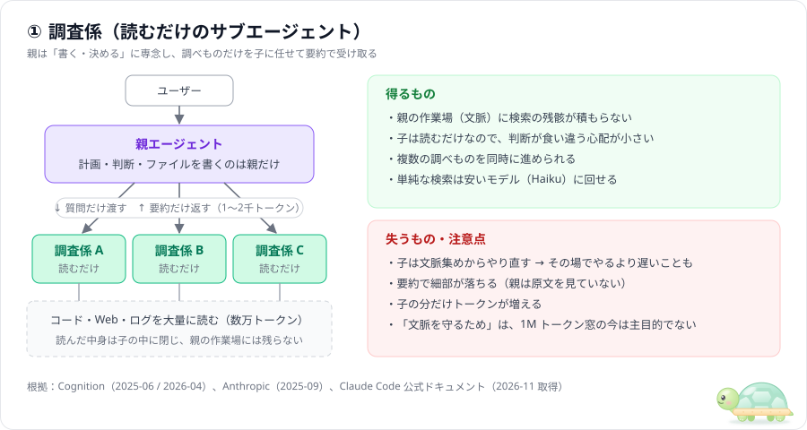
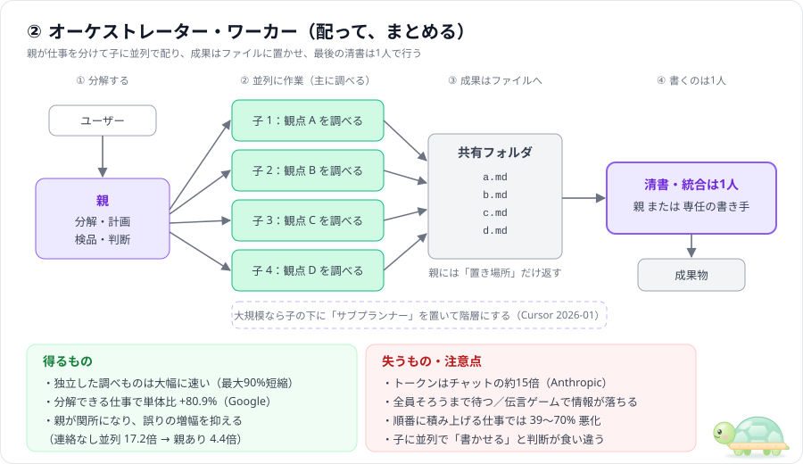
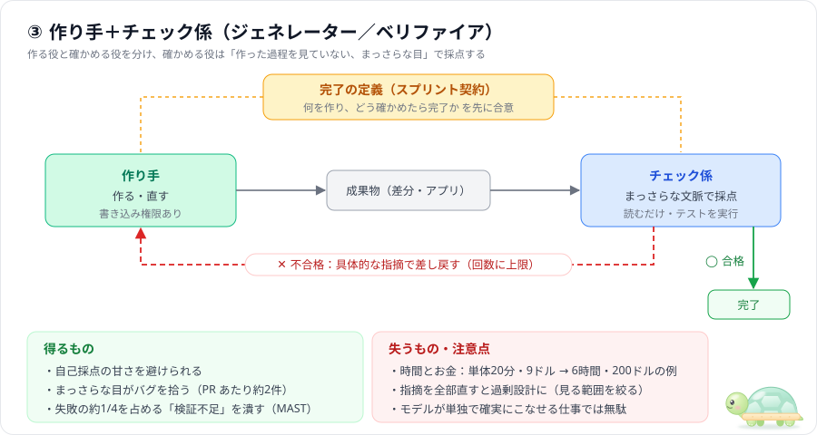
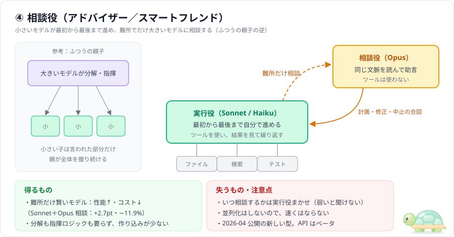
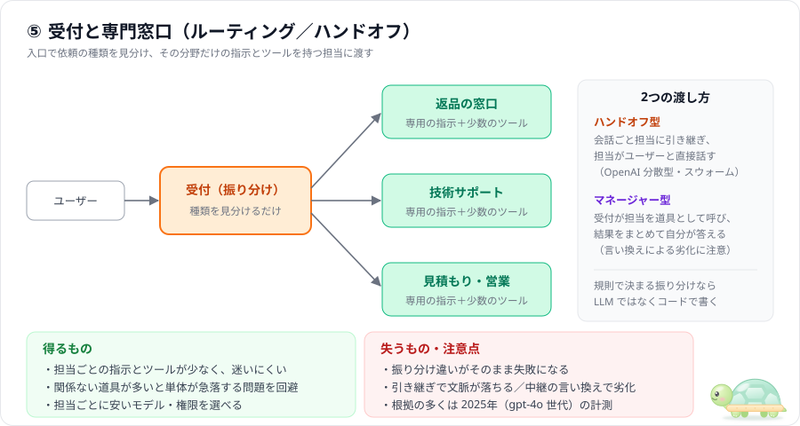
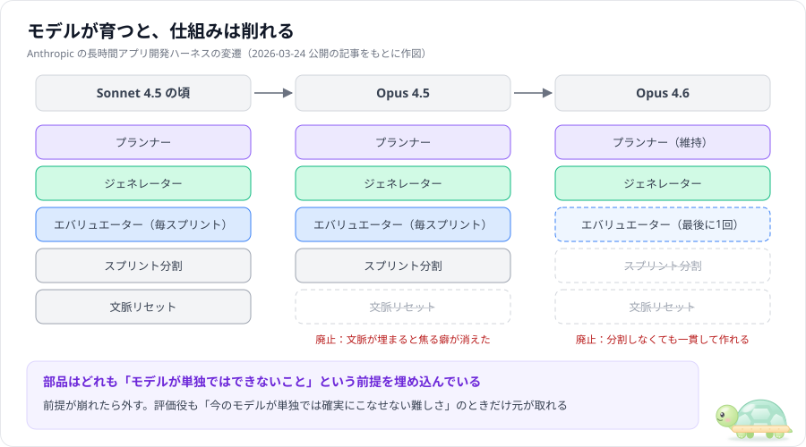
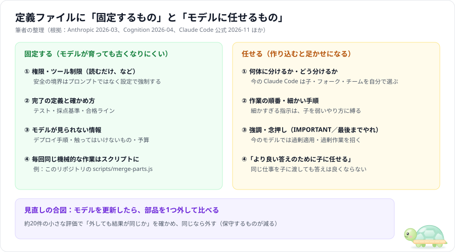

# 親子エージェントの定番パターン5選 — 効く理由・失うもの・古くなる部分

> この文書は「親エージェントとサブエージェントは、どう組み合わせると効率的か」について、論文・AI 企業の公式ブログ・公式ドキュメントで繰り返し出てくる**定番の型を5つ**に絞って説明する読み物です。
> 調査日は **2026-11-07**。集めた一次情報（21件）は出典ごとに [INFO/](../INFO/README.md) にメモしてあります。
> AI は1年で別物のように進化します。そこで各パターンに**根拠の鮮度**を付け、最後の [7章](#7-ai-の進化で仕組みが足かせになる問題) で「昔のセオリーのうち、もう外してよいもの」と「モデルに任せた方がよいもの」を整理しました。
> 出典のない記述や筆者の判断には「筆者の整理」と書いています。

### 鮮度ラベル（2026-11-07 基準）

| ラベル | 公開時期 | 読み方 |
|---|---|---|
| **新** | 6か月以内 | そのまま参考にしてよい |
| **中** | 6〜12か月前 | 考え方は有効。数値やモデル名は1〜2世代前 |
| **古** | 12か月超 | 原則は今も引用されるが、当時のモデルの弱点を補う工夫が混ざっている前提で読む |

---

## 目次

0. [まず結論（早見図）](#0-まず結論早見図)
1. [大前提：まず1人、読むのは分担・書くのは1人](#1-大前提まず1人読むのは分担書くのは1人)
2. [パターン①：調査係（読むだけのサブエージェント）](#2-パターン①調査係読むだけのサブエージェント)
3. [パターン②：オーケストレーター・ワーカー（配って、まとめる）](#3-パターン②オーケストレーターワーカー配ってまとめる)
4. [パターン③：作り手＋チェック係](#4-パターン③作り手チェック係)
5. [パターン④：相談役（アドバイザー）](#5-パターン④相談役アドバイザー)
6. [パターン⑤：受付と専門窓口（ルーティング／ハンドオフ）](#6-パターン⑤受付と専門窓口ルーティングハンドオフ)
7. [AI の進化で「仕組み」が足かせになる問題](#7-ai-の進化で仕組みが足かせになる問題)
8. [まとめ](#8-まとめ)
9. [参考文献](#参考文献)

---

## 0. まず結論（早見図）

| # | パターン | ひとことで | 向く | 向かない | 根拠の鮮度 |
|---|---|---|---|---|---|
| ① | 調査係 | 子は**読むだけ**、要約を返す | 広い検索・ログ読み・下調べ | 小さな修正、すぐ答えが要るとき | 新〜中 |
| ② | オーケストレーター・ワーカー | 親が配って、**最後は1人で書く** | 独立した調べものが多い、並列で速くしたい | 順番に積み上げる仕事 | 中〜古 |
| ③ | 作り手＋チェック係 | **まっさらな目**で採点し差し戻す | 完成の基準がはっきりしている、品質が大事 | モデルが単独で確実にこなせる仕事 | 新〜中 |
| ④ | 相談役 | **小さいモデルが主役**、難所だけ大きいモデルに相談 | 量が多くコストを抑えたい、難所がときどきある | 並列で速くしたい | 中 |
| ⑤ | 受付と専門窓口 | 入口で**種類を見分けて**担当へ渡す | 依頼の種類がはっきり分かれる業務 | 振り分けが規則で決まる（→コードで十分） | 古〜新 |

どの資料にも共通する一番大事な結論は、パターンより手前にあります。**「まず1人で試し、足りないところにだけ型を足す」**です（次章）。

---

## 1. 大前提：まず1人、読むのは分担・書くのは1人

### 1.1 主要な発信元は、そろって「まず1人」と言っている

| 発信元 | 言っていること | 日付 | 鮮度 |
|---|---|---|---|
| Anthropic | いちばん単純な解から始め、必要なときだけ複雑にする | 2024-12 | 古 |
| OpenAI | まず単体エージェントの能力を最大化せよ | 2025-04 | 古 |
| Microsoft | 要件を確実に満たす、いちばん低い複雑さを使え | 2026-09 更新 | 新 |
| Claude Code 公式 | 新しいセッションの最初の素直なプロンプトで、たいてい正しく動くように作ってある | 2026-11 取得 | 新 |

（出典：[INFO/01](../INFO/01_anthropic_building-effective-agents.md)、[03](../INFO/03_openai_practical-guide-to-building-agents.md)、[20](../INFO/20_microsoft_orchestration-patterns.md)、[21](../INFO/21_claude-code_docs.md)）

### 1.2 分担が効くかどうかは「仕事の形」で逆転する

Google Research ほかの大規模実験（2025-12〜2026-04、鮮度：中）は、道具・プロンプト・計算量をそろえて**構成だけ**を変えて比べました（[INFO/11](../INFO/11_google_scaling-agent-systems.md)）。

| 仕事の形 | 分担した結果 |
|---|---|
| 分解できる（財務分析：観点ごとに独立して調べられる） | 親が配る型で、1人より **+80.9%** |
| 順番に積み上げる（計画：前の手が次の手を決める） | **どの分担構成も 39〜70% 悪化** |

増やせば増やすほど良くなるわけではなく、**仕事の形と構成が合っているか**で決まります。

### 1.3 「読む」は分担しやすく、「書く」は分担しにくい

2025年6月、Cognition の「マルチエージェントを作るな」（[INFO/05](../INFO/05_cognition_dont-build-multi-agents.md)）と、Anthropic の「作ったら 90% 良くなった」（[INFO/06](../INFO/06_anthropic_multi-agent-research-system.md)）が同じ週に公開されました。LangChain がこの2つを次のように整理し（[INFO/07](../INFO/07_langchain_how-and-when-multi-agent.md)）、これがその後の共通認識になりました。

- 調べる（**読む**）作業は、手分けしても食い違いが小さい → 分担向き
- 作る（**書く**）作業は、1つ1つの行動に「暗黙の判断」（スタイル・設計・例外処理）が含まれる。並列に書くと判断がぶつかる → 1人向き
- Anthropic の調査システムも、**分担しているのは読む段階だけで、最終レポートは1体が書いている**

Cognition は 2026年4月の続編（[INFO/17](../INFO/17_cognition_multi-agents-working.md)、鮮度：中）で「読む子・レビュー役・マネージャー型は実際に機能している」と見解を更新しました。そのうえで「**並列に書くスウォームはまだダメ**」という部分は維持しています。

> **このリポジトリの実験でも同じ傾向が出ています。** 自己紹介ページ（1ファイルの HTML）では、1人（A）が 5分21秒、HTML・CSS・JS を3体に並列で書かせた分担（B）が 6分20秒 で、分担の方が遅くなりました。B の時間の約34%は「部品を1ファイルに書き写す統合」に使われています（[output/report_01-profile.md](../output/report_01-profile.md)、各1回の計測）。

---

## 2. パターン①：調査係（読むだけのサブエージェント）

### 仕組み

- 親が「〇〇はどこで定義されている？」「このログで何が起きている？」といった**質問だけ**を子に渡す。
- 子は大量のファイル・Web・ログを読み、**要約だけ**を返す。子に書き込みの権限は持たせない。
- ファイルを書くのも判断するのも親だけ。Claude Code の組み込み **Explore**（読み取り専用）がこの型です。

### なぜ効くのか

| 理由 | 根拠 |
|---|---|
| 親の作業場（コンテキスト）に検索の残骸が残らない。子は数万トークン読んでも、返すのは 1,000〜2,000 トークン程度 | Anthropic 2025-09（[INFO/10](../INFO/10_anthropic_context-engineering.md)）古 |
| 子は読むだけなので「暗黙の判断」がぶつからない。協調というより「**ツール呼び出しに近い**」 | Cognition 2026-04（[INFO/17](../INFO/17_cognition_multi-agents-working.md)）中 |
| 単純な検索は安いモデル（Haiku）に回せる | Claude Code 公式 2026-11（[INFO/21](../INFO/21_claude-code_docs.md)）新 |

### 失うもの・注意点

- **遅くなることがある**：新しい子は、親がすでに知っている文脈を集め直すところから始めます。小さな調べものなら、親がその場でやった方が速いこともあります。
- **細部が落ちる**：親が見るのは要約だけです。要約から漏れた事実は親に届きません。
- **トークンが増える**：子の分だけ使用量が増えます。
- **昔の理由は薄れた**：2025年ごろは「親の文脈窓を守るため」が主な理由でした。2026年11月時点の公式ベストプラクティスは、多くのモデルが 1M トークン窓を持ち圧縮も自動になったので「**文脈を守るためにサブエージェントを使え**」を「もうやめていいアドバイス」に挙げています（[INFO/21](../INFO/21_claude-code_docs.md)）。今も残る価値は、並列で進められること、雑多な出力を隔離できること、の2つです。

### 使いどころ

- 向く：コードベース全体の検索、長いテスト結果やログから要点だけ拾う、複数の調べものを同時に進める。
- 向かない：1〜2ファイルを見れば済む調べもの、親が会話の流れごと理解している必要がある判断。

---

## 3. パターン②：オーケストレーター・ワーカー（配って、まとめる）

### 仕組み

1. 親が仕事を**独立した小タスク**に分ける（何に分けるかは、事前に決めずその場で決める）。
2. 子に並列で配る。子ごとに「目的・出力形式・使ってよい道具・やらない範囲」を書く。
3. 子は成果を**ファイルに置き**、親には「どこに置いたか」だけ返す（伝言ゲームを防ぐ）。
4. **清書・統合は1人**が行う（親か、専任の書き手）。

大規模になると、子の下に「サブプランナー」を置いて階層にします（Cursor の例、[INFO/13](../INFO/13_cursor_scaling-agents.md)）。

### なぜ効くのか

| 理由 | 数字 | 根拠 |
|---|---|---|
| 独立した調べものを同時に進められる | 複雑な調査で時間を**最大90%短縮**。Opus 4 親＋Sonnet 4 子は Opus 4 単体より **+90.2%** | Anthropic 2025-06（[INFO/06](../INFO/06_anthropic_multi-agent-research-system.md)）古 |
| 分解できる仕事では大きく伸びる | 財務分析で単体比 **+80.9%** | Google ほか 2025-12〜2026-04（[INFO/11](../INFO/11_google_scaling-agent-systems.md)）中 |
| 親が「関所」になり、子の誤りが広がるのを止める | 誤りの増幅：連絡なしの並列は**17.2倍**、親ありは**4.4倍** | 同上 |
| たくさん考えさせられる | 性能差の **80%** はトークン使用量だけで説明できた | Anthropic 2025-06 |

最後の行は見落とされがちです。マルチエージェントが強い理由の多くは、「賢くなる」ことではなく「**価値に見合うだけトークンを使える**」ことにあります（[INFO/07](../INFO/07_langchain_how-and-when-multi-agent.md)）。

### 失うもの・注意点

- **お金**：トークンは普通のチャットの約 **15倍**（Anthropic）。価値の高い仕事でないと割に合いません。
- **待ち時間**：親は子の一団が全員終わるまで待ちます。1体が遅いと全体が止まります。
- **伝言ゲーム**：子の要約を親がさらに言い換えると、情報が落ちます。成果はファイルで受け渡します。
- **順番に積み上げる仕事では逆効果**：39〜70% 悪化（Google）。
- **子に並列で「書かせる」と食い違う**：LangChain の Open Deep Research は、最初に各章を子が並列に書く設計にしてレポートがバラバラになり、「調べるのは子、書くのは最後に1回」に作り直しました（[INFO/08](../INFO/08_lance-martin_bitter-lesson.md)）。
- **分担の仕組み自体が詰まる**：Cursor は、全員対等で共有ファイルを取り合う方式で「20体が2〜3体分の速さに落ちた」と報告しています。統合役を置いたら、解決より多くの渋滞を生んだので外しました（[INFO/13](../INFO/13_cursor_scaling-agents.md)）。

> **このリポジトリの B・C との関係**：`page-director` は「親が設計 → 職人3体が並列に部品を**書く** → 親が統合」で、これは「書く作業の分担」です。最終成果が1つのファイルにまとまる仕事では、統合の手間が並列化の得を食いつぶしやすくなります。C で統合を AI ではなくスクリプトにしたら B より約2分速くなり、1人（A）より速くなったのは、毎回同じ「書き写し」を決まった手順の処理に移したからです（[output/report_01-profile.md](../output/report_01-profile.md)）。

### 使いどころ

- 向く：幅の広い調査、複数モジュールの独立した調べもの、互いに触らないファイルを担当ごとに分けられる作業。
- 向かない：1本の文章・1つのファイルにまとまる成果物、前の結果で次の手が決まる作業、密につながったコード修正。

---

## 4. パターン③：作り手＋チェック係

### 仕組み

- **作り手**が作り、**チェック係**が採点する。不合格なら具体的な指摘をつけて差し戻し、合格するか回数の上限に達するまで繰り返す。
- チェック係は、作った過程を見ていない**まっさらな文脈**で動かし、書き込み権限は与えない。
- 始める前に「何を作り、どう確かめたら完了か」を両者で合意しておく（Anthropic の「スプリント契約」）。
- 名前は資料によって違います。評価者・最適化者（evaluator-optimizer）、maker-checker、generator-verifier、critic loop、reflection loop はどれも同じ型です（[INFO/20](../INFO/20_microsoft_orchestration-patterns.md)）。

### なぜ効くのか

| 理由 | 根拠 |
|---|---|
| **自分の仕事を自分で採点すると甘くなる**。別の評価役を厳しく調整する方が、作り手に自己批判させるよりずっと扱いやすい | Anthropic 2026-03（[INFO/15](../INFO/15_anthropic_harness-design.md)）中 |
| まっさらな文脈のレビュー役は、作り手が見落とすバグを捕まえる。Devin Review は PR あたり平均約2件、その約58%が重大 | Cognition 2026-04（[INFO/17](../INFO/17_cognition_multi-agents-working.md)）中 |
| マルチエージェントの失敗の約 **1/4（23.5%）は検証の不足・誤り**。高いレベルの目的チェックを足すと +15.6% | MAST 論文 2025（[INFO/02](../INFO/02_mast_why-multi-agent-systems-fail.md)）古 |
| 同じ仕事を子に渡しても答えは良くならない。新しいレビュー役が効くのは、**推論の過程を見ていない**から | Claude Code 公式 2026-11（[INFO/21](../INFO/21_claude-code_docs.md)）新 |

Claude Code の `/code-review` は、会話を見ていない新しいサブエージェントで差分をレビューします。この型の代表例です。

### 失うもの・注意点

- **時間とお金**：Anthropic の例では、レトロゲーム作成が 1人なら 20分・9ドル、作り手＋評価役の構成なら 6時間・200ドル（20倍超）でした。品質は上がりますが、高くつきます。
- **過剰設計**：「問題を探せ」と頼まれたレビュー役は必ず何か見つけます。全部直すと、不要な抽象化や起こりえないケースのテストが増えます。「正しさに関わるものだけ。スタイルは無視」のように**見る範囲を絞る**のが公式の推奨です（[INFO/21](../INFO/21_claude-code_docs.md)）。
- **終わらないループ**：差し戻しの上限回数を決めておきます（MAST の失敗例でも「終了条件を知らない」が 12.4%）。
- **モデルが強いと要らない**：Anthropic は「評価役が元を取るのは、**今のモデルが単独では確実にこなせない難しさ**のときだけ」と書いています。モデルが育つほど、出番が減る部品です（[7章](#7-ai-の進化で仕組みが足かせになる問題)）。
- **議論させるのとは別物**：同格の AI 同士を議論させる手法（マルチエージェント・ディベート）は、効果の大半が単なる多数決で説明できたという論文があります（[INFO/09](../INFO/09_debate-or-vote.md)、2025、古）。効くのは「議論」ではなく、**役割の違う、まっさらな目のチェック**です。

---

## 5. パターン④：相談役（アドバイザー）

### 仕組み

- **小さいモデル（Sonnet / Haiku）が実行役**として、最初から最後まで自分で仕事を進める。
- 自分では判断しきれない場面でだけ、**大きいモデル（Opus）に相談**する。
- 相談役は同じ文脈を読んで「計画・修正・中止の合図」を返すだけで、ツールは使わない。
- 「大きい親が分解して小さい子に配る」ふつうの親子の**逆**です。Anthropic は 2026-04 に API のベータ機能（advisor tool）として公開しました（[INFO/16](../INFO/16_anthropic_advisor-strategy.md)）。Cognition は同じ考え方を「スマートフレンド」と呼んでいます（[INFO/17](../INFO/17_cognition_multi-agents-working.md)）。

### なぜ効くのか

- **賢いモデルを、必要なときだけ使える**。Anthropic の公表値では、Sonnet＋Opus 相談役は Sonnet 単体より SWE-bench Multilingual で **+2.7ポイント**、しかもタスクあたりコストは **−11.9%**。Haiku＋Opus 相談役は BrowseComp で **41.2%**（Haiku 単体 19.7%）。
- **作り込みが少ない**：分解の仕組みも、子の群れも、指揮のロジックも要りません。

### 失うもの・注意点

- **いつ相談するかは実行役まかせ**：Cognition は「両方が強いモデルなら機能する」「実行役が弱いと、自分の限界に気づけず聞くべきときに聞けない」と報告しています。
- **速くはならない**：並列化はしないので、時間短縮の手段ではありません。
- **新しい型**：2026年4月に広まったばかりで、数字はベンダーの公表値です。導入前に「Sonnet 単体／Sonnet＋相談役／Opus 単体」を自分の課題で比べることを、Anthropic 自身が勧めています。

---

## 6. パターン⑤：受付と専門窓口（ルーティング／ハンドオフ）

### 仕組み

- 入口の**受付**が依頼の種類を見分け、その分野だけの指示とツールを持つ**担当**に渡す。
- 渡し方は2種類あります（OpenAI のガイド、[INFO/03](../INFO/03_openai_practical-guide-to-building-agents.md)）。
  - **ハンドオフ型（分散型）**：会話ごと担当に引き継ぎ、担当がユーザーと直接話す。
  - **マネージャー型**：受付が担当を「道具」として呼び、結果をまとめて自分が答える。

### なぜ効くのか

- **迷いが減る**：1体に関係ない道具を大量に持たせると、選び間違いが増えます。LangChain の計測（2025-06、gpt-4o）では、関係ない業務領域が2つ以上あると単体エージェントの成績が急落し、使うトークンも増え続けました（[INFO/04](../INFO/04_langchain_benchmarking-multi-agent.md)）。
- **分ける目安**：OpenAI は「問題は道具の数より**似ていること**」と書いています。明確に区別できれば15個以上でも動く一方、重なる道具10個未満で苦しむ例もあります。名前と説明を直しても改善しないなら分けます。
- **担当ごとに安いモデルや権限を選べる**。

### 失うもの・注意点

- **振り分け違い**：受付が間違えると、その先はすべて無駄になります。
- **引き継ぎで文脈が落ちる**：マネージャー型では、受付が担当の返事を**言い換えて**伝えるときに劣化します。LangChain は「担当の返事をそのまま転送する」仕組みを足して約50%改善しました。
- **規則で決まるならコードで十分**：Microsoft は「振り分けが決まった規則でできるならハンドオフは避ける」としています（[INFO/20](../INFO/20_microsoft_orchestration-patterns.md)）。
- **根拠が古め**：数字の多くは 2025年（gpt-4o 世代）のものです。今のモデルは多数の道具を持たせても選択を誤りにくくなっているので、「単体が急落する点」は後ろにずれていると考えるのが自然です（筆者の判断）。

> **コーディング支援ツールでの姿**：Claude Code では、親が各サブエージェントの `description` を見て、自分で委任先を選びます。これが受付の役割に当たります。顧客対応のような業務アプリほど型ははっきりしませんが、「説明文が似た子を並べると迷う」点は同じです。

---

## 7. AI の進化で「仕組み」が足かせになる問題

### 7.1 実例：モデルが育つと、仕組みは削れる

Anthropic は長時間かけてアプリを丸ごと作る構成（プランナー＋作り手＋評価役）を、モデルの世代が変わるたびに作り直し、その記録を公開しています（[INFO/15](../INFO/15_anthropic_harness-design.md)、2026-03、鮮度：中）。

| 部品 | 何のためにあったか | どうなったか |
|---|---|---|
| 文脈リセット | Sonnet 4.5 は文脈が埋まると焦って雑になる癖があった | Opus 4.5 で癖がほぼ消えたので**廃止** |
| スプリント分割 | 大きな仕事を一度に扱えなかった | Opus 4.6 で、分割しなくても一貫して作れるようになり**廃止** |
| スプリントごとの評価 | 途中で品質が崩れた | **最後に1回だけ**に変更 |
| プランナー | 作り手が仕事の範囲を小さく見積もる | 今も**維持** |

この記事の中心にある一文が、この章の主題です。

> 「ハーネスの部品はどれも『モデルが単独ではできないこと』という前提を埋め込んでいる」（Anthropic, 2026-03）

ほかの現場からも同じ報告が出ています。

| 発信元 | 報告 | 日付 | 鮮度 |
|---|---|---|---|
| Cursor | 「改善の多くは、複雑さを**足す**ことではなく**取り除く**ことから来た」。統合役を置いたら渋滞を生んだので外した | 2026-01 | 中 |
| LangChain（Open Deep Research） | ツール呼び出しが不安定だった頃の固定ワークフローが、モデルの上達で足かせになり、1年で3回作り直した | 2025-07 | 古 |
| Manus・Vercel（Philipp Schmid の紹介） | Manus は6か月で5回作り直した。Vercel はツールを80%削って、手順・トークン・応答時間が減った | 2026-01 | 中 |

元になっている考え方は、AI 研究でいう「**苦い教訓（The Bitter Lesson）**」です。人が手で組み込んだ工夫は、計算量とモデルの進歩で伸びる汎用的なやり方に最後は負ける、というものです。OpenAI の Hyung Won Chung はこれを「今の計算量に必要な構造は足せ。ただし後で外せ」と言い換えています（[INFO/08](../INFO/08_lance-martin_bitter-lesson.md)）。

### 7.2 公式ドキュメントにも「やめていいこと」表ができた

Claude Code の公式ベストプラクティス（2026-11 取得、鮮度：新）には、「昔は正しかったが、モデルが追いついたのでやめてよいアドバイス」の表があります（[INFO/21](../INFO/21_claude-code_docs.md)）。親子構成に関係する行を抜き出します。

| 昔のアドバイス | 今の扱い |
|---|---|
| 文脈を守るためにサブエージェントを使え | 文脈切れはもうほとんど問題でない。並列化・雑多な出力の隔離・独立レビューには今も有効だが、どれも追加のトークンがかかる |
| より良い答えのためにサブエージェントに任せよ | 同じ仕事を子に渡しても答えは良くならない（効くのは「まっさらな目のレビュー」で、委任とは別物） |
| 重要事項は大文字や IMPORTANT で強調せよ | 強調は過剰適用を招く。曲げられない規則はフックや拒否ルールに |
| 「最後までやれ」「手を抜くな」と書け | 過剰作業を招く。代わりに合格すべきチェックを与える |

### 7.3 「分担の仕方」はモデル自身が決める方向へ

2026年の大きな変化は、**どう分担するかを人が固定せず、実行中のモデルがその場で決める**仕組みが標準になったことです。

| 例 | 中身 | 日付 | 鮮度 |
|---|---|---|---|
| Claude Code | 広い検索は自分で Explore に回す。脇道の作業は自分で**フォーク**（会話を引き継いだ子）にする。子は既定でバックグラウンドで動く。大量の機械的変更は `/batch` が5〜30単位に自動分割する | 2026-11 取得 | 新 |
| Claude Code エージェントチーム（実験的） | 人数やタスク分割はリードが決める。有効にすると、頼まなくてもチームができることがある | 2026-11 取得 | 新 |
| Kimi K2.5 Agent Swarm | **事前定義のサブエージェントもワークフローもなし**に、モデルが最大100体の子をその場で作って指揮する。分担のさせ方そのものを強化学習で学ばせた（ベンダー公表で最大4.5倍速い） | 2026-01 | 中 |

一方で、**構成を自動探索して固定する**研究（ADAS・AFlow・MaAS など）には反証も出ています。2026年6月の論文は、自動生成されたマルチエージェント構成が、最大10倍のコストをかけても単純な多数決（CoT-SC）に負け、役に立たない複雑さで肥大化していたと報告しました（[INFO/18](../INFO/18_illusion-of-multi-agent-advantage.md)、鮮度：新、査読前）。

ここから言えるのは次のことです（筆者の整理）。

- 「**実行中のモデルが、必要なときだけ子を使う**」方向は、製品の既定動作になりつつあり、うまくいっている。
- 「**探索で作った複雑な構成を固定する**」方向は、まだ単純な方法に勝てていない。
- どちらも「人が分担を細かく決め打ちする」ことからは離れている。

### 7.4 では、定義ファイルに何を書くべきか

以下は筆者の整理です。根拠は上に挙げた Anthropic・Cognition・Claude Code 公式です。

**固定してよい（モデルが育っても古くなりにくい）もの**

1. **権限・ツール制限**：「レビュー役は読むだけ」のような安全の境界です。プロンプトでお願いするのではなく、`tools` などの設定で強制します。モデルが賢くなっても、この境界が要らなくなることはありません。
2. **完了の定義と確かめ方**：テスト・採点基準・合格ライン。公式ベストプラクティスが「今も価値がある」と明記している数少ない項目です。
3. **モデルが見られない情報**：デプロイ手順・触ってはいけないもの・予算など、リポジトリを読んでも分からないこと。
4. **毎回同じ機械的な作業**：AI の構成ではなく**スクリプト**にします。このリポジトリの `scripts/merge-parts.js` がその例で、スクリプトはモデルが変わっても古くなりません。

**任せた方がよい（作り込むと足かせになる）もの**

1. **何体に分けるか・どう分けるか**：今の Claude Code は、子・フォーク・チームを状況に応じて自分で使い分けます。
2. **作業の順番・細かい手順**：Anthropic は「プランナーが細かい実装まで指定すると、作り手を弱いやり方に縛る」と書いています。Cognition も「マネージャーは指示を細かく書きすぎがち」と指摘しています。
3. **強調・念押し**：今のモデルでは過剰適用・過剰作業を招きます。
4. **「良い答えのために子に任せる」こと自体**：答えは良くなりません。

### 7.5 保守コストの比べ方

| | 分担を固定した構成（例：親1＋職人3を定義） | モデルに任せる構成（素のセッション＋最小限の定義） |
|---|---|---|
| 最初の手間 | 大きい（設計書の約束事・各職人の定義・統合手順） | 小さい |
| モデル更新のたび | 前提が崩れていないか見直しが要る。放置すると、新しいモデルの能力を縛る | ほぼ不要。モデルの改善がそのまま効く |
| 結果のばらつき | 小さい（毎回同じ流れ） | やや大きい（その場の判断で変わる） |
| 向く場面 | 同じ種類の仕事を何十回も回す、コストや権限を厳密に管理したい | 仕事の中身が毎回違う、試行錯誤の段階 |

**見直しの手順**（筆者の提案。Anthropic・LangChain の「評価は約20件から始められる」に基づく）

1. 構成の部品ごとに「**これはモデルの何の弱点を補っているのか**」を1行メモしておく。
2. モデルを更新したら、部品を1つ外した版を作る。
3. 約20件の同じお題で、外す前と後を比べる。
4. 結果が変わらなければ外す。保守するものが1つ減ります。

### 7.6 このリポジトリへの当てはめ

- `page-director`（親＋HTML・CSS・JS の職人3体）は、「**書く作業を並列に分担する**」固定構成です。7章の基準で見ると、成果物が1ファイルにまとまる仕事には向きにくく、実際に1人（A）より遅くなりました。
- C が速かったのは、AI の構成を増やしたからではなく、**機械的な作業をスクリプトに移した**からです。固定してよいもの④の例です。
- 次に試す価値がある実験（筆者の提案）：**方式 D**として、`--agent` も `--disallowedTools Agent` も付けない素の `claude -p` に同じお題を渡し、「サブエージェントを使うかどうかもモデルに任せる」場合と A・B・C を比べる。今のモデルが自分で選ぶ分担が、固定した分担より良いかどうかを確かめられます。

---

## 8. まとめ

| 問い | 答え |
|---|---|
| 最初にやることは？ | **1人で試す**。足りないところにだけ型を足す |
| 一番安全に効く型は？ | ①調査係（読むだけ）と ③チェック係（まっさらな目）。どちらも「書くのは1人」を崩さない |
| 並列で速くしたいときは？ | ②配って、まとめる。ただし**調べる部分だけ**を並列にし、清書は1人で |
| 賢さが足りないときは？ | ④相談役。小さいモデルが主役で、難所だけ大きいモデルに聞く |
| 依頼の種類がはっきり分かれるときは？ | ⑤受付と専門窓口。規則で決まる振り分けならコードで |
| 避けるべきことは？ | 順番に積み上げる仕事の分担、子に並列で「書かせる」こと、同格の AI 同士の議論に期待しすぎること |
| 古くなる部分は？ | 「モデルが苦手なこと」を補う工夫すべて。モデルを更新したら外して比べる |
| 固定してよいのは？ | 権限・完了の定義・モデルが見られない情報・機械的な作業（スクリプト） |

---

## 参考文献

鮮度は 2026-11-07 基準です。詳しいメモ（要点・原文引用・注意点）は [INFO/](../INFO/README.md) にあります。

| # | 出典 | 日付 | 鮮度 |
|---|---|---|---|
| 1 | Anthropic, [Building effective agents](https://www.anthropic.com/engineering/building-effective-agents) | 2024-12-19 | 古 |
| 2 | Cemri ほか, [Why Do Multi-Agent LLM Systems Fail?](https://arxiv.org/abs/2503.13657)（NeurIPS 2025 D&B） | 2025-03（v3: 2025-10） | 古 |
| 3 | OpenAI, [A practical guide to building agents](https://cdn.openai.com/business-guides-and-resources/a-practical-guide-to-building-agents.pdf) | 2025-04 | 古 |
| 4 | LangChain, [Benchmarking Multi-Agent Architectures](https://www.langchain.com/blog/benchmarking-multi-agent-architectures) | 2025-06-10 | 古 |
| 5 | Cognition, [Don't Build Multi-Agents](https://cognition.com/blog/dont-build-multi-agents) | 2025-06-12 | 古 |
| 6 | Anthropic, [How we built our multi-agent research system](https://www.anthropic.com/engineering/multi-agent-research-system) | 2025-06-13 | 古 |
| 7 | LangChain, [How and when to build multi-agent systems](https://www.langchain.com/blog/how-and-when-to-build-multi-agent-systems) | 2025-06-16 | 古 |
| 8 | Lance Martin, [Learning the Bitter Lesson](https://rlancemartin.github.io/2025/07/30/bitter_lesson/) | 2025-07-30 | 古 |
| 9 | Choi ほか, [Debate or Vote](https://arxiv.org/abs/2508.17536)（NeurIPS 2025） | 2025-08 | 古 |
| 10 | Anthropic, [Effective context engineering for AI agents](https://www.anthropic.com/engineering/effective-context-engineering-for-ai-agents) | 2025-09-29 | 古 |
| 11 | Kim ほか（Google Research）, [Towards a Science of Scaling Agent Systems](https://arxiv.org/abs/2512.08296)／[ブログ](https://research.google/blog/towards-a-science-of-scaling-agent-systems-when-and-why-agent-systems-work/) | 2025-12（v3: 2026-04） | 中 |
| 12 | Philipp Schmid, [The importance of Agent Harness in 2026](https://www.philschmid.de/agent-harness-2026) | 2026-01-05 | 中 |
| 13 | Cursor, [Scaling long-running autonomous coding](https://cursor.com/blog/scaling-agents) | 2026-01-14 | 中 |
| 14 | Moonshot AI, [Kimi K2.5](https://www.kimi.com/blog/kimi-k2-5)（Agent Swarm） | 2026-01 | 中 |
| 15 | Anthropic, [Harness design for long-running apps](https://www.anthropic.com/engineering/harness-design-long-running-apps) | 2026-03-24 | 中 |
| 16 | Anthropic, [The advisor strategy](https://claude.com/blog/the-advisor-strategy) | 2026-04-09 | 中 |
| 17 | Cognition, [Multi-Agents: What's Actually Working](https://cognition.com/blog/multi-agents-working) | 2026-04-22 | 中 |
| 18 | Jwalapuram ほか, [The Illusion of Multi-Agent Advantage](https://arxiv.org/abs/2606.13003)（査読前） | 2026-06-11 | 新 |
| 19 | ADAS / AFlow / MaAS / MAS-ZERO（構成の自動設計。二次情報で確認） | 2024-08〜2025-05 | 古 |
| 20 | Microsoft, [AI Agent Orchestration Patterns](https://learn.microsoft.com/en-us/azure/architecture/ai-ml/guide/ai-agent-design-patterns) | 2026-02（更新 2026-09） | 新 |
| 21 | Claude Code 公式, [Subagents](https://code.claude.com/docs/en/sub-agents)／[Agent teams](https://code.claude.com/docs/en/agent-teams)／[Best practices](https://code.claude.com/docs/en/best-practices) | 2026-11-07 取得 | 新 |
