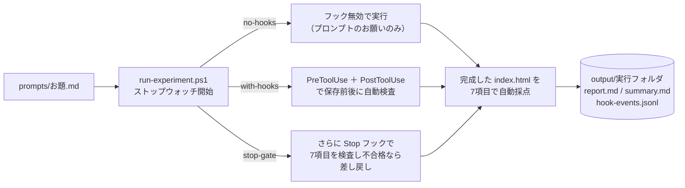

# hook-guide — フック（Hooks）を「使う／使わない」で AI のルール遵守と品質を比べる

このフォルダ（`agent-study/hook-guide`）は、AI エージェントの**フック**（Hooks：動きの節目に自動で割り込むプログラム）を学ぶための作業場です。
読み物は [docs/](docs/00_hook-guide.md)、パターン別の見本は [samples/](samples/README.md) にあります。
「AI・フック・アプリはどうつながり、どの順で動く？」から知りたい場合は、[全体図と4つのシーケンス図](docs/03_hook-flow-examples.md)をご覧ください。アプリへの状態通知、チャット送信時の処理、操作前後の検査・整形、終了時の差し戻しを、Claude Code と Copilot / VS Code の違いとともに図解しています。
フックの定番パターン5選と、AI の進化で変わる「プロンプトとフックの境界線」の整理は [docs/02_hook-patterns.md](docs/02_hook-patterns.md)（調査メモは [info/](info/README.md)）にあります。

この README では、ルートに置いた**すぐ使える3つのフック**を使って、

1. **Claude Code なしでも1秒でできる「フック単体のローカル実験」**
2. **厳格な HTML/CSS/アクセシビリティ規約つきのお題を、次の3方式で作り比べる実験**

の手順を説明します。

| 方式 | モード名 | やり方 |
|---|---|---|
| A | **no-hooks**（お願いベース） | フックをすべて無効にし、プロンプトの「禁止事項・技術規約」の文章だけで AI に守らせる |
| B | **with-hooks**（関所＋事後チェック） | `PreToolUse`（保存前の外部 CDN・保護ファイル遮断）と `PostToolUse`（保存直後の自動整形・インライン `style` 検査）を有効にする |
| C | **stop-gate**（B＋完了ゲート） | B に加えて `Stop` フックを有効にし、AI が完了しようとした時点で**全7項目の技術規約を検査して、不合格なら自動で差し戻す**（無限ループ防止のため差し戻しは1回まで） |

> 📌 ルートの [.claude/settings.json](.claude/settings.json) は、**この `hook-guide` フォルダで Claude Code を起動したとき**だけ読み込まれます（親の `agent-study` で起動した場合は効きません）。`run-experiment.ps1` は自動でこのフォルダに移動してから実行します。

---

## 1. フォルダ構成

```text
hook-guide/
├─ README.md                       ← この手順書
├─ .claude/settings.json           ← Claude Code 用のフック設定（PreToolUse / PostToolUse / Stop）
├─ .github/hooks/hooks.json        ← GitHub Copilot / VS Code 用の同じフック設定
├─ hooks/                          ← 実際に動く Node.js フックスクリプト（標準モジュールのみ）
│   ├─ guard-write.js              … PreToolUse：.env・危険コマンド・外部 CDN を保存前にブロック（exit 2）
│   ├─ post-check.js               … PostToolUse：末尾空白の自動整形＋インライン style 等の即時指摘
│   └─ stop-verify.js              … Stop：7つの必須要件が揃うまで完了を差し戻す（無限ループ防止つき）
├─ prompts/                        ← 厳格な技術規約つきのお題
│   ├─ 01-profile-strict.md        … 自己紹介ページ（7つの必須規約つき）
│   └─ 02-cafe-strict.md           … 架空のカフェのホームページ（7つの必須規約つき）
├─ scripts/
│   ├─ test-hooks-locally.js       ← ★Claude 不要！模擬 JSON を流し込んでフックの挙動を1秒で試すテスト
│   ├─ generate-sequence-diagrams.js ← 4枚のシーケンス図を共通の列順・名称・配色で生成
│   └─ run-experiment.ps1          ← A / B / C を実行し、時間・コスト・規約遵守スコア（7点満点）を記録
├─ output/                         ← 実験結果の置き場（実行するたびにフォルダが増える）
│   └─ summary.md                  … 全実行の一覧表（自動で1行ずつ追記）
├─ docs/                           ← 読み物（00: 入門、01: Copilot 編、02: 定番5選、03: 全体図・シーケンス図）
├─ info/                           ← docs/02 を書くために集めた一次情報の出典メモ（10件、鮮度つき）
└─ samples/                        ← そのまま別プロジェクトにコピーして使える5パターンの見本集
```

---

## 2. 【すぐ試せる】Claude Code なしでフックの動きを1秒で体験する

フックの正体は「標準入力（`stdin`）から JSON を受け取り、終了コード（`0` か `2`）または JSON を返すだけのスクリプト」です。
そのため、Claude Code を起動しなくても、Node.js さえあればターミナルで今すぐ全フックの動作を確かめられます。

```powershell
cd C:\git_home\agent-study\hook-guide
node scripts/test-hooks-locally.js
```

実行すると、次の11ケースの模擬データが各フックに流し込まれ、結果が一覧表示されます。

1. `.env` を編集しようとしたとき → `PreToolUse` が **終了コード `2` で強制ブロック**するか
2. `rm -rf` を実行しようとしたとき → `PreToolUse` が **終了コード `2` で強制ブロック**するか
3. 禁止された外部 CDN（`https://...`）を含む HTML を保存しようとしたとき → **保存前にブロック**するか
4. 安全な HTML 保存は **終了コード `0` で通過**するか
5. インライン `style="..."` を含む HTML を保存した直後 → `PostToolUse` が **即座に指摘 JSON を返す**か
6. 必須タグが欠けたまま完了しようとしたとき → `Stop` フックが **`decision: "block"` で差し戻す**か
7. すでに1回差し戻した直後（`stop_hook_active: true`）→ **無限ループ防止で通過させる**か（＝差し戻しは1回まで）
8. 全7項目の規約を満たした HTML → `Stop` フックを **一発で合格通過**するか
9. プロンプトに API キー（`sk-...`）を貼ったとき → `UserPromptSubmit` が **送信前にブロック**するか
10. 通常のプロンプト送信時 → `UserPromptSubmit` が **現在の Git ブランチ名を自動添付**するか
11. GitHub Copilot 形式の入力（`toolName` / `toolArgs`）で `.env` を作ろうとしたとき → **同じスクリプトで Copilot でもブロック**できるか

---

## 3. Claude Code で A / B / C を実行して比べる

実際に Claude Code を動かして、「プロンプトのお願いだけ（A）」と「フックによる強制（B・C）」でどれだけ規約違反や手戻りが変わるかを計測します。

### 自己紹介ページ（厳格規約版）

```powershell
# A：フックなし（プロンプトのお願いのみ）
powershell -ExecutionPolicy Bypass -File scripts\run-experiment.ps1 -Prompt prompts\01-profile-strict.md -Mode no-hooks -Model sonnet -Open

# B：関所（PreToolUse）＋ 事後チェック（PostToolUse）
powershell -ExecutionPolicy Bypass -File scripts\run-experiment.ps1 -Prompt prompts\01-profile-strict.md -Mode with-hooks -Model sonnet -Open

# C：B ＋ 完了ゲート（Stop で7項目すべて合格するまで差し戻し）
powershell -ExecutionPolicy Bypass -File scripts\run-experiment.ps1 -Prompt prompts\01-profile-strict.md -Mode stop-gate -Model sonnet -Open
```

### カフェのホームページ（厳格規約版）

```powershell
powershell -ExecutionPolicy Bypass -File scripts\run-experiment.ps1 -Prompt prompts\02-cafe-strict.md -Mode no-hooks -Model sonnet -Open
powershell -ExecutionPolicy Bypass -File scripts\run-experiment.ps1 -Prompt prompts\02-cafe-strict.md -Mode with-hooks -Model sonnet -Open
powershell -ExecutionPolicy Bypass -File scripts\run-experiment.ps1 -Prompt prompts\02-cafe-strict.md -Mode stop-gate -Model sonnet -Open
```

### スクリプトが内部でやっていること



1回の実行が終わると、`output/<日時>_<お題>_<方式>/` に以下が保存されます。

- `index.html`：完成した Web ページ
- `report.md`：実測時間・ターン数・コスト・**7項目の規約遵守スコア**・フックが何回介入したかの記録
- `hook-events.jsonl`：方式 B・C でフックがいつ発火し、何をブロック／自動整形したかの詳細な証跡ログ

---

## 4. 読み物ガイド（どこから読むか）

| 順番 | ファイル | 内容 |
|---|---|---|
| 図から | [docs/03_hook-flow-examples.md](docs/03_hook-flow-examples.md) | **全体図と4つのシーケンス図**：誰がフックを起動するか、アプリへの状態通知、通知なしの自動処理、Claude / Copilot の相違点 |
| 1 | [docs/00_hook-guide.md](docs/00_hook-guide.md) | **フック入門**（Claude Code 編）：プロンプトとの違い、主要10イベント、設定ファイルの解剖図、`stdin` / `exit 2` / JSON 出力の仕組み、無限ループ防止などの落とし穴 |
| 2 | [docs/01_copilot-hook-guide.md](docs/01_copilot-hook-guide.md) | **GitHub Copilot / VS Code 編**：`.github/hooks/hooks.json` の書き方、Claude Code との対応表、Git Hooks（`pre-commit`）や VS Code 設定との組み合わせ方 |
| 3 | [docs/02_hook-patterns.md](docs/02_hook-patterns.md) | **フックの定番パターン5選**：関所・自動整形・完了ゲート・文脈注入・監査通知の5つの型と、AI が進化してもフックに残すべき領域の境界線 |
| 4 | [samples/README.md](samples/README.md) | **サンプル集**：自分のプロジェクトにそのままコピーして使える5パターンの設定＆スクリプト |
| 5 | [info/README.md](info/README.md) | **一次情報の出典メモ**：公式ドキュメント・Anthropic ブログ・論文の要点と鮮度整理 |
