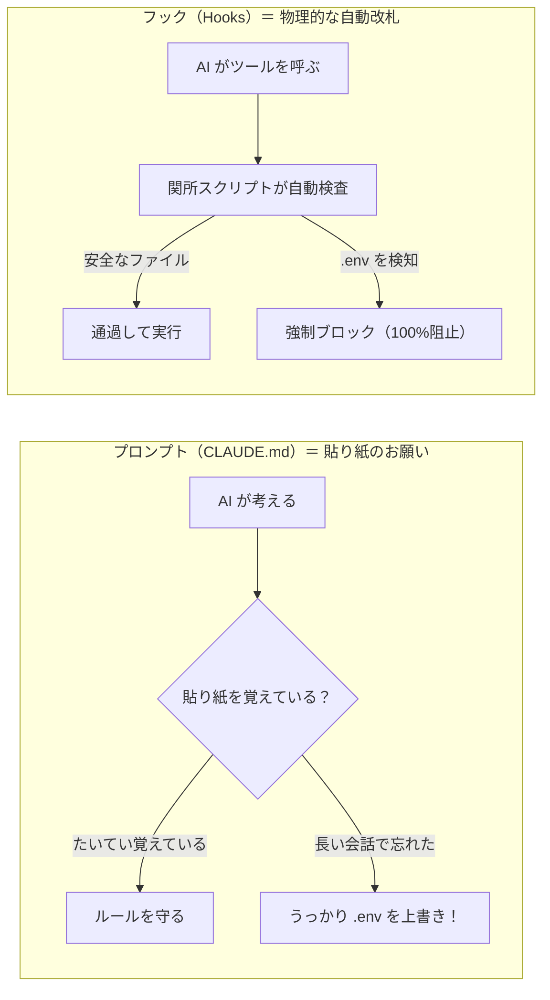
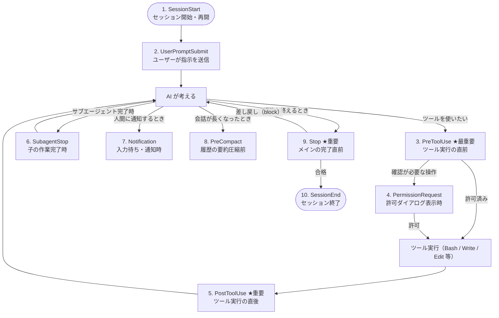
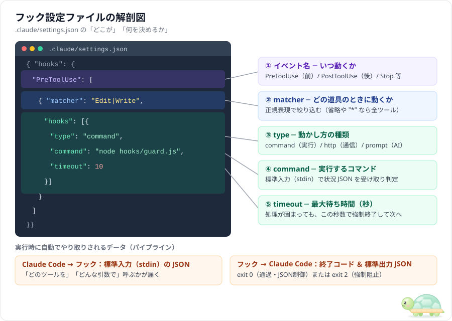
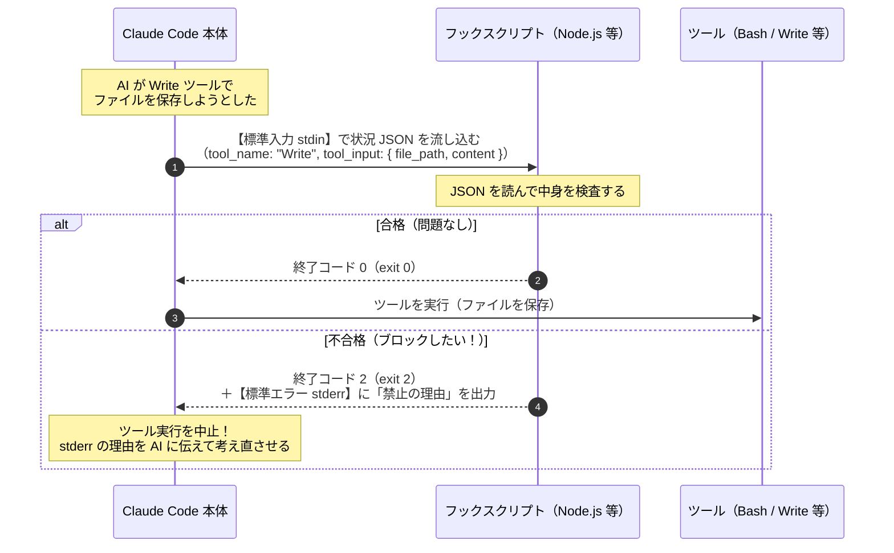
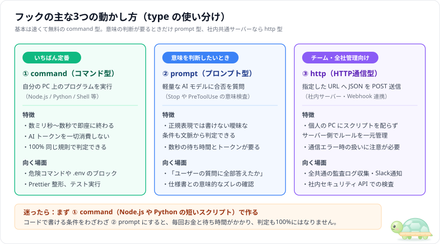
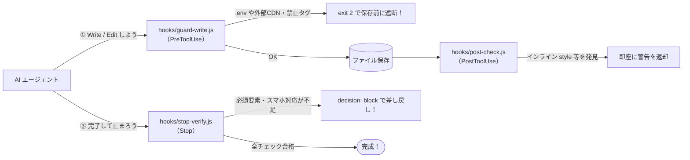

# フック（Hooks）入門 — Claude Code を例に

> この文書は「フック（Hooks）って何？プロンプト（`CLAUDE.md`）やサブエージェントと何が違うの？いつ動いて、どうやって危険な操作を止めたり自動整形したりするの？実際どう設定ファイルを書く？」という疑問に、順番に答える読み物です。
> 対象は Claude Code（2026年11月時点）。仕様は更新が速いので、細かい設定項目は公式ドキュメント（[Hooks reference](https://code.claude.com/docs/en/hooks)、[Hooks guide](https://code.claude.com/docs/en/hooks-guide)）で最新を確認してください。
> 根拠が必要な記述には出典リンクを付けています。出典のない記述は「筆者の判断」「模式図」などと明記しています。出典の一覧は[参考文献](#参考文献)にあります。
> この文書に出てくるフック構成の設定ファイルとスクリプトは、[samples/](../samples/README.md) にパターン別にまとめてあります。

---

## 目次

1. [そもそもフック（Hooks）とは何か](#1-そもそもフックhooksとは何か)
2. [どんなタイミングで動くか（ライフサイクルと10のイベント）](#2-どんなタイミングで動くかライフサイクルと10のイベント)
3. [設定ファイルの置き場所と書き方](#3-設定ファイルの置き場所と書き方)
4. [データの受け渡し（標準入力 JSON・終了コード・標準出力 JSON）](#4-データの受け渡し標準入力-json終了コード標準出力-json)
5. [コマンド型・プロンプト型・HTTP型の使い分け](#5-コマンド型プロンプト型http型の使い分け)
6. [実践：3つのフックで「絶対ルール」を強制する](#6-実践3つのフックで絶対ルールを強制する)
7. [ハマりやすい落とし穴と対策](#7-ハマりやすい落とし穴と対策)
8. [まとめ](#8-まとめ)

---

## 1. そもそもフック（Hooks）とは何か

**フック（Hooks** 、AI エージェントが動く途中の「決まった節目（ライフサイクル）」で、**人間があらかじめ用意したプログラムやチェック処理を自動的に割り込ませる仕組み**です。

たとえば、次の3つの場面を想像してください。

- AI が `.env`（パスワードや秘密鍵が入った設定ファイル）を書き換えようとした**直前**に、プログラムが自動で割り込ん **そのファイルは編集禁止です」と物理的に止める**。
- AI がコードを編集して保存した**直後**に、自動でコード整形ツール（Prettier など）を走らせて**インデントや書き方をきれいに揃える**。
- AI が「作業が終わりました！」と返答を終えようとした**瞬間**に、自動でテストを走らせ、**テストが落ちていたら「まだ直っていません」と突き返して作業を続けさせる**。

これらを AI の気分や注意力に頼らず、**100% 確実に動かす**のがフックの役割です（出典：[Claude Code Docs「Hooks guide」](https://code.claude.com/docs/en/hooks-guide)）。

### 1.1 プロンプト（`CLAUDE.md`）の「お願い」とフックの「強制」の違い

AI エージェントにルールを守らせる方法は、大きく2種類あります。

| 種類 | 専門用語での呼び方 | 例 | 確実性 |
|---|---|---|---|
| **プロンプト・指示書** | **確率的（Probabilistic）**<br/>※AI が文脈を読んでその都度判断するため、まれに忘れたり違う解釈をしたりする | `CLAUDE.md` に「絶対に `.env` を触らないで」「保存したら毎回 Prettier を実行して」と書く | 80〜95% 程度（会話が長くなったり作業が複雑になると抜けやすい） |
| **フック（Hooks）** | **決定論的（Deterministic）**<br/>※同じ入力に対して常に100%同じプログラムが動くため、例外や忘れが起きない | `PreToolUse` フックで `.env` への書き込みを検知したら終了コード `2` で遮断する | **100 **AI がどれだけ焦っていても物理的に通らない） |

建物のセキュリティで例えると、`CLAUDE.md` は壁に貼られた****です。真面目な人は守りますが、急いでいると見落とします。一方、フックはカードキーがないと物理的に開かな **自動改札（関所）** す。



### 1.2 サブエージェント・スキル・権限設定との違い

Claude Code には似たカスタマイズ機能がいくつかあります。それぞれの役割分担を整理すると迷いません（筆者の整理）。

| 仕組み | ひとことで言うと | 誰が動くか | 向いている仕事 |
|---|---|---|---|
| **CLAUDE.md（メモリ）** | 常時貼ってある「業務マニュアル」 | メインの AI | 設計方針、コーディングの好み、言葉遣い |
| **Skills（スキル）** | 必要なときだけ開く「手順書」 | メインの AI | 特定の作業手順（リリース手順、PR 作成手順など） |
| **Subagents（サブエージェント）** | 仕事を分担する「別の AI 作業員」 | **別の AI** | 大量のファイル調査、独立した部品作り、客観レビュー |
| **Permissions（権限設定）** | 道具ごとの「通行許可証」 | 設定ルール | `Bash(rm -rf *)` の禁止など、名前だけで決まる単純な許可・拒否 |
| **Hooks（フック）** | 節目に自動で動く「自動改札・自動機械」 | **スクリプ **プログラム） | ファイルの中身を見て止める、保存後に自動整形、テスト合格まで完了させない |

---

## 2. どんなタイミングで動くか（ライフサイクルと10のイベント）

ユーザーが指示を出してから AI が作業を終えるまでの間に、フックを差し込めるタイミング（**イベント**）は主に10箇所あります（出典：[Claude Code Docs「Hooks reference」](https://code.claude.com/docs/en/hooks)）。

### 2.1 全体の流れ（ライフサイクル図）



### 2.2 イベント一覧表

特に実務でよく使うのは **★印の4つ（`PreToolUse`, `PostToolUse`, `Stop`, `UserPromptSubmit`）** です。まずはこの4つだけ覚えれば十分です。

| イベント名 | いつ動くか | マッチャー（絞り込み） | このタイミングでできること |
|---|---|---|---|
| **`SessionStart`** | セッションを開始・再開・圧縮復帰したとき | `startup`, `resume`, `clear`, `compact` | 環境変数の準備、ブランチ情報の初期注入 |
| **`UserPromptSubmit`** ★ | ユーザーが指示を送った直後（AI が読む前） | なし（毎回動く） | 指示への背景情報の自動添付、機密情報を含む送信のブロック |
| **`PreToolUse`** ★ | AI がツールを実行する**直前** | ツール名（`Bash`, `Edit\|Write` など） | **危険な操作のブロック**、確認なしの自動承認、**引数の書き換え** |
| **`PermissionRequest`** | ユーザーに「許可しますか？」と聞く直前 | ツール名 | 安全な条件なら自動で「許可」、危険なら自動で「拒否」を返す |
| **`PostToolUse`** ★ | ツールが正常に実行された**直後** | ツール名（`Edit\|Write` など） | **自動フォーマット（Prettier 等）**、構文チェック、監査ログ記録 |
| **`Notification`** | Claude Code が通知を出すとき | `permission_prompt`, `idle_prompt` など | デスクトップ通知の表示、完了チャイム音を鳴らす、Slack 通知 |
| **`Stop`** ★ | メインの AI が返答を終えて止まろうとしたとき | なし | **完了テストの実行**。不合格なら止めるのを阻止して続きをやらせる |
| **`SubagentStop`** | サブエージェントが作業を終えて止まろうとしたとき | エージェント名 | 子エージェントの成果物チェック。不合格ならその子にやり直させる |
| **`PreCompact`** | 会話履歴が長くなり自動圧縮（`/compact`）される直前 | `manual`, `auto` | 要約される前の全文バックアップ、要約時の注意点の追加 |
| **`SessionEnd`** | セッションを閉じるとき | `clear`, `logout`, `exit` など | 一時ファイルの掃除、セッション全体の作業ログ集計 |

---

## 3. 設定ファイルの置き場所と書き方

フックは JSON 形式の設定ファイル（`settings.json`）に書きます。Claude Code の画面上で `/hooks` と打ってメニューから対話的に追加することもできます。

### 3.1 置き場所と効く範囲

| ファイルの場所 | 効く範囲 | Git で共有するか | 向いている用途 |
|---|---|---|---|
| `.claude/settings.json` | このプロジェクトだけ | **す **チーム全員に効く） | プロジェクト共通の保護ルール、自動整形、完了テスト |
| `.claude/settings.local.json` | このプロジェクトだけ | **しな **自分だけ） | 自分の PC 固有のパスを使う処理、個人用の実験フック |
| `~/.claude/settings.json` | 自分のすべてのプロジェクト | しない（ホームフォルダ） | 完了時のチャイム音、全プロジェクト共通の危険コマンド防止 |
| `.claude/agents/*.md` の上部 | そのサブエージェントの中だけ | する | 特定の職人エージェントだけに課す専用チェック |

### 3.2 設定ファイルの解剖図

1つのフック設定は「**① どのイベントで → ② どの道具のときに（matcher）→ ③ 何を実行するか（command** の3段構造になっています。



### 3.3 マッチャー（`matcher`）の書き方

`PreToolUse` や `PostToolUse` では、どの道具（ツール）が使われたときにフックを動かすかを `matcher` で絞り込みます。ここは**正規表 **文字のパターン指定）が使えます（出典：[Claude Code Docs「Hooks reference」](https://code.claude.com/docs/en/hooks)）。

| `matcher` の書き方 | 反応する対象 |
|---|---|
| `"Bash"` | `Bash`（シェルコマンド実行）のときだけ |
| `"Edit\|Write"` | `Edit`（部分編集）または `Write`（新規・全体保存）のとき |
| `"Notebook.*"` | `Notebook` で始まるすべてのツール |
| `"mcp__memory__.*"` | `memory` という MCP サーバーの全ツール |
| `""` または省略、`"*"` | **すべてのツー **`Read` や `Grep` でも毎回動く） |

> **コツ**：ファイルを書き換える処理を見張りたいときは、`"Edit|Write"`（必要なら `"Edit|Write|MultiEdit"`）にするのが定番です。マッチャーを省略すると、AI がファイルを読む（`Read`）たびにもフックが走って遅くなります。

---

## 4. データの受け渡し（標準入力 JSON・終了コード・標準出力 JSON）

ここが一番大事な仕組みです。「Claude Code 本体」と「あなたが書いたフックスクリプト」は、どうやって会話するのでしょうか？

答えは、コマンドラインの標準的な3つの通り道（**標準入力 `stdin`**、**終了コード `exit code`**、**標準出力 `stdout` / 標準エラー出力 `stderr`**）を使います。



### 4.1 フックが受け取るデータ（標準入力 `stdin`）

フックが起動すると、Claude Code はその瞬間の状況を **JSON 形式のテキスト**としてスクリプトの**標準入力（`stdin`：キーボード入力の代わりにプログラムへデータを流し込む入り口** 渡します。

たとえば AI が `Write` ツールで `index.html` を保存しようとしたとき、`PreToolUse` フックには次のような JSON が届きます。

```json
{
  "session_id": "abc12345",
  "transcript_path": "C:/Users/you/.claude/projects/.../abc12345.jsonl",
  "cwd": "C:/git_home/agent-study/hook-guide",
  "permission_mode": "default",
  "hook_event_name": "PreToolUse",
  "tool_name": "Write",
  "tool_input": {
    "file_path": "C:/git_home/agent-study/hook-guide/index.html",
    "content": "<!DOCTYPE html><html>..."
  }
}
```

イベントごとに、よく使うフィールドは決まっています。

| イベント | `stdin` の JSON に入ってくる主な項目 |
|---|---|
| 共通 | `session_id`, `cwd`（現在のフォルダ）, `hook_event_name` |
| `PreToolUse` | `tool_name`（`"Bash"`, `"Write"` など）, `tool_input`（コマンド文字列 `command` や保存先 `file_path`、中身 `content`） |
| `PostToolUse` | 上記に加えて `tool_response`（ツールの実行結果） |
| `UserPromptSubmit` | `prompt`（ユーザーが入力した文章） |
| `Stop` / `SubagentStop` | `stop_hook_active`（すでに1回差し戻した直後かどうかを表す `true` / `false`） |

### 4.2 終了コード（Exit Code）で返すシンプルな制御

スクリプトが最後に返す数字（**終了コード / Exit Code**）だけで、通すか止めるかを決められます。いちばん簡単で確実な方法です。

| 終了コード | 意味 | Claude Code の動き |
|---|---|---|
| **`0`** | **成功・通過** | そのまま処理を続ける。`stdout`（標準出力）に JSON が書かれていればそれを読み取る |
| **`2`** | **強制ブロック（阻止）** | **その操作を即座に中止する**。`stderr`（標準エラー出力）に出した文章を AI に「拒否された理由」として自動で伝える |
| **`1` など（0と2以外）** | **非ブロッキング警告** | 「フックでエラーが起きた」と画面に警告を出すが、**処理自体は止めずに続行する** |

> **超重要：「止めたいときは `exit 1` ではなく `exit 2`！」**
> 普通のプログラミングではエラー終了に `process.exit(1)` を使いがちですが、Claude Code のフックで `1` を返すと「フックスクリプト自身のバグ」とみなされ、**ツール実行は止まりません**。意図してブロックするときは必ず **`2`** を返します（出典：[Claude Code Docs「Hooks reference」](https://code.claude.com/docs/en/hooks)）。

### 4.3 標準出力（`stdout`）の JSON で返す高度な制御

「ただ止めるだけでなく、引数を安全な形に書き換えたい」「確認ダイアログを飛ばして自動承認したい」「`Stop` フックで完了を差し戻したい」といった場合は、**終了コード `0` で終了しつつ、標準出力（`stdout`）に決まった形の JSON（JSON スキーマ）を1つ出力**します。

#### ① `PreToolUse` で「許可・拒否・引数の書き換え」をする場合

`hookSpecificOutput` という箱の中に、`permissionDecision`（許可判定）や `updatedInput`（書き換え後の引数）を入れて返します。

```json
{
  "hookSpecificOutput": {
    "hookEventName": "PreToolUse",
    "permissionDecision": "allow",
    "permissionDecisionReason": "安全なテスト実行コマンドのため自動承認しました",
    "updatedInput": {
      "command": "npm test -- --watch=false"
    }
  }
}
```

| 項目 | 指定できる値と意味 |
|---|---|
| `permissionDecision` | `"allow"`：人への確認画面を飛ばして自動実行する（ただし `settings.json` の `deny` ルールは超えられない）<br/>`"deny"`：実行を拒否し、`permissionDecisionReason` を AI に伝える（`exit 2` と同じ効果）<br/>`"ask"`：人間に確認ダイアログを出して判断を仰ぐ |
| `updatedInput` | ツールに渡る引数（`tool_input`）を**その場ですり替える**。たとえば AI が `--watch` 付きで止まらないテストコマンドを叩こうとしたとき、自動で `--watch=false` に書き換えて実行させられる |

#### ② `Stop` や `PostToolUse` で「不合格なのでやり直し（差し戻し）」を命じる場合

トップレベル（一番外側の階層）に `"decision": "block"` と `"reason"` を書いて出力します。

```json
{
  "decision": "block",
  "reason": "index.html に必須の <main> タグと aria-label 属性がありません。修正してから完了してください。"
}
```

これを返すと、AI は「まだ終われない」と認識し、`reason` の指摘を読んで自動的に修正作業を続けます。

---

## 5. コマンド型・プロンプト型・HTTP型の使い分け

フックの `type` には3種類（さらにエージェント呼び出し等を含めると4種類）ありますが、基本は以下の3つの使い分けです（出典：[Claude Code Docs「Hooks reference」](https://code.claude.com/docs/en/hooks)）。



### 5.1 それぞれの書き方例

#### ① `command`（コマンド型：おすすめ）

```json
{
  "type": "command",
  "command": "node \"$CLAUDE_PROJECT_DIR/hooks/guard-write.js\"",
  "timeout": 10
}
```

- 環境変数 `$CLAUDE_PROJECT_DIR` にはプロジェクトのルートフォルダの絶対パスが入ります。AI が途中で `cd` して別のサブフォルダに移動していても、スクリプトを見失いません。

#### ② `prompt`（プロンプト型：意味のチェック）

```json
{
  "type": "prompt",
  "prompt": "ユーザーが求めたすべての要件が完了しているか確認してください。未完了なら block と理由を返してください。",
  "timeout": 30
}
```

- `Stop` や `SubagentStop` で、「テストは通ったけれど、そもそもユーザーの質問に全部答えているか？」を軽い AI モデルにチェックさせたいときに使います。

#### ③ `http`（HTTP通信型：社内サーバー連携）

```json
{
  "type": "http",
  "url": "https://internal-audit.example.com/claude-hooks",
  "headers": {
    "Authorization": "Bearer $AUDIT_TOKEN"
  },
  "allowedEnvVars": ["AUDIT_TOKEN"],
  "timeout": 10
}
```

- `stdin` に渡されるのと同じ JSON が HTTP POST で送信され、サーバーからのレスポンス JSON がそのままフックの出力として扱われます。

---

## 6. 実践：3つのフックで「絶対ルール」を強制する

このフォルダ（`hook-guide`）の直下には、Web ページ制作のお題で実際に動く3つのフックスクリプト（Node.js 製、外部ライブラリ不要）が入っています。どのように書かれているかを見てみましょう。

### 6.1 全体の連携イメージ



### 6.2 スクリプトの最小テンプレート（Node.js）

Bash（`.sh`）と `jq` でフックを書くと、Windows 環境で動かなかったり文字化けしたりしがちです。**Node.js（`node`）なら Claude Code が動く環境にはほぼ確実に入っており、Windows でも Mac でも同じコードがそのまま動きま **筆者の推奨）。

標準入力から JSON を読み取る基本の形は次のとおりです。

```javascript
// フックスクリプトの基本骨格（Node.js 標準機能のみ）
const fs = require('fs');

// 1. 標準入力（stdin＝ファイル記述子 0）から JSON を丸ごと読む
const raw = fs.readFileSync(0, 'utf8');
const input = JSON.parse(raw);

// 2. ツール名や引数を取り出す
const toolName = input.tool_name || '';
const filePath = (input.tool_input && input.tool_input.file_path) || '';
const content  = (input.tool_input && input.tool_input.content) || '';

// 3. 条件を検査する（例：.env ファイルへの書き込みを禁止）
if (filePath.endsWith('.env') || filePath.includes('/.env')) {
  // 標準エラー（stderr）に理由を書き、終了コード 2 でブロック！
  process.stderr.write('エラー: .env ファイルの編集はフックにより禁止されています。\n');
  process.exit(2);
}

// 4. 問題なければ終了コード 0 で通過
process.exit(0);
```

たったこれだけで、AI がどんな理由をつけようと `.env` は絶対に書き換えられなくなります。

---

## 7. ハマりやすい落とし穴と対策

フックを自作するときに多くの人が一度はハマるポイントを6つにまとめました（出典：[Claude Code Docs「Hooks reference」](https://code.claude.com/docs/en/hooks) ほか）。

| # | 落とし穴 | 何が起きるか | 対策 |
|---|---|---|---|
| 1 | **`Stop` フックの無限ループ** | `Stop` フックが毎回 `decision: "block"` を返すと、AI が直せない問題のときに永遠に終われなくなる | 入力 JSON の **`input.stop_hook_active` が `true` なら無条件で `process.exit(0)` す **少なくとも1回差し戻した後は通す） |
| 2 | **`exit 1` で止めようとする** | `process.exit(1)` にしても「フックのエラー」としか見なされず、ツールがそのまま実行されてしまう | 阻止したいときは必ず **`process.exit(2)`** を使う（または JSON で `permissionDecision: "deny"`） |
| 3 | **JSON の入れ子忘れ** | `PreToolUse` で `{"permissionDecision": "deny"}` と一番外側に書くと、**無言で無視されて素通りする** | 必ず `{"hookSpecificOutput": {"hookEventName": "PreToolUse", "permissionDecision": "deny"}}` の形にする（`Stop` の `decision: "block"` は外側で OK） |
| 4 | **`stdout` に余計なログを出す** | JSON を返すフックの中で `console.log("デバッグ中")` と書くと、JSON として壊れて読み取りに失敗する | デバッグ表示や人間向けのメッセージはすべて `console.error(...)`（`stderr`）に出し、`stdout` には純粋な JSON 1個だけを出す |
| 5 | **Windows のパス区切り（`\` と `/`）** | `filePath.includes('hooks/guard.js')` と書くと、Windows で `hooks\guard.js` が来たときにすり抜ける | 判定前に `filePath.replace(/\\/g, '/')` でスラッシュに統一してから検査する |
| 6 | **`Edit` ツールの引数名の違い** | `Write` ツールは `tool_input.content` に全文が入るが、`Edit` ツールは `tool_input.new_string` に書き換え部分だけが入る | 両方を検査するときは `const text = input.tool_input.content \|\| input.tool_input.new_string \|\| ''` のように両方見る |

---

## 8. まとめ

| 疑問 | 答え |
|---|---|
| フックは何のためにある？ | プロンプトの「お願い」では100%にならないルール（安全境界・自動整形・完了検査）を、**プログラムで確実に強制・自動化するため** |
| まずどのイベントから使えばいい？ | 危険防止の **`PreToolUse`**、保存後チェックの **`PostToolUse`**、完了検査の **`Stop`** の3つから始める |
| どうやって操作を止める？ | スクリプトで `stderr` に理由を出力し、**終了コード `2`（`process.exit(2)`）** で終わる |
| どうやって完了を差し戻す？ | `Stop` フックで `{"decision": "block", "reason": "直す箇所"}` を `stdout` に出力して終了コード `0` で終わる（無限ループ防止の `stop_hook_active` チェックを忘れずに） |
| 何語でスクリプトを書くのが良い？ | Windows / Mac 両方で同じように動く **Node.js（標準モジュールのみ）** または Python がおすすめ |

次の [01_copilot-hook-guide.md](01_copilot-hook-guide.md) では、これと同じ仕組みを **GitHub Copilot / VS Code** でどう使うかを説明します。また [02_hook-patterns.md](02_hook-patterns.md) では、フックの定番パターン5選と「何をフックにし、何をモデルに任せるか」の境界線を掘り下げます。

---

## 参考文献

すべて 2026-11-10 閲覧。詳しいメモは [info/](../info/README.md) にあります。

| # | 文献 | 本書で使った内容 |
|---|---|---|
| 1 | Claude Code Docs「[Hooks reference](https://code.claude.com/docs/en/hooks)」 | 10のイベント一覧、マッチャー、`stdin` JSON の構造、終了コード `0` と `2`、`hookSpecificOutput`（`permissionDecision`, `updatedInput`）、`decision: "block"`、`stop_hook_active`、`command` / `prompt` / `http` の仕様 |
| 2 | Claude Code Docs「[Automate workflows with hooks](https://code.claude.com/docs/en/hooks-guide)」 | 通知・自動整形・保護ファイルブロック・文脈注入の実践パターン |
| 3 | Claude Code Docs「[Best practices](https://code.claude.com/docs/en/best-practices)」 | プロンプトでの大文字強調をやめてフック・拒否ルールに移す指針、検証手段の提供 |
| 4 | Claude Code Docs「[Settings](https://code.claude.com/docs/en/settings)」 | `settings.json` / `settings.local.json` の優先順位、`permissions.deny` とフックの関係 |
