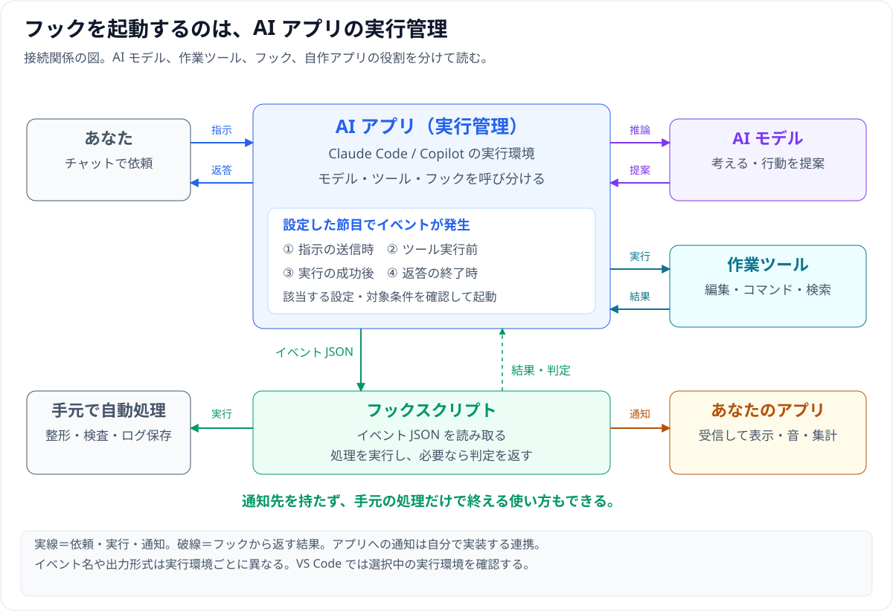
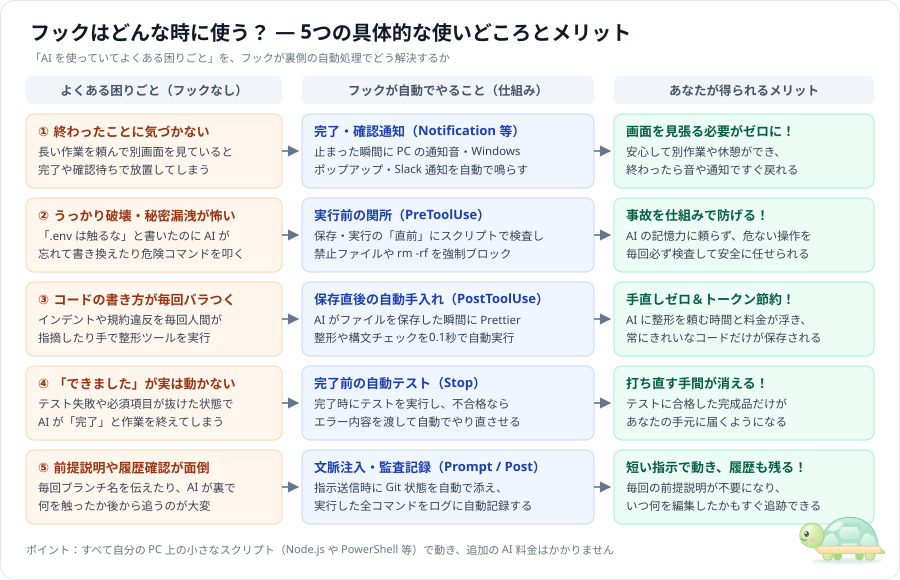
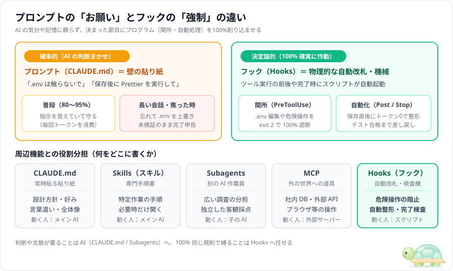
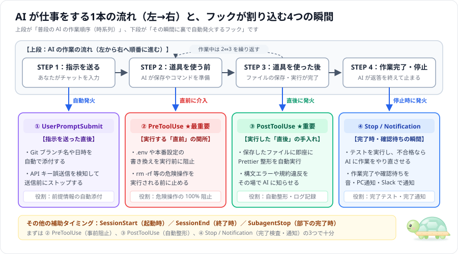
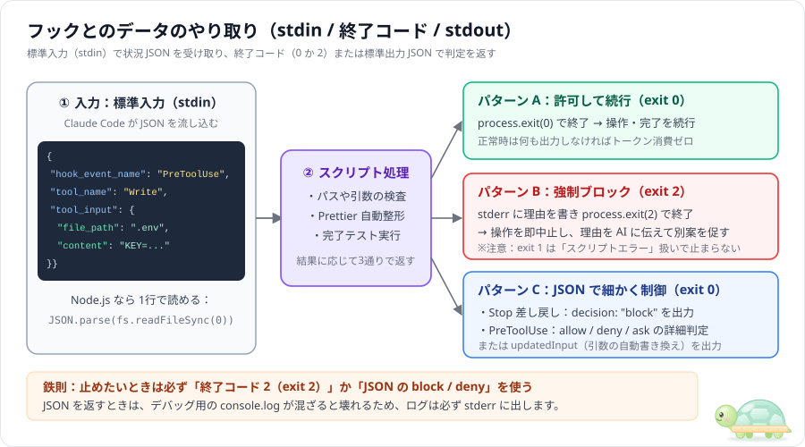

# フック（Hooks）入門 — どんな時に使い、どんなメリットがあるのか

> **フック**（Hooks）は、AI アプリの実行管理部分が、**設定した節目に一致する処理（通知・チェック・自動整形など）を自動実行する仕組み**です。処理は AI アプリが動いている環境で実行されます。
>
> 起動の判断を AI モデルに任せず、イベントと設定で処理を呼び出します。**検査の範囲・精度は実装次第**で、無効な設定や実行失敗もログで確認します。

## まず、全体の接続関係を見る



**AI モデルが考え、AI アプリがツールとフックを呼び分けます。** フックは手元の処理だけでも使え、自分のアプリに状態を送る連携も作れます。[全体図と4つのシーケンス図](03_hook-flow-examples.md)では、アプリ通知・送信時の処理・操作前後の検査・終了時の差し戻しを、Claude Code と Copilot / VS Code の違いも含めて説明しています。

---

## 1. そもそもフックはどんな時に使う？（5つの具体例とあなたのメリット）

「フックって難しそうだけど、自分の普段の作業で何の役に立つの？」と思ったら、まず次の5つの場面を見てください。



1. **AI の作業が終わったら「音や通知」で知らせてほしいとき**（`Notification` / `Stop`）
   - 長い作業を AI に頼んで別画面で仕事をしているとき、終わった瞬間や確認待ちで止まった瞬間に **PC のチャイム音・Windows のデスクトップ通知・Slack 通知**を自動で鳴らせます（画面をずっと見張る必要がなくなります）。
2. **`.env`（秘密鍵）の書き換えや危険な削除コマンドを絶対防ぎたいとき**（`PreToolUse`）
   - プロンプトに「`.env` は触らないで」と書いても AI はときどき忘れますが、フックならファイル保存やコマンド実行の「直前」に割り込んで、**禁止パターンに一致する操作を毎回確実にブロック**できます。
3. **AI が書いたコードを保存と同時に自動で綺麗に整えたいとき**（`PostToolUse`）
   - AI がファイルを保存した直後に、裏で自動的に `Prettier`（コード整形）や構文チェックを走らせます。AI に「整形して」と頼む時間とトークン代がゼロになります。
4. **「できました！」と言われて開いたら動かない、をなくしたいとき**（`Stop`）
   - AI が完了して止まろうとした瞬間に自動でテストを走らせ、エラーがあれば **AI に「まだここが通っていないよ」と自動で突き返して続きを直させます**。
5. **毎回の前提説明や「AI が何をしたか」の記録を自動化したいとき**（`UserPromptSubmit` / `PostToolUse`）
   - 指示を送るたびに現在の Git ブランチ名などを裏で自動添付したり、AI が実行したコマンドや編集したファイルをログファイルに1行ずつ自動記録したりできます。

> ⚠️ **「100% 防げる」の正しい意味**：フックは**毎回必ず起動**しますが、検査はスクリプトに書いた条件の範囲だけです。たとえば `Write` / `Edit` の `.env` 書き込みだけを検査していると、AI が `Bash` で `echo KEY=1 > .env` を実行した場合はすり抜けます。絶対に守りたい規則は、**関係するツール（`Bash`・`PowerShell`・`Write`・`Edit` など）をすべて `matcher` に含め**、Claude Code の権限設定（`permissions.deny`）とも組み合わせて二重に守るのが安全です。



---

## 2. いつ動くか — AI の作業の「1本の流れ（左→右）」と4つの割り込み地点

あなたがチャットで指示を送ってから AI が作業を終えるまでの **左から右への1本の流れ（上段）** に対して、フックがどの瞬間に割り込むか（下段）を図にしました。



次の表は、Claude Code のフックイベントのうち**よく使う主要10個**です（2026年11月時点で全30種類近くあります。全量は [Hooks reference](https://code.claude.com/docs/en/hooks) を参照）。

| イベント名 | タイミング | ブロック（止める）できるか | 主な用途 |
| :--- | :--- | :--- | :--- |
| **`SessionStart`** | 起動・再開・履歴圧縮直後 | — | 環境変数の設定、圧縮後のルール再注入 |
| **`UserPromptSubmit`** | ユーザーが指示を送信した直後 | **可**（指示を AI に渡さず破棄） | ブランチ名や差分の自動添付、機密送信阻止 |
| **`PreToolUse`** ★ | ツール実行の**直前** | **可**（ツールを実行させない） | `.env` 保護、`rm -rf` 阻止、引数の書き換え |
| **`PermissionRequest`** | 確認ダイアログが出る直前 | **可**（JSON の `decision` で許可／拒否） | 安全なコマンドの自動承認・危険操作の自動拒否 |
| **`PostToolUse`** ★ | ツール実行の**直後** | **不可**（実行済み。AI に修正を促すだけ） | Prettier 自動整形、構文エラーの即時フィードバック |
| **`Notification`** | 確認待ち・アイドル通知時 | — | デスクトップ通知・音声アラート・Slack 通知 |
| **`SubagentStop`** | サブエージェント完了直前 | **可**（子に作業を続けさせる） | 子エージェントの成果物チェック・差し戻し |
| **`PreCompact`** | 会話履歴の圧縮直前 | **可**（圧縮を中止） | 圧縮前のログ退避 |
| **`Stop`** ★ | メイン AI が完了して止まる直前 | **可**（止まらせず作業を続けさせる） | テスト・必須項目の検査、不合格なら作業続行を強制 |
| **`SessionEnd`** | セッション終了時 | — | 一時ファイルの掃除、監査ログの集計 |

> 💡 **最初は ★ 印の 3 つ（`PreToolUse`・`PostToolUse`・`Stop`）だけ覚えれば、実務でよくある用途の大半をカバーできます。**

---

## 3. どこに・どう書くか — 設定ファイルの解剖図


| 置き場所 | スコープ（効く範囲） | Git 共有 | 用途 |
| :--- | :--- | :---: | :--- |
| **`.claude/settings.json`** | プロジェクト全体 | 共有する | **【基本】** チーム全員で守る保護・整形・完了検査 |
| **`.claude/settings.local.json`** | プロジェクト（自分だけ） | 除外する | 個人用の通知音や実験中のフック |
| **`~/.claude/settings.json`** | 自分の PC の全プロジェクト | PC 内 | どのリポジトリでも効かせたい共通ガード |
| **`.claude/agents/*.md` の先頭** | 特定サブエージェントのみ | 共有する | そのサブエージェント稼働中だけ有効なフック |

> ほかに、組織の管理ポリシー設定・プラグイン・スキルの先頭（frontmatter）にもフックを書けます。

- **`.claude/settings.json` が読まれる条件**：Claude Code を**起動したフォルダ（プロジェクトのルート）**の `.claude/` だけが読まれます。たとえば `agent-study/` で起動すると、`agent-study/hook-guide/.claude/settings.json` は読まれません。
- **`matcher`**（対象フィルタ）：`PreToolUse` や `PostToolUse` で「どのツールに反応するか」をツール名で絞ります（例：`"Edit|Write"`、`"Bash|PowerShell"`）。Windows では Claude Code がコマンド実行に **`PowerShell` ツール**を使うことがあるため、コマンド検査では `Bash` と並べて書いておくと抜け漏れを防げます。`SessionStart`（`startup` / `compact` など）や `Notification`（通知の種類）にも matcher がありますが、`Stop` や `UserPromptSubmit` には matcher がないので省略します。
- **パスの書き方**：どのフォルダから実行されても動くよう、コマンド内のパスには `$CLAUDE_PROJECT_DIR`（プロジェクトのルート）を付けます。

---

## 4. データの受け渡し — stdin / 終了コード / stdout



| 終了コード | 意味 | AI エージェントの挙動 |
| :---: | :--- | :--- |
| **`0`** | **成功・許可** | そのまま処理を続行（または `stdout` の JSON 指示に従う） |
| **`2`** | **ブロック** | `stderr`（エラー出力）に書いた理由を伝えて、**そのイベントの操作を止める**（何が止まるかはイベントごとに違う。下の表を参照） |
| **`1` など** | スクリプトの不具合 | 警告を表示するだけで、**処理は止まらず続行される**（ブロックには使えない） |

`exit 2` で「何が止まるか」はイベントによって違います（主なもの）。

| イベント | `exit 2` の効果 |
| :--- | :--- |
| `PreToolUse` | ツールを実行させない。理由は AI に渡り、AI が別の方法を考える |
| `UserPromptSubmit` | 指示を AI に渡さずに破棄する。理由は**ユーザーに**表示される |
| `Stop` / `SubagentStop` | 止まらせずに作業を続けさせる。理由は AI に渡る |
| `PostToolUse` | **ツールはすでに実行済み**なので取り消せない。理由を AI に伝えるだけ |
| `Notification` / `SessionStart` など | 止める対象がないので、実質的な効果はない |

> ⚠️ **最大の注意点**：AI を止めたいときは必ず **`process.exit(2)`**（シェルスクリプトなら `exit 2`）を使うか、**`exit 0` のうえで** JSON の `"decision": "block"` や `"permissionDecision": "deny"`（`PreToolUse` 用。`hookSpecificOutput` の中に書く）を返してください。`exit 1` では止まりません。
>
> 📌 **Copilot では違う**：GitHub Copilot の `preToolUse` では、`exit 2` 以外の非0終了（スクリプトのエラー落ちなど）も「拒否」として扱われます（安全側に倒す設計）。詳しくは [01_copilot-hook-guide.md](01_copilot-hook-guide.md)。

---

## 5. 主な3つの実行タイプ — `command` / `prompt` / `http`

`type` には次の3つのほか、MCP サーバーのツールを呼ぶ `mcp_tool` や、サブエージェントに検査させる `agent`（実験的機能）もあります。まずはこの3つを押さえれば十分です。


| タイプ | 仕組み | 速度・コスト | 向いている用途 |
| :--- | :--- | :--- | :--- |
| **`command`**（基本） | ローカルのコマンド（Node.js 等）を実行 | 数十ms・無料 | ファイル保護、Prettier 整形、テスト実行（**全体の9割**） |
| **`prompt`** | 軽量な AI モデルに「条件を満たしたか」を判定させる | 数秒・少額 | `Stop` 時に「指示の抜け漏れがないか」を文章の意味で検査 |
| **`http`** | 指定 URL へ JSON を POST 送信して応答を受け取る | 通信次第 | 社内の監査ログ基盤や共通ポリシーサーバーとの連携 |

---

## 6. 5分で試せる最小ハンズオン

このフォルダのルート（`hook-guide/`）には、すぐに動く3段構えのフックが入っています。Claude Code がなくても Node.js 単体でテストできます。

```powershell
cd C:\git_home\agent-study\hook-guide

# 1. フック単体の動作確認（模擬の入力JSONを流し込んでテスト）
node .\scripts\test-hooks-locally.js

# 2. Claude Code CLI がある場合の比較実験（フックなし vs フックあり）
#    -Prompt（お題）と -Mode（no-hooks / with-hooks / stop-gate）は必須です
powershell -ExecutionPolicy Bypass -File scripts\run-experiment.ps1 -Prompt prompts\01-profile-strict.md -Mode no-hooks
powershell -ExecutionPolicy Bypass -File scripts\run-experiment.ps1 -Prompt prompts\01-profile-strict.md -Mode with-hooks
```

---

## 7. ハマりやすい4つの落とし穴

1. **`Stop` フックの無限ループ**：`Stop` フックで毎回ブロックすると、AI が直せない問題にぶつかったとき止まれなくなります。入力 JSON の **`stop_hook_active`** が `true`（すでに Stop フックの差し戻しを受けて作業を続けている最中）なら `exit 0` で通す安全弁を入れてください。この書き方だと**差し戻しは1回まで**になります。2回以上差し戻したい場合は、回数をファイルに記録して上限で通すようにします（なお Claude Code 側にも「連続8回まで」の上限があります）。
2. **JSON 出力に `console.log` が混ざる**：`stdout` で JSON を返す際、デバッグ用の `console.log` が1行でも混ざると JSON の解析に失敗します。デバッグ表示は必ず `console.error(...)`（`stderr`）に出します。
3. **Windows と Mac のコマンド差**：設定ファイル内に直接長いシェルコマンドを書くと、OS ごとのクォートやコマンド差で壊れます。`node hooks/xxx.js` のように **Node.js スクリプト1本を呼び出す構成**にすると全 OS で同じように動きます。
4. **重いテストを毎回走らせる**：数分かかるテストを `PostToolUse` に入れると編集のたびに待たされます。保存直後は軽量な構文チェックだけに絞り、全体テストは完了時（`Stop`）に回します。

---

## 関連ドキュメント

- **全体のつながりと4つのシーケンス図** → [03_hook-flow-examples.md](03_hook-flow-examples.md)
- **GitHub Copilot / VS Code での使い方** → [01_copilot-hook-guide.md](01_copilot-hook-guide.md)
- **そのまま使える定番5パターン** → [02_hook-patterns.md](02_hook-patterns.md)
- **コピペ用サンプル集（5種）** → [samples/README.md](../samples/README.md)
- **一次情報の出典メモ（10件）** → [info/README.md](../info/README.md)
