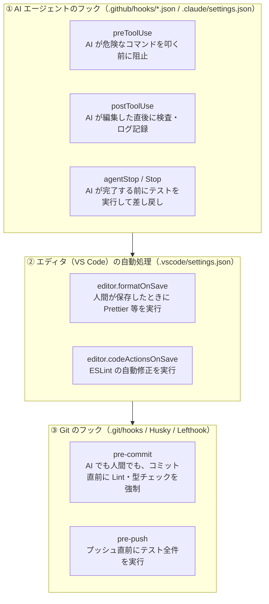

# GitHub Copilot / VS Code でフック相当の仕組みはどう使うか

> [フック（Hooks）入門（Claude Code 編）](00_hook-guide.md)の続編です。Claude Code でできた「ツール実行前のブロック（`PreToolUse`）」「編集後の自動整形（`PostToolUse`）」「完了前の検査ゲート（`Stop`）」を、**GitHub Copilot**（VS Code のエージェントモード、Copilot CLI、Copilot Coding Agent）や既存の **Git Hooks / VS Code タスク**でどう実現するかをまとめます。
> 内容は 2026-11-10 時点の公式ドキュメントにもとづきます。Copilot のフック機能は更新が速いため、使う前に[参考文献](#参考文献)のページで最新を確認してください。
> Copilot 形式のフック設定ファイルは、Claude Code 形式と並べて [samples/](../samples/README.md) にパターン別にまとめてあります。

---

## 目次

1. [結論](#1-結論)
2. [Copilot / VS Code の「3つのフック階層」を整理する](#2-copilot--vs-code-の3つのフック階層を整理する)
3. [Claude Code との対応表](#3-claude-code-との対応表)
4. [実践：`.github/hooks/hooks.json` の書き方](#4-実践githubhookshooksjson-の書き方)
5. [Claude Code 用の設定やスクリプトはそのまま使えるか](#5-claude-code-用の設定やスクリプトはそのまま使えるか)
6. [既存の仕組み（VS Code 設定・Git Hooks）との賢い組み合わせ方](#6-既存の仕組みvs-code-設定git-hooksとの賢い組み合わせ方)
7. [会社の環境で使うときの注意点](#7-会社の環境で使うときの注意点)
8. [まとめ](#8-まとめ)

---

## 1. 結論

**できます。** GitHub Copilot と VS Code にも、Claude Code の Hooks とほぼ同じ概念・同じイベント名の **Agent Hooks（エージェントフック）** 機能があります。

- **リポジトリ共有の設定ファイル**：`.github/hooks/*.json`（例：`.github/hooks/hooks.json`）に書く。
- **主要なイベント**：`preToolUse`（実行前）、`postToolUse`（実行後）、`sessionStart`（開始時）、`userPromptSubmitted`（プロンプト送信時）、`agentStop`（完了時）など、Claude Code と1対1で対応する。
- **OS 別のコマンド指定**：1つの設定の中に `bash`（Mac/Linux 用）と `powershell`（Windows 用）を並べて書けるため、Windows 混在の社内チームでも共有しやすい。
- **フックスクリプト本体の使い回し**：標準入力（`stdin`）で JSON を受け取って検査する Node.js スクリプトなら、**Claude Code 用に書いたスクリプトをほぼそのまま Copilot でも使い回せる**。

さらに、すべてを AI エージェントのフックでやる必要はありません。「ファイル保存時の整形」は VS Code の `formatOnSave`、「コミット前の最終検査」は Git Hooks（`pre-commit`）に任せるという**組み合わせ**が実務では最も安定します（6章）。

出典：[GitHub Docs「About hooks in GitHub Copilot」](https://docs.github.com/en/copilot/customizing-copilot/about-hooks)、[VS Code Docs「Agent hooks in Visual Studio Code」](https://code.visualstudio.com/docs/copilot/customization/hooks)

---

## 2. Copilot / VS Code の「3つのフック階層」を整理する

VS Code や GitHub リポジトリで開発するとき、自動処理を差し込める場所は1つではありません。どの層で何を止めるかを整理すると、設計がすっきりします。



| 階層 | 誰の操作に効くか | 特徴 |
|---|---|---|
| **① AI エージェントのフック** | **AI だけ** | AI がツールを使う瞬間や、AI が「終わった」と判断した瞬間に割り込める。失敗理由をそのまま AI に返して自律修正させられる |
| **② VS Code の保存時設定** | 主に**人間**（エディタ保存） | 設定が簡単で動作が速い。ただし AI が裏でファイルを直接書き換えたときには動かないことがある |
| **③ Git Hooks（`pre-commit` 等）** | **AI と人間の両方** | コミットという最終関所で確実に止められる。ただし「AI がファイルを編集中」の段階では動かない |

---

## 3. Claude Code との対応表

Claude Code のフックと、GitHub Copilot（CLI / Coding Agent / VS Code）のフックの対応表です（出典：[GitHub Docs](https://docs.github.com/en/copilot/customizing-copilot/about-hooks)、[VS Code Docs](https://code.visualstudio.com/docs/copilot/customization/hooks)）。

### 3.1 設定場所と書き方の違い

| 項目 | Claude Code | GitHub Copilot（`.github/hooks` 形式） | VS Code（Agent Hooks） |
|---|---|---|---|
| プロジェクト設定ファイル | `.claude/settings.json` | `.github/hooks/*.json`（例：`hooks.json`） | `.github/hooks/*.json` または `.vscode/settings.json`（`.claude/settings.json` も読み取り可） |
| 最上位のバージョン指定 | なし（`"hooks": { ... }`） | `"version": 1` が必須 | 読み込むファイル形式に準拠 |
| コマンドの指定キー | `"command": "..."` | `"bash": "..."` と `"powershell": "..."` を併記可能 | 両形式に対応 |
| タイムアウト指定 | `"timeout": 10`（秒） | `"timeoutSec": 10`（秒） | 両形式に対応 |
| 作業フォルダ指定 | `$CLAUDE_PROJECT_DIR` 等 | `"cwd": "."` を指定可能 | 両形式に対応 |

### 3.2 イベント名の対応

イベントの役割は同じですが、**大文字始まり（PascalCase）か小文字始まり（camelCase）か**の違いがあります。

| タイミング | Claude Code のイベント名 | Copilot（`.github/hooks/*.json`）のイベント名 |
|---|---|---|
| セッション開始時 | `SessionStart` | `sessionStart` |
| プロンプト送信時 | `UserPromptSubmit` | `userPromptSubmitted` |
| **ツール実行の直前** | **`PreToolUse`** | **`preToolUse`** |
| **ツール実行の直後** | **`PostToolUse`** | **`postToolUse`** |
| サブエージェント開始時 | （なし／PreToolUse(Agent)） | `subagentStart` |
| サブエージェント完了時 | `SubagentStop` | `subagentStop` |
| **メインの完了時** | **`Stop`** | **`agentStop`**（VS Code では `Stop` も対応） |
| コンテキスト圧縮前 | `PreCompact` | `preCompact` |

---

## 4. 実践：`.github/hooks/hooks.json` の書き方

会社のリポジトリで Copilot（CLI・VS Code・クラウドの Coding Agent）にフックを効かせたいときは、`.github/hooks/hooks.json` を作成します。

### 4.1 設定ファイルの例

```json
{
  "version": 1,
  "hooks": {
    "preToolUse": [
      {
        "type": "command",
        "bash": "node .github/hooks/scripts/guard-write.js",
        "powershell": "node .github/hooks/scripts/guard-write.js",
        "cwd": ".",
        "timeoutSec": 10
      }
    ],
    "postToolUse": [
      {
        "type": "command",
        "bash": "node .github/hooks/scripts/post-check.js",
        "powershell": "node .github/hooks/scripts/post-check.js",
        "cwd": ".",
        "timeoutSec": 15
      }
    ],
    "agentStop": [
      {
        "type": "command",
        "bash": "node .github/hooks/scripts/stop-verify.js",
        "powershell": "node .github/hooks/scripts/stop-verify.js",
        "cwd": ".",
        "timeoutSec": 20
      }
    ]
  }
}
```

### 4.2 なぜ `node` スクリプトを呼ぶのがおすすめなのか

上の例では、`bash` にも `powershell` にも**まったく同じ `node .github/hooks/scripts/xxx.js`** を書いています。

- もしここを `.sh`（シェルスクリプト）と `.ps1`（PowerShell スクリプト）で別々に書くと、**同じチェック処理を2つの言語で二重管理**することになり、片方だけ直し忘れるバグが必ず起きます。
- 処理の中身を **Node.js（`.js`）の1ファイル** にまとめておけば、`bash` から呼ばれても `powershell` から呼ばれても、そして **Claude Code（`.claude/settings.json`）から呼ばれても、同じ1つのスクリプトで動きます**（筆者の推奨）。

---

## 5. Claude Code 用の設定やスクリプトはそのまま使えるか

### 5.1 VS Code は `.claude/settings.json` も読み取れる

VS Code の公式ドキュメントによると、VS Code の Agent Hooks は互換性のためワークスペース内の `.claude/settings.json` も検出して読み取ることができます（出典：[VS Code Docs「Agent hooks」](https://code.visualstudio.com/docs/copilot/customization/hooks)）。

ただし、以下の違いには注意が必要です。

| 観点 | 注意すること |
|---|---|
| **ツール名の違い** | Claude Code ではファイル編集が `Write` / `Edit`、シェル実行が `Bash` ですが、Copilot 側では `edit` / `create` や `bash` / `powershell` など小文字や別名で渡ってくることがあります |
| **JSON のフィールド名** | 標準入力（`stdin`）で届く JSON の基本構造は似ていますが、ツール引数が `tool_input` か `toolArgs` かなど細かい差が出ることがあります |

### 5.2 両対応にするフックスクリプトの書き方（防御的コーディング）

スクリプト側でツール名やファイルパスを取り出すときに、**大文字・小文字や別名の両方を拾う**ように数行工夫しておくと、Claude Code と Copilot のどちらから呼ばれてもそのまま動きます。

```javascript
// Claude Code と GitHub Copilot の両方で動く取り出し方
const toolName = (input.tool_name || input.toolName || '').toLowerCase();
const toolInput = input.tool_input || input.toolArgs || input.input || {};

// ファイルパス（file_path / path / filePath のどれで来ても拾う）
const filePath = (
  toolInput.file_path ||
  toolInput.filePath ||
  toolInput.path ||
  ''
).replace(/\\/g, '/');

// コマンド文字列（command / script のどちらでも拾う）
const command = toolInput.command || toolInput.script || '';
```

このワークスペースの `hooks/` と `samples/` にあるスクリプトは、すべてこの**両対応の書き方**で作ってあります。

---

## 6. 既存の仕組み（VS Code 設定・Git Hooks）との賢い組み合わせ方

社内環境で「Copilot の Agent Hooks がまだプレビューで無効化されている」「設定を増やしすぎたくない」という場合でも、**従来からある開発ツールのフック**を組み合わせることで、8割以上の目的は達成できます（筆者の整理）。

| やりたいこと | Agent Hooks が使えるとき | Agent Hooks が使えないときの代替手段 |
|---|---|---|
| 危険なコマンド（`rm -rf` 等）の阻止 | `preToolUse` フック | VS Code のターミナル自動承認リスト（`chat.tools.terminal.autoApprove`）で安全なコマンドだけ許可し、危険なコマンドは手動確認にする |
| 編集後のコード整形（Prettier） | `postToolUse` フック | `.vscode/settings.json` の `"editor.formatOnSave": true` ＋ Git の `pre-commit`（`lint-staged`） |
| テストや Lint が通るまで完了させない | `agentStop` / `Stop` フック | Git の `pre-commit` / `pre-push` フックにテストを入れ、AI には「最後に `git commit` するまで終わるな」と指示する |
| 背景情報・規約の共有 | `sessionStart` / `userPromptSubmitted` | `.github/copilot-instructions.md` または `.github/instructions/*.instructions.md`（ファイル種類別の自動添付） |

> **ポイント**：Git の `pre-commit` フックは、AI エージェントが `git commit` コマンドを叩いたときにも**全く同じように発動し、失敗すればエラー出力が AI に返ります**。つまり、AI にコミットまで行わせる運用なら、昔からある Git Hooks はそのまま「AI に対する完了ゲート」として機能します。

---

## 7. 会社の環境で使うときの注意点

| 注意点 | 内容 | 出典 |
|---|---|---|
| **デフォルトブランチへの配置が必要** | GitHub 上で動く Copilot Coding Agent（クラウド版）で `.github/hooks/` を動かす場合、設定ファイルがデフォルトブランチ（`main` 等）にマージされている必要がある | [GitHub Docs](https://docs.github.com/en/copilot/customizing-copilot/about-hooks) |
| **組織ポリシーによる制限** | 企業の管理者がセキュリティ上の理由でローカルフックの自動実行を制限している場合がある | [VS Code Docs](https://code.visualstudio.com/docs/copilot/customization/hooks) |
| **両方の設定ファイルを置くときの重複実行** | 同じリポジトリに `.claude/settings.json` と `.github/hooks/hooks.json` の両方を置くと、VS Code が両方を読み込んでフックが2回走る可能性がある。VS Code で使うときは設定で有効なソースを確認する | 筆者の注意喚起 |
| **Windows の文字コード（UTF-8）** | PowerShell 経由でスクリプトが呼ばれる際、日本語のエラーメッセージが文字化けすることがある。Node.js スクリプトなら `process.stderr.write` は UTF-8 で出力されるため比較的安定する | 筆者の経験則 |

---

## 8. まとめ

| 疑問 | 回答 |
|---|---|
| Copilot でも Claude Code のようなフックは使える？ | **使える**。`.github/hooks/hooks.json` に `preToolUse` や `postToolUse` を定義する |
| スクリプトは別々に書く必要がある？ | **ない**。Node.js（`.js`）で1本書いておけば、Claude Code・Copilot・Windows・Mac のすべてで共用できる |
| 会社の環境で Agent Hooks が使えなかったら？ | `.github/instructions/*.instructions.md`（パス別の指示自動注入）と、**Git の `pre-commit` フック**を組み合わせれば、同等のガードレールを作れる |

次の [02_hook-patterns.md](02_hook-patterns.md) では、ツールを問わず使える**「フックの定番パターン5選」**と、AI の進化によって変わる「プロンプトとフックの境界線」を詳しく解説します。

---

## 参考文献

すべて 2026-11-10 閲覧。詳しいメモは [info/](../info/README.md) にあります。

| # | 文献 | 本書で使った内容 |
|---|---|---|
| 1 | GitHub Docs「[About hooks in GitHub Copilot](https://docs.github.com/en/copilot/customizing-copilot/about-hooks)」 | `.github/hooks/*.json` の構造、`preToolUse` / `postToolUse` 等のイベント、`bash` / `powershell` の併記、デフォルトブランチの要件 |
| 2 | VS Code Docs「[Agent hooks in Visual Studio Code](https://code.visualstudio.com/docs/copilot/customization/hooks)」 | VS Code での Core 8 イベント、`.claude/settings.json` との互換性、企業ポリシーの扱い |
| 3 | Claude Code Docs「[Hooks reference](https://code.claude.com/docs/en/hooks)」 | Claude Code 側のイベント・スキーマとの比較基準 |
