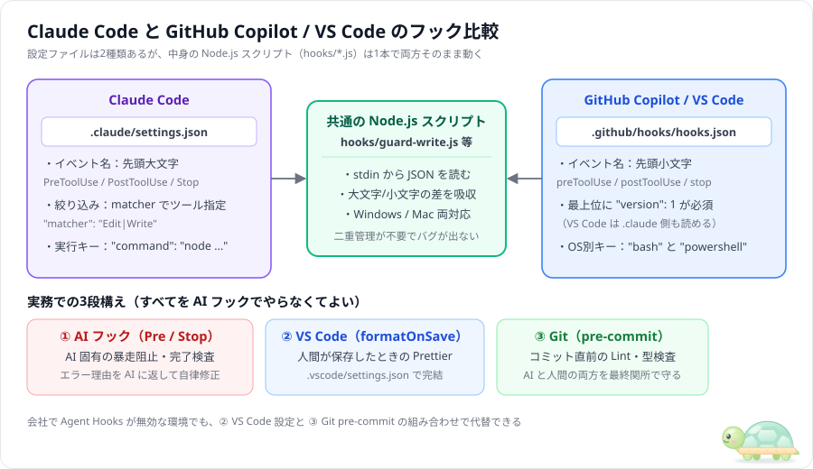

# GitHub Copilot / VS Code でフックはどう使うか

2026年現在、**GitHub Copilot**（VS Code のエージェント・Copilot CLI・クラウド上の Coding Agent）にも、Claude Code とよく似た **Hooks**（フック）が搭載されています。**入力 JSON の違いを吸収する数行を書いておけば、Node.js スクリプト1本を Claude Code と Copilot の両方で使い回せます**。

ただし「ほぼ同じ」なのは考え方までで、**イベントごとにできること（止められるか・出力が使われるか）には差があります**。この章では、その差を中心に整理します。

> ⚠️ VS Code のフック機能は 2026年11月時点で **Preview（プレビュー）** です。仕様が変わる可能性があるため、最新情報は [GitHub Docs: Hooks configuration](https://docs.github.com/en/copilot/reference/hooks-configuration) と [VS Code Docs: Agent hooks](https://code.visualstudio.com/docs/copilot/customization/hooks) を確認してください。

---

## 1. Claude Code と Copilot / VS Code の違いと共通スクリプト構成



| 比較項目 | Claude Code | GitHub Copilot（VS Code / CLI / Cloud） |
| :--- | :--- | :--- |
| **設定ファイル** | `.claude/settings.json` | **`.github/hooks/*.json`**（例：`hooks.json`）。VS Code は設定 `chat.useClaudeHooks` を有効にすると `.claude/settings.json` も読める |
| **最上位の必須キー** | `"hooks": { ... }` | **`"version": 1`** と `"hooks": { ... }` |
| **イベント名の表記** | 先頭大文字（`PreToolUse` / `PostToolUse` / `Stop`） | 先頭小文字（`preToolUse` / `postToolUse` / `agentStop`） |
| **コマンド指定** | `"command": "node ..."` | OS 別の **`"bash"` / `"powershell"`**。`"command"` だけ書くと両方に自動で使われる |
| **入力 JSON のキー** | `tool_name` / `tool_input`（snake_case） | `toolName` / `toolArgs`（camelCase）。ツール名も `bash` / `edit` / `create` / `view` など小文字 |
| **ツールの絞り込み** | `"matcher": "Edit\|Write"` | CLI は `"matcher"` 対応（ツール名全体に一致する正規表現）。**VS Code は matcher を無視**する |
| **実行前に止める方法** | **終了コード `2`**、または JSON の `permissionDecision: "deny"` | **終了コード `2`**、または JSON の `permissionDecision: "deny"`（`permissionDecisionReason` 必須） |
| **スクリプトがエラー落ちしたとき（実行前フック）** | 警告のみで**ツールは実行される** | **ツールは拒否される**（安全側に倒す） |

### イベントの対応表と「できること」の差

| Claude Code | Copilot | Copilot 側の注意点 |
| :--- | :--- | :--- |
| `SessionStart` | `sessionStart` | 出力 JSON の `additionalContext` が AI に渡る |
| `UserPromptSubmit` | `userPromptSubmitted` | ⚠️ **command フックの出力は無視される**。文脈の自動添付もプロンプトのブロックもできない（→ `sessionStart` で代用） |
| `PreToolUse` | `preToolUse` | Claude Code とほぼ同じ（`exit 2` か `permissionDecision: "deny"` で拒否） |
| `PostToolUse` | `postToolUse` | ⚠️ **`decision: "block"` は使えない**。AI に伝えたいことは `additionalContext` で返す |
| `Stop` | `agentStop` | `decision: "block"` と `reason` で差し戻せる。入力に `stop_hook_active` もある。連続8回で強制終了 |
| `SubagentStop` | `subagentStop` | 子エージェントの完了時 |
| `Notification` | `notification` | Copilot CLI のみ |

---

## 2. `.github/hooks/hooks.json` の書き方（Copilot 用）

リポジトリの `.github/hooks/hooks.json` に以下の設定を置くと、VS Code の Copilot エージェント・Copilot CLI・GitHub 上の Coding Agent でフックが動きます（クラウドの Coding Agent では、このファイルが**デフォルトブランチ**に入っている必要があります）。

```json
{
  "version": 1,
  "hooks": {
    "preToolUse": [
      {
        "type": "command",
        "bash": "node ./hooks/guard-write.js",
        "powershell": "node ./hooks/guard-write.js",
        "timeoutSec": 15
      }
    ],
    "postToolUse": [
      {
        "type": "command",
        "bash": "node ./hooks/post-check.js",
        "powershell": "node ./hooks/post-check.js",
        "timeoutSec": 15
      }
    ],
    "agentStop": [
      {
        "type": "command",
        "bash": "node ./hooks/stop-verify.js",
        "powershell": "node ./hooks/stop-verify.js",
        "timeoutSec": 15
      }
    ]
  }
}
```

- `bash` は Mac / Linux 用、`powershell` は Windows 用のコマンドです。同じコマンドで済むなら、代わりに `"command": "node ./hooks/guard-write.js"` を1行書くだけでも両方に使われます。
- `timeoutSec` を省略すると 30 秒です。**`preToolUse` がタイムアウトした場合は「拒否」ではなく通常の許可確認に進む**ので、重い処理は入れないでください。

> 💡 **ポイント**：VS Code は `matcher` を無視するため、どのツールでもフックが呼ばれます。**対象ツールの絞り込みは Node.js スクリプト側の `if` 文で行う**と、Claude Code・Copilot CLI・VS Code のどれでも同じように動きます。

---

## 3. Claude Code と Copilot の両方で動くスクリプトの書き方

渡される JSON のキー名（`tool_name` と `toolName`、`tool_input` と `toolArgs`）の違いを吸収するヘルパーを先頭に数行書くだけで、1本のスクリプトを両方で共用できます（本ガイドの `hooks/*.js` と `samples/` はこの両対応方式です）。

```javascript
const fs = require('fs');
const data = JSON.parse(fs.readFileSync(0, 'utf8') || '{}');

// Claude Code（snake_case）と Copilot（camelCase）の両方から値を取り出す
const toolName = String(data.tool_name || data.toolName || '').toLowerCase();
let toolInput = data.tool_input || data.toolArgs || {};
if (typeof toolInput === 'string') {
  // Copilot では引数が JSON 文字列で届く場合があるため、念のため解析する
  try { toolInput = JSON.parse(toolInput); } catch { toolInput = {}; }
}
// Claude Code は file_path、Copilot は path でファイルパスが届く
const filePath = toolInput.file_path || toolInput.path || '';

// 例：.env ファイルへの書き込みを両方まとめてブロック（終了コード 2）
if (/(^|[\\/])\.env$/i.test(filePath)) {
  process.stderr.write('[BLOCKED] .env の変更は禁止されています。\n');
  process.exit(2);
}
process.exit(0);
```

ツール名も製品ごとに違います（例：Claude Code の `Write` は Copilot では `create`、`Bash` は `bash` または `powershell`）。スクリプトでは**小文字に揃えてから、両方の名前を並べて判定**すると安全です。

---

## 4. VS Code 設定・Git Hooks との使い分け（実務の3段構え）

VS Code で開発する場合、すべてを AI フックで作る必要はありません。既存の仕組みと組み合わせると設定がシンプルになります。

| やりたいこと | 一番手軽で確実な仕組み | 設定場所 |
| :--- | :--- | :--- |
| **AI の危険コマンド阻止・ファイル保護** | **AI フック**（`PreToolUse` / `preToolUse`） | `.claude/settings.json` / `.github/hooks/hooks.json` |
| **AI が完了する前の要件・テスト検査** | **AI フック**（`Stop` / `agentStop`） | `.claude/settings.json` / `.github/hooks/hooks.json` |
| **人間が保存したときの自動整形** | **VS Code 標準設定**（`editor.formatOnSave`） | `.vscode/settings.json` |
| **コミット直前の Lint・型チェック** | **Git Hooks**（Husky / `pre-commit`） | `.husky/pre-commit` |
| **PR 作成後の全体テスト・ビルド検査** | **GitHub Actions**（CI） | `.github/workflows/ci.yml` |

> 📌 **社内ポリシーで AI の Hooks 機能が無効化されている場合**でも、**`.vscode/settings.json`（保存時自動整形）＋ Git `pre-commit`（コミット前検査）** の2つを設定しておけば、AI が書いたコードもコミット時に必ずチェックできます。

---

## 関連ドキュメント

- **フックの基本とライフサイクル** → [00_hook-guide.md](00_hook-guide.md)
- **そのまま使える定番5パターン** → [02_hook-patterns.md](02_hook-patterns.md)
- **コピペ用サンプル集（5種）** → [samples/README.md](../samples/README.md)
