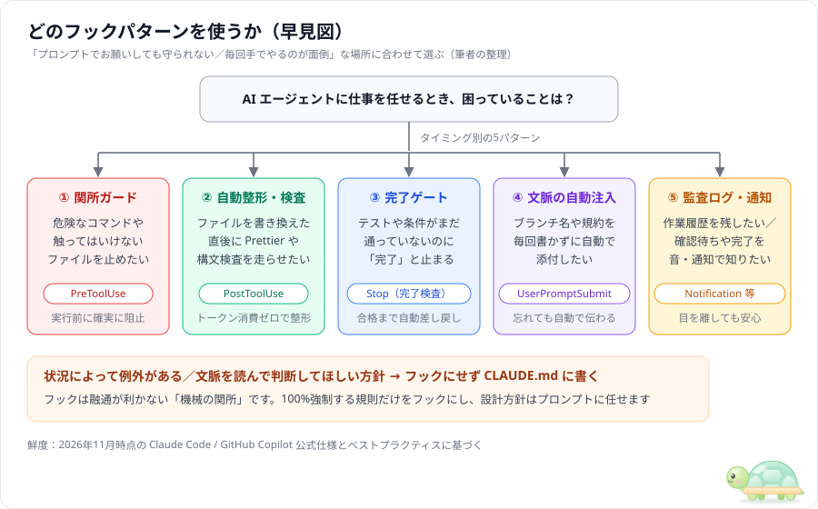
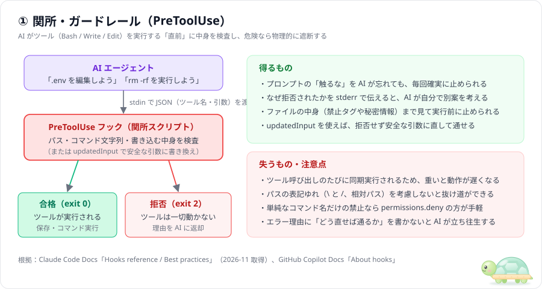
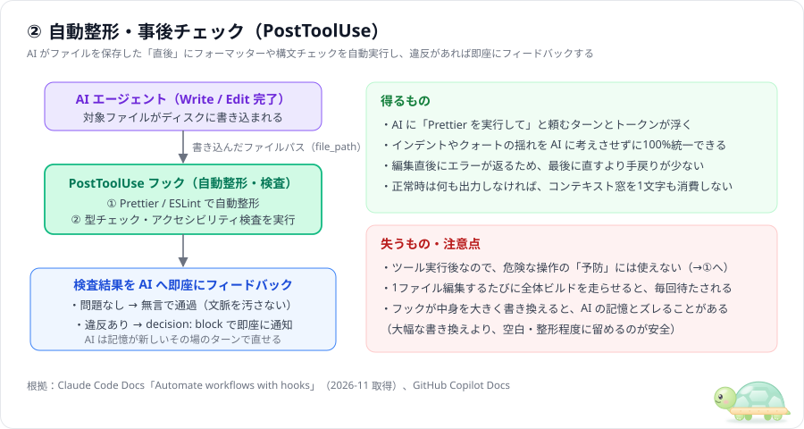
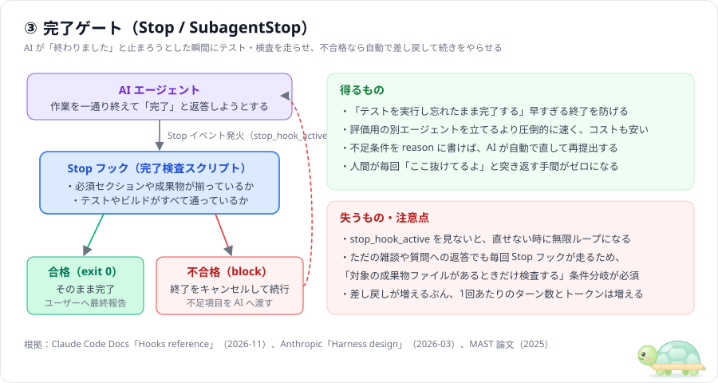
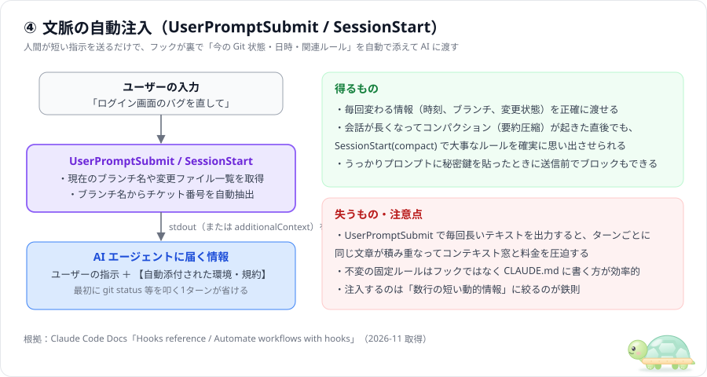
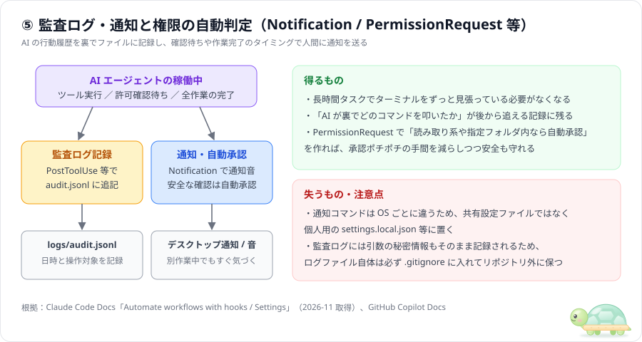
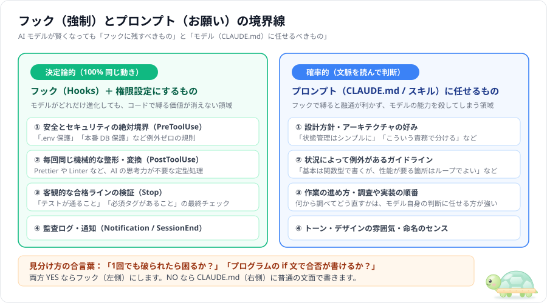

# フックの定番パターン5選 — 効く理由・失うもの・AIの進化で変わる部分

> この文書は「AI エージェントのフック（Hooks）は、どういう場面でどう使うと一番効くのか」について、公式ドキュメント・AI 企業のエンジニアリングブログ・論文で繰り返し出てくる**定番の型を5つ**に絞って説明する読み物です。
> 調査日は **2026-11-10**。集めた一次情報（10件）は出典ごとに [info/](../info/README.md) にメモしてあります。
> AI モデルは1年で別物のように賢くなります。そこで各パターンに**根拠の鮮度**を付け、最後の [7章](#7-ai-の進化でフックにするものモデルに任せるものの境界線) で「モデルがどれだけ進化してもフックに残すべきもの」と「フックにせずモデル（プロンプト）に任せるべきもの」を整理しました。
> 出典のない記述や筆者の判断には「筆者の整理」と書いています。

### 鮮度ラベル（2026-11-10 基準）

| ラベル | 公開時期 | 読み方 |
|---|---|---|
| **新** | 6か月以内 | そのまま参考にしてよい |
| **中** | 6〜12か月前 | 考え方は有効。数値やモデル名は1〜2世代前 |
| **古** | 12か月超 | 原則は今も引用されるが、当時のモデルの弱点を補う工夫が混ざっている前提で読む |

---

## 目次

0. [まず結論（早見図）](#0-まず結論早見図)
1. [大前提：「プロンプトでお願いするな、フックで強制せよ」](#1-大前提プロンプトでお願いするなフックで強制せよ)
2. [パターン①：関所・ガードレール（`PreToolUse`）](#2-パターン①関所ガードレールpretooluse)
3. [パターン②：自動整形・事後チェック（`PostToolUse`）](#3-パターン②自動整形事後チェックposttooluse)
4. [パターン③：完了ゲート（`Stop` / `SubagentStop`）](#4-パターン③完了ゲートstop--subagentstop)
5. [パターン④：文脈の自動注入（`UserPromptSubmit` / `SessionStart`）](#5-パターン④文脈の自動注入userpromptsubmit--sessionstart)
6. [パターン⑤：監査ログ・通知と権限の自動判定（`Notification` / `PermissionRequest`）](#6-パターン⑤監査ログ通知と権限の自動判定notification--permissionrequest)
7. [AI の進化で「フックにするもの／モデルに任せるもの」の境界線](#7-ai-の進化でフックにするものモデルに任せるものの境界線)
8. [まとめ](#8-まとめ)
9. [参考文献](#参考文献)

---

## 0. まず結論（早見図）

| # | パターン | 使うイベント | ひとことで | 向く | 向かない | 根拠の鮮度 |
|---|---|---|---|---|---|---|
| ① | [関所・ガードレール](#2-パターン①関所ガードレールpretooluse) | `PreToolUse` | 危険な操作を実行**前**に**100%遮 **または引数を無害化） | `.env` 保護、破壊コマンド防止、禁止構文の遮断 | 文脈次第で例外があるルール | 新 |
| ② | [自動整形・事後チェック](#3-パターン②自動整形事後チェックposttooluse) | `PostToolUse` | ファイル保存**直後**に自動で整形・検査を走らせる | Prettier / ESLint、構文検査、即時エラー通知 | 全体ビルドなど何十秒もかかる重い処理 | 新 |
| ③ | [完了ゲート](#4-パターン③完了ゲートstop--subagentstop) | `Stop` / `SubagentStop` | テストや必須条件が通るまで**完了させず差し戻す** | テスト必須化、必須要素の抜け漏れ防止 | 合否がプログラムで判定できない曖昧な課題 | 新〜中 |
| ④ | [文脈の自動注入](#5-パターン④文脈の自動注入userpromptsubmit--sessionstart) | `UserPromptSubmit` / `SessionStart` | ブランチ名・時刻・規約を**裏で自動添付**する | チケット番号の自動付与、要約圧縮後のルール再注入 | 毎回変わらない長文マニュアル（→`CLAUDE.md` へ） | 新 |
| ⑤ | [監査ログ・通知と自動承認](#6-パターン⑤監査ログ通知と権限の自動判定notification--permissionrequest) | `Notification` / `PermissionRequest` ほか | 作業履歴を記録し、**入力待ちや完了を通知**する | 長時間タスクの完了通知、安全な確認の自動承認、操作記録 | チーム全員に個人の通知設定を押し付けること | 新 |

どの資料にも共通する一番大事な原則は、****です（次章）。

---

## 1. 大前提：「プロンプトでお願いするな、フックで強制せよ」

### 1.1 2025年から2026年で変わった「公式の教え」

2025年前半までは、AI に大事なルールを守らせる方法として「`CLAUDE.md` に `IMPORTANT:` や `NEVER` と大文字で強調して書く」というテクニックが公式ブログでも紹介されていました（[info/08](../info/08_anthropic_claude-code-best-practices-blog.md)、2025-04、古）。

しかし 2026年11月時点の Claude Code 公式ベストプラクティスでは、この「大文字や強調でお願いするやり方」は明確に****に分類されています（[info/03](../info/03_claude-code_best-practices.md)、鮮度：新）。

| やり方 | 何が起きるか | 公式の推奨（2026年時点） |
|---|---|---|
| プロンプトに `IMPORTANT: NEVER ...` と大文字で強調して書く | ① 会話が長くなるとそれでも忘れることがある（100%ではない） ② 今の賢いモデルは強調に過敏に反応し、状況に合わない場面でも無理やり守ろうとして動きが固くなる（過剰適用） | **曲げられない規則（invariants）はプロンプトで叫ぶのをやめ、フック（Hooks）や拒否設定（`permissions.deny`）に移す** |
| プロンプトに「最後まで手を抜くな」「全部確認しろ」と書く | 必要のないリファクタリングや過剰な作業まで増える | **合格すべき客観的なチェック（テスト・リンター・`Stop` フックの検証スクリプト）を与える** |

（出典：[info/03](../info/03_claude-code_best-practices.md)、[info/01](../info/01_claude-code_hooks-reference.md)、[info/05](../info/05_github_copilot-hooks.md)）

### 1.2 なぜ AI だけでは 100% にならないのか

大規模言語モデル（LLM）は、文脈から「次に最も確からしい言葉や行動」を**確率的に（probabilistically** ぶ仕組みです。そのため、どれほど性能が上がっても次の性質が残ります。

1. **目の前の課題に集中すると、最初の注意書きが薄れる**：エラー修正に熱中しているとき、「外部 CDN は使わないで」という最初の制約を忘れて、手っ取り早く動く CDN リンクを貼ってしまう。
2. **自分の仕事を自分で採点すると甘くなる**：Anthropic のハーネス設計の報告（[info/09](../info/09_anthropic_harness-design.md)、2026-03、中）でも、作り手自身に自己点検させると見落としが多く、外側の仕組みで客観的にチェックして差し戻す方が確実に機能すると結論づけられています。
3. **機械的な作業に AI のターンを使うのは無駄**：ファイルを保存したあとに毎回 AI が「では Prettier を実行します」と考えてツールを呼ぶと、それだけで数秒と数千トークンが消えます。

だからこそ **柔軟に考える部分」は AI に任せ、「絶対に越えてはいけない一線」と「毎回決まりきった機械処理」はフック（プログラム）に任せる**という分担が効きます。

---

## 2. パターン①：関所・ガードレール（`PreToolUse`）

### 仕組み

- AI が `Bash`（コマンド実行）や `Write` / `Edit`（ファイル編集）を実行する**直前**に、`PreToolUse` フックが起動する。
- スクリプトは標準入力（`stdin`）で渡されたツール名と引数（ファイルパス、書き込む内容、コマンド文字列）を検査する。
- ルール違反を見つけたときの返し方は2通りある（[info/01](../info/01_claude-code_hooks-reference.md)）：
  1. **強制ブロック**：`stderr` に「なぜダメで、どう直すべきか」を書き、**終了コード `2 **または JSON の `permissionDecision: "deny"`）を返す。ツールは一切実行されず、理由が AI に渡る。
  2. **引数の自動書き換え（無害化** JSON の `updatedInput` で引数を安全な形に書き換えて `permissionDecision: "allow"` を返す。

### なぜ効くのか

| 理由 | 根拠 |
|---|---|
| 実行される**前**に止まるため、`rm -rf` や `.env` の上書きといった取り返しのつかない事故を **100% 予防**できる | Claude Code 公式 2026-11（[info/01](../info/01_claude-code_hooks-reference.md)、[02](../info/02_claude-code_hooks-guide.md)）新 |
| ただ止めるだけでなく「理由」が AI に直接返るため、AI は人間が介入しなくてもその場で別案に切り替えられる | 同上 |
| ファイル名だけでな **これから書き込もうとしている中身（`content`）** で検査できる（例：API キーの混入や、禁止された `<script src="https://...">` タグの混入を保存前に弾く） | 同上 |

### 失うもの・注意点

- **重いと全操作が鈍くなる**：`PreToolUse` はツールを呼ぶたびに同期実行されます。ここで時間のかかる通信や全体検査を走らせると、AI の1手ごとに待ち時間が発生します。数十ミリ秒で終わる文字列・パス検査に絞るのが鉄則です。
- **単純な拒否なら `permissions.deny` で十分**：「`.env` を読ませない」「`git push --force` を禁止する」のように名前やパターンだけで決まるものは、`settings.json` の `permissions.deny` に書く方がスクリプト不要で確実です（[info/04](../info/04_claude-code_settings-permissions.md)）。「ファイルの中身を見て判定したい」「分かりやすいカスタム理由を返したい」「引数を書き換えたい」ときにフックを使います。
- **理由の書き方が悪いと AI が詰まる**：「エラー：禁止されています」だけ返すと、AI はなぜダメか分からず同じ操作を繰り返します。「外部 CDN（`https://...`）は禁止です。すべての CSS と JS をこのファイル内に直接書いてください」のように**代替行動をセットで返す**のがコツです。

### 使いどころ（サンプル：[samples/01-block-dangerous-cmd/](../samples/01-block-dangerous-cmd/)）

- `.env`、秘密鍵、マイグレーション履歴、`package-lock.json` などの保護
- 破壊的コマンド（`rm -rf`, `git reset --hard`, 本番 DB 接続）の遮断
- コーディング規約で禁止された構文・外部ライブラリの保存前ブロック

---

## 3. パターン②：自動整形・事後チェック（`PostToolUse`）

### 仕組み

- AI が `Write` や `Edit` でファイルをディスクに保存した**直後**に、`PostToolUse` フックが起動する。
- スクリプトは保存されたファイルパス（`tool_input.file_path`）を受け取り、拡張子に合わせてフォーマッター（Prettier, Biome, Black, `gofmt` など）や軽い構文チェック（ESLint, 型チェック、HTML 規約検査など）を実行する。
- 問題がなければ何も出力せず `exit 0` で終わる。もし構文エラーや規約違反が見つかったら、`{"decision": "block", "reason": "エラー内容"}`（または `stderr`＋`exit 2`）で AI に即座に知らせる。

### なぜ効くのか

| 理由 | 根拠 |
|---|---|
| AI に「保存したら Prettier を叩いて」と頼む必要がなくなり、**AI の思考ターンとトークンを一切使わずに**コードスタイルが100%揃う | Claude Code 公式 2026-11（[info/02](../info/02_claude-code_hooks-guide.md)、[03](../info/03_claude-code_best-practices.md)）新 |
| 1ファイル編集した直後にエラーが返るため、AI の記憶が新しいうちにその場で直せる（最後にまとめて大量のエラーを出すより手戻りが圧倒的に少ない） | GitHub Copilot 公式 2026-11（[info/05](../info/05_github_copilot-hooks.md)）新 |
| 合格時は無言（出力なし）にしておけば、AI のコンテキスト窓を1文字も消費しない | 筆者の整理 |

### 失うもの・注意点

- **重い全体テストをここに入れてはいけない**：AI が5つのファイルを順番に編集するとき、1ファイルごとに30秒かかるテストスイートが走ると、それだけで2分半止まります。`PostToolUse` に入れるのは****だけにし、全体テストは次のパターン③（`Stop` フック）に入れます。
- **ファイルを大きく書き換えると AI が混乱する**：フックがインデントを整える程度なら問題ありませんが、フック側でコードの構造を大幅に書き換えてしまうと、AI が直前に覚えた行番号や内容とズレて、次の `Edit` が失敗することがあります。

### 使いどころ（サンプル：[samples/02-auto-format-lint/](../samples/02-auto-format-lint/)）

- ファイル保存ごとの Prettier / Biome / Ruff / `gofmt` の自動実行
- インライン `style=""` 属性や `console.log` の消し忘れなど、軽い静的チェックの即時フィードバック

---

## 4. パターン③：完了ゲート（`Stop` / `SubagentStop`）

### 仕組み

- AI が一通りの作業を終えて「完成しました！」と返答を止めようとした瞬間に、`Stop`（サブエージェントなら `SubagentStop`）フックが起動する。
- スクリプトは「本当に完了してよいか」を機械的に検査する（テストの実行、ビルド確認、必須ファイルや必須 HTML 要素の存在チェックなど）。
- すべて合格なら `exit 0` でそのまま完了させる。
- 1つでも不合格があれば、`stdout` に `{"decision": "block", "reason": "不足している項目のリスト"}` を出力して、**完了を取り消し（ブロックし）、AI に作業を続行させる**。

### なぜ効くのか

| 理由 | 根拠 |
|---|---|
| エージェントの失敗原因の **約 23.5%** は「早すぎる終了（Premature Termination）」と「不完全な検証」。外側の検証器で合否を判定して差し戻すだけで成功率が **+15.6%** 改善する | MAST 論文 2025（[info/10](../info/10_mast_why-multi-agent-systems-fail.md)）古 |
| 作り手は自分の成果物に甘くなる。外側の客観的なチェックで差し戻す方が、プロンプトで「よく確認しろ」と頼むよりはるかに確実 | Anthropic 2026-03（[info/09](../info/09_anthropic_harness-design.md)）中、Claude Code 公式（[info/03](../info/03_claude-code_best-practices.md)）新 |
| 「チェック係の別 AI（サブエージェント）」を立ち上げると数十秒〜数分と大量のトークンがかかるが、**スクリプトによる `Stop` フックなら0.1秒・トークン消費ゼロで採点できる** | 筆者の整理（[agent-guide のパターン③](../../agent-guide/docs/02_agent-patterns.md#4-パターン③作り手チェック係)との比較） |

### 失うもの・注意点

- **無限ループの罠（最頻出トラブル** AI がどうしても直せないエラーが出たとき、毎回ブロックし続けると永遠に終わらなくなります。入力 JSON に含まれる **`stop_hook_active` が `true`（＝すでに1回差し戻した直後）なら、次は必ず `exit 0` で通す**という安全弁をスクリプトの冒頭に書きます（[info/01](../info/01_claude-code_hooks-reference.md)）。
- **「ただの質問」でも毎回走る**：ユーザーが「このフォルダの構成を教えて」と聞いただけで、AI が答え終わったときにも `Stop` フックは走ります。「成果物ファイル（例：`index.html`）が存在しないとき、または今回が制作タスクでないときは何もしないで `exit 0` する」という条件分岐を入れておく必要があります。

### 使いどころ（サンプル：[samples/03-stop-until-pass/](../samples/03-stop-until-pass/)）

- 単体テスト・型チェック・ビルドが通るまで完了させないゲート
- お題で指定された必須セクション・レスポンシブ対応・アクセシビリティ属性がすべて揃っているかの最終検品

---

## 5. パターン④：文脈の自動注入（`UserPromptSubmit` / `SessionStart`）

### 仕組み

- ユーザーがチャット欄で指示を送った直後（`UserPromptSubmit`）、またはセッション開始・要約圧縮からの復帰時（`SessionStart`）にフックが起動する。
- スクリプトが標準出力（`stdout`）に出力したテキスト（または JSON の `additionalContext`）が、**AI への背景情報として自動的にプロンプトの裏に添付される**。

### なぜ効くのか

| 理由 | 根拠 |
|---|---|
| `CLAUDE.md` には「固定の文章」しか書けないが、フックな **今の Git ブランチ名」「未コミットの変更ファイル」「現在時刻」などの動的な情報**を計算して渡せる | Claude Code 公式 2026-11（[info/01](../info/01_claude-code_hooks-reference.md)、[02](../info/02_claude-code_hooks-guide.md)）新 |
| 長い会話で自動コンパクション（履歴の要約圧縮）が起きたとき、`CLAUDE.md` や最初の指示が薄れることがある。`SessionStart`（マッチャー `compact`）を使えば、**圧縮直後に大事なルールを確実に再注入できる** | Claude Code 公式 2026-11（[info/02](../info/02_claude-code_hooks-guide.md)）新 |
| AI が最初に「まず `git status` と `git branch` を確認します」とツールを叩く1ターンを丸ごと節約できる | 筆者の整理 |

### 失うもの・注意点

- **入れすぎるとコンテキスト窓と料金を食い潰す**：`UserPromptSubmit` はユーザーが発言する**毎ターン**走ります。ここで毎回100行のルール集を出力すると、10往復で1,000行の同じ文章が履歴に積み重なります。
- **固定ルールは `CLAUDE.md` に書く**：毎回変わらないプロジェクト規約は `CLAUDE.md` に置き、フックで注入するの **その瞬間にしか分からない3〜5行の短い状態（ブランチ名・変更ファイル・圧縮後の要点リマインド）** けに絞ります。

### 使いどころ（サンプル：[samples/04-context-injection/](../samples/04-context-injection/)）

- 現在の Git ブランチ名（例：`feature/PROJ-123-login`）からチケット番号を抜き出して自動添付する
- コンパクション（`compact`）直後に、絶対に忘れてほしくない3行の制約を再注入する
- ユーザーのプロンプトにパスワードや秘密鍵（`sk-...` など）が含まれていたら送信前にブロックする

---

## 6. パターン⑤：監査ログ・通知と権限の自動判定（`Notification` / `PermissionRequest`）

### 仕組み

- **監査ログ（Audit Log** `PostToolUse` や `SessionEnd` で、いつ・どのツールを・どんな引数で実行したかを `logs/audit.jsonl`（1行1JSONの記録ファイル）に追記する。
- **通知（Notification** `Notification` や `Stop` で、AI が人間の許可待ち（`permission_prompt`）や入力待ち（`idle_prompt`）、あるいは作業完了になったときに、OS の通知バナーやチャイム音を鳴らす。
- **権限の自動判定（PermissionRequest** 許可確認ダイアログが出る直前にスクリプトで検査し、安全な範囲なら自動で `allow` を返して人間への確認をスキップする。

### なぜ効くのか

| 理由 | 根拠 |
|---|---|
| 数分〜十数分かかる自律タスクを走らせている間、画面をずっと見張っていなくても、**確認待ちや完了の瞬間だけ音や通知で気づける** | Claude Code 公式 2026-11（[info/02](../info/02_claude-code_hooks-guide.md)）新 |
| 企業やチームで AI エージェントを使う際、「AI が裏でどのファイルを触り、どのコマンドを実行したか」の**改ざんできない証跡（監査ログ** 自動で残る | GitHub Copilot 公式 2026-11（[info/05](../info/05_github_copilot-hooks.md)）新 |
| 「全部無条件で許可するのは怖いが、毎回ポチポチ承認するのも疲れる」というジレンマを、プログラムによる条件判定で解消できる | Anthropic 2025-04（[info/08](../info/08_anthropic_claude-code-best-practices-blog.md)）古、[info/01](../info/01_claude-code_hooks-reference.md) 新 |

### 失うもの・注意点

- **通知設定をプロジェクト共有ファイルに入れない**：音が鳴るコマンドやデスクトップ通知の仕組みは、Windows・macOS・Linux で異なり、また「音を鳴らしたくない人」もいます。通知フックは `.claude/settings.json` ではなく、個人用の **`.claude/settings.local.json`** または **`~/.claude/settings.json`** に書きます（[info/04](../info/04_claude-code_settings-permissions.md)）。
- **監査ログの Git コミット事故**：監査ログにはコマンド引数や書き込んだ内容がそのまま記録されるため、機密情報が混ざることがあります。ログ出力先（`logs/` など）は必ず `.gitignore` に入れます。

### 使いどころ（サンプル：[samples/05-audit-and-notify/](../samples/05-audit-and-notify/)）

- 全ツール実行履歴の `audit.jsonl` への自動記録
- 作業完了時・確認待ち時の Windows トースト通知／Mac 通知／ビープ音

---

## 7. AI の進化で「フックにするもの／モデルに任せるもの」の境界線

### 7.1 ハーネス（外側の仕組み）は、モデルが育つと足かせになることがある

[agent-guide の 7章](../../agent-guide/docs/02_agent-patterns.md#7-ai-の進化で仕組みが足かせになる問題)でも見たとおり、Anthropic は「ハーネス（AI の外側に組んだ制御の仕組み）の部品はどれも、今のモデルが単独ではできないことという前提を埋め込んでいる」と指摘しています（[info/09](../info/09_anthropic_harness-design.md)、2026-03、中）。

これはフックでもまったく同じです。たとえば、「AI がテストの書き方を間違えないように、ファイルを保存するたびにテストの書き方を細かく説教するフック」を作ったとします。モデルが次の世代になって賢くなると、そのフックは**モデルの柔軟な問題解決を邪魔するだけのノイズ**になります。

### 7.2 境界線の見分け方：何をフックに残し、何をプロンプトに任せるか

では、モデルがどれだけ進化しても**絶対に古びないフック**とは何でしょうか？答えは明確です。

| 分類 | 具体例 | なぜそうするのか |
|---|---|---|
| **ずっとフック（または `deny`）に残すもの** ＝ **決定論的（Deterministic** 領域 | ① **安全とセキュリティの絶対境 **`.env` 保護、本番 DB 保護、破壊コマンド遮断） ② **毎回100%同じ機械的変 **Prettier 整形、ログ記録、通知） ③ **客観的な合格基準の検 **テスト実行、必須タグ・構文の検査） | モデルがどれだけ賢くなっても、「うっかり確率 0.1%」をゼロにするには外側のコードによる関所が要る。また機械的な整形に AI のトークンを使う理由は将来も生まれない |
| **プロンプト（`CLAUDE.md` / スキル）に任せるもの** ＝ **確率的（Probabilistic** 領域 | ① **設計方針・コードの書き方の好み** ② **状況によって例外があるルール** ③ **どういう順番で調べてどう実装するか** | プログラムの `if` 文で白黒つけられないものをフックで無理に縛ると、正当な例外までブロックされて AI が立ち往生する |

### 7.3 フックを作る前の「3つの自問自答チェック」

新しいフックを書きたくなったら、次の3つを確認してください（筆者の提案）。

1. ****
   - 「場合によっては破ってもいい」なら、フックではなく `CLAUDE.md` に書きます。
2. **「プログラムの `if` 文や既存ツール（Linter / テスト）で、0.5秒〜数秒以内に白黒判定できるか？」**
   - 判定できない、または何分もかかるなら、常時動くフックには向きません。
3. **「ブロックしたとき、AI が次にどう行動すれば通るかを `reason`（または `stderr`）で1文で教えられるか？」**
   - 教えられないなら、ブロックされた AI は袋小路に入ります。

---

## 8. まとめ

| 問い | 答え |
|---|---|
| プロンプトの強調（`IMPORTANT`）とフック、どちらを使う？ | 1回でも破られたら困る規則は、強調ではなく**フック（または `permissions.deny`）で物理的に強制する** |
| 危険なコマンドや `.env` 編集を止めたいときは？ | **① 関所・ガードレール（`PreToolUse`）**。実行前に検査し、`exit 2` で遮断する |
| コードの整形や軽い構文チェックを自動化したいときは？ | **② 自動整形・事後チェック（`PostToolUse`）**。保存直後にツールを走らせ、AI のトークンを節約する |
| テストや必須条件を満たすまで完了させたくないときは？ | **③ 完了ゲート（`Stop`）**。完了直前に検査し、不合格なら `decision: "block"` で差し戻す（`stop_hook_active` で無限ループを防ぐ） |
| ブランチ名や圧縮後のルールを自動で伝えたいときは？ | **④ 文脈の自動注入（`UserPromptSubmit` / `SessionStart`）**。短い動的情報だけを裏で添える |
| 完了を音で知ったり、行動履歴を残したいときは？ | **⑤ 監査ログ・通知（`Notification` / `PostToolUse`）**。通知設定は個人用ファイルに置く |
| AI が進化しても残るフックは？ | **「安全の絶対境界」「機械的な整形・記録」「客観的な合格検証」の3つ**。手順や設計の好みはモデルに任せる |

このワークスペースのルートには、パターン①・②・③を実際に組み合わせて **フックなし（お願いベース）」と「フックあり（強制ガード＋完了ゲート）」で Web ページ制作の品質と手戻りがどう変わるか**を実験できる環境を用意してあります。試し方はルートの [README.md](../README.md) をご覧ください。

---

## 参考文献

鮮度は 2026-11-10 基準です。詳しいメモ（要点・原文引用・注意点）は [info/](../info/README.md) にあります。

| # | 出典 | 日付 | 鮮度 |
|---|---|---|---|
| 1 | Claude Code Docs, [Hooks reference](https://code.claude.com/docs/en/hooks) | 2026-11-10 取得 | 新 |
| 2 | Claude Code Docs, [Automate workflows with hooks](https://code.claude.com/docs/en/hooks-guide) | 2026-11-10 取得 | 新 |
| 3 | Claude Code Docs, [Best practices](https://code.claude.com/docs/en/best-practices) | 2026-11-10 取得 | 新 |
| 4 | Claude Code Docs, [Settings](https://code.claude.com/docs/en/settings) | 2026-11-10 取得 | 新 |
| 5 | GitHub Docs, [About hooks in GitHub Copilot](https://docs.github.com/en/copilot/customizing-copilot/about-hooks) | 2026-11-10 取得 | 新 |
| 6 | VS Code Docs, [Agent hooks in Visual Studio Code](https://code.visualstudio.com/docs/copilot/customization/hooks) | 2026-11-10 取得 | 新 |
| 7 | Anthropic, [Building effective agents](https://www.anthropic.com/engineering/building-effective-agents) | 2024-12-19 | 古 |
| 8 | Anthropic, [Claude Code: Best practices for agentic coding](https://www.anthropic.com/engineering/claude-code-best-practices) | 2025-04-18 | 古 |
| 9 | Anthropic, [Harness design for long-running apps](https://www.anthropic.com/engineering/harness-design-long-running-apps) | 2026-03-24 | 中 |
| 10 | Cemri ほか, [Why Do Multi-Agent LLM Systems Fail? (MAST)](https://arxiv.org/abs/2503.13657) | 2025-03（v3: 2025-10） | 古 |
