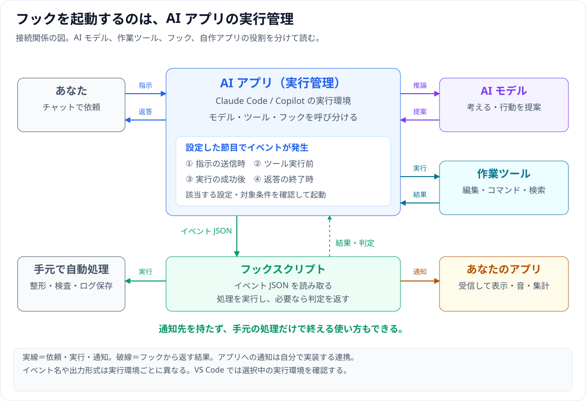
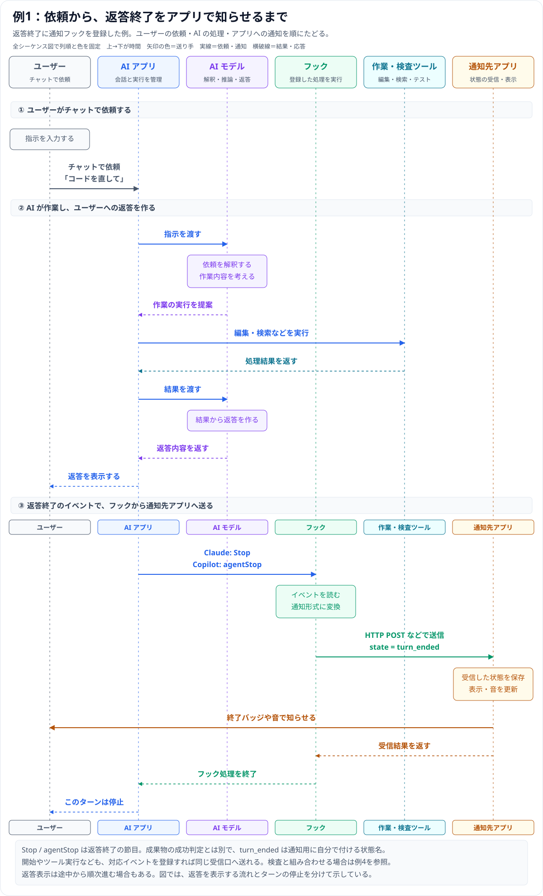
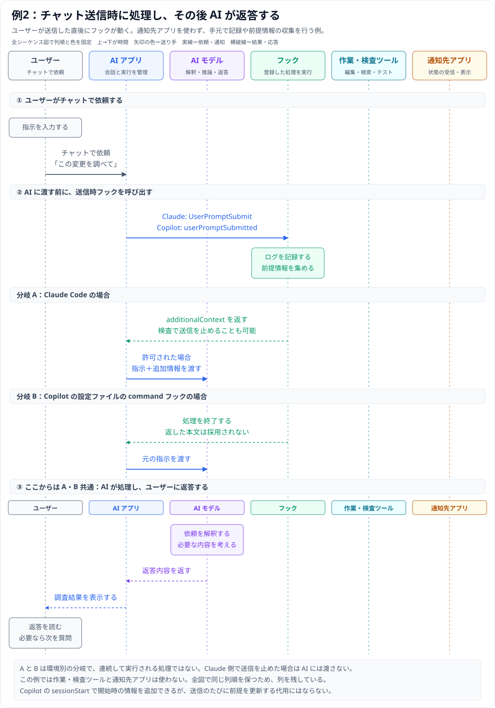
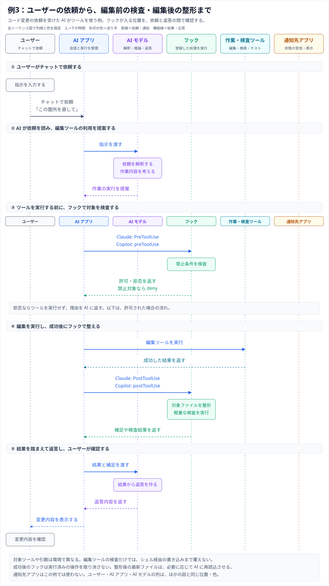
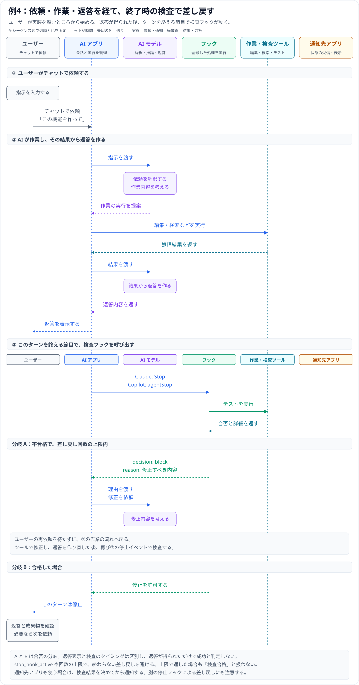
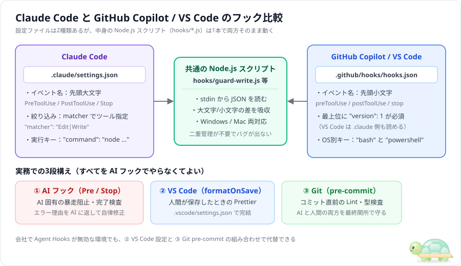

# フックは誰が呼び、どう動く？ — 全体図と 4 つのシーケンス図

**フック**（Hooks）を呼び出すのは、AI モデルそのものではなく **AI アプリの実行管理部分（ハーネス）** です。指示送信・ツール実行前後・返答終了などの節目に、設定した処理（**command フック** など）を自動起動し、手元の整形・ブロック・外部アプリ通知を行えます。

本ページでは **Claude Code** と **GitHub Copilot（VS Code / Copilot CLI）** を対象に、実務でよくある 4 パターンの流れを図解します（公式資料確認日：**2026-11-12**）。

---

## 全体の接続関係と図の読み方



- **登場人物と色分け**：左から **ユーザー（グレー） → AI アプリ（青） → AI モデル（紫） → フック（緑） → 作業・検査ツール（青緑） → 通知先アプリ（オレンジ）** の 6 列で全シーケンス図を固定しています。
- **図の読み方**：時間は上から下へ進み、矢印の色は「送り手」、横の破線は「応答・結果」です。図中の分岐 A・B は条件による別ルートを示します。
- **共通の入出力**：command フックにはイベント情報が **標準入力の JSON** として渡り、処理後に **終了コードや JSON** で判定を返します（[Claude の入出力仕様](https://code.claude.com/docs/en/hooks#hook-input-and-output)、[Copilot の入出力仕様](https://docs.github.com/en/copilot/reference/hooks-reference#hook-event-input-payloads)）。ファイル保存と外部アプリ通知の併用も可能です。

---

## 例1：状態を自分のアプリへ送る

フックが節目のイベントを受け取って共通 JSON に変換し、自作アプリや通知ツールの受信口へ送る仕組みです。



- **表示や通知音は受信アプリ側で決める**：上の図は汎用的な command フックで変換して HTTP POST（またはファイル追記・ローカル IPC）する例です（Claude には受信口を直接呼ぶ `type: "http"` もあります：[Claude の HTTP フック](https://code.claude.com/docs/en/hooks-guide#http-hooks)）。
- **観測する主な節目**（カッコ内は `Claude Code / Copilot`）：指示受付（`UserPromptSubmit` / `userPromptSubmitted`）、ツール実行前（`PreToolUse` / `preToolUse`）、ツール成功（`PostToolUse` / `postToolUse`）、確認待ち（`PermissionRequest`・`Notification` / `permissionRequest`・CLI の `notification`）、返答終了（`Stop` / `agentStop`）、終了（`SessionEnd` / `sessionEnd`）（[Claude のライフサイクル](https://code.claude.com/docs/en/hooks#hook-lifecycle)、[Copilot のイベント一覧](https://docs.github.com/en/copilot/reference/hooks-reference#hook-events)）。

製品ごとの JSON フォーマット差（snake_case 対 `sessionId` などの camelCase）を吸収するため、送信側で次のような共通形式にそろえると受信アプリがシンプルになります（`source` / `state` / `observed_at` は独自項目の例）：

```json
{
  "source": "claude-code",
  "session_id": "example-session",
  "event": "Stop",
  "state": "turn_ended",
  "observed_at": "2026-11-12T12:00:00+09:00"
}
```

- **注意点 1（返答終了 ≠ 検査合格）**：`Stop` / `agentStop` だけではテスト合格かは分かりません。検査で差し戻すなら例 4 と統合します。またユーザー中断や API エラーは別経路になります（[Stop の条件](https://code.claude.com/docs/en/hooks#stop)）。
- **注意点 2（`Notification` の扱い）**：Claude の `Notification` は `notification_type` ごとに確認待ち等を通知します。Copilot の `notification` は **CLI 限定として文書化**されており、クラウドや VS Code 全般で同一とは限りません（[Claude の通知](https://code.claude.com/docs/en/hooks#notification)、[Copilot の通知](https://docs.github.com/en/copilot/reference/hooks-reference#notification-hook)）。

---

## 例2：送信のたびにローカル処理を動かす



- **できることの境界**：ログ記録などの手元処理は両方可能ですが、設定ファイルの command フック出力（`additionalContext` の添付やプロンプト拒否）が採用されるのは **Claude の `UserPromptSubmit`** のみです。**Copilot の `userPromptSubmitted`** では出力が採用されないため、開始時の前提付与には `sessionStart` を使います（[送信時フック](https://code.claude.com/docs/en/hooks#userpromptsubmit)、[出力に関する制約](https://docs.github.com/en/copilot/reference/hooks-reference#userpromptsubmitted--userpromptsubmit)、[文脈注入サンプル](../samples/04-context-injection/README.md)）。
- **「必ず実行」の意味**：AI モデルの判断を介さず、一致イベントが起きた瞬間に設定どおり自動起動するという意味です（[フックの基本動作](https://code.claude.com/docs/en/hooks-guide#how-hooks-work)）。

---

## 例3：操作の前後に処理を入れる



検査・整形の本体スクリプトは共通化できても、ホストへ返す JSON の形は製品に合わせます（実行前に拒否する例）：

Claude Code (`PreToolUse`)：

```json
{
  "hookSpecificOutput": {
    "hookEventName": "PreToolUse",
    "permissionDecision": "deny",
    "permissionDecisionReason": "保護ファイルへの編集です"
  }
}
```

Copilot (`preToolUse`)：

```json
{
  "permissionDecision": "deny",
  "permissionDecisionReason": "保護ファイルへの編集です"
}
```

- **抜け道と再読取に注意**：編集ツールだけを禁止してもシェルコマンド経由の書き換えは防げないため対象を広く確認します。また実行後フックで自動整形したときは、AI に再読取を促す補足を返すとズレを防げます（[Claude の実行前判定](https://code.claude.com/docs/en/hooks#pretooluse-decision-control)、[Copilot の実行前判定](https://docs.github.com/en/copilot/reference/hooks-reference#pretooluse-decision-control)、見本：[関所](../samples/01-block-dangerous-cmd/README.md) / [自動整形](../samples/02-auto-format-lint/README.md)）。

---

## 例4：終了時に検査して差し戻す



- **差し戻しの仕組み**：図の ② が通常作業と返答表示、③ が終了判定です。Claude の `Stop`、Copilot の `agentStop` で `decision: "block"` と `reason` を返すと、ユーザー入力を待たず自動でやり直しへ戻せます。無限ループを防ぐため `stop_hook_active` 等で回数上限を設けます（[Claude の停止判定](https://code.claude.com/docs/en/hooks#stop-decision-control)、[Copilot の停止判定](https://docs.github.com/en/copilot/reference/hooks-reference#agentstop--subagentstop-decision-control)、見本：[完了ゲート](../samples/03-stop-until-pass/README.md)）。
- **通知と組み合わせるコツ**：「検査 → 合否決定 → 合格なら通知／不合格なら差し戻し」を **1 つのフック処理** にまとめ、上限到達時にも誤って合格通知を出さないようにします。

---

## 環境による違い（移植時のチェックリスト）



VS Code はあくまで画面側のアプリであり、選択した **実行環境（Claude / Copilot / 旧 Local）** によって採用されるフック仕様が決まります（モデル切替とは別です：[VS Code の実行環境の選択](https://code.visualstudio.com/docs/agent-customization/hooks#choose-the-hook-implementation-for-your-session)）。

| 確認項目 | Claude Code | Copilot（VS Code 実行環境 / CLI） |
|---|---|---|
| **設定ファイル** | `.claude/settings.json` の `hooks` | `.github/hooks/*.json`（`version: 1` と `hooks`） |
| **入力 JSON キー** | `session_id`、`tool_name`、`tool_input` | 小文字名では `sessionId`、`toolName`、`toolArgs` |
| **判定・補足 JSON** | `hookSpecificOutput` 内に記述 | `preToolUse` / `postToolUse` はトップレベルに記述 |
| **ツール名表記** | `Edit` / `Write` など | `edit` / `create` など |
| **実行環境と失敗時** | Claude Code が動く環境。失敗時ブロック設定あり | リモート・クラウド含む実行環境。`preToolUse` は異常終了で拒否・タイムアウトは許可フローへ |

- **移植と通知先の注意**：Copilot は `.claude` 設定や互換名を読める場合がありますが、入出力 JSON の完全互換は保証されません。検査・整形の本体と入出力変換層を分け、リモート環境から手元アプリへ送る場合は `localhost` の向き先と `session_id` 混線に注意してください（[VS Code の移行上の注意](https://code.visualstudio.com/docs/agent-customization/hooks#migrate-hooks-between-harnesses)、[Copilot の設定形式](https://docs.github.com/en/copilot/reference/hooks-reference#hook-configuration-format)、[Claude の失敗時制御](https://code.claude.com/docs/en/hooks#block-the-action-when-a-hook-fails)、[Copilot の終了コード](https://docs.github.com/en/copilot/reference/hooks-reference#exit-codes-for-command-hooks)）。

## 次に読む

- [入門ガイド：設定と標準入出力](00_hook-guide.md) ／ [Copilot / VS Code の設定例](01_copilot-hook-guide.md) ／ [定番 5 パターンと使い分け](02_hook-patterns.md)
- [監査ログ・通知のサンプル](../samples/05-audit-and-notify/README.md)（ターミナル通知の例）
