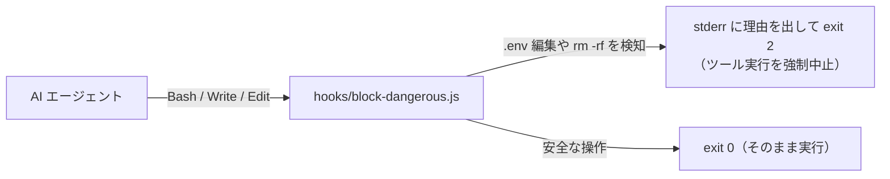

# 01 危険な操作・保護ファイルのブロック（`PreToolUse`）

AI がツールを実行する**直前**に中身を検査し、`.env` などの機密ファイルの編集や、`rm -rf` / `git push --force` のような危険なコマンドを**毎回確実に遮断する**関所パターンです（検査できるのはスクリプトに書いたパターンだけなので、抜け道に注意。詳しくは [00 の 1章](../../docs/00_hook-guide.md)）。ガイドの [02 のパターン 1](../../docs/02_hook-patterns.md#パターン-1事前ガードレールpretooluse-guardrail) に対応します。

## 仕組み



## ファイル構成

```text
01-block-dangerous-cmd/
├─ README.md
├─ hooks/
│  └─ block-dangerous.js           ← 関所スクリプト本体
├─ claude-code/
│  └─ .claude/settings.json        ← Claude Code 用設定
└─ copilot/
   └─ .github/hooks/hooks.json     ← GitHub Copilot 用設定
```

## ターミナルで単体テストする（Claude 不要）

PowerShell で次のコマンドを実行すると、AI が `.env` を書き換えようとした場面を模擬して、終了コード `2` でブロックされることを確認できます。

```powershell
# 1. 危険な操作（.env の書き込み）→ ブロックされて ExitCode 2 になる
'{"tool_name":"Write","tool_input":{"file_path":".env","content":"SECRET=123"}}' | node samples/01-block-dangerous-cmd/hooks/block-dangerous.js
$LASTEXITCODE

# 2. 安全な操作（src/index.js の書き込み）→ 通過して ExitCode 0 になる
'{"tool_name":"Write","tool_input":{"file_path":"src/index.js","content":"console.log(1);"}}' | node samples/01-block-dangerous-cmd/hooks/block-dangerous.js
$LASTEXITCODE
```
