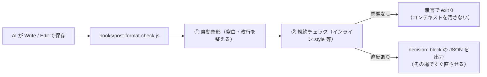

# 02 ファイル保存後の自動整形・構文検査（`PostToolUse`）

AI がファイルを保存した**直後**に自動で整形（末尾空白の除去・改行コード統一など）と構文・規約チェックを走らせ、違反があればその場で AI にフィードバックするパターンです。ガイドの [02 の 3章](../../docs/02_hook-patterns.md#3-パターン②自動整形事後チェックposttooluse) に対応します。

## 仕組み



## ファイル構成

```text
02-auto-format-lint/
├─ README.md
├─ hooks/
│  └─ post-format-check.js         ← 自動整形＆検査スクリプト
├─ claude-code/
│  └─ .claude/settings.json        ← Claude Code 用設定
└─ copilot/
   └─ .github/hooks/hooks.json     ← GitHub Copilot 用設定
```

> 実務で Prettier や ESLint を使う場合は、スクリプト内の整形処理のところで `npx prettier --write <filePath>` を呼ぶだけで同じ仕組みになります。このサンプルでは追加パッケージなしですぐ試せるよう、Node.js 標準機能だけで整形と HTML 検査を行っています。
