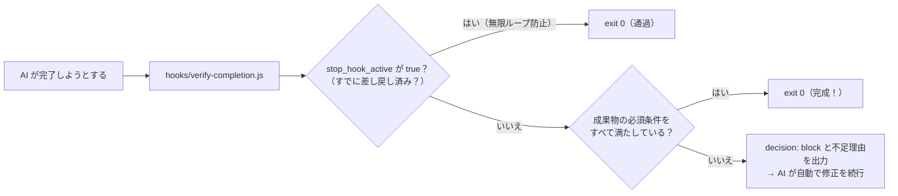

# 03 検査が通るまで完了させない完了ゲート（`Stop`）

AI が「作業が終わりました」と止まろうとした瞬間に検査スクリプトを走らせ、必須要素の抜けやテスト失敗があれば **`decision: "block"` で完了を取り消して続きをやらせる**パターンです。ガイドの [02 の 4章](../../docs/02_hook-patterns.md#4-パターン③完了ゲートstop--subagentstop) に対応します。

## 仕組み



## ファイル構成

```text
03-stop-until-pass/
├─ README.md
├─ hooks/
│  └─ verify-completion.js         ← 完了検査スクリプト（無限ループ防止つき）
├─ claude-code/
│  └─ .claude/settings.json        ← Claude Code 用設定
└─ copilot/
   └─ .github/hooks/hooks.json     ← GitHub Copilot 用設定
```

## ポイント：`stop_hook_active` による無限ループ防止

`Stop` フックを作るうえで一番大切なのが次の3行です。

```javascript
if (data.stop_hook_active === true) {
  process.exit(0);
}
```

これを入れておかないと、AI がどうしても直せないエラーにぶつかったときに、永遠に差し戻され続けて止まらなくなります。
