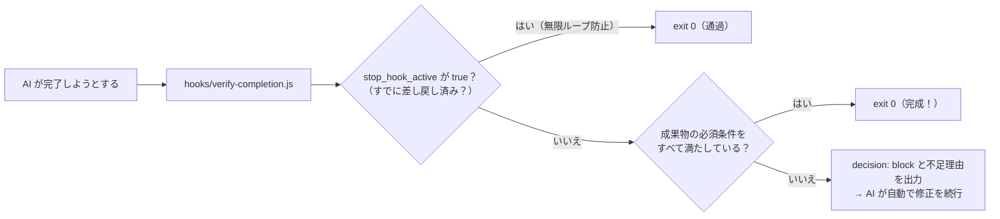

# 03 検査が通るまで完了させない完了ゲート（`Stop`）

AI が「作業が終わりました」と止まろうとした瞬間に検査スクリプトを走らせ、必須要素の抜けやテスト失敗があれば **`decision: "block"` で完了を取り消して続きをやらせる**パターンです。ガイドの [02 のパターン 3](../../docs/02_hook-patterns.md#パターン-3完了ゲートstop-completion-gate) に対応します。

## 仕組み



## ファイル構成

```text
03-stop-until-pass/
├─ README.md
├─ hooks/
│  └─ verify-completion.js         ← 完了検査スクリプト（無限ループ防止つき）
├─ claude-code/
│  └─ .claude/settings.json        ← Claude Code 用設定
└─ copilot/
   └─ .github/hooks/hooks.json     ← GitHub Copilot 用設定
```

## ポイント：`stop_hook_active` による無限ループ防止

`Stop` フックを作るうえで一番大切なのが次の3行です。

```javascript
if (data.stop_hook_active === true) {
  process.exit(0);
}
```

これを入れておかないと、AI がどうしても直せないエラーにぶつかったときに、差し戻され続けて止まらなくなります（Claude Code・Copilot とも、連続8回で強制的に止める上限はあります）。

### 注意：この書き方だと「差し戻しは1回まで」

`stop_hook_active` は「すでに Stop フックの差し戻しを受けて作業を続けている最中」に `true` になります。そのため上の3行だと、**1回差し戻したあとの2回目の完了は、まだ不合格でも通過**します。

「合格するまで何度でも（ただし上限つきで）差し戻したい」場合は、差し戻した回数をファイルに記録し、上限に達したら通すようにします。

```javascript
// 例：最大3回まで差し戻す（回数はセッションごとのファイルに記録）
const counterFile = path.join(os.tmpdir(), `stop-gate-${data.session_id || data.sessionId || 'local'}.txt`);
const count = fs.existsSync(counterFile) ? Number(fs.readFileSync(counterFile, 'utf8')) : 0;
if (count >= 3) process.exit(0);            // 上限に達したら通す
fs.writeFileSync(counterFile, String(count + 1));
```

### Copilot（`agentStop`）での動き

Copilot の `agentStop` にも同じ `stop_hook_active` が届き、`{"decision": "block", "reason": "..."}` で差し戻せるため、スクリプトはそのまま共用できます。
