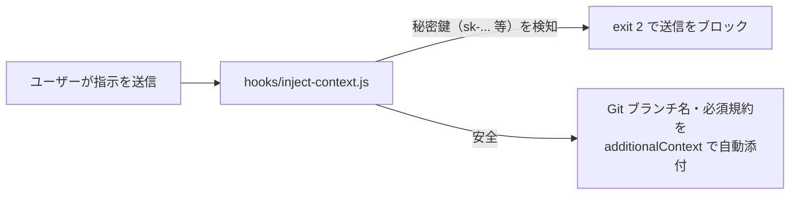

# 04 プロンプト送信時の文脈自動注入（`UserPromptSubmit`）

人間がチャット欄から指示を送った瞬間に、現在の Git ブランチ名や未コミット変更、絶対に守るべき短い規約を**裏で自動的に添付して AI に渡す**パターンです。また、うっかり秘密鍵（API キーなど）をプロンプトに貼り付けてしまった場合は送信前にブロックします。ガイドの [02 のパターン 4](../../docs/02_hook-patterns.md#パターン-4文脈の自動注入context-injector) に対応します。

> ⚠️ **Copilot ではできることが限られます**：Copilot の `userPromptSubmitted` は command フックの出力を無視するため、**指示ごとの自動添付も、秘密鍵を含むプロンプトのブロックもできません**。そのため Copilot 用の設定（[copilot/.github/hooks/hooks.json](copilot/.github/hooks/hooks.json)）では `sessionStart` に登録し、**会話の開始時に1回だけ**ブランチ名などを添付します。

## 仕組み



## ファイル構成

```text
04-context-injection/
├─ README.md
├─ hooks/
│  └─ inject-context.js            ← 文脈注入＆機密検査スクリプト
├─ claude-code/
│  └─ .claude/settings.json        ← Claude Code 用設定
└─ copilot/
   └─ .github/hooks/hooks.json     ← GitHub Copilot 用設定
```

## ターミナルで単体テストする（Claude 不要）

```powershell
# 1. 通常のプロンプト → 環境情報が JSON（additionalContext）として出力される
'{"prompt":"ボタンの色を変えて"}' | node samples/04-context-injection/hooks/inject-context.js

# 2. うっかり API キーを貼ったプロンプト → ブロック（ExitCode 2）される
'{"prompt":"このキー sk-proj-1234567890abcdefghij を使って"}' | node samples/04-context-injection/hooks/inject-context.js
$LASTEXITCODE
```
