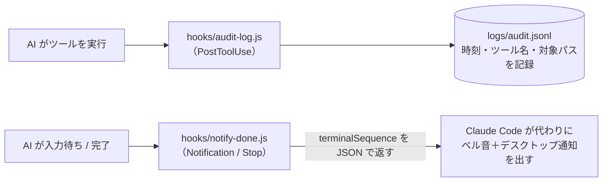

# 05 監査ログの記録と完了通知（`PostToolUse` / `Notification`）

対象にしたツールの実行履歴を `logs/audit.jsonl` に1行ずつ記録し、AI の確認待ちや返答終了を通知するパターンです。ガイドの [02 のパターン 5](../../docs/02_hook-patterns.md#パターン-5監査ログ通知audit-log--notification) に対応します。

**自分のアプリへ状態を送る構成**は、[全体図と状態通知のシーケンス図](../../docs/03_hook-flow-examples.md#例1状態を自分のアプリへ送る)をご覧ください。このサンプルはターミナルへの通知とログ保存の例で、アプリの受信口は含みません。

## 仕組み



## 通知のしくみ（なぜ JSON で返すのか）

フックは画面（ターミナル）につながっていない裏方のプロセスとして動きます。そのため、スクリプトからベル文字（`\u0007`）を `stdout` や `stderr` に書いても**音は鳴りません**。

Claude Code では、出力 JSON の **`terminalSequence`** に制御文字を入れて返すと、Claude Code が自分の画面に書き出して代わりに鳴らしてくれます（対話モードで画面を開いているときだけ有効）。

```json
{ "terminalSequence": "\u0007\u001b]9;Claude needs your permission\u0007" }
```

- `\u0007` … ベル音
- `\u001b]9;本文\u0007` … Windows Terminal・iTerm2・WezTerm などのデスクトップ通知

GitHub Copilot にはこの仕組みがないため、Copilot で通知したい場合は、スクリプト内で OS の通知コマンドや Slack の Webhook などを呼び出してください（このサンプルでは、どちらの環境でも `logs/notifications.log` に記録だけは残します）。

## いつ通知されるか

| 設定 | 発火するタイミング |
|---|---|
| Claude Code の `Notification` | 許可の確認待ち、入力待ちのまましばらく経ったときなど |
| Claude Code の `Stop` | AI が返答を終えたとき。作業の成功・検査合格とは区別する |
| Copilot の `agentStop` | AI が返答を終えたとき |

終了時の検査で差し戻す場合は、通知だけを別登録すると不合格でも終了通知が出ることがあります。[検査と通知を組み合わせる流れ](../../docs/03_hook-flow-examples.md#例4終了時に検査して差し戻す)を参照してください。

## ファイル構成

```text
05-audit-and-notify/
├─ README.md
├─ hooks/
│  ├─ audit-log.js                 ← 監査ログ記録スクリプト
│  └─ notify-done.js               ← 通知スクリプト
├─ claude-code/
│  └─ .claude/settings.json        ← Claude Code 用設定
└─ copilot/
   └─ .github/hooks/hooks.json     ← GitHub Copilot 用設定
```

> **ログの注意**：`logs/audit.jsonl` には、コマンドの引数に含まれる秘密情報もそのまま記録されます。`logs/` は必ず `.gitignore` に追加してください。また、このファイルは AI 自身も書き換えられるため、改ざんされては困る監査用途なら、AI の作業フォルダの外や外部サーバーに送ってください。
>
> **通知の注意**：通知音を鳴らすかどうかは個人の好みが分かれるため、実務では通知用のフックだけは `.claude/settings.local.json`（Git 管理外）または `~/.claude/settings.json`（ホームディレクトリ）に置くのがおすすめです。
