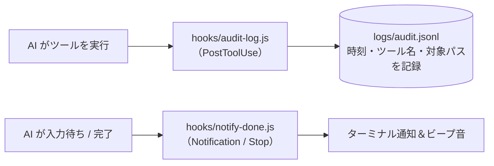

# 05 監査ログの記録と完了通知（`PostToolUse` / `Notification`）

AI が実行したすべてのツール履歴を `logs/audit.jsonl` に1行ずつ自動記録し、AI が確認待ちや作業完了になったタイミングで通知を出すパターンです。ガイドの [02 の 6章](../../docs/02_hook-patterns.md#6-パターン⑤監査ログ通知と権限の自動判定notification--permissionrequest) に対応します。

## 仕組み



## ファイル構成

```text
05-audit-and-notify/
├─ README.md
├─ hooks/
│  ├─ audit-log.js                 ← 監査ログ記録スクリプト
│  └─ notify-done.js               ← 通知スクリプト
├─ claude-code/
│  └─ .claude/settings.json        ← Claude Code 用設定
└─ copilot/
   └─ .github/hooks/hooks.json     ← GitHub Copilot 用設定
```

> **注意**：通知音を鳴らすかどうかは個人の好みが分かれるため、実務では通知用のフックだけは `.claude/settings.local.json`（Git 管理外）または `~/.claude/settings.json`（ホームディレクトリ）に置くのがおすすめです。
