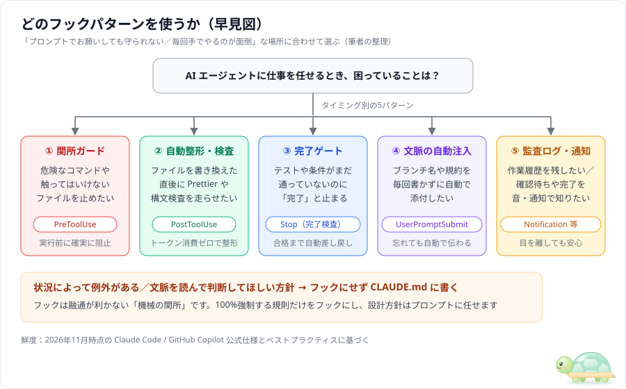

# フック設定＆スクリプトのサンプル集

ガイド（[00_hook-guide.md](../docs/00_hook-guide.md)、[01_copilot-hook-guide.md](../docs/01_copilot-hook-guide.md)、[02_hook-patterns.md](../docs/02_hook-patterns.md)）に出てきた定番フック5パターンを、**そのままコピーして使える設定ファイル＋Node.js スクリプト**としてまとめた置き場です。

> ワークスペース直下の [.claude/settings.json](../.claude/settings.json) と [hooks/](../hooks/) は「このワークスペースの実験ですぐ動くフック一式」です。こちらの `samples/` は「パターンごとに最小構成で見比べるための見本」です。

## パターン一覧

| # | パターン | イベント | ガイドの該当箇所 | Claude Code | Copilot |
|---|---|---|---|---|---|
| 01 | [危険な操作・保護ファイルのブロック](01-block-dangerous-cmd/) | `PreToolUse` | 02 のパターン 1 | ○ | ○ |
| 02 | [ファイル保存後の自動整形・構文検査](02-auto-format-lint/) | `PostToolUse` | 02 のパターン 2 | ○ | ○ |
| 03 | [完了前に検査して不合格なら差し戻す（完了ゲート）](03-stop-until-pass/) | `Stop` / `agentStop` | 02 のパターン 3 | ○ | ○ |
| 04 | [ブランチ名・規約の自動注入](04-context-injection/) | `UserPromptSubmit`（Copilot は `sessionStart`） | 02 のパターン 4 | ○ | △（開始時に1回添付のみ。プロンプトのブロック不可） |
| 05 | [監査ログの記録と完了チャイム通知](05-audit-and-notify/) | `PostToolUse` / `Notification` / `Stop` | 02 のパターン 5 | ○ | △（ログのみ。通知は自分で OS コマンド等を追加） |



## フォルダの見方

各パターンは同じ形になっています。スクリプト本体（`hooks/*.js`）は Node.js の標準機能だけで書かれており、Windows でも Mac でも追加パッケージなしでそのまま動きます。

```text
samples/<パターン>/
├─ README.md                       ← 仕組み・動きの流れ・単体テストコマンド
├─ hooks/
│  └─ *.js                         ← 共通で使う Node.js フックスクリプト
├─ claude-code/
│  └─ .claude/settings.json        ← Claude Code 用の設定見本
└─ copilot/
   └─ .github/hooks/hooks.json     ← GitHub Copilot / VS Code 用の設定見本
```

`claude-code/` と `copilot/` の設定ファイルを並べて見ると、書き方の違いがすぐ分かります。

| 違い | Claude Code（`.claude/settings.json`） | Copilot（`.github/hooks/hooks.json`） |
|---|---|---|
| イベント名の表記 | 先頭大文字（`PreToolUse`, `PostToolUse`, `Stop`） | 先頭小文字（`preToolUse`, `postToolUse`, `agentStop`） |
| ツール絞り込み | `"matcher": "Edit\|Write"` で対象ツールを指定 | 見本では matcher を書かず（VS Code は無視するため）、スクリプト側で `toolName` を見て分岐 |
| 入力 JSON のキー | `tool_name` / `tool_input` | `toolName` / `toolArgs`（スクリプトは両方に対応済み） |
| コマンド指定 | `"command": "node hooks/xxx.js"` | `"bash": "..."` と `"powershell": "..."` を併記可能 |

> 細かい仕様差（Copilot の `postToolUse` は `decision: "block"` ではなく `additionalContext` を使う、など）は [01_copilot-hook-guide.md](../docs/01_copilot-hook-guide.md) の対応表にまとめています。

## 使い方

### 1. Claude なしでスクリプト単体の動きを試す（1秒）

どのスクリプトも標準入力（`stdin`）から JSON を受け取るだけなので、ターミナルで模擬 JSON を流し込めばその場で動きを確かめられます（各サンプルの `README.md` にコピペ用コマンドが書いてあります）。

### 2. 自分のプロジェクトに組み込む

1. 使いたいパターンの `hooks/*.js` を、自分のプロジェクトの `hooks/`（または `.github/hooks/scripts/`）にコピーします。
2. Claude Code なら `claude-code/.claude/settings.json` の中身をプロジェクトの `.claude/settings.json` にマージします。
3. GitHub Copilot なら `copilot/.github/hooks/hooks.json` をプロジェクトの `.github/hooks/hooks.json` にコピーします。
