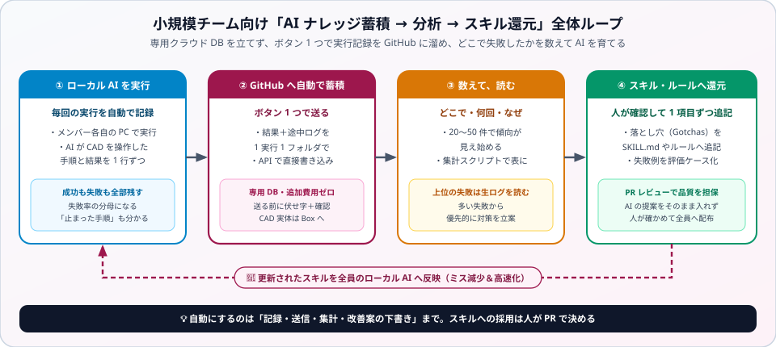

# 00. 全体像と世の中の取り組み — なぜ GitHub から小さく始めるのか

## 1. やりたいこと：「使う → 貯める → 数える → AI に返す」

ローカルで動く AI ツール（例：AI が CAD ソフトを操作して 3D パーツを作るアプリ）をチームで使い始めると、大事な記録が個人の PC の中に埋もれていきます。

- **実行の結果**：「狙いどおりの形ができた」「穴が端面に干渉した」
- **途中経過のログ**：AI がどの CAD コマンドを、どんな値で、どの順番で呼び、どこでエラーが返ったか
- **気づき**：「穴あけを面取りより先にすると成功する」

本ガイドのゴールは次の 2 つです。

1. **ボタン 1 つで、結果も途中ログもそのまま GitHub に溜まる**ようにする
2. 20〜50 件たまったら **どこで・何回・なぜ失敗しているか** を数え、AI のスキル（手順書）やルールを直す

これを繰り返して、チーム全員のローカル AI がミスなく素早く動く状態に近づけていきます。

---

## 2. いきなりクラウド DB を作らなくてよい理由

実行記録を貯めると聞くと、最初に思い浮かぶのは「クラウドにデータベース（DB）と API サーバーを立てる」方法です。大規模な運用では王道ですが、**2〜3 人で立ち上げたばかりの段階**では、次の負担のほうが先に重くなります。

| 観点 | 最初からクラウド DB を構築 | 今ある GitHub でライトに開始 |
|---|---|---|
| **費用・手続き** | クラウドの契約・DB の維持費・セキュリティ申請が先に必要 | 既存の GitHub に Private リポを 1 つ足すだけ |
| **構築の手間** | API・DB の設計・認証・管理画面まで一式を作る | ファイルの閲覧・検索・履歴・PR レビューが最初からそろっている |
| **初期のデータ量** | 数十件の記録に対して仕組みが重すぎる | 20〜50 件で傾向が見え始める。その規模にちょうどよい軽さ |
| **将来の移行** | — | **1 実行 1 フォルダの JSON** で貯めておけば、規模が大きくなったときにクラウド DB へそのまま取り込める |

> [!NOTE]
> **費用について**：本ガイドの基本形（アプリが API で直接書き込む経路 A）は GitHub Actions を使わないので、Actions の利用枠も消費しません。Actions を使う経路でも、プライベートリポジトリには毎月の無料枠があります（例：GitHub Free は月 $12 USD 分、GitHub Team は月 $18 USD 分。標準の Linux ランナーは 1 分あたり $0.006 が目安）。パブリックリポジトリの標準ランナーは無料です（出典は [sources.md](sources.md)）。

---

## 3. 世の中ではどう取り組まれているか

「専用 DB を立てずに GitHub を保存先にする」発想にも、「実行記録を見て AI を直す」発想にも、確かな先例があります。

### ① GitHub を軽量なデータ蓄積先として使う実例

| 実例 | どんな仕組みか | 本ガイドに活かせるヒント |
|---|---|---|
| **Git scraping** （Simon Willison, 2020） | データを取得しては **Git リポジトリへ自動コミット**し続ける手法。専用 DB の代わりに、コミット履歴そのものを変化の記録にする | 「ファイルを自動でコミットして貯める」構成そのものの先例。テキストなら履歴・差分・復旧が自動で手に入る |
| **Utterances ／ Giscus** （OSS のコメント基盤） | ブログのコメントの保存先として、専用 DB の代わりに **GitHub Issues（Utterances）** や **GitHub Discussions（Giscus）** を使う | 認証・検索・一覧画面・議論の場を自前で作らず、GitHub に任せられる |

### ② 実行記録を「分析 → 改善」につなげる実践知

| 知見・出典 | 核心となる考え方 | 本ガイドに活かせるヒント |
|---|---|---|
| **「まず実データを見る」エラー分析** （Hamel Husain, 2025-03） | 汎用的なダッシュボードより、**実際の記録を人の目で読んでメモを書き、失敗の種類ごとに件数を数える**のが最も効く | 高度な集計基盤は要らない。`runs/` を集計して「多い失敗トップ 3」を出し、その生ログを読むだけで直す場所が見える |
| **「評価は実際の失敗 20〜50 件から」** （Anthropic Engineering, 2026-01） | AI エージェントの評価ガイド（*Demystifying evals for AI agents*）。テストケースは数百件を待たず、**実際の失敗から集めた 20〜50 件**で始めてよい。やり取りの記録を読むことが大事 | 2〜3 人のチームで集まる数十件でも、十分に改善の材料になる |
| **「スキルは差分で少しずつ育てる」** （SkillsBench 2026 ／ ACE 2025） | 実データなしに AI が自分で書いたスキルは、平均で効果がなかった（SkillsBench）。全文の書き直しを繰り返すと、大事な細部が消えていく（ACE） | AI には実際の記録から改善案を出させ、スキルには**落とし穴を 1 項目ずつ足す**。本ガイドでは、採用を人が PR で決める運用をすすめる（詳しくは [agent-skill ガイド](../agent-skill/01_skill-management-loop.md)） |

---

▶ 次の章：[01. 開発初期のライトな蓄積方法 5 選](01_lightweight-options.md)
