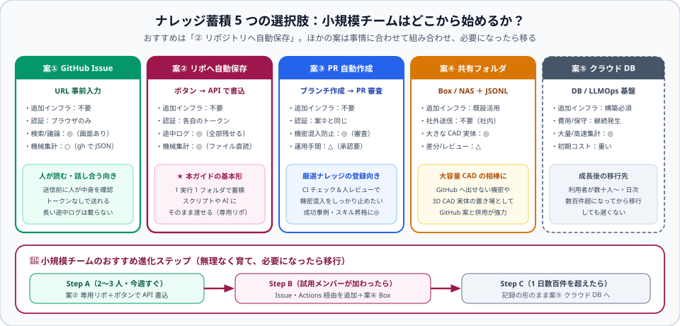

# 01. 開発初期にライトに始められる 5 つの蓄積方法

立ち上げ初期の小規模チーム（2〜3 人＋少数の試用メンバー）が、クラウド DB を作らずに AI の実行記録（結果と途中ログ）を貯めるには、主に次の **5 つの選択肢** があります。  
**おすすめは「案② GitHub リポジトリへ自動保存」** です。ほかの案は、事情に合わせて組み合わせます。

---

## 1. 5 つの方法の比較

| 方式 | 仕組み（どうやって貯めるか） | 導入の軽さ | 認証の手間 | 集計・分析のしやすさ | 向いている場面 |
|---|---|---|---|---|---|
| **案① GitHub Issue** （URL 事前入力） | 共有ボタンで Issue 作成画面を開き、人が確認して送る。ラベルで分類する | ◎ 数時間〜 | ◎ ブラウザのログインだけ | ○ `gh issue list --json` で取り出せる。ただし本文は文章なので項目の取り出しにひと手間。長い途中ログは載らない | 人が読んで話し合いたい記録。トークンを用意しない人 |
| **案② GitHub リポジトリへ自動保存** （**おすすめ**） | 共有ボタンで、アプリが **1 実行 1 フォルダ**（結果＋途中ログ）を GitHub API でナレッジ専用リポに直接書き込む（**clone 不要**）。Actions 経由でも可 | ○ アプリに数十行＋専用リポ 1 つ | ○ 各自のトークン（専用リポだけに絞った PAT か `gh` のログイン） | ◎ ファイルをそのままスクリプトや AI に渡せる | **ボタン 1 つで、生ログごと貯めたいとき**。本ガイドの基本形 |
| **案③ GitHub PR 自動作成** | 直接 `main` に積まず、ブランチを切って Pull Request にする | ○ 軽い | △ 案②と同じくらい | ◎ マージ後はファイルとして分析できる | 成功事例をお手本やスキル候補として**厳選して**残したいとき |
| **案④ 共有フォルダ** （Box / OneDrive / 社内 NAS） | 社内ストレージの同期フォルダに JSONL や CAD 成果物を置く | ◎ 既存の環境 | ◎ 社内の認証のまま | ○ スクリプトで集計できる。ただし同じファイルへの同時追記や、変更履歴の追跡に弱い | GitHub に出せない機密や、**大きな CAD 実体ファイルの置き場**（案②と併用） |
| **案⑤ 専用クラウド DB ／ LLMOps 基盤** | 専用の DB や監視ツールに全記録を送る | △ 重い（構築・費用） | △ 認証基盤が必要 | ◎ 大量の記録を素早く検索・可視化できる | 利用者が数十人、1 日数百件を超えてからの移行先 |

> [!NOTE]
> **用語の補足**
> - **JSONL（JSON Lines）**：1 行に 1 件の JSON を書くテキスト形式。末尾に 1 行足すだけで記録できるのでログ向きです。本ガイドでは 1 回の実行の途中経過（`steps.jsonl`）に使います。
> - **ナレッジ専用リポ**：アプリのコードとは別に作る、記録を貯めるためだけの Private リポジトリ（[02 章](02_github-architecture.md)）。

---

## 2. 小規模チームにおすすめの「3 段階の成長パス」

最初から完璧な基盤は要りません。**記録の形（`run.json` と `steps.jsonl`）だけ先に決めておけば**、あとは困りごとが出たときに次へ進めば十分です。

### Step A（今週・2〜3 人）：案②を小さく始める

- ナレッジ専用の Private リポを 1 つ作り、送る人に **Write** 権限を付ける（利用者の PC に clone する必要はない）
- アプリに「自動記録＋共有ボタン」を入れる（[03 章の雛形②](03_analyze-to-skills.md)。数十行のモジュール）
- 成功も失敗も押す。20〜50 件たまったら、集計スクリプトで「どこで・何回・なぜ」を見る
- アプリにまだ手を入れられない場合は、案①の Issue で手書きから始めてもかまいません

**次へ進む合図**：トークンを渡したくない人が加わった

### Step B（試用メンバーが加わったら）：トークンを使わない経路を足す

- トークンを渡せる人は経路 A のまま。渡したくない人は Issue 経由（経路 B＋C）か、dispatch 経由（経路 D）で送る（[02 章](02_github-architecture.md)）
- どの経路で届いても、Actions が同じ `runs/` の形にそろえるので、集計はそのまま使える
- CAD の `.step` など大きな成果物は Box などに置き（案④）、`run.json` には参照先だけを書く（[大容量データは Git の外に置く](../agent-skill/05_large-files-outside-git.md)）

**次へ進む合図**：1 日数百件を超える、スクリプトでの集計が重い、検索画面がほしい

### Step C（全社展開）：案⑤へ移る

- 1 実行 1 フォルダの JSON で貯めてあるので、スクリプトでそのまま取り込めます。それまでの記録は無駄になりません。
- GitHub → 集計用 DB → 社内 DB → クラウドと、どう段階的に移るかは [04. この先の発展](04_evolution-db-cloud.md) にまとめています。

---

▶ 次の章：[02. GitHub で作る実践構成（記録の形・送り方・置き場所）](02_github-architecture.md)
